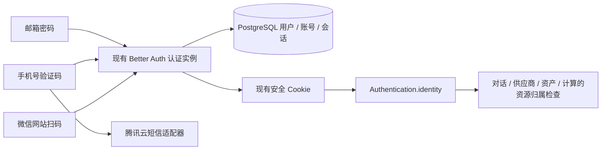

# Mio 追加认证方案：手机号与微信

状态：保留原分析与方案背景。2026-11-13 项目负责人已授权实施推荐的手机号和微信单元；本期范围、验收和动态边界以[认证扩展变更](../changes/phone-wechat-auth/change.md)为准。2026-11-22 项目负责人调整决策：旧用户与业务数据改为迁移（见[旧数据迁移 PRD](../../legacy-migration/prd.md)），并新增邮箱密码配置开关、账号禁用与用户资料能力（见[账号控制与资料扩展](../changes/auth-account-controls-and-profile/change.md)）。历史背景与既有接受事实保持不变。

归属：[技术底座 PRD](../prd.md)；现行行为以[认证底座](../../../auth.md)和[认证 HTTP 契约](../../../apis/auth.md)为准；原认证接受见[成果入口](../complete/report.md#auth-registration-foundation)。本提案不替换现行规范或原接受事实。

## 1. 推荐结论

**保留当前 Better Auth 1.7.18 + PostgreSQL + Cookie 会话，追加手机号验证码和微信网站扫码入口。** 所有登录方式最终落到同一个 Mio `userId`，继续由现有 `Authentication.identity()` 解析可信身份，各业务域继续检查资源归属。

推荐先完成手机号验证码登录／注册、已有账号绑定手机号，再完成微信登录／显式绑定。手机号密码作为兼容旧入口的条件单元；Agent API Token、桌面本地身份桥接、团队权限不随本次自动引入。

本方案以 Web 为本期目标，保留当前邮箱密码入口。项目负责人已选择微信独立登录、手机号绑定可选，不迁移旧用户与资产；下文保留当时的分析和推荐背景。

## 2. 旧项目实际有哪些认证能力

这里的“旧项目”指用户提供的 `mio v1.5` 源码。该副本当前没有 Git 提交，因此结论针对所读文件，不代表生产部署配置。表中旧路径相对旧项目根目录。

| 分类                | 实际入口与行为                                                                                                                                                                                                                                                  | 源码依据                                                                                                   |
| ------------------- | --------------------------------------------------------------------------------------------------------------------------------------------------------------------------------------------------------------------------------------------------------------- | ---------------------------------------------------------------------------------------------------------- |
| 手机号 + 密码       | `POST /api/auth/register` 注册并登录；`POST /api/auth/login` 校验密码。注册没有短信所有权验证；schema 仅要求手机号长 11、密码至少 6 字符，密码用 bcrypt 保存                                                                                                    | `backend/app/routers/auth.py:436,490`；`backend/app/schemas/auth.py:4`；`backend/app/utils/security.py:14` |
| 手机号 + 短信验证码 | `POST /api/auth/send-code`、`/verify-code-login`；未注册手机号验证成功后自动创建用户。真实发送适配腾讯云短信                                                                                                                                                    | `backend/app/routers/auth.py:537,636`；`backend/app/services/tencent_sms.py`                               |
| 微信网站扫码        | `GET /api/auth/wechat/qrcode` 创建会话，`/wechat/poll/{session_id}` 轮询；前端将授权 `code/state` 交给 `POST /wechat/callback/complete`，服务端向微信换取身份。已绑定用户直接登录，新微信进入 `need_bind_mobile`，经 `/wechat/confirm` 验证短信后创建／绑定用户 | `backend/app/routers/auth.py:213,242,297,688,721,767,854`                                                  |
| Agent API Token     | 用户创建的 `miioo_agent_…` 随机 Bearer 凭据；数据库保存 SHA-256，支持过期、撤销和 scopes。属于程序调用身份，不是第四种人类登录表单                                                                                                                              | `backend/app/dependencies.py:26,78,98`；`backend/app/routers/agent.py:133,169,185`                         |
| 桌面身份桥接        | `POST /api/desktop/session/bind` 只在桌面模式启用，并检查本地绑定秘密；信任 Electron 完成云端认证后提交的身份，生成独立本地用户及 JWT                                                                                                                           | `backend/app/routers/desktop_account.py:27,32,86`                                                          |

旧前端 `frontend_new/src/components/LoginModal.jsx:155` 的可见主入口是“手机号验证码”和“微信扫码”；手机号密码 API 存在，但不能把 API 存在等同于当前主登录弹窗提供了密码入口。软件激活／试用／硬件绑定是桌面许可边界，不等同于 Web 用户认证；当前副本缺少完整 Electron 宿主，未验证桌面链路。

登录后的承载方式是 **HS256 access JWT + refresh JWT**：JWT 含 `sub/exp/type`；登录响应既返回 token，也设置 HttpOnly Cookie。`get_current_user()` 优先读 Bearer，再读 access Cookie，并检查用户仍有效。旧前端 `api/request.js:78` 将两种 token 写入 localStorage，401 后使用 refresh token 刷新。Cookie 与 Bearer 是凭据传输方式，不应重复计为登录方式。

账号管理还包括手机号换绑、微信绑定／解绑和注销。检查的主认证路由中没有邮箱登录、Google／Apple 登录、Passkey 或 MFA，也没有完整邮件验证／邮件找回入口。本次未运行旧项目测试；已有 `test_wechat_auth_flow.py` 使用替身验证回调分支，不能证明真实微信接入已通过。

### 需要调整的旧行为

以下是源码观察与迁移风险，不是已确认的生产事故。

| 源码观察                                                                                                     | 追加方案的处理                                                                                     |
| ------------------------------------------------------------------------------------------------------------ | -------------------------------------------------------------------------------------------------- |
| 管理员手机号使用静态验证码；另有开发态短信跳过、验证码回显、模拟微信确认分支。管理员标记也可由手机号名单决定 | 新认证不继承这些生产入口。测试通过隔离替身注入验证码；管理员权限另有明确授权流程                   |
| 手机号密码注册不证明号码归属；`is_phone_bound` 字段不能作为历史所有权证据                                    | 新手机号必须经过 OTP 验证；旧手机号迁移不一律标为已验证                                            |
| `POST /api/users/me/wechat/bind` 直接接收 `wechat_id` 并写入 `wechat_openid`，本接口没有微信授权交换         | 不迁移该接口语义。微信主体只取服务端兑换得到的标识；手机号、昵称、前端传来的 openid 都不能代替证明 |
| `/logout` 只清 Cookie；refresh 校验签名及用户后重新签发，在这条链路中没有持久会话撤销或 refresh 重放检测     | 保留新 Mio 的数据库会话与撤销，不为兼容旧前端重新引入一套自签 JWT                                  |
| 短信消费是分别读取、判断、删除；Redis 失败时运行态可回退进程内存                                             | 使用固定库的消费路径并补并发验证，不照搬旧状态存储；多实例下不能靠进程内状态确认一次性消费         |
| 短信当日次数与验证码同一状态保存，成功消费会删除该状态                                                       | 发送预算与短期验证码分开，不能因登录成功就重置当日费用限制                                         |
| 旧微信 `state=session_id`，轮询可据会话 ID 取得 token；未见发起浏览器的独立绑定校验                          | 优先使用库的浏览器绑定 OAuth state 和标准回调；需要保留轮询交互时另验浏览器绑定、一次领取与重放    |

## 3. 当前 Mio 已有的基础

本次核对基线为 `3490f017b16fd2bf4fafa5067d936ea99082ac02`，来源包括 [config.ts](../../../../src/auth/config.ts)、[service.ts](../../../../src/auth/service.ts)、[http.ts](../../../../src/auth/http.ts) 和现行认证规范。

| 已有能力                                            | 本次复用方式                                                                         |
| --------------------------------------------------- | ------------------------------------------------------------------------------------ |
| 邮箱密码注册／登录，密码 12–128 字符                | 保留，新增入口不能降低其密码政策；邮箱当前未验证，不能据相同邮箱自动合并账号         |
| PG 持久会话；默认 7 天，1 天后可续期                | 所有新增登录方式复用。`/api/v1/me` 只校验身份；`/api/auth/get-session` 负责续期      |
| 退出、改密、列出与撤销会话                          | 保留，补测手机号／微信创建的会话同样可撤销                                           |
| 精确 Origin、路由白名单、有界 JSON、Cookie 安全属性 | 追加具体路由和回调例外；不把整套库插件路由直接暴露                                   |
| 数据库限流，可显式选择 Redis                        | 沿用现有故障策略；短信需要额外按号码及费用预算约束，不等同于现有按 IP/路径限流       |
| `identity(headers) -> {userId,sessionId}`           | 业务消费者继续使用这个边界，不能接受请求体 userId，也不能用 `MIO_API_TOKEN` 冒充用户 |

当前明确禁用了 `accountLinking`，手机号／OAuth 路由也未开放。安装插件、增加环境变量，并不自动形成可用的登录业务。

## 4. 目标结构与最小实现边界

优先扩展 `src/auth/`、现有显式迁移和插件装配，短信外部请求放 `src/integrations/` 的窄适配器；运行时不导入旧项目，不改 DSH 上游源码。新增实际模块与依赖时同步 AST 护栏、类型检查和构建范围。

固定安装包已经包含 `phoneNumber()` 插件和 `socialProviders.wechat`。这与上游[手机号插件说明](https://better-auth.com/docs/plugins/phone-number)、[微信网站扫码说明](https://better-auth.com/docs/authentication/wechat)一致；版本判断以本地 1.7.18 实现为准，不把最新文档选项直接复制进固定版本。

不新建认证微服务、独立 JWT 签发器、通用 OAuth 框架或第二套用户表。当前已有认证实例和可信身份消费者，新建这些层会增加迁移与撤销一致性成本，尚无对应收益。只有库确实不能满足下面的绑定／并发要求时，才增加该缺口所需的局部适配。

### 手机号：验证即登录／注册

1. 前端接收大陆手机号，服务端严格验证并统一为 E.164 `+86…`；国家范围先限大陆，国际号码作为后续产品决定。存储唯一约束建立在规范化后的号码上。
2. 复用 `phoneNumber` 插件。候选参数：6 位随机 OTP、5 分钟有效期、最多 3 次错误；真实值在实施时与短信模板一起固定。这些是本方案建议，不是当前 Mio 已采用规则。
3. 用腾讯云短信发送适配器实现 `sendOTP`，显式等待有界的供应商结果；响应只表示供应商受理，不宣称用户已收到。超时／未知结果不自动重发，用户重试仍受冷却与预算限制。
4. `signUpOnVerification` 允许已验证的新手机号创建用户。已有邮箱用户在已登录状态绑定空闲手机号，保持原 `userId`；登录操作和绑定操作必须有不同意图与验证上下文。
5. 固定版插件需要生成占位邮箱。使用不含明文手机号的服务端生成标识和保留域；保持 `emailVerified=false`。占位邮箱不是联系邮箱，不参加邮件找回、邀请或自动合并；拒绝用户通过邮箱注册／改邮箱入口认领保留域。
6. 默认沿用插件在 PG 中保存、消费 verification 的能力；已读实现包含 `consumeVerificationValue`。必须实测正确码并发、错误码并发、重新发送与消费交错，不把函数名当作完整并发证明。此版默认将短期 OTP 值存入 verification，若项目要求数据库泄露时也隐藏验证码，需单独评估受支持的存储／验证扩展，不能声称设置一个不存在的 `storeOTP` 选项即可完成。

短信预算必须覆盖所有会发送 OTP 的入口，包括重发、密码找回，以及手机号密码登录中未验证号码的自动发码分支。建议按号码 60 秒冷却、小时／日预算，叠加 IP 与应用总预算；预算值在 C0 与账户真实发送额度共同确定。独立预算状态的寿命应覆盖统计窗口，OTP 被消费不能清掉预算。[腾讯云验证码说明](https://intl.cloud.tencent.com/zh/document/product/382/35747)也区分验证码状态和发送频率／日限额；实际套餐、模板审核及额度本次未核实。

现有 Redis 限流仅支持当前窗口与恢复协议；不得直接把 24 小时短信预算塞入该资源，再沿用“等待 65 秒即可恢复额度”的结论。推荐首期号码／费用预算落 PG，通过原子更新避免并发超发；现有 Redis 只继续承担其已约定的请求限流。若改用 Redis 保存长期预算，须重新设计持久化、未知结果与恢复条件，属于另一个实际约束变化。

### 微信：先使用标准网站授权回调

使用内置网站应用 provider 发起 `snsapi_login`，服务端回调换取身份并创建现有会话。优先同站点跳转或弹窗回调，登录页返回后读取现有 session；不为沿用旧 URL 预建二维码会话表与轮询状态机。

必须明确以下细节：

- 当前 HTTP 适配器要允许精确的微信 GET 回调，而不是把所有 POST 的 Origin 校验关闭。回调依赖库的 state、发起浏览器 Cookie、过期及一次性消费；任意回调地址、任意 provider、前端自传 openid／unionid 均拒绝。
- 只允许配置好的 AppID、回调 origin 与站内返回路径；回调处理后清除 URL 中的 code/state。供应商 access token 不成为 Mio 业务会话，不返回前端或进入业务日志；若库持久化它，应采用其公开加密配置并验证存储。
- 本地 1.7.18 的微信 `accountSubject` 使用 `unionid || openid`，不是始终 openid；旧系统仅存 `wechat_openid`。必须核对相同 AppID、是否持续提供 UnionID、缺失后再次出现时的主体稳定性。变化不能默默生成第二个 Mio 用户；若内置行为不能满足，先通过公开扩展点实现有命名空间的稳定映射，再开放该切片。不得依赖包内未公开文件作为运行时 API。
- 微信不提供可信邮箱。固定版会生成占位邮箱且 `emailVerified=false`；这不是需要用户额外填写邮箱的依据，也不是开启同邮箱自动合并的依据。

**推荐产品行为：微信可独立登录，手机号绑定可选；已有账号用户从“绑定微信”进入，保留原数据。** 若必须复制旧“首次微信强制绑定手机号”，则新增明确的未完成注册状态，完成 OTP 前不能访问业务。不能给这种用户普通完整会话后只靠前端遮罩，也不能把现有所有无手机号邮箱用户一起封禁。这一决定只影响微信单元，短信单元可先推进。

### 多方式绑定：保持账号与资产归属

`user` 是 Mio 主体；密码凭据和微信身份归入库的 `account`，手机号使用插件的用户扩展字段。首期不重复维护通用 `identities` 表。

| 情况                           | 推荐处理                                                                                           |
| ------------------------------ | -------------------------------------------------------------------------------------------------- |
| 已登录用户绑定尚未占用的手机号 | 近期重新认证 + 本次绑定用途 OTP，事务确认唯一性；userId 不变                                       |
| 匿名验证码登录命中已有号码     | 登录该号码所属账号；不存在则按已确认自助注册政策创建                                               |
| 号码或微信已属于另一个用户     | 返回脱敏冲突，提示登录原账号；本期不自动合并两个账号或转移资源                                     |
| 已有邮箱用户绑定新微信         | 当前可信会话 + 新微信授权，绑定到当前 userId；回调时仍核对原会话未撤销且未切换用户                 |
| 换绑／解绑                     | 近期重新认证，验证新的凭据；至少保留一种可实际使用的登录方式。未设置密码的占位邮箱不算备用登录方式 |

当前 `accountLinking.enabled=false` 会阻止直接使用库的显式微信连接；微信未验证邮箱还会涉及 `trustedProviders` 和 `allowDifferentEmails`。**不能只把 accountLinking 改成 true 就算完成。** 微信单元 C0 要以固定版隔离探针验证：允许当前用户主动绑定，同时匿名同邮箱绝不自动合并，已被占用的微信不能转移，发起会话撤销后绑定失败。优先库公开机制；若配置不能同时表达这些条件，采用只处理显式绑定的窄插件，保留禁止自动合并规则。

手机号插件的原始 verify 接口同时有登录、`updatePhoneNumber`、`disableSession` 等语义。HTTP 层不能不加约束地透传所有参数：区分登录与绑定用途，拒绝越权字段，绑定票据绑定原用户／会话和号码。验证凭据的消费必须绑定用途，不能把登录码拿来改密或换绑。换绑、解绑与账号合并不是登录所必需，未完成相应证据前保持关闭。

## 5. 候选接口与前端接入

下表是拟开放接口，不是已发布契约。现有邮箱、退出、会话与 `/api/v1/me` 保持兼容；新增规则采纳后才更新现行 API 文档。

| 能力                               | 候选路由                                                                             | 身份及副作用                                                                                      |
| ---------------------------------- | ------------------------------------------------------------------------------------ | ------------------------------------------------------------------------------------------------- |
| 发送登录验证码                     | `POST /api/auth/phone-number/send-otp`                                               | 匿名，按号码／IP／费用预算限流；产生外部短信费用                                                  |
| 验证登录／自助注册                 | `POST /api/auth/phone-number/verify`                                                 | 只接收规范化号码和验证码等明确字段；成功创建／查询用户并签发 Cookie，禁止从此入口自行选择换绑模式 |
| 本人初次绑定手机号                 | `POST /api/auth/phone-binding/send-otp`、`/phone-binding/confirm`                    | Mio 窄包装的候选入口；必须有近期可信身份，绑定用途与会话；已占用号码拒绝                          |
| 微信登录                           | `POST /api/auth/sign-in/social`                                                      | 只允许 `provider=wechat` 和批准的返回地址，返回授权 URL／重定向，不接受直传身份 token 的替代分支  |
| 微信授权回调                       | `GET /api/auth/callback/wechat`                                                      | 只凭完整 OAuth 事务校验成功后登录／绑定；不依赖普通 POST Origin 规则                              |
| 本人绑定微信                       | `POST /api/auth/link-social`，或等价窄包装                                           | 仅在上述显式绑定探针通过后开放；近期会话 + 微信证明；不开放全 provider                            |
| 手机号密码（条件单元）             | `POST /api/auth/sign-in/phone-number`                                                | 已验证手机号且存在 `credential` 密码记录；不可把 OTP 自动注册误称为已经有密码                     |
| 首次设密码／找回（与密码单元一起） | `POST /api/auth/phone-number/request-password-reset`、`/phone-number/reset-password` | 仅已验证号码可用、独立 reset 用途 OTP；成功设置／修改 credential 并撤销旧会话，重新登录           |

固定版密码重置路径可以为已有手机号用户创建缺少的 credential 记录，因此无需给 OTP 新用户生成“用户不知道的随机密码”。启用时明确设置 `revokeSessionsOnPasswordReset`，验证 OTP 消费、密码写入、撤销的事务结果；新密码仍为 12–128 字符。普通 `/change-password` 需要旧密码，不是首次设密码入口。

前端统一 `credentials: 'include'`，不沿用旧 localStorage access/refresh token 方案。即使库 JSON 含有 token，浏览器也不持久化或转发它；Cookie 继续作为本期唯一用户请求身份载体。界面处理 401 为需登录、429 为冷却、503 为依赖不可用，不能把 503 当成密码错或自动反复发短信。

部署优先同源反向代理。若前端与后端跨站点，当前 SameSite=Lax 不会因为增加 Origin 白名单就自动可用；部署方案要先解决这一条件。本仓库不含前端，具体接入哪个前端检出、其域名及登录页由实施前确定，不默认改相邻仓库。

## 6. 数据、配置与旧账号迁移

新增数据尽量沿 Better Auth：用户 `phoneNumber` 唯一、`phoneNumberVerified`；微信 account 与用户关联；verification 保存短期验证材料；独立的小型短信预算记录保存统计窗口。运行时和迁移继续复用认证配置来源，显式迁移，普通启动仅检查，不自动改库。

短信配置包含服务端 SDK 凭据、应用 ID、签名、模板和区域；微信配置包含网站应用 AppID、secret 与固定回调地址。不得复制旧配置默认值或真实 `.env`。启用但配置不完整时拒绝该配置装载；测试使用假供应商，不设置生产万能码。供应商异常转为脱敏错误，不把包含 secret 的请求 URL 或上游异常原文直接返回。

**推荐默认不迁移旧登录会话，所有旧用户在新服务重新登录。** 账号数据迁移是条件任务，需要先确认要保留哪些旧账号和业务数据。

1. 在获授权的脱敏导出上检查手机号规范化冲突、微信标识可信度、停用用户、密码哈希、跨域 owner 字段；本次未读取生产库，数量和质量未知。
2. 尽可能保留旧 UUID 作为新 userId；若与现有 Mio 账号冲突或需归并，建立显式映射并让各业务域分别迁移。多个业务库不具备跨库单事务，必须保留检查点、备份和可恢复顺序。
3. 不以旧 `is_phone_bound=true` 或手工写入的 `wechat_openid` 直接授予已验证身份。采用重新验证；旧注册未验证手机号，新系统不能仅凭新持有人 OTP 就把历史敏感资产自动移交。历史资产领取需要旧凭据证明或明确的人工恢复政策。
4. 旧密码是 bcrypt，不能直接当作新库默认密码哈希使用。首选重新验证后设置新密码；确需密码平滑迁移，单独实现受限的旧 bcrypt 校验并在成功后重哈希，设置退场条件，核对旧 6 位密码与新政策冲突。
5. 旧微信仅存 openid，导入前确认原 AppID 与新 provider 的 subject 规则；不同应用的 openid 不可直接对应，缺 UnionID 时不能按昵称推断同人。
6. 不导入旧 JWT、refresh token、管理员静态验证码或 Agent Token；不把旧手机号白名单自动转换为管理员角色。先验证备份恢复与身份／资产归属一致性，再安排真实切换。

本期不要求在线双写、双 Token 验证或共享旧 SECRET_KEY。这些机制会扩大切换、撤销和故障恢复成本；只有明确的不中断迁移要求才另行论证。

## 7. 拟开发单元与 C0/C1 安排

下列保留原规划的开发单元，状态定义沿[协调协议](../../../coordination.md#当前任务的生命周期)。A1 和 A2 已获实施授权；实际候选、验证和接受仍分别判断。

| 单元与产物                               | C0 决定、依赖与解决动作                                                                                                                                                                                        | C1 实施与验收／接受条件                                                                                                                                                                                                               |
| ---------------------------------------- | -------------------------------------------------------------------------------------------------------------------------------------------------------------------------------------------------------------- | ------------------------------------------------------------------------------------------------------------------------------------------------------------------------------------------------------------------------------------- |
| A1：手机号验证码登录／注册与本人初次绑定 | 确认是否允许短信自助注册、首期大陆号码、Web 前端归属、发送预算、腾讯云应用／模板与真实验证费用授权；核对占位邮箱保留域、并发消费、绑定用途隔离的固定版能力。现有 PG 可复用，不能以未来测试缺失阻塞已明确的实现 | 接插件、短信适配与号码预算，显式迁移、精确路由；验证同一账号身份稳定、并发不重复消费／超发、账号冲突、错误／超时不误成功、老邮箱和撤销回归。隔离替身通过后，再对指定号码做经授权的真实 HTTP＋浏览器短信闭环；用户接受本单元结果后交付 |
| A2：微信网站登录与显式绑定               | 依赖已有认证底座；若强制首次绑定手机号则依赖 A1。确定可选／强制绑手机、网站应用 AppID／回调域、前端跳转方式；验证 unionid/openid 稳定映射和禁止自动合并的显式绑定方案。这些是 C0 关键缺口，有缺口只暂停 A2     | 配 provider、回调与绑定，保持同一 userId；测 state/浏览器绑定、回放、会话撤销／切换、冲突、占位邮箱和供应商失败；真实已绑定／新微信用户分别走查。若选强制手机号，补所有业务入口的未完成注册拒绝；真实验收与用户接受后交付             |
| A3：手机号密码与首次设密／重置，条件单元 | 只有确认需要旧密码入口时进入本期；依赖 A1。确认重置政策、全会话撤销、账号恢复与老密码处理；沿固定插件公开接口核验，不预建迁移兼容层                                                                            | 追加密码入口与 reset OTP；无密码用户可安全设密，旧密码不能继续使用，撤销含对话流的现有约定保持。正确／错误／过期／重放与事务失败证据齐全后接受                                                                                        |

推荐最小首交付为 A1，随后 A2。若用户只使用旧主登录弹窗，A3 可保持后续条件项。邮件验证／邮件找回、MFA、Agent API Token、桌面桥接、团队角色和老业务数据迁移另按真实需求安排，不为这些远期项预建执行记录。

若引入 Agent API Token，应独立限定服务对象、scopes、过期、撤销和消费入口；它不能替代 `MIO_API_TOKEN`、登录 Cookie 或授予 DSH 模型工具权限。当前 Profile 的工具全拒绝规则保持原职责。

## 8. 验证、规范与放量条件

实施时至少取得以下可观察结果，不能只测库函数调用：

- **身份一致性**：邮箱账号绑定手机号／微信后，`/me.userId` 及本人已有资源归属不变；另一用户不能接管标识；客户端伪造 userId、验证状态或 provider 被拒绝。
- **短信闭环**：成功、供应商拒绝、响应未知、超时、发送冷却与总预算、OTP 过期／错误上限／并发消费／重发交错；所有发送通道共享预算，验证成功不重置日计数。
- **OAuth 闭环**：正确与错误 state、缺发起 Cookie、过期／重复 code、恶意 callbackURL、AppID/主体变化、占位邮箱碰撞、绑定期间退出或切换账号；浏览器验证 Cookie、重定向和 CORS。
- **持久化与生命周期**：唯一约束、并发创建、事务回滚、显式迁移幂等／异常结构、重载会话保留与资源释放；有 OAuth 供应商 token 时核对存储加密及脱敏。
- **已有消费者**：旧邮箱密码、改密／撤销、会话续期以及对话／供应商／资产／计算的可信主体路径；服务 Token 不成为用户身份。

按受影响文件与有效全量基线选择增量回归，最终需有覆盖 `pnpm check` 的当前有效结论；依据不可靠才由 GitHub Actions 全量验证，不把长 Redis 恢复演练机械重复为每个文档／入口的前置。固定版本验证、隔离供应商测试、真实浏览器、真实短信／微信和生产部署分别报告。

采纳并实施后，必要规范在 verify 前更新：认证配置与生命周期写回 `docs/auth.md`，实际 HTTP 路由写回 `docs/apis/auth.md`；短信／微信外部依赖约束在对应集成契约维护并链接消费者。沿用 [PostgreSQL 契约](../../../integrations/postgres.md)，现有 Redis 的故障与恢复严格沿 [Redis 契约](../../../integrations/redis.md)；只写候选时不提前把它们改为现行规则。

## 9. 证据与评审时需要决定的事项

本次完成了两项目相关源码、配置声明、旧前端登录入口、当前固定库实现和官方文档的只读核对；没有发送短信、登录微信、读取生产用户库或运行认证业务回归。当前源码已存在认证，不等于本次重新验收了它；原认证接受仅覆盖原成果声明的范围。

旧源关键文件 SHA-256（供后续核对是否漂移）：

| 文件                                    | SHA-256                                                            |
| --------------------------------------- | ------------------------------------------------------------------ |
| `backend/app/routers/auth.py`           | `453bc6bc4931729428dfaca3ae3836e2aca0adeb3dc04de300ef72df61e545aa` |
| `backend/app/dependencies.py`           | `fe942fbf3ae011d8820c1db9de7817d5a96b348a75b65035393faada41f90b8e` |
| `backend/app/routers/users.py`          | `f2934d6bd53c86385eff1a6e9a6884b410aefac89ff4e8e82a73c3f3119811bc` |
| `backend/app/services/runtime_state.py` | `15500c916080fe1e88a1649fe5d0a115b9da03ceb81e551dc45e0dad84331684` |

固定库对照入口：[v1.7.18 手机号实现](https://github.com/better-auth/better-auth/blob/v1.7.18/packages/better-auth/src/plugins/phone-number/routes.ts)、[v1.7.18 微信 provider](https://github.com/better-auth/better-auth/blob/v1.7.18/packages/core/src/social-providers/wechat.ts)、[账号绑定公开说明](https://better-auth.com/docs/concepts/users-accounts)。本地安装包的对应实现已经读取；上游说明不替代本项目接入验证。

本期已选择 A1→A2、微信独立登录且手机号绑定可选，不实施手机号密码或迁移旧用户／旧资产。实际实现与验收沿[认证扩展变更](../changes/phone-wechat-auth/change.md)追踪。
