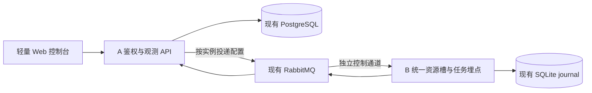

# Worker 并发观测、任务占槽历史与动态上限 PRD

```mio-change
{"version":1,"type":"feature","section":"目标与边界"}
```

本 PRD 回应 2026-11-20 提出的需求：查看 Worker 并发个数和上限、每个任务占用的 Worker 数目，通过小型 Web 页面保留并查询历史，并在线调整并发上限。本文基于 `origin/A@7002715` 原型方案在主干确立产品要求、架构口径与 **O0–O5 本期开发单元规划**（对应[父 PRD](../../prd.md#通用媒体处理与资产自动派生)中的 M5 单元），**当前主干尚未合入对应源码**；所有新增协议、表结构、管理 API 与 Web 页面均为待实施候选，须在后续按 O0–O5 合入主干并完成隔离回归、浏览器视觉验证与人类接受后正式收口，本 PRD 登记不代表开发就绪或能力已接受。

## 主干基线与候选代码落点

| 当前基线与候选机制                                                                                              | 主干已有入口 / 候选落点                                                                                                                                                                     | 对本次方案的影响                                                               |
| --------------------------------------------------------------------------------------------------------------- | ------------------------------------------------------------------------------------------------------------------------------------------------------------------------------------------- | ------------------------------------------------------------------------------ |
| 单个 B 进程共享 `total`/`encode`/`probe` 计数槽，默认和最低部署硬上限为 `2/1/1`                                 | 候选 `compute/src/resource-slots.ts`（M1 引入）、[启动入口](../../../../../compute/src/main.ts)                                                                                             | 三类协议共享真实准入；网页只能在部署硬上限内调整                               |
| 各计算消费通道提高有界 prefetch（如 32）；单路视频转码、独立音频检测与通用媒体处理共槽                          | [Broker](../../../../../compute/src/adapters/rabbitmq.ts)、[单路视频 Worker](../../../../../compute/src/worker.ts)、[音频 Worker](../../../../../compute/src/audio-worker.ts)（M5/O1 改造） | broker 在途消息不等于实际计算；实际并发以槽位事件和快照为准                    |
| 通用媒体处理按 attempt 管理活动任务；多步骤执行受同一 attempt 内的串行保护                                      | 候选 `compute/src/media-worker.ts`、候选 `compute/src/adapters/media-process.ts`（M2 引入）                                                                                                 | 初版每个实际执行 attempt 占用一个 B 实例中的一个资源槽，多步骤不虚增 Worker 数 |
| 未知或未确认退出的进程阻断对应资源类                                                                            | 候选 `compute/src/media-worker.ts`、[单路视频维护](../../../../../compute/src/maintenance.ts)                                                                                               | 动态增大上限不能绕过现有 HOLD / 未知进程保护                                   |
| FFmpeg 线程参数固定为 2；A 侧单路视频转码与通用媒体处理活动任务配额合计全局 500/每用户 10                       | [运行说明](../../../../../compute/README.md)、候选 `src/compute/capacity.ts`（M1 引入）                                                                                                     | 线程数、受理任务配额、运行槽位是三个独立口径                                   |
| A 新增 5 张 PG Worker 核心业务表（另含配套遥测 inbox 与 control outbox 表），B 增量扩展 SQLite telemetry outbox | [A schema](../../../../../src/compute/schema.ts)、[B journal](../../../../../compute/src/adapters/journal.ts)（M5/O1–O2 增量扩展）                                                          | 遥测和控制均可重放、去重，且不依赖浏览器或 RabbitMQ Management API             |

以上区分了 `main@072c6d4` 已有代码与 M1–M5 候选落点。通用媒体处理（[通用媒体处理设计](../../media-compute.md)）与既有单路视频转码、独立音频检测各自保持独立核验与接受边界；本 PRD 可读不等于源码已合入或能力已接受。

## 本期结果与口径

本期覆盖独立 compute B 的单路视频转码（`/api/v1/compute/jobs`）、独立音频检测与通用媒体处理（`/api/v1/compute/media`），交付可查询的实际并发、任务归属、历史图表和每实例动态上限。A 内执行的图片/供应商任务保留其现有资源模型；分布式全局执行令牌、自动扩缩容、任意加权调度及 FFmpeg 线程在线调参不在本期。本 PRD 不承诺服务器最大吞吐。

| 界面字段              | 定义                                                                                                                              |
| --------------------- | --------------------------------------------------------------------------------------------------------------------------------- |
| Worker 实例数         | 以稳定 instanceId 区分 B 部署实例，以 bootId 区分启动轮次；展示在线、数据过期、离线                                               |
| 当前任务并发          | 已取得槽且尚未释放的执行数，包含该 attempt 在下载、执行、上传和收尾期间持续持槽的时间                                             |
| 总上限 / 分类上限     | 每实例 total、encode、probe 三个运行准入上限；聚合页展示各在线实例合计，离线/过期实例单列                                         |
| 配置上限 / 已生效上限 | A 已保存的 desired 配置与 B 已确认的 applied 配置分别展示，附版本和确认时间                                                       |
| 单任务 Worker 占用    | 按协议、jobId、attemptId 或 inspectionId 记录实际 instanceId；当前模型正常执行为 1 个实例、1 个 encode/probe 槽，等待和释放后为 0 |
| 子步骤与重试          | 同一 attempt 的串行子步骤不计成多个 Worker；重试有独立 attempt 记录，任务页汇总其历史                                             |
| 未知进程 / HOLD       | 单独列出不确定占用、相关 attempt 和资源类阻断；不能把未知状态算作空闲                                                             |
| 历史曲线              | 查询时间窗内实际占槽、生效上限和部署硬上限；采样缺口断线显示，超上限排空期间单独标识                                              |
| 排队                  | 展示 Worker 本地待槽数；broker ready/unacknowledged 不计入实际并发，本期不引入 RabbitMQ management 凭据                           |
| 单任务历史            | 等待、取得槽、释放/取消、实例归属和占用时长；业务阶段与结果以 A 的已有任务记录为准                                                |

实际占槽初版按单位 1 计量；若后续一个任务需要并行子任务，届时再定义多槽权重。界面先准确反映当前模型，不提供一个尚未生效的任意权重输入框。受理配额 500/10 可展示，在线编辑范围限于 B 执行上限。

## 最小架构与职责



- B 负责实际占槽、释放、等待、心跳和应用配置。业务槽计数来自真实 acquire/release；观测链路故障不重跑 FFmpeg，也不改变业务结果确认顺序。
- A 负责登录与操作员授权、历史落库、聚合查询和配置审计。B 不获得 A 的数据库、登录秘密或 MQ 管理凭据。
- 页面由 A 提供同源静态资源及 API，使用原生 JavaScript、CSS 和 SVG 图表，不另起数据库或指标平台；静态资源进入 A 构建产物。
- 管理接口从现有 Cookie 身份解析后核对 `MIO_COMPUTE_OPS_USER_IDS` 操作员 allowlist。A 始终消费并保存 Worker 遥测；未设置 `MIO_COMPUTE_OPS_ENABLED=true` 时不发布调限，也不注册管理入口。普通用户接口仍按 owner 隔离。
- RabbitMQ 新增遥测路由与按 instanceId 精确寻址的配置控制队列，由已有拓扑部署入口增量预建，授予精确权限；B 运行时不声明拓扑。不能把目标实例配置放进多 B 竞争消费的共享任务队列。

## 动态上限的实际行为

1. 将计数槽按实际执行身份持有槽记录，支持 `current` / `snapshot` / `setLimits` 和幂等释放。默认与最低硬上限仍为 `total=2`、`encode=1`、`probe=1`。
2. 原子准入条件为总占用低于 `total`、对应类别占用低于分类上限，并且该类别没有现有 HOLD。各分类上限可以大于 `total`，总上限始终再次约束实际并发。
3. 上调后唤醒等待执行；下调不终止现有任务。例如运行 3 个、上限从 3 改到 1，先显示 `3/1` 与排空中，直到占用低于 1 才准入下一个任务。`total=0` 或某分类 `=0` 表示暂停相应新执行。
4. 同步改造单路视频转码和独立音频检测的 busy/admission/排空逻辑，使多个不同执行身份可并发；通用媒体处理保留同 attempt 去重及子步骤保护。增加并发后，重复 `inspectionId` 不能同时读写或删除同一临时目录。
5. 调整计算消费者的有界 prefetch/在途集合，使可执行并发确实可达；本地待槽数量有界，降低上限不丢弃已投递消息，不通过持续 nack 重投制造循环。控制通道继续独立，满载时仍能取消或调限。
6. 配置使用 `expectedRevision` 和递增 `revision`。A 在同事务保存 desired、操作记录和投递 outbox；并发编辑冲突返回 409。
7. B 验证部署硬上限，先将已应用配置及 `revision` 持久化到 journal，再应用并回报 `applied`。重投或旧 `revision` 不使配置回退；启动按持久配置和未知进程保留重新建立槽状态。
8. 对于更换卷、journal 丢失或 `instanceId` 不匹配，沿现有启动保护停止，不自动用空配置放行。B 离线时，页面只显示已保存/待生效；收到匹配 `revision` 的新确认后才显示已生效。
9. 配置过大、超出硬上限、权限不足或校验失败均返回明确错误和原因。回退配置通过新的 `revision` 操作，并完整保留前后值、操作者和应用结果。

硬上限属于部署侧经资源预算确认的保护值，网页只能在其范围内调整。现有 2 线程参数及容器 CPU/内存约束各自保留；提高逻辑并发不自动证明机器能安全承载。多实例页合计各实例上限，本期不承诺原子控制整个集群的执行总量。

## 采集、历史和数据边界

心跳与页面轮询均为 5 秒；超过 15 秒标为数据过期，超过 60 秒标为离线。离线不等于进程退出，不释放未知占用；历史曲线在相邻采样超过 15 秒时断线显示缺测区间。

总览历史按每个采样时刻聚合最近 15 秒内各实例的最新样本；Worker 详情保留单实例原始曲线。有界历史查询优先返回时间窗内最新的 N 个样本，再按时间正序输出，避免点数上限截掉当前状态。

占槽取得/释放、阶段、阻断、配置应用等关键变化使用独立、有界的 journal 事件 outbox，按 `instanceId`、`bootId`、`sequence`/`eventId` 幂等落库，避免用 5 秒快照猜短任务和峰值。记录过量或通道故障时保留明确缺口/丢失区间标记，不能为了观测无限占磁盘或阻断业务收尾。业务 journal 与业务消息保持各自的恢复事实。

候选增量新增下列 5 张 PostgreSQL 核心业务表（另含配套遥测 inbox 与 control outbox 表），不复制媒体正文、输入对象键、COS 签名地址或用户凭据：

| 数据结构                           | 作用                                                                                    |
| ---------------------------------- | --------------------------------------------------------------------------------------- |
| `mio_compute_worker_instances`     | 最近 bootId、心跳、运行态、desired/applied revision、当前槽位快照和 HOLD                |
| `mio_compute_worker_samples`       | 定时并发、上限、等待和缺测质量；按实例与时间建索引                                      |
| `mio_compute_worker_events`        | 占槽/释放/阶段/阻断事件及去重键，重建任务占用区间与峰值                                 |
| `mio_compute_worker_executions`    | 从事件维护的执行归属、资源类、开始/结束、槽位数、结果和不确定状态；关联已有 job/attempt |
| `mio_compute_worker_limit_changes` | 不可变配置修订、操作者、前后值、desired/applied/拒绝状态和时间；原投递沿用 outbox 机制  |

原始采样保留 7 天，任务占槽事件与执行摘要保留 30 天，配置审计保留 90 天。清理按记录类型先后执行，再删除无引用的旧遥测 inbox，避免采样清理级联删除仍在保留期内的事件。查询限定时间和点数；保留策略不删除现有任务、业务 journal、资产或恢复所需文件。

同一事件乱序/重复和旧 `bootId` 的迟到心跳不得覆盖新实例状态；启动轮次需有 journal 持久递增序号或等价的明确先后关系，不能只按迟到消息的接收时间决定当前实例。B 报告事件时间与 A 接收时间都保留；跨实例时钟不同步时标出质量限制，不把采样峰值当精确峰值。首版必须展示 A outbox 待发和 B 本地待槽数；broker ready/unacknowledged 仅在部署已有受限只读采集入口时接入，不可取得时明确显示未知。A/B 继续不持有 MQ 管理凭据，浏览器和 B 不直接访问管理端。

## 页面与 API

候选页面入口为 `/ops/compute/`，候选服务端管理 API 前缀为 `/api/v1/ops/compute`（对应现行契约 `docs/apis/compute-ops.md` 将随 M5/O2–O4 实现切片在 verify 前创建并登记，不在 P0 提前创建）；不修改现有本人任务 API。

| 页面区域          | 内容                                                                                               |
| ----------------- | -------------------------------------------------------------------------------------------------- |
| 总览              | 在线/过期/离线实例、实际并发/已生效上限、分类占用、HOLD、队列积压与最近峰值                        |
| Worker 列表与详情 | 每实例 total/encode/probe、等待任务、当前任务、心跳时间、配置 desired/applied 和调限表单           |
| 任务列表与详情    | API 可按协议外的实例、任务和状态过滤；页面展示最近执行、attempt/inspection、占用 Worker 与占槽区间 |
| 历史与变更        | 最近一小时并发曲线叠加当时上限，独立页面展示调限审计                                               |

| 候选 API                                      | 用途                                          |
| --------------------------------------------- | --------------------------------------------- |
| `GET /api/v1/ops/compute/summary`             | 当前聚合状态及数据新鲜度                      |
| `GET /api/v1/ops/compute/workers`             | 实例分页及当前容量                            |
| `GET /api/v1/ops/compute/workers/{id}`        | 实例任务、HOLD 和配置状态                     |
| `GET /api/v1/ops/compute/executions`          | 有界执行历史过滤                              |
| `GET /api/v1/ops/compute/executions/{id}`     | 单次执行占槽与阶段时间线                      |
| `GET /api/v1/ops/compute/history`             | 有界时间范围与点数的并发/上限曲线             |
| `GET /api/v1/ops/compute/limits`              | 调限审计查询                                  |
| `PUT /api/v1/ops/compute/workers/{id}/limits` | 提交 `expectedRevision`、total、encode、probe |

写接口复用现有精确 Origin、JSON、读取时限、会话复核和 `no-store` 约束，增加操作员权限核对。表单同时显示当前实际占用、部署硬上限、提交值和生效反馈；保存后以 `applied` 回报更新，不能先乐观显示成功生效。页面正常、空态、离线、数据缺口、超上限排空和无权访问均纳入验收。

## O0–O5 本期开发单元与 C0/C1 安排

生命周期定义沿[协调协议](../../../../coordination.md#当前任务的生命周期)，规划交付遵循[规划交付要求](../../../../coordination.md#规划交付要求)。以下 O0–O5 单元归属于[父 PRD](../../prd.md#通用媒体处理与资产自动派生)的 **M5** 集成切片（其中 O0/O1 的计数槽接口在 M1 同步对齐，避免 M5 返工）；**规划交付不自动授予 O0–O5 代码实施或环境操作授权，开工前须在各单元 C0 确认对应实施授权**。当前主干均未启动或接受；O0–O4 为 M5 内部渐进切片，单切片测试通过不构成独立接受，统一随 O5/M5 完整候选经独立审查与人类明确接受后登记 `worker-observability` 成果。

| 单元                   | 结果与非目标                                                                                                                                                                                  | C0：决定、授权、依赖、缺口及解决动作                                                                                                                                                                                                                                                | C1：实施顺序、验收与接受条件                                                                                                                                                                                                                                                                                                                                |
| ---------------------- | --------------------------------------------------------------------------------------------------------------------------------------------------------------------------------------------- | ----------------------------------------------------------------------------------------------------------------------------------------------------------------------------------------------------------------------------------------------------------------------------------- | ----------------------------------------------------------------------------------------------------------------------------------------------------------------------------------------------------------------------------------------------------------------------------------------------------------------------------------------------------------- |
| O0 口径和协议冻结      | 冻结 `worker.telemetry`、`worker.limits.command/result` 严格消息协议、稳定 `instanceId`/`bootId`/`sequence`/`executionId` 身份与按实例控制队列拓扑；不含业务实现                              | 依赖 M1 共享协议与计数槽定义稳定；开工前须确认 O0 协议与拓扑变更实施授权，确认 `MIO_COMPUTE_WORKER_INSTANCE_IDS` 与精确 MQ 权限边界，共享协议与拓扑由集成负责人唯一写入；缺口为既有 `broker:init` 增量升级对按实例控制队列的冲突检测，解决动作为 C0 核对拓扑幂等升级                | 先在 `contracts/compute/` 实现严格 parser 与大小校验，再补 `scripts/service/compute-broker-topology.ts` 与权限单测；验收覆盖非法消息、旧 revision、实例不匹配与精确 AMQP 权限边界；**接受条件**：作为 M5 内部切片不单独接受，随 O5/M5 完整候选经独立审查与人类明确接受后收口                                                                                |
| O1 真实并发与占槽采集  | 在 M1 已引入的计数型 `ResourceSlots` 基础上，扩展按执行身份持槽、动态 `setLimits`、三类 Worker 并发准入与排空、占槽/等待/释放/HOLD 埋点及 SQLite telemetry outbox；不含 A 侧持久化或 Web 页面 | 依赖 O0 与 M1–M2 运行时接口；开工前须确认 O1 Worker 并发与 journal 改造实施授权；核对单路视频转码（`compute/src/worker.ts`）与独立音频检测（`compute/src/audio-worker.ts`）放开多并发时的临时目录与重投隔离；缺口为同 `inspectionId` 并发目录竞争，解决动作为 C0 冻结按尝试隔离路径 | 先改造计数槽与三类 Worker 并发准入（保留未知进程 HOLD 阻断与 100000 条遥测上限），再接 SQLite 增量迁移与 outbox；验收覆盖 `total`/`encode`/`probe` 组合、幂等释放、HOLD 不可绕过、并发后 ACK/清理顺序与音频重投不回退；**接受条件**：单切片测试通过不构成独立接受，随 O5/M5 完整候选经独立审查与人类明确接受后登记 `worker-observability` 成果              |
| O2 历史后端与只读 API  | 在 A 落地 5 张 PG `mio_compute_worker_*` 核心业务表（另含配套遥测 inbox 与 control outbox 表）、7/30/90 天分层清理及 `GET /api/v1/ops/compute/*` 只读查询接口；不含写调限与前端页面           | 依赖 O0–O1 遥测契约及现行认证/PG 规范；开工前须确认 O2 迁移与只读管理接口实施授权；确认 `MIO_COMPUTE_OPS_USER_IDS` allowlist 与未启用 `MIO_COMPUTE_OPS_ENABLED=true` 时不注册管理路由；缺口为 `docs/apis/compute-ops.md` 精确错误码与分页上限，解决动作为 C0 冻结 API 细节          | 先落 PG 显式增量迁移与幂等消费/聚合查询，再落分层清理与只读 HTTP 路由，并在 verify 前起草 `docs/apis/compute-ops.md`；验收覆盖乱序/旧 `bootId` 不覆盖新态、事件列映射、7/30/90 天顺序清理与非操作员拒绝；**接受条件**：单切片测试通过不构成独立接受，随 O5/M5 完整候选经独立审查与人类明确接受后登记 `worker-observability` 成果                            |
| O3 持久动态调限        | 交付 `PUT /api/v1/ops/compute/workers/{id}/limits`、A 侧 desired/审计/control outbox 与 B 侧 journal 持久 `revision`/硬上限校验/`applied`/`rejected` 回报                                     | 依赖 O0–O2；开工前须确认 O3 持久调限与控制通道实施授权；冻结 `expectedRevision` 409 冲突、0 暂停、下调平滑排空与离线待生效语义，以及按实例控制队列独立于满载计算通道；缺口为重启后旧 `revision` 与硬上限下调冲突裁决，解决动作为 C0 冻结重启夹紧规则                                | 先实现 A 侧事务 desired+审计+outbox 与路由，再实现 B 侧控制消费、硬上限校验与 journal 持久化；验收覆盖 0 暂停、降限排空、重启保留、超硬上限拒绝、并发编辑 409、错误实例拒绝及满载下控制通道不阻塞；**接受条件**：单切片测试通过不构成独立接受，随 O5/M5 完整候选经独立审查与人类明确接受后登记 `worker-observability` 成果                                  |
| O4 小型 Web 可观测界面 | 交付 `/ops/compute/` 同源原生 JS/CSS/SVG 页面（总览、Worker 详情、实际/生效/硬上限曲线、任务占槽、调限表单、审计），5 秒轮询，纳入 A 独立构建产物；不另起指标平台                             | 依赖 O2–O3 API 冻结；开工前须确认 O4 同源静态页面与构建集成实施授权；确认同源 Cookie 鉴权、精准 Origin 写校验、15s 缺测断线及超上限排空视觉标记；缺口为独立构建脚本静态资源复制与插件路由挂载顺序，解决动作为 C0 核对 `src/plugin.ts` 与 `scripts/service/build.ts`                 | 先实现同源静态页面与 SVG 曲线/表单交互，再接入构建复制与路由注册，同步更新 `docs/apis/compute-ops.md` 与 `docs/local-environments.md`；验收覆盖桌面/移动布局、空态、离线、曲线断点、长 `instanceId`、无权访问与刷新后历史/配置可查；**接受条件**：单切片测试通过不构成独立接受，随 O5/M5 完整候选经独立审查与人类明确接受后登记 `worker-observability` 成果 |
| O5 联合回归与交回      | 完成 O0–O4 全链路自动化回归、真实并发变更验证、浏览器视觉核验、`quality-review`/`norms-review` 与独立审查交回；不宣称目标服务器最大吞吐或生产容量                                             | 依赖 O0–O4 形成干净候选及隔离 PG/RabbitMQ/常驻 `mio_dev` 环境；开工前须确认 O5 联验、浏览器视觉验证与交付审查授权；确认独立审查者与覆盖 `pnpm check` 的有效来源；缺口为生产机器提高硬上限后的长稳容量证据，解决动作为继续如实保留为延期/pending，不以短测替代                       | 执行受影响单测/集成回归、双产物构建、浏览器端到端实证与三方对账；**接受条件**：所有必需证据绑定同一干净候选、实际证明“改上限真改变并发”且不破坏既有单路转码/音频/通用媒体处理，经人类明确接受后登记 `worker-observability` 成果                                                                                                                             |

主要候选修改入口为：B 侧 `compute/src/resource-slots.ts`（候选）、`compute/src/main.ts`、三类 worker/runtime、`compute/src/maintenance.ts`、`compute/src/adapters/rabbitmq.ts` 与 `compute/src/adapters/journal.ts`；共享协议 `contracts/compute/`；A 侧 `src/compute/schema.ts`、store/service、管理 API、同源静态资源与 `src/plugin.ts`；以及构建、拓扑、本地环境与隔离测试。

## 已确认实施决定

| 决定        | 当前值与行为                                                                                                                                      |
| ----------- | ------------------------------------------------------------------------------------------------------------------------------------------------- |
| 调限边界    | 每个 Worker 实例独立 revision 和控制队列；不提供集群原子总上限                                                                                    |
| 操作员      | 显式 `MIO_COMPUTE_OPS_USER_IDS` allowlist；未启用 Ops 时不注册页面和管理 API                                                                      |
| Worker 实例 | `MIO_COMPUTE_WORKER_INSTANCE_IDS` 同时用于拓扑、B 控制队列权限和 A 遥测 allowlist                                                                 |
| 部署硬上限  | 默认和最低 2/1/1；通过 `MIO_COMPUTE_HARD_MAX_TOTAL`、`MIO_COMPUTE_HARD_MAX_ENCODE`、`MIO_COMPUTE_HARD_MAX_PROBE` 提高后重启 B，网页不能越过硬上限 |
| 降低与暂停  | 降低上限不取消已运行任务，显示排空；0/0/0 可暂停所有新执行，分类 0 可暂停对应资源类                                                               |
| 保留期      | 采样 7 天、执行事件和摘要 30 天、调限审计 90 天                                                                                                   |
| 遥测故障    | B 最多保留 100000 条未确认 Worker 消息；记录失败只写错误日志，不回滚或重跑业务；已确认消息超过 24 小时后清理                                      |
| 不在本期    | 全局集群令牌、自动扩缩容、任意多槽权重、FFmpeg 线程在线调参、RabbitMQ management 指标                                                             |

## 验收重点与工作量

必须用实际执行证明“改上限真的改变并发”，并覆盖 `encode`/`probe`/`total` 组合、不同实例隔离、单任务归属、短任务峰值、同执行身份去重、控制通道不被满载阻塞、取消/异常/重启后不漏占或双释放、未知进程不冒充空闲、离线待生效和历史断档。

历史重启后可查询，配置 `revision` 与操作者可追溯；非操作员不得读取跨用户任务或修改上限。PG 迁移、保留清理和观测异常不影响业务任务/资产恢复。自动回归复用仓库隔离通道，真实业务和容量观察按实际授权单独取得，短测不代替父 PRD 中延期的正式容量窗口。

目标部署若提高 `2/1/1` 硬上限，必须另做 CPU、内存、磁盘和代表性媒体容量观察。短时单机测试只证明调限和准入行为，不证明长期吞吐或生产容量。

## 规范与成果关系

实施阶段须沿用并在 verify 前同步更新[计算 HTTP 契约](../../../../apis/compute.md)、[RabbitMQ 契约](../../../../integrations/rabbitmq.md)、[现有运行说明](../../../../../compute/README.md)、[常驻环境](../../../../local-environments.md)及新增 `docs/apis/compute-ops.md`（不在 P0 提前创建或修改现行规范）。已有 `compute-jobs`、`compute-worker`、`compute-local-artifacts` 等接受事实只代表各自候选；本能力须在后续实施与验证后由 `worker-observability` 成果独立验证和接受。

本文件记录当前产品要求、规划边界与 O0–O5 开发单元安排。主干尚未合入对应实现；后续静态检查、隔离回归、浏览器视觉验证、目标服务器容量与人类接受均须分别取证，未执行项如实保持 pending。
