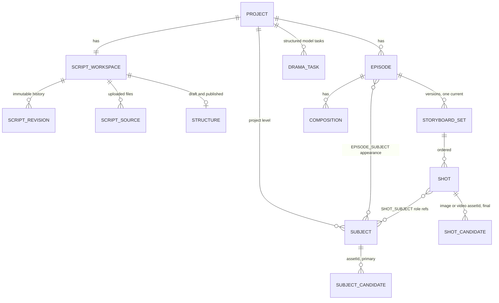

# Mio AI 漫剧工作流后端 PRD

**状态**：待评审。本文只规划 Mio 后端如何承接 `miioo` 的漫剧项目工作流，包括项目、剧本、分集、主体、分镜、分镜视频和剪辑成片。D1–D6 是本期开发单元；依赖视频或语音生成的子任务登记了进入条件，前置能力被接受后再开发。所有接口均为候选，当前只交付规划。任务生命周期、开发授权、候选验证和业务接受按[当前任务的生命周期](../../coordination.md#当前任务的生命周期)与[协调协议](../../coordination.md#规划交付要求)分别记录。前端会在后端迭代完成后，由专人按 Mio 的新逻辑改造，本文不设计前端改动。[任务资料入口](../index.md) · [统一资产库 PRD](../unified-asset-library/prd.md)

## 用户目标与首个里程碑

登录创作者新建一个漫剧项目后，可以在 Mio 中完成以下流程：写或上传剧本，通过多轮对话打磨剧本，确认为结构化草稿并发布为若干集，提取角色、场景、道具并为它们定稿形象图，再为某一集智能分镜、为镜头生图或生视频、选定稿，最后进入剪辑、渲染成片或导出剪映工程。关闭页面或重新登录后，所有已保存的内容、选择和在途任务都能恢复。

**首个业务验收点**设在 D4 结束：手写剧本 → 发布 3 集 → 提取主体 → 生成角色图并定稿 → 第 1 集智能分镜 → 某个镜头生图，且实际送入的参考图是定稿角色图 → 刷新后各项一致。这条链路不依赖视频和语音生成，可以用现有能力真实验收。

| 单元                | 用户得到的结果                                                                                                                                 | 直接依赖                                    |
| ------------------- | ---------------------------------------------------------------------------------------------------------------------------------------------- | ------------------------------------------- |
| D1 项目、分集与总览 | 新建、打开、改名、复制、归档漫剧项目；项目信息和自定义风格；手工维护分集；总览进度与只读项目资产概况                                           | Mio 登录、资产、统一资产库 U1               |
| D2 剧本工作区       | 编辑或上传剧本，多轮对话创作，确认为结构化草稿，带版本编辑，重新分集或重写某集，发布为正式分集，回到对话，查看和恢复历史版本                   | D1、对话服务、结构化任务机制、统一资产库 U1 |
| D3 主体             | 按集提取角色、场景、道具；维护字段；上传、从历史/我的资产选择或生成候选图并定稿；批量生成；主体上下文同源历史                                  | D2、图片任务、统一资产库 U1                 |
| D4 分镜与分镜图     | 单集智能分镜（覆盖即新版本），编辑、排序、复制、删除，自然语言改写，Excel 导入，镜头生图（引用定稿主体图）和定稿，版本恢复；分镜上下文同源历史 | D3、图片任务、统一资产库 U1                 |
| D5 分镜视频         | 上传或从历史/我的资产选择视频作为镜头候选并定稿，抽取首尾帧作为下一镜参考（独立入历史）；**生成视频待视频能力**                                | D4、计算服务 B、统一资产库 U1               |
| D6 剪辑与成片       | 按集开始剪辑，成片工程保存（草稿引用保护），服务端渲染（每版独立入历史），导出剪映工程包                                                       | D5、计算服务 B、统一资产库 U1               |

## 已确认的决定

以下决定来自 2026-11-22 项目负责人的明确回答，是本 PRD 的约束：

1. **漫剧项目和画布项目完全分开**，各自维护独立的项目表、业务对象和业务结果记录，互不干涉。两者只在使用用户资产时行为相同：复用同一底层资产域（[资产 API](../../apis/assets.md)）与[统一资产库 PRD](../unified-asset-library/prd.md) 的统一解析、引用保护和目录能力；统一生成历史在[统一资产库 PRD](../unified-asset-library/prd.md#3-生成历史) 作为**资产域汇总登记/索引层**实现（按服务端核实上下文过滤同源 `historyId`），绝不合并漫剧与画布的业务任务表或结果表。图片、视频等生成服务同样作为下层服务共享。
2. **剧本对话走对话引擎**（多轮创作）。**结构化节点直接调用模型接口**，由代码组装每一步所需的上下文。
3. **D5/D6 纳入本期**。依赖尚未实现的视频生成或语音生成的子任务，等[视频 PRD](../onelink-video-generation/prd.md) 或[音频 PRD](../onelink-audio-generation/prd.md) 的对应能力被接受后再开发。
4. **只写后端**：接口按 Mio 现行规范设计，不背旧后端的协议兼容包袱，也不设计前端如何改。
5. **旧数据需要迁移**，迁移规则另立 PRD。本 PRD 的领域模型必须能承接旧库中的漫剧数据（包括 `legacy_v1` 项目和不属于任何分集的分镜），但模型按 Mio 的需求独立设计，不迁就旧表结构。旧的剧本对话消息不迁移。

## 已有能力与依据

需求输入为：miiooai.com 项目工作流逆向报告（个人资料，未入库）；`miioo` 前端 `feat/frontend_V2.0` 的 `1c1b363`，其中包括旧后端的 [OpenAPI 契约](https://github.com/miioo-aigc/miioo/blob/1c1b36339afb1f0db026d0809a3c688d285200c2/frontend/src/api/openapi.json)（`/api/projects` 下 163 个操作）；以及旧库只读快照的结构与规模画像。核对基线为 Mio `main` 的 `c00a018`。开发开始前须以目标基线重新核对。

| 领域           | 可直接依赖的事实                                                                                                                                                                                                                                                                                                        | 漫剧要补的部分                                                                                                                                                                                                             |
| -------------- | ----------------------------------------------------------------------------------------------------------------------------------------------------------------------------------------------------------------------------------------------------------------------------------------------------------------------- | -------------------------------------------------------------------------------------------------------------------------------------------------------------------------------------------------------------------------- |
| 身份           | 登录 Cookie 识别可信用户；手机号验证码和微信扫码登录已有接受成果。[认证 API](../../apis/auth.md)                                                                                                                                                                                                                        | 漫剧服务从装配入口注入 `Authentication.identity`，每次按 owner 条件查询                                                                                                                                                    |
| 资产与 COS     | 浏览器申请上传、直传私有 COS、确认、短期下载；持久引用是 `assetId`。[资产 API](../../apis/assets.md) · [COS 契约](../../integrations/cos.md)。统一生成历史、我的资产个人目录库、显式业务引用保护、回收站与 `POST /api/v1/assets/resolve` 统一解析及下载由[统一资产库 PRD](../unified-asset-library/prd.md)（U1–U4）承载 | 漫剧不自建资产列表或个人目录；在写入/移除定稿、候选、参考图、项目直传、剪辑草稿、成片及音频关联时同步登记或释放显式业务引用，将有效媒体产出事务接入 U1 生成历史，并提供上下文同源历史与项目总览只读资产概况                |
| 图片生成       | `POST /compute/images` 幂等受理、参考图 `imageAssetIds`、按序号登记输出、unknown 不重发、可恢复。[计算 API](../../apis/compute.md) · [图片成果](../onelink-image-generation/complete/report.md)                                                                                                                         | 主体图和镜头图的执行记录、输出到候选记录的关联，以及单输出成功后的 U1 生成历史登记                                                                                                                                         |
| 文本与对话     | 对话服务支持用户归属、BYOK、持久回执、SSE、协作式取消；OneLink chat 路由已按平台路由白名单受控。[对话 API](../../apis/conversations.md) · [对话配置](../../conversations.md) · [对话成果](../conversation-service/complete/report.md)                                                                                   | 剧本对话需要漫剧专属提示词和项目上下文；结构化任务需要一个非对话的模型调用执行器（文本产出不进入媒体生成历史）                                                                                                             |
| 重媒体计算     | 服务 B 通过 RabbitMQ 接收固定 profile 的 `transcode.v1`，具备 ffmpeg/ffprobe 与恢复 journal。[计算协议](../compute-service/protocol.md) · [RabbitMQ](../../integrations/rabbitmq.md)                                                                                                                                    | 抽帧、渲染、剪映工程包打包等新命令需要扩展协议（个人空间多文件/文件夹通用 ZIP 下载由统一资产库 U4 后端清单签名 + 前端浏览器直连私有 COS 流式打包实现，应用服务器与服务 B 均不拉取/打包文件字节，与漫剧重媒体计算彻底独立） |
| 素材库         | 本人素材组、同步、真人认证会话。[素材 API](../../apis/materials.md) · [素材成果](../onelink-material-library/complete/report.md)                                                                                                                                                                                        | 主体绑定真人素材、Seedance 视频联动（仅允许有效认证状态提交新生成；认证失效拦截与重新认证归[万联素材库 PRD](../onelink-material-library/prd.md) 条件单元 `ML-12`，已生成漫剧媒体不受后续认证失效影响）                     |
| 视频与语音生成 | 尚未启动                                                                                                                                                                                                                                                                                                                | 分镜生视频、音色、配音片段：登记为被阻塞子任务（解阻塞后有效媒体输出同样接入 U1 生成历史与显式业务引用）                                                                                                                   |

旧库规模（用于确定边界）：剧本正文最大约 170 KB（P95 约 44 KB），结构化草稿最大约 670 KB，单集正文最大约 45 KB；单项目最多 10 集、54 个主体；单集当前版本最多 119 个镜头；成片时间线最大约 8 KB。

## 领域模型

模型按 Mio 的需求设计，下面的名称和字段是候选，会在 D1 的 C0 定稿。

- **项目**：名称、描述、封面 `assetId`、画幅、视觉风格（预设、本人自定义风格引用或自由提示词）、创作模式（对白或旁白）、语言、备注、`revision`、活动或归档状态。用户自定义风格是用户级资源，单独维护。
- **剧本工作区**：阶段为 `draft`、`dialogue`、`structured`、`published` 之一；包括当前正文、绑定的对话 ID、草稿版本号。**剧本修订**一经写入不可修改，用 `source` 区分来源（manual、upload、dialogue、confirm、publish、episode_snapshot、migration）。**剧本源文件**引用 `assetId`，并保存解析出的文本。
- **结构化草稿**：用 Mio 自己的 schema 版本（例如 `mio.drama.structure.v1`）表达整体设定、剧本设计、主体提纲和分集条目；草稿和已发布内容各有 `revision`。
- **分集**：集号、标题、摘要、正文、结构条目引用和状态。状态为 `draft → scripted → extracted → storyboarded → editing → edited`，只能前进不能后退；进入剪辑只能通过专用接口，不能通过普通更新绕过。
- **主体**：一律是项目级，类型为角色、场景或道具，字段按类型校验。主体出现在哪一集，只由 `EPISODE_SUBJECT` 这一种关系表达。音色引用作为保留字段，语音能力就绪前不可用。
- **分镜**：一律属于某一集的某个 `STORYBOARD_SET` 版本，每集只有一个当前版本。重新分镜会生成新版本，旧版本可以恢复。镜头对主体的引用经 `SHOT_SUBJECT` 记录角色类型。
- **候选**：主体图和镜头图/视频都只通过候选记录引用 `assetId`，分别标记定稿，并区分媒体来源（生成产出、项目直接上传、从生成历史/我的资产选用）；行上不直接存 URL。生成来源（执行 ID、输出序号与同源 `historyId` 追溯）由服务端写入，但不把来源历史存活作为候选可读前置。
- **成片工程**：归属某一集，包括时间线、轨道设置、字幕样式、分辨率、画幅、`revision`；时间线草稿引用的媒体与每次成功渲染产出的成片资产（按导出版本独立记录，新版本不覆盖旧版本）各自维护持久引用保护。
- **结构化任务**：见下一节。

领域表不带任何旧流程标记。迁移进来的项目在行为上与新建项目一致，旧来源只记录在迁移映射中。

## 跨期接口约定

下表路径均省略 `/api/v1`。私有请求使用 Mio 登录 Cookie，写请求必须带允许的精确 Origin 和 JSON 正文。owner 由服务端从会话取得；跨用户资源一律按"不可访问"处理。错误体沿用 `{error:{code,message,requestId}}`，并复用[响应原语](../../apis/index.md#运行时公共能力)。存储、COS、OneLink 和 RabbitMQ 分别遵循既有集成契约。[PostgreSQL](../../integrations/postgres.md) · [COS](../../integrations/cos.md) · [OneLink](../../integrations/onelink.md)

- **幂等与版本**：创建、生成、发布、复制、批量操作都使用客户端稳定的 UUID `requestId`。同一用户在同一作用域用相同输入重试，返回原结果；同键不同输入返回 409。可编辑资源带 `revision`，写入时传 `baseRevision`，版本过期返回 409 并告知当前版本。
- **正文上限**：当前请求读取器默认 8 KiB（认证和对话为 16 KiB，见[请求原语](../../../src/http-request.ts)）。剧本正文、结构化草稿和分镜批量写入需要按路由单独设限，上限值按旧库实际规模在 D2 的 C0 确定，超出时返回 413，原内容保持不变。
- **资产引用与统一解析**：所有媒体以稳定 `assetId` 引用，接入[统一资产库 PRD](../unified-asset-library/prd.md)（U1–U4）承载的统一生成历史、我的资产个人目录库、显式业务引用保护与 `POST /api/v1/assets/resolve` 统一解析。漫剧在写入或更新封面、剧本源文件、主体定稿/候选/参考图、分镜当前图/视频与保留版本候选、项目直传、剪辑草稿、成片及音频关联时，须经资产服务核对“本人所有、状态为 ready 且具备该路径选材/重开授权”（仅存于回收站的条目不可作为新选材来源），并在同一短事务（漫剧与资产位于同一媒体数据库时，见 D1 的 C0）或统一引用服务接缝内同步登记或释放对应的显式业务引用。预览、批量解析、选择器勾选或未提交草稿不建立持久引用；版本冲突（409）、校验失败或保存回滚均维持已提交引用。读取和重开作品（含旧签名过期刷新与项目总览）经 `POST /api/v1/assets/resolve` 按项目归属与已存有效业务引用重签短期地址，不依赖来源历史或我的资产条目存活；签名地址绝不持久保存。
- **选材与项目直接上传隔离**：主体候选/参考图、分镜图片/视频候选与剪辑时间线可直接选用「生成历史」或「我的资产」中的本人媒体（无需先保存到我的资产，选用不产生生成历史）。在项目各业务入口**直接本地上传的素材**（含剧本上传源文件、主体上传图、分镜上传图/视频、剪辑上传音频/视频/图片等）**默认只留在本项目内**：不产生生成历史、**不自动进入我的资产、删除时也不进入资产回收站**；单文件大小沿用通用资产（1 GiB）或对应业务自身上限，**不受我的资产本地上传 20 MiB 与 5 后缀限制**。用户仅在主动调用统一资产库 U2 `POST /api/v1/personal-library/saves`“保存到我的资产”时，才按稳定 `assetId`/有效业务引用创建独立个人库副本（不改项目归属、不新增历史）。
- **有效媒体产出接入统一生成历史**：主体生图（D3）、镜头生图（D4）、镜头抽帧（D5，抽帧结果作为独立衍生媒体记一条新历史，原视频保留）、服务端渲染成功导出的成片（D6，每次成功渲染导出一版记一条独立历史）及未来解阻塞后的分镜生视频、配音生成与二次编辑保存结果，在单个有效输出持久化成功且核实 COS 原件时，事务接入[统一资产库 PRD](../unified-asset-library/prd.md#3-生成历史) U1 生成历史登记（多输出部分成功保留成功项、不因同批失败撤销；按 `(businessTaskId, outputIndex)` 回执重放防重；历史彻底删除或到期清理后由 U1 不可复活去重墓碑防延迟回调复活）。**剧本对话与结构化文本任务结果（D2/D3/D4 文本类任务）属于生成文本，不进入媒体生成历史**；未保存预览、缩略图、播放转码与失败/取消项均不纳入。主体与分镜上下文历史直连 U1 同源过滤查询，与全局历史共享同一 `historyId` 与删除状态。
- **四类删除语义严格区分（对齐 `L01–L14`）**：漫剧与统一资产库严格区分以下四类动作，禁止借源资产级联删除接口替代历史删除或关系移除（完整矩阵见[删除与引用矩阵](../unified-asset-library/prd.md#6-删除与引用矩阵)）：
  1. **从全局或主体/分镜上下文删除生成历史**（走 U1 `POST /api/v1/asset-history/deletions`）：仅同步隐藏同一 `historyId` 并进入 30 天资产回收站，**绝不清空主体定稿、候选、参考图、分镜当前图/视频/配音、剪辑草稿或已导出成片**；从回收站恢复历史仅恢复列表可见性并保留原 `completedAt`（不置顶），绝不复活已删对象或反写覆盖当前定稿/选用。
  2. **从主体/分镜移除从历史或我的资产选用的媒体（或取消定稿）**：仅解除当前业务位置引用（若正是当前定稿/选用则清空该位置），来源生成历史与我的资产副本完整保留，**不进入资产回收站**。
  3. **删除项目直接上传素材**：从对应项目候选/上传列表移除，若正被当前定稿/分镜采用则清空该当前位置，**不进入资产回收站**；已主动保存到我的资产的独立副本及其他独立引用保留；仅当[回收站与物理媒体清理](../unified-asset-library/prd.md#7-回收站与物理媒体清理)定义的全部 **7 类**有效持有关系同时归零时才具备物理 GC 资格。
  4. **删除主体或镜头业务对象**：解除被删对象自身业务引用，已产生的生成历史（保留来源名称快照，返回 `sourceDeleted = true` 且不提供失效跳转）与其他对象的独立引用保留，**不进入资产回收站**。
- **异步任务**：模型结构化任务、图片生成、B 计算任务都返回持久任务 ID。页面刷新后按 ID 查询；状态区分 accepted、running、succeeded、partial、failed、unknown。unknown 不自动重发，只能沿原身份核对。
- **总览与列表**：列表使用游标分页；总览统计与分集状态同源计算，项目资产概况为项目内只读业务视图，不构成全局生成历史的项目筛选控件。

## 结构化任务与剧本对话

**结构化任务（直接调用模型）**：确认剧本、重新分集、重写某集、提取主体、梳理主体字段、智能分镜、自然语言改写镜头字段，都是同一种任务：

1. **受理**：短事务核对项目、工作区或分镜集的 `baseRevision`，冻结本次输入。输入包括所引用的修订、主体表快照、模型 `modelRef` 和路由快照、提示词模板版本。持久化任务意图后返回任务 ID。
2. **组装上下文**：由代码按任务类型确定性组装，不依赖对话历史。例如智能分镜只放项目设定、本集正文、本集主体表（ID、名称、要点）和分镜规范。超长剧本按集或按场景分块执行。稳定前缀放在前面，以便命中 prompt 缓存。
3. **调用**：使用用户本人的 OneLink Key 和已启用的平台路由，只提交一次。提交结果不明时进入 unknown，不自动重发。
4. **校验与修复**：输出必须符合该任务的 JSON schema，主体名称必须能对应到主体 ID。不合格时，最多针对失败字段做一次定向修复调用，这是计入任务记录的第二次显式调用。仍不合格则任务失败，不写入领域数据。
5. **结算**：在短事务中按受理时的 `baseRevision` 写入新修订或新分镜版本。基线已变化时，任务结果标记为 conflicted 并保留，不覆盖用户的新编辑。
6. **观测**：沿用对话服务的 token 与失败分类口径，不记录费用。

提示词模板以代码形式维护并带版本号，任务记录保存所用版本。

**剧本对话（对话引擎）**：每个项目工作区绑定一个由对话服务创建、归属于用户的会话，消息、SSE 事件和取消沿用[对话 API](../../apis/conversations.md)。漫剧需要对话服务提供两项扩展，在 D2 的 C0 与对话服务边界一同确定：

- 按会话用途注入专属系统提示词（剧本创作）；
- 每轮注入项目上下文（当前正文摘要、已确认设定）。

对话产出不会直接成为正式数据，只有用户明确采纳某轮回复时，才写入一个新的剧本修订。

## D1 · 项目、分集与总览

**结果与非目标**：项目的增删改查、复制、归档；项目信息自动保存；用户自定义风格；分集手工维护；总览进度与**只读项目资产概况**（承接统一资产页取消项目分类后的项目业务视图）。团队、成员、权限、积分、批注、备份、资产回收站，以及在总览直接替换、取消定稿、移除或删除项目内容的写操作均不在范围内。

**归档与彻底粉碎边界（已确认）**：现阶段 `DELETE /drama-projects/{id}` 固定只做**封存归档**——项目退出活动列表、停止新执行，但**继续持有该项目内全部有效媒体引用以支持重开与已受理任务查询**（项目与项目直接上传素材均不进入资产回收站）；“彻底粉碎/销毁项目”本期不做、以后再考虑。现阶段只有明确的业务位置移除（如取消定稿、移除候选、删除主体/镜头、删除项目直接上传素材）才解除该项目内对应的业务引用；即便以后引入彻底粉碎/销毁项目动作，已产生的生成历史（保留来源名称快照，服务端返回 `sourceDeleted = true` 且不提供失效跳转）与用户已主动保存到我的资产的独立副本依然完整保留（见[统一资产库 PRD · 删除与引用矩阵](../unified-asset-library/prd.md#6-删除与引用矩阵)）。

**项目总览资产概况扩展（承接原资产页项目分类，对齐 `P01–P03`）**：在既有各集状态进度、剧本进度及角色/场景/道具“定稿数/总数”统计基础上，项目总览须提供完整的**项目资产概况后端数据契约**（在 D1 的 C0 固定是在 `GET /drama-projects/{id}/overview` 扩展返回，还是增设分类分页子接口 `GET /drama-projects/{id}/asset-overview`；该接口属于项目内只读业务概况，绝非全局生成历史的项目筛选控件）：

- **角色、场景、道具**：保留现有业务归属展示，严格区分当前定稿与候选历史，绝不混为同一对象；
- **分镜**：按分集/分镜返回当前选用的图片与视频引用（包含选用的项目直接上传素材）；未选用位置明确为空，**绝不汇总全部候选，绝不拿第一张候选冒充当前选用**；
- **音频**：返回当前采用的配音、背景音乐、音效引用及其用途与所属分集/分镜/剪辑位置（同一媒体被多处采用时可按使用关系分别展示；待自动配音/语音生成能力就绪前，剪辑工程中已绑定/上传的配音、背景音乐、音效按同一结构承接）；
- **成片**：按导出完成时间倒序返回**全部成功导出的成片版本**（含渲染/导出身份、`assetId`、版本名称、成功导出完成时间），突出最新版本但**绝不以最新覆盖旧版本**；失败、导出中与剪辑草稿留在对应模块，不列入成片概况；
- **只读与交互边界**：总览仅支撑预览/试听（经 `POST /api/v1/assets/resolve` 按项目有效引用重签短期地址）、单文件原件下载（对接统一资产库 U4 `POST /api/v1/downloads/resolve`）、主动保存到我的资产（对接统一资产库 U2 `POST /api/v1/personal-library/saves`，按稳定 `assetId`/有效业务引用创建独立个人库副本，不修改项目归属、不新增生成历史）与跳转对应业务位置；**不提供在总览直接替换、取消定稿、移除或删除项目内容的接口副作用**。删除生成历史后总览仍正常显示当前采用媒体；从回收站恢复历史不反写或覆盖当前定稿/选用。

**C0**

- 确认漫剧表放在资产所在的媒体数据库（建议，和素材库、统一资产库扩展表同库不同表、各自持连接池），并确定与统一资产库 U1 显式业务引用登记/释放的同库短事务或服务接缝。
- 确认项目名称、描述的服务端上限，并统一旧前端不一致的 50/200/30 字规则。
- 落实已确认边界：现阶段 `DELETE /drama-projects/{id}` 固定只做**封存归档**（退出活动列表、停止新执行、继续持有全部有效媒体引用），“彻底粉碎/销毁项目”本期不做、以后再考虑。
- 确认复制项目的范围：建议复制结构与当前定稿/选用结果，媒体按 `assetId` 新增新项目的独立业务引用（不复制底层文件，不产生生成历史），排除在途任务。
- 确定项目总览资产概况的正式契约形态：在 `GET /drama-projects/{id}/overview` 扩展还是独立增设分类分页子接口 `GET /drama-projects/{id}/asset-overview`，并冻结角色/场景/道具、分镜、音频、成片四类响应结构与空位表示（未落地实体的类别在 D1 阶段按空集规范返回，随 D3–D6 陆续接入真实数据源）。

| 接口                                                                                         | 输入、返回与副作用                                                                                                                                                                            |
| -------------------------------------------------------------------------------------------- | --------------------------------------------------------------------------------------------------------------------------------------------------------------------------------------------- |
| 新增 `POST /drama-projects`、`GET /drama-projects`                                           | 创建传 `requestId` 和项目字段（含封面 `assetId` 显式业务引用登记），同一事务建立项目和空剧本工作区；列表按本人、搜索词、游标返回                                                              |
| 新增 `GET/PATCH/DELETE /drama-projects/{id}`                                                 | 详情包括 `revision`；PATCH 带 `baseRevision`（更新封面同步增释业务引用）；DELETE 固定只做封存归档（退出活动列表、停止新执行、继续持有全部有效媒体引用，不入资产回收站；本期不做彻底粉碎）     |
| 新增 `POST /drama-projects/{id}/copies`、`GET /drama-operations/{operationId}`               | 复制受理后返回操作 ID，完成时给出新项目 ID；同键重试返回原操作；媒体仅新增新项目的独立业务引用、不复制底层文件、不产生生成历史                                                                |
| 新增 `GET /drama-projects/{id}/overview`（及候选 `GET /drama-projects/{id}/asset-overview`） | 各集状态进度、剧本进度、角色/场景/道具“定稿数/总数”及只读项目资产概况（角色/场景/道具定稿、分镜当前图/视频、音频及用途位置、全部成功成片倒序）；只读无修改副作用，随 D3–D6 陆续接入真实数据源 |
| 新增 `GET/POST /drama-projects/{id}/episodes`、`PATCH/DELETE /drama-episodes/{episodeId}`    | 手工增删改分集；状态只能前进；进入剪辑不能经此接口                                                                                                                                            |
| 新增 `GET/POST /visual-styles`、`PATCH/DELETE /visual-styles/{id}`                           | 用户级自定义风格（名称、提示词、颜色）                                                                                                                                                        |

**C1 要点**：先建项目、分集与显式业务引用接缝的存储、服务、HTTP 三层并接入装配入口，再做总览（含资产概况只读契约与统一解析衔接）与复制；随 D3–D6 落地逐类挂接主体、分镜、音频与成片真实数据源。新模块进入护栏的 AST 边界和源码覆盖。

**验收**：模拟创建响应丢失后用同一 `requestId` 重试，只得到原项目；两个标签页基于同一版本修改，后到的一方得到 409；另一个账号读写返回不可访问；复制后修改副本不影响原项目，资产引用数量正确、文件未被复制且不产生生成历史；归档后项目退出活动列表、不进入资产回收站，已受理任务仍可查询且项目内全部有效媒体引用仍可重签读回。同时补齐项目总览资产概况判据（D1 阶段验收只读契约骨架、归属隔离、空类规范与封面/已有引用读回，D3–D6 落地后逐类全量验收 `P01–P03`）：

- **`P01`（分镜与主体概况）**：主体类别严格区分当前定稿与候选历史；分镜类别按分集/分镜准确返回当前选用的图片与视频（含选用的项目直接上传素材），未选用位置明确为空，绝不拿第一张候选冒充当前选用，也不汇总全部候选；
- **`P02`（音频与成片概况）**：音频类别返回当前采用的配音、背景音乐、音效引用及其用途与所属分集/分镜/剪辑位置；成片类别按成功导出完成时间倒序返回全部成功导出版本（突出最新、保留全部旧版本），失败、导出中与剪辑草稿均不列入；
- **`P03`（只读边界与历史隔离）**：总览仅支撑预览/试听、单文件原件下载、主动保存到我的资产（经 U2 创建独立个人库副本且不改项目归属、不新增历史）与跳转定位，无直接替换、取消定稿、移除或删除项目内容的写接口；删除对应生成历史并令旧签名过期后，总览仍可经 `POST /api/v1/assets/resolve` 正常读回当前采用媒体；从回收站恢复历史不反写或覆盖当前定稿/选用。

## D2 · 剧本工作区

**结果与非目标**：正文编辑与上传、多轮对话、确认、结构编辑、重新分集、重写某集、发布、回到对话、历史版本。剧本格式质量的人工评估不在范围内；剧本对话与结构化文本任务结果属于生成文本，**不进入统一资产库的媒体生成历史**。

**C0**

- 确定可上传的剧本格式（txt、docx、pdf 等）、业务自身大小上限（沿用通用资产或剧本业务上限，不受我的资产本地上传 20 MiB 限制）和解析库，以及解析失败的处理方式；明确剧本上传源文件属于项目直接上传素材，登记显式业务引用、不进入生成历史、不自动进入我的资产、删除时不进入资产回收站。
- 按旧库规模确定正文、结构化草稿的请求上限（见上文）。
- 与对话服务确定"会话用途提示词 + 项目上下文注入"的扩展边界；它影响对话服务的公共契约，须在对话服务一侧同步规范。
- 定义 `mio.drama.structure.v1` 的 schema，以及发布时"已有下游数据"的影响策略：发布后新增、删减、改动的集，如何处理已有主体关系和分镜。
- 为确认、重新分集、重写各选定一个可验收的 chat 路由。

| 接口                                                                                            | 输入、返回与副作用                                                                                                                   |
| ----------------------------------------------------------------------------------------------- | ------------------------------------------------------------------------------------------------------------------------------------ |
| 新增 `GET /drama-projects/{id}/script`                                                          | 阶段、当前正文、草稿版本、结构摘要、绑定的会话 ID、可用动作                                                                          |
| 新增 `PUT /drama-projects/{id}/script/text`                                                     | `requestId, baseRevision, text`；写入新修订（manual）                                                                                |
| 新增 `POST /drama-projects/{id}/script/sources`                                                 | `requestId, assetId`；登记本人项目直传剧本文件并同步写显式业务引用、解析写入新修订（upload）；不入历史、不自动入我的资产、不入回收站 |
| 新增 `POST /drama-projects/{id}/script/dialogue`                                                | 为工作区创建或返回绑定的会话；之后的消息、事件、取消直接使用对话 API                                                                 |
| 新增 `POST /drama-projects/{id}/script/adoptions`                                               | `requestId, baseRevision, conversationId, turnRequestId`；把指定轮次的回复采纳为新修订（dialogue）                                   |
| 新增 `POST /drama-projects/{id}/script/confirm`                                                 | `requestId, baseRevision, modelRef, episodeCount?, episodeDurationSeconds?`；受理结构化任务，成功后进入 `structured`（文本不入历史） |
| 新增 `GET/PATCH /drama-projects/{id}/script/structure`                                          | PATCH 传 `baseRevision` 和有序操作列表（增删改、移动条目）                                                                           |
| 新增 `POST .../script/structure/resplit`、`POST .../script/structure/items/{itemId}/regenerate` | 结构化任务；结果写入新的草稿版本（文本不入媒体生成历史）                                                                             |
| 新增 `POST /drama-projects/{id}/script/structure/publish`                                       | `requestId, baseRevision, impactPolicy`；在同一事务中生成或更新正式分集，进入 `published`                                            |
| 新增 `POST /drama-projects/{id}/script/reopen`                                                  | 回到对话阶段，已发布的分集保留                                                                                                       |
| 新增 `GET .../script/revisions`、`GET .../script/revisions/{revisionId}`、`POST .../restore`    | 历史版本列表、详情、恢复（恢复本身也写入一个新修订）                                                                                 |
| 新增 `GET /drama-projects/{id}/tasks/{taskId}`                                                  | 结构化任务状态、所用模板版本、结算结果或冲突                                                                                         |

**C1 要点**：先实现结构化任务执行器（受理、组装、单次调用、校验修复、结算、恢复），用确认剧本作为首个消费者。之后依次做结构编辑、发布、重新分集和重写，最后做对话扩展与采纳。

**验收**：手写剧本后确认，得到结构化草稿；编辑结构时用旧版本提交得到 409；发布 3 集后，分集与草稿条目一一对应；受理后再修改正文，任务结算为 conflicted，用户的新修改保留；模拟提交结果不明，任务停留在 unknown，供应商调用次数不增加；在对话中采纳某轮回复，生成一条新修订，未采纳的回复不进入正文；恢复旧版本后历史完整；核对剧本上传源文件已建立显式业务引用且未进入生成历史/我的资产，剧本对话与结构化文本任务未产生任何媒体生成历史（`H07`）。真实模型调用使用常驻开发环境的有界最小规格。

## D3 · 主体

**结果与非目标**：提取、维护、候选图、定稿、参考图、批量生成、主体上下文同源生成历史查询，以及与统一资产库协同的选材、项目直传隔离与四类删除保护。音色绑定和真人素材绑定是被阻塞子任务。

**C0**

- 确定各类型主体的字段 schema。
- 确定提取任务的去重规则：同名主体合并为一个，同时记录它出现在哪些集（提取与字段梳理属结构化文本任务，不进入媒体生成历史）。
- 确定主体候选记录如何区分来源（生成、项目直接上传、从生成历史/我的资产选用），以及与统一资产库 U1 显式业务引用、生图输出入历史登记（含部分成功保留、重放防重与彻底删除墓碑防复活）的事务接缝；核对主体定稿与候选在 D1 项目总览中的严格区分。
- 确定批量生成的上限与并发，以及"仅生成未定稿"的语义。
- 为主体图选定一个图片路由；需要参考图时选支持参考图的路由。

| 接口                                                                                                             | 输入、返回与副作用                                                                                                                                                                                                                                                                                             |
| ---------------------------------------------------------------------------------------------------------------- | -------------------------------------------------------------------------------------------------------------------------------------------------------------------------------------------------------------------------------------------------------------------------------------------------------------- |
| 新增 `POST /drama-projects/{id}/script/extract-subjects`                                                         | `requestId, episodeIds, sourceRevision, modelRef`；结构化任务，结算为主体及出现关系（文本任务不入媒体生成历史）                                                                                                                                                                                                |
| 新增 `GET/POST /drama-projects/{id}/subjects`、`GET/PATCH/DELETE /drama-subjects/{subjectId}`、`POST .../copies` | 按类型、分集、游标列出；PATCH 带 `baseRevision`；`DELETE` 解除该主体自身业务引用（不入资产回收站），已产生的生成历史保留来源快照（`sourceDeleted = true`），其他主体/对象独立引用保留                                                                                                                          |
| 新增 `POST /drama-subjects/{subjectId}/extract-fields`                                                           | 结构化任务，梳理主体字段（文本任务不入媒体生成历史）                                                                                                                                                                                                                                                           |
| 新增 `PUT /drama-episodes/{episodeId}/subjects`                                                                  | 维护本集出现的主体                                                                                                                                                                                                                                                                                             |
| 新增 `GET/POST /drama-subjects/{subjectId}/candidates`、`DELETE .../candidates/{candidateId}`                    | 登记本人 ready 图片为候选并同步写显式业务引用：支持直接从「生成历史」/「我的资产」选用（无需先保存、不新增历史）与项目直传（只留本项目、不入历史、不自动入我的资产、不受 20 MiB 限制）；`DELETE` 区分移除选用（保留来源历史/个人库副本）与删除项目直传，若正为当前定稿则清空定稿位，两者均**不进入资产回收站** |
| 新增 `POST /drama-subjects/{subjectId}/generations`                                                              | `requestId, modelRef, parameters`；内部复用图片任务服务，单个有效输出持久化成功后按 `(businessTaskId, outputIndex)` 事务登记为候选、写显式引用并接入 U1 生成历史（部分成功保留成功项、重放防重、墓碑防复活）                                                                                                   |
| 新增 `GET /drama-subjects/{subjectId}/generation-history`                                                        | 对接统一资产库 U1 上下文同源历史查询，与全局生成历史共享同一 `historyId` 与删除状态（删除历史走 U1 `POST /api/v1/asset-history/deletions`，绝不清空主体定稿或候选）                                                                                                                                            |
| 新增 `PUT/DELETE /drama-subjects/{subjectId}/primary`                                                            | 设置或取消定稿候选（取消定稿仅解除定稿标记/位置，不删除来源历史或个人库副本，不入回收站）                                                                                                                                                                                                                      |
| 新增 `PUT /drama-subjects/{subjectId}/references`                                                                | `assetIds, primaryAssetId`；绑定参考图（可直接选用历史/我的资产或项目直传）并增量维护显式业务引用，移除参考图不连带删除来源且不入回收站                                                                                                                                                                        |
| 新增 `POST /drama-projects/{id}/subject-generations`                                                             | 批量：`requestId, subjectIds, modelRef, parameters, onlyWithoutPrimary`；返回操作 ID，每个主体对应一个图片任务，各成功输出分别接入候选与 U1 生成历史                                                                                                                                                           |

**C1 要点**：先做主体与候选存储及显式业务引用接缝，再做提取任务，然后做单个生成（关联图片任务输出并事务接入 U1 生成历史与上下文同源历史查询），最后做批量与 D1 总览主体概况数据源挂接。

**验收**：从 3 集剧本提取主体，同名主体合并且出现关系正确；生成角色图后，刷新可以看到候选并定稿，且全局与主体上下文历史出现同源 `historyId`（`H02`、`H11`）；同一 `requestId` 重试只有一个图片任务且回调重放不产生重复历史（`H05`）；批量生成部分失败时，成功的候选与对应历史保留、失败项可单独重试（`H04`）；另一个账号不能操作该主体。同时覆盖主体删除与引用保护判据：

- 从全局历史或主体上下文历史删除已定稿角色图，全局与主体上下文同步隐藏并入回收站，但角色定稿、其他角色独立引用与个人库副本经刷新、重登与旧签名过期重签仍可读回一致原件（`L01–L02`、`L08`、`L14`）；
- 更换定稿后从回收站恢复旧历史，仅恢复历史可见性且保留原完成时间，不覆盖新定稿（`L13`）；
- 移除从历史或我的资产选用的候选/参考图或取消定稿，仅解除当前位置关系，来源历史与个人库副本保留且不入回收站（`L11`）；
- 删除主体直接上传图（未受 20 MiB 个人库限制），若正被定稿则清空定稿位，不入资产回收站；已主动保存到我的资产的独立副本及其他引用仍可读（`L10`）；
- 删除主体业务对象，解除其自身引用且不入回收站，已产生的生成历史保留来源快照（`sourceDeleted = true`）且其他对象的独立引用不受影响（`L09`）。

## D4 · 分镜与分镜图

**结果与非目标**：智能分镜、编辑、排序、复制、删除、自然语言改写、Excel 导入、镜头生图与定稿、版本恢复、分镜上下文同源生成历史查询，以及与统一资产库协同的选材、项目直传隔离与四类删除保护。生成视频不在本单元；智能分镜与自然语言改写属结构化文本任务，不进入媒体生成历史。

**C0**

- 确定镜头字段 schema，以及台词、主体引用、提示词提及（mentions）的结构。
- 确定 Excel 导入模板与校验规则（上传的 xlsx 文件按项目直传处理，不入生成历史与回收站）。
- 确定镜头生图时自动附带的参考图规则（定稿主体图、上一镜尾帧）和数量上限，须符合路由的参考图上限。
- 确定批量生图"仅未定稿"的语义，以及单个有效输出落库成功后事务接入 U1 生成历史（部分成功保留、重放防重、墓碑防复活）与 `STORYBOARD_SET` 全部可恢复版本候选的显式业务引用维护规则（保证恢复旧版本后媒体仍可重签读回，且总览 `P01` 仅投影当前版本已选用的图/视频）。

| 接口                                                                                                                              | 输入、返回与副作用                                                                                                                                                                                                                                                          |
| --------------------------------------------------------------------------------------------------------------------------------- | --------------------------------------------------------------------------------------------------------------------------------------------------------------------------------------------------------------------------------------------------------------------------- |
| 新增 `GET /drama-episodes/{episodeId}/storyboard`                                                                                 | 当前版本及镜头，游标分页，可选附带生成参数                                                                                                                                                                                                                                  |
| 新增 `POST /drama-episodes/{episodeId}/storyboard/generations`                                                                    | `requestId, modelRef, baseSetRevision?`；结构化任务，结果写成**新版本**并设为当前版本（"覆盖"即新版本，旧版本可恢复；文本任务不入媒体生成历史）                                                                                                                             |
| 新增 `GET .../storyboard/versions`、`POST .../storyboard/versions/{setId}/restore`                                                | 版本列表与恢复（旧版本保留的候选与定稿媒体继续受显式业务引用保护）                                                                                                                                                                                                          |
| 新增 `POST /drama-episodes/{episodeId}/storyboard/imports`                                                                        | `requestId, assetId`（xlsx，项目直传，不入历史与回收站）；校验后生成新版本                                                                                                                                                                                                  |
| 新增 `POST /drama-episodes/{episodeId}/shots`、`PATCH/DELETE /drama-shots/{shotId}`、`POST .../copies`                            | PATCH 只接受字段白名单，带 `baseRevision`；`DELETE` 解除被删镜头自身业务引用（不入资产回收站），已产生的生成历史保留来源快照（`sourceDeleted = true`），其他镜头独立引用保留                                                                                                |
| 新增 `PUT /drama-episodes/{episodeId}/storyboard/order`                                                                           | `baseRevision, shotIds`，提交完整顺序                                                                                                                                                                                                                                       |
| 新增 `POST /drama-shots/{shotId}/rework`                                                                                          | 自然语言改写单个字段，结构化任务（文本任务不入媒体生成历史）                                                                                                                                                                                                                |
| 新增 `GET/POST /drama-shots/{shotId}/candidates`、`DELETE .../candidates/{candidateId}`、`PUT/DELETE /drama-shots/{shotId}/final` | 登记本人图片或视频资产为候选（支持从历史/我的资产选用不新增历史，或项目直传只留本项目、不自动入我的资产、不受 20 MiB 限制）并写显式业务引用；分别设置或取消图片/视频定稿；`DELETE` 候选按选用移除与项目直传删除分别处置（若为当前定稿则清空该位置），均**不进入资产回收站** |
| 新增 `POST /drama-shots/{shotId}/image-generations`、`POST /drama-episodes/{episodeId}/image-generations`                         | 单个或批量生图，受理时冻结参考图；单个有效输出持久化成功后事务登记为候选、写显式引用并接入 U1 生成历史（部分成功保留原序号、重放防重、墓碑防复活）                                                                                                                          |
| 新增 `GET /drama-shots/{shotId}/generation-history`                                                                               | 对接统一资产库 U1 上下文同源历史查询，与全局生成历史共享同一 `historyId` 与删除状态（删除历史走 U1 `POST /api/v1/asset-history/deletions`，绝不清空分镜当前图/视频或保留版本）                                                                                              |

**C1 要点**：先做分镜集、镜头存储与多版本显式业务引用维护，然后依次做智能分镜任务、编辑排序、生图（复用图片任务并事务接入 U1 生成历史与上下文同源查询），最后做导入、改写并挂接 D1 项目总览分镜概况数据源。

**验收**：即首个业务验收点。另需覆盖：再次智能分镜生成新版本，恢复旧版本后镜头、定稿及旧版本引用的媒体经重签均一致；镜头生图受理后修改主体定稿，本次已冻结的参考图不变；批量生图部分成功时保留原序号并仅将成功项入历史（`H04`）；排序用旧版本提交得到 409；镜头生图入全局与分镜同源历史、删除历史后分镜当前图与项目总览 `P01` 经刷新重登和重签仍完整可用（`H11`、`L03`、`L08`、`L14`）；移除选用媒体或删除项目直传图均不入回收站且后者若当前采用则清空当前位（`L10–L11`）；删除镜头后历史保留来源快照（`L09`）；换定稿后恢复旧历史不覆盖新定稿（`L13`）；项目总览未选用分镜明确为空、绝不拿第一张候选冒充当前选用（`P01`）。

## D5 · 分镜视频

**结果与非目标**：本期先交付不依赖视频生成的部分，包括视频候选（项目直传或从生成历史/我的资产选择）、视频定稿、抽取首尾帧作为下一镜参考（抽帧结果作为独立衍生媒体记入统一生成历史，原视频保留），以及四类删除保护。**分镜生成视频**和 **Seedance 真人素材参考**是被阻塞子任务。

**C0**

- 在计算协议中新增抽帧命令（例如 `frame.v1`）：确定输入（本人视频资产的冻结键和 ETag）、输出（独立衍生图片资产）和恢复语义；这会改变计算协议契约。明确抽帧结果持久化成功后按 `(jobId, outputIndex)` 事务登记为镜头/下一镜参考图并接入统一资产库 U1 生成历史（记一条新历史、原视频与原视频历史保留、重放防重、墓碑防复活）。
- 确定视频候选可接受的格式与大小（沿通用资产 1 GiB 上限，不受我的资产本地上传 20 MiB 限制）；明确项目直传视频默认只留本项目（不入历史、不自动入我的资产、删除不入回收站），仅用户主动保存到我的资产时才创建独立个人库副本。

| 接口                                            | 输入、返回与副作用                                                                                                                                              |
| ----------------------------------------------- | --------------------------------------------------------------------------------------------------------------------------------------------------------------- |
| 复用 D4 的候选、定稿、移除与上下文历史接口      | 视频资产作为候选（支持历史/我的资产选用与项目直传）并写显式业务引用，分别设置或取消视频定稿；删除候选与删除生成历史按四类删除语义隔离                           |
| 新增 `POST /drama-shots/{shotId}/frames`        | `requestId, candidateId, position: first\|last`；受理 B 抽帧任务，结果登记为独立衍生图片资产、写入镜头/下一镜参考图显式引用并**记一条新生成历史**（原视频保留） |
| 新增 `GET /drama-shots/{shotId}/frames/{jobId}` | 抽帧任务状态与结果资产（含关联 `historyId`）                                                                                                                    |

**C1 要点**：先扩展 A→B 命令与 B 的抽帧适配器（复用 ffmpeg 与 journal 恢复），再接漫剧接口与 U1 生成历史/显式引用登记，并同步接入 D1 项目总览分镜当前视频概况。

**验收**：上传视频（含大于 20 MiB 的合法视频样本，核对不受我的资产本地上传限制且未自动入历史/我的资产）并定稿，抽取尾帧并作为下一镜生图的参考图，实际送入的参考图字节与抽帧结果一致，且抽帧结果作为新条目进入统一生成历史、原视频保留（`H06`）；B 在抽帧过程中重启后按原身份恢复，不重复登记也不产生重复历史（`H05`）；删除视频或抽帧生成历史并令旧签名过期后，分镜当前视频、项目总览 `P01` 与已冻结参考图均经重签读回一致原件（`L03`、`L08`、`L14`）；移除选用视频或删除项目直传视频均不进入资产回收站（`L10–L11`）。

## D6 · 剪辑与成片

**结果与非目标**：开始剪辑、成片工程、服务端渲染成片（每次成功渲染导出记一条独立生成历史，新版本不覆盖旧版本）、剪映工程包导出；成片工程时间线草稿引用的媒体与每次成功渲染产出的成片资产各自维护持久引用保护。以上都能用已上传或从历史/我的资产选用的视频、图片、音频真实验收。自动配音、配音片段是被阻塞子任务；个人空间多文件/文件夹通用 ZIP 下载由[统一资产库 PRD](../unified-asset-library/prd.md#u4--添加到新画布与下载清单签名) U4 承担（后端仅提供目录清单展开与私有 COS 短期签名、前端浏览器直连私有 COS 流式打包，应用服务器不拉取/打包文件字节），不再涉及服务端通用 ZIP 打包执行载体选型，与本单元服务端 B 的剪映工程包导出彻底独立，不在本单元范围。

**C0**

- 定义渲染命令（例如 `render.v1`）的时间线子集：视频、图片、音频、字幕轨，裁剪、倍速、音量、视觉变换。确定字幕烧录范围：SRT 完整支持，ASS 只支持声明的子集。确定输出规格和时长上限；这会改变计算协议契约。
- 定义成片工程时间线草稿（引用的视频、图片及配音/背景音乐/音效）与每次成功渲染成片版本的显式业务引用登记/释放规则，以及成功渲染导出事务接入 U1 生成历史的去重键（如 `(renderId, 0)`）与墓碑防复活规则：
  - 草稿保存与剪辑内项目直传素材（视频/图片/音频，沿通用资产 1 GiB 或剪辑业务上限，不受 20 MiB 个人库本地上传限制）**不产生生成历史、不自动进入我的资产、删除不入资产回收站**；
  - 每次服务端渲染成功导出一版成片均**记一条独立生成历史**并保留该版本独立成片记录与持久引用（新版本绝不覆盖旧版本；失败、导出中与剪辑草稿既不进入生成历史，也不列入项目总览成片概况）；
  - 删除来源生成历史或我的资产副本，绝不影响重开剪辑工程草稿或下载任意历史成片版本。
- 确定剪映工程包的目标版本和打包方式（由 A 生成草稿 JSON，B 打包媒体；与统一资产库 U4“后端清单签名 + 前端浏览器直连私有 COS 流式打包”的个人空间通用 ZIP 下载彻底独立，不涉及服务端通用 ZIP 打包载体共用）。
- 确定成片工程与分集状态的关系：进入剪辑只写 `editing`；"完成"的判定沿用产品规则，渲染或导出成功本身不自动等于完成。

| 接口                                                                                                                                | 输入、返回与副作用                                                                                                                                                                                   |
| ----------------------------------------------------------------------------------------------------------------------------------- | ---------------------------------------------------------------------------------------------------------------------------------------------------------------------------------------------------- |
| 新增 `POST /drama-episodes/{episodeId}/start-edit`                                                                                  | 前置条件为本集已分镜；幂等地推进 `storyboarded → editing`，已是 editing 或 edited 则原样返回；不创建工程                                                                                             |
| 新增 `GET/POST /drama-episodes/{episodeId}/compositions`、`GET/PATCH/DELETE /drama-compositions/{compositionId}`、`POST .../copies` | 工程归属本集；PATCH 带 `baseRevision`；时间线引用本人 ready 资产（可选自历史/我的资产或项目直传）并增量维护显式业务引用（草稿保存不入历史）；`DELETE` 仅解除草稿自身引用，不入回收站且保留已导出成片 |
| 新增 `POST /drama-compositions/{compositionId}/renders`、`GET .../renders/{renderId}`                                               | 冻结当时的工程版本与资产快照，受理 B 渲染任务；每次成功渲染产出独立成片资产与版本记录，同步建立持久引用并**记一条独立生成历史**（不覆盖旧版本；失败/渲染中不入历史与总览成片）                       |
| 新增 `POST /drama-episodes/{episodeId}/jianying-exports`、`GET .../jianying-exports/{exportId}`                                     | 导出剪映工程包，结果是一个 zip 资产（漫剧专属服务端 B 剪映工程包，与统一资产库 U4 后端清单签名 + 前端浏览器直连私有 COS 流式打包的通用 ZIP 下载彻底独立）                                            |

**C1 要点**：先做开始剪辑、工程存储与草稿显式引用维护，然后做 B 渲染命令与适配器（成功后事务写入独立成片版本、持久引用与 U1 生成历史，并挂接 D1 项目总览音频与成片概况数据源），最后做剪映导出。

**验收**：未分镜的集开始剪辑返回 409；重复开始剪辑不重复推进、不降级；保存工程时用旧版本提交得到 409；用上传或选用的两段视频、一段音频和 SRT 字幕连续渲染导出两版成片，均可下载、解码且时长与轨道符合时间线，两版成片均按完成时间倒序出现在项目总览成片概况且各自产生一条独立生成历史，新版本不覆盖旧版本，失败/渲染中与剪辑草稿不列入历史和成片概况（`H08`、`P02`）；删除所用分镜视频/音频、成片的生成历史及个人库副本并令旧签名过期后，重开剪辑工程草稿、下载两版历史成片及项目总览音频/成片预览与主动保存到我的资产均经重签读回一致字节（`L03`、`L08`、`L14`、`P03`）；删除剪辑直传音频不入回收站且已主动保存到我的资产的副本保留（`L10`）；渲染期间 B 重启后按原身份恢复且不产生重复历史（`H05`）；剪映包可以被目标版本的剪映打开（人工观察）。

## 被阻塞子任务与进入条件

这些子任务现在不建执行记录。前置能力被接受后，在对应单元内细化 C0 再实施。

| 子任务                                                               | 所属单元 | 进入条件                                                                                                                                                                                                                                                                                                                                                                                                       |
| -------------------------------------------------------------------- | -------- | -------------------------------------------------------------------------------------------------------------------------------------------------------------------------------------------------------------------------------------------------------------------------------------------------------------------------------------------------------------------------------------------------------------- |
| 分镜生成视频（文生、首尾帧、主体参考、多镜头等按模式逐项）           | D5       | [视频 PRD](../onelink-video-generation/prd.md) 的对应模式被接受；解阻塞后单个有效视频输出事务接入统一资产库 U1 生成历史与显式业务引用                                                                                                                                                                                                                                                                          |
| Seedance 真人素材作为视频参考、主体绑定真人素材、AIGC 素材库同步主体 | D3/D5    | 视频模式被接受，且[万联素材库 PRD](../onelink-material-library/prd.md) 的视频联动单元被接受；**仅允许有效认证状态提交新生成**，认证失效拦截与重新认证归万联素材库条件单元（`ML-12`），**已生成的漫剧媒体及既有作品引用完全不受后续认证失效或删除影响**                                                                                                                                                         |
| 主体绑定音色、项目音色设置                                           | D3/D1    | [音频 PRD](../onelink-audio-generation/prd.md) 的音色查询被接受                                                                                                                                                                                                                                                                                                                                                |
| 旁白、台词配音片段，按分镜生成旁白                                   | D6       | 音频 PRD 的 TTS 被接受；解阻塞后成功配音输出接入 U1 生成历史、显式业务引用及 D1 项目总览音频概况                                                                                                                                                                                                                                                                                                               |
| 分镜业务资源包下载（漫剧专属）                                       | D6 之后  | 个人空间多文件/文件夹通用 ZIP 下载已归属[统一资产库 PRD](../unified-asset-library/prd.md#u4--添加到新画布与下载清单签名) U4 本期独立推进（后端清单签名 + 前端浏览器直连私有 COS 流式打包，应用服务器不拉取/打包文件字节），不再涉及服务端通用 ZIP 打包执行载体选型，与漫剧 D6 服务端 B 剪映工程包导出彻底独立；漫剧专属“分镜业务资源包下载”留在 D6 之后按需评估，届时可同样优先采用清单签名 + 前端流式打包方案 |

## 旧前端功能覆盖

本表是需求来源核对，不是前端设计：保证将来前端改造时，所需数据和接口都已具备或明确置后。

| 旧功能（`/api/projects` 及相关）                                                                                                                | 处置                                                                                                                                                                                                                                                                      |
| ----------------------------------------------------------------------------------------------------------------------------------------------- | ------------------------------------------------------------------------------------------------------------------------------------------------------------------------------------------------------------------------------------------------------------------------- |
| 项目 CRUD、复制、总览、项目信息、封面、自定义风格                                                                                               | D1（总览扩展分镜、音频与成片只读资产概况，承接原资产页项目分类）                                                                                                                                                                                                          |
| 分集 CRUD、开始剪辑                                                                                                                             | D1、D6                                                                                                                                                                                                                                                                    |
| 剧本工作区：对话（含流式与中断）、上传、确认、结构编辑、重新分集、重写、发布、回到对话、任务查询、历史版本                                      | D2（对话消息与事件沿用对话 API；剧本对话与结构化文本不入媒体生成历史）                                                                                                                                                                                                    |
| 旧版拆分预览/应用拆分/定稿（finalize）兼容路径、单集剧本同步或流式生成                                                                          | 不单独承接，由 D2 的确认、发布和重写覆盖                                                                                                                                                                                                                                  |
| 主体：提取、CRUD、复制、字段梳理、场景梗概、候选图、上传、从资产选择、生成、批量生成、定稿、参考图、下载                                        | D3（选材复用统一资产库，下载走统一资产库短期地址，上下文历史同源）                                                                                                                                                                                                        |
| 分镜：列表、CRUD、排序、智能分镜、从定稿剧本生成首集、Excel 导入、自然语言改写、单字段更新、生图、上传图/视频、候选与定稿、版本历史与恢复、下载 | D4/D5（选材复用统一资产库，下载走统一资产库短期地址，上下文历史同源）                                                                                                                                                                                                     |
| 分镜生视频                                                                                                                                      | 被阻塞（视频）                                                                                                                                                                                                                                                            |
| 成片工程、渲染、剪映导出                                                                                                                        | D6（每版成功渲染独立入历史、不覆盖旧版，草稿与成片均受引用保护）                                                                                                                                                                                                          |
| 配音片段、音色设置、视频片段                                                                                                                    | 被阻塞（音频/视频）                                                                                                                                                                                                                                                       |
| 个人空间通用多文件/文件夹 ZIP 打包、漫剧专属分镜业务资源包                                                                                      | 通用 ZIP 下载归[统一资产库 PRD](../unified-asset-library/prd.md#u4--添加到新画布与下载清单签名) U4 本期独立推进（后端清单签名 + 前端浏览器直连私有 COS 流式打包，应用服务器不拉取/打包文件字节）；漫剧专属分镜资源包留 D6 之后按需评估（优先沿用清单签名 + 前端流式打包） |
| 工作台图片（`workbench`）                                                                                                                       | 归入待立项的创作模块 PRD                                                                                                                                                                                                                                                  |
| 成员、邀请、分集授权、编辑锁、积分、快照、批注、备份、回收站、审计日志、工作流审批                                                              | 不承接（团队协作不在当前范围；个人媒体 30 天逻辑回收站由统一资产库 U3 承接，不接收漫剧项目、业务对象或项目直传素材）                                                                                                                                                      |
| 项目包导入导出（`package/export`、`package/import`）                                                                                            | 不承接，旧数据经迁移 PRD 转入                                                                                                                                                                                                                                             |

## 与其他资料的关系

- **统一资产库**：与[统一资产库 PRD](../unified-asset-library/prd.md) 分工明确——统一资产库 U1–U4 承载统一生成历史汇总索引层、我的资产个人目录库、30 天逻辑回收站、显式业务引用保护与物理媒体 GC、`POST /api/v1/assets/resolve` 统一解析，以及单文件原件下载与多文件/文件夹下载清单签名（前端浏览器直连私有 COS 流式 ZIP 打包，应用服务器不拉取/打包文件字节）；漫剧维护独立项目与业务表，负责写入/释放显式业务引用、接入有效媒体产出入历史、提供主体/分镜上下文同源历史及项目总览只读资产概况。
- **旧数据迁移**：由[旧后端数据迁移 PRD](../legacy-migration/prd.md)统筹，负责把旧库漫剧数据转换为本 PRD 的领域模型，并与统一资产库 U5 完成存量生成历史与项目直传归位对账。本 PRD 的各单元在设计存储时，须保留迁移所需的稳定 ID 和写入入口，但不在领域表中加旧流程标记。迁移切换要求漫剧、画布和创作模块都已完成。
- **画布**：与[画布接口承接 PRD](../canvas-integration/prd.md)（已在当前主干维护）完全分开维护各自的项目表与业务结果表，双方统一对接[统一资产库 PRD](../unified-asset-library/prd.md)（U1–U4）的统一生成历史、我的资产、显式引用保护与批量解析能力，并共享下层图片/视频/音频生成服务。
- **技术底座**：沿用[技术底座 PRD](../ai-drama-foundation/prd.md) 的分层、护栏和 DESIGN-OVER-001 规则；本 PRD 不改写其已接受成果。

## 验收环境

业务验收通过 HTTP 调用链（脚本或 API 场景）执行，记录请求、任务、资产 ID、版本以及操作前后的持久状态。重复提交、并发、故障和部分成功优先在隔离回归通道用可控替身验证；模型、图片和 COS 的业务闭环在常驻开发环境逐次执行有界最小规格调用，保留请求身份、实际产物与结论。[常驻环境](../../local-environments.md) · [验证与接受](../../coordination.md#验证与接受)

各单元的接受条件：该单元的接口链路跑通；适用的归属、冲突、幂等、恢复场景通过；持久数据与接口返回一致。单元通过只承认该单元。被阻塞子任务不影响其所属单元其余部分的接受。

## 未决事项

| 事项                                                                         | 影响                             | 解决动作                                                                                                                                                                                                                                                                                         |
| ---------------------------------------------------------------------------- | -------------------------------- | ------------------------------------------------------------------------------------------------------------------------------------------------------------------------------------------------------------------------------------------------------------------------------------------------ |
| 漫剧表的数据库位置与统一资产库显式引用事务接缝                               | D1 存储、事务边界与引用保护      | D1 的 C0 决定，建议与资产同库不同表、各自持连接池                                                                                                                                                                                                                                                |
| 项目总览资产概况接口形态（扩展 `overview` vs 独立分类分页 `asset-overview`） | D1 总览契约与 D3–D6 资产概况分页 | D1 的 C0 定稿并冻结角色/场景/道具、分镜、音频、成片四类只读响应结构                                                                                                                                                                                                                              |
| 对话服务的会话用途和上下文注入                                               | D2 对话部分及对话服务的公共契约  | D2 的 C0 与对话服务边界一同确定                                                                                                                                                                                                                                                                  |
| 剧本上传格式与解析库                                                         | D2 上传                          | D2 的 C0                                                                                                                                                                                                                                                                                         |
| 结构化 schema 与发布影响策略                                                 | D2/D3/D4 数据一致性              | D2 的 C0                                                                                                                                                                                                                                                                                         |
| 计算协议新增抽帧、渲染与剪映工程包打包命令                                   | D5/D6，以及计算协议契约          | 各单元 C0 分别设计并同步协议规范（个人空间通用 ZIP 下载由统一资产库 U4 后端清单签名 + 前端浏览器直连私有 COS 流式打包实现，不再涉及服务端通用 ZIP 打包执行载体选型，与漫剧 D6 服务端 B 剪映工程包导出彻底独立；漫剧未来 D6 之后若需分镜资源包下载亦可优先采用清单签名 + 前端流式打包或按需评估） |
| 分集"完成"（edited）的判定规则                                               | D6 分集状态                      | D6 的 C0 按产品规则确认                                                                                                                                                                                                                                                                          |
