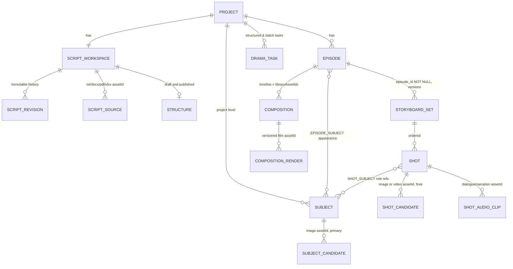

# Mio AI 漫剧工作流后端 PRD

**状态**：待评审。本文规划 Mio 后端如何承接 `miioo` 的漫剧项目工作流，覆盖项目、剧本、分集、主体、音色与认证素材绑定、分镜、分镜图/视频/配音、二次编辑及剪辑成片。D1–D6 是本期开发单元；所有新增接口均为候选，当前只交付规划，不直接改写现行规范、生产源码或数据库。任务生命周期、开发授权、候选验证和业务接受按[当前任务的生命周期](../../coordination.md#当前任务的生命周期)与[协调协议](../../coordination.md#规划交付要求)分别记录。核对基线为仓库提交 `3441367`；实施前须以目标基线复核。前端在后端迭代完成后按 Mio 新契约改造，本文不设计前端改动。[任务资料入口](../index.md) · [统一资产库 PRD](../unified-asset-library/prd.md) · [提示词底座 PRD](../prompt-runtime/prd.md)

## 用户目标与首个里程碑

登录创作者新建一个漫剧项目后，可以在 Mio 中完成完整闭环：写或上传剧本（或直接导入多集 Excel 分镜模板），通过多轮对话打磨剧本，确认为结构化草稿并发布为若干集；提取角色、场景、道具，绑定音色或 Seedance 认证素材并定稿形象图（支持单图与三视图）；按集智能分镜、跨镜自然语言改写、为镜头合成对白/旁白配音、生图或生视频、执行裁剪/重绘/选帧/视频剪辑并选定稿；最后进入多轨在线剪辑、渲染成片或导出剪映工程包。关闭页面或重新登录后，所有已保存内容、选择和在途任务均可恢复。

**首个业务验收点**保留在 D4 图文主链结束：手写剧本 → 发布 3 集 → 提取主体 → 生成角色图并定稿 → 第 1 集智能分镜 → 某个镜头生图（实际送入参考图为定稿角色图）→ 刷新后各项一致。该检查点验证核心领域状态机与图文闭环，随后无缝推进配音、D5 分镜视频与 D6 剪辑成片验收。

| 单元                | 用户得到的结果                                                                                                                                               | 直接依赖                                                    |
| ------------------- | ------------------------------------------------------------------------------------------------------------------------------------------------------------ | ----------------------------------------------------------- |
| D1 项目、分集与总览 | 新建、改名、复制、归档漫剧项目；项目信息、全局旁白音色与自定义风格；手工维护分集及单集正文；总览进度与四类只读项目资产概况                                   | Mio 认证、资产、音频音色查询、统一资产库 U1/U2/U4           |
| D2 剧本工作区       | 编辑或上传剧本，项目级多集 Excel 分镜导入与原文件下载，多轮对话创作与采纳，确认为结构化草稿，结构编辑、重拆与单集重写，发布正式分集，回到对话，历史版本恢复  | D1、对话服务、提示词底座 P1–P2、统一资产库 U1/U4            |
| D3 主体             | 按集提取角色/场景/道具；字段梳理；绑定角色音色与 Seedance 认证素材；单图/`three_view` 三视图生成、批量生成、二次图片编辑、选用/直传候选与定稿；同源历史      | D2、图片任务、音频、素材库、提示词底座 P1–P2、统一资产库 U1 |
| D4 分镜与分镜图     | 单集智能分镜（含重拆指令，覆盖即新版本），镜头编辑/排序/复制/删除，分集跨镜自然语言改写，单集 Excel 导入，镜头对白配音合成，镜头生图、二次编辑与定稿，版本库 | D3、图片任务、音频、提示词底座 P1–P2、统一资产库 U1         |
| D5 分镜视频         | 分镜单镜/批量生视频（文生、首尾帧、`@主体` 多参、Seedance 认证素材与口播同步），视频候选与定稿，首尾帧或任意秒抽帧，视频时间裁剪                             | D4、视频任务、通用媒体计算、素材库、统一资产库 U1           |
| D6 剪辑与成片       | 按集开始剪辑，多轨成片工程与素材箱保存，音频波形与预览流，服务端多轨渲染（显式画幅，每版独立入历史），按分集定稿镜头或工程导出剪映包                         | D5、通用媒体计算、统一资产库 U1                             |

## 已确认的决定

以下决定来自项目负责人的明确确认，是本 PRD 的硬约束：

1. **漫剧项目和画布项目完全分开**，各自维护独立的项目表、业务对象和业务任务/结果表，互不合并。两者仅在底层媒体与生成底座上共享[资产 API](../../apis/assets.md)、[统一资产库 PRD](../unified-asset-library/prd.md)（U1–U4）及图片/视频/音频/媒体计算服务。
2. **剧本对话走对话引擎，结构化节点走无会话提示词底座**。多轮剧本打磨复用对话服务；7 类结构化文本任务统一复用[提示词底座 PRD](../prompt-runtime/prd.md)（P1–P2），由代码确定性组装上下文，绝不依赖多轮对话历史传状态。
3. **解除已落地底座的假阻塞，纳入 D1–D6 正文契约**。通用媒体计算（`/api/v1/compute/media`）、标准音频与复刻（`/api/v1/audio/*`）、Seedance 素材库（`/api/v1/materials/*`）、异步视频生成（`/api/v1/compute/videos`）及对话 `drama-script` 上下文注入均已在仓库落地，直接在对应单元定型正式接口。
4. **只写后端，零旧脏协议兼容**：接口严格按 Mio `/api/v1/*` 规范设计，不兼容旧后端 `snake_case`、裸 URL 字段或隐式级联副作用。
5. **新模型不迁就历史孤儿形态**：旧库数据转换由[旧后端数据迁移 PRD](../legacy-migration/prd.md) 单点收敛（例如旧库 72 条无分集孤儿分镜在迁移时统一归入已有单集或新建迁移集），**本 PRD 的 `STORYBOARD_SET.episode_id` 等核心外键严格 `NOT NULL`，业务运行时零空分集兼容分支**。

## 已有能力与依据

需求输入为：`miioo` 正式前端源码与旧后端线上逻辑核查、旧库只读快照规模画像（单剧本正文最大约 170 KB / P95 约 44 KB，结构化草稿最大约 670 KB，单集正文最大约 45 KB；单项目最多 10 集、54 个主体；单集当前版本最多 119 个镜头；成片时间线最大约 8 KB）及 Mio 提交 `3441367` 已实现能力：

| 领域           | Mio 已就绪可直接复用的事实                                                                                                                                                                                                                                                                    | 漫剧域唯一负责的部分                                                                                                                                                                  |
| -------------- | --------------------------------------------------------------------------------------------------------------------------------------------------------------------------------------------------------------------------------------------------------------------------------------------- | ------------------------------------------------------------------------------------------------------------------------------------------------------------------------------------- |
| 身份与资产     | 登录 Cookie 鉴权（[认证 API](../../apis/auth.md)）；私有 COS 直传确认与 `assetId`（[资产 API](../../apis/assets.md)）；统一生成历史、我的资产、显式业务引用保护、回收站与受控解析/清单下载（[统一资产库 PRD](../unified-asset-library/prd.md) U1–U4）                                         | 按 owner 隔离项目数据；在业务写事务中单点调用资产引用同步与 U1 生成历史登记原语；提供上下文同源历史过滤与 `GET /drama-projects/{id}/overview`                                         |
| 文本与提示词   | 多轮对话 SSE、取消与 `drama-script` 3 键上下文快照注入（[对话 API](../../apis/conversations.md) · [project-context.ts](../../../src/conversations/project-context.ts)）；防注入信封、`RefTable`、`estimateTokens` 与无会话 `1+1` 修复内核（[提示词底座 PRD](../prompt-runtime/prd.md) P1–P2） | 维护 `DRAMA_TASK` 与 `baseRevision` 乐观锁结算；实现 7 类漫剧 `StructuredPromptSpec`（含分镜正文 `@[Ref]` 提及防丢校验）、长剧本按集/场切分、风格与 `three_view` 编译及双层提示词分离 |
| 图片与视频生成 | `POST /compute/images`（含 `generate`、`edit` 与路由准入校验）及 `POST /compute/videos`、`GET /compute/video-capabilities/{modelRef}`（Seedance/Kling/Vidu/HappyHorse 驱动已接入，见[计算 API](../../apis/compute.md)）                                                                       | 冻结主体/镜头参考素材与参数，分离 `displayPrompt` 与 `providerPrompt`，关联任务输出到候选记录与 U1 生成历史                                                                           |
| 音频与素材库   | 音色列表、零样本复刻与异步配音任务（[音频 API](../../apis/audio.md)）；真人活体认证与 AIGC 虚拟素材组（[素材 API](../../apis/materials.md)）                                                                                                                                                  | 维护项目旁白音色、角色 `voiceRef` 与认证 `materialId` 绑定，编排镜头对白/旁白配音生成并在分镜生视频时解析有效认证素材与口播参考音频                                                   |
| 通用媒体计算   | `POST /compute/media` 已验收 `frames.extract`（`first_last` / `timestamps`）、`video.trim`、`audio.waveform`、`video.derivatives`、`composition.render`、`subtitle.burn`（[计算成果](../compute-service/complete/report.md)）                                                                 | 主服务内部直接调用同一媒体处理应用服务承接抽帧、视频裁剪、时间轴波形与成片渲染；仅剪映工程 `.jypack/.zip` 组装在 D6 独立定义                                                          |

## 领域模型

- **项目（`PROJECT`）**：名称、描述、封面 `assetId`、画幅（`16:9 | 9:16 | 1:1`）、视觉风格（预设键值、`custom:<styleId>` 或自由风格词）、创作模式（`dialogue | narration`）、默认旁白音色 `narratorVoiceRef`（可空）、语言、备注、`revision`、状态（`active | archived`）。自定义风格 `/api/v1/visual-styles` 为用户级独立表。
- **剧本工作区（`SCRIPT_WORKSPACE`）**：阶段为 `draft | dialogue | structured | published`；含当前正文、绑定 `conversationId`、草稿 `revision`。**剧本修订（`SCRIPT_REVISION`）**不可变，`source` 区分 `manual | upload | xlsx_import | dialogue | confirm | publish | episode_snapshot | migration`。**剧本源文件（`SCRIPT_SOURCE`）**引用上传的 `.txt/.md/.docx/.pdf/.xlsx` `assetId` 与解析摘要。
- **结构化草稿（`STRUCTURE`）**：以 `mio.drama.structure.v1` 表达整体设定、剧本设计、主体提纲与分集条目（带稳定 `itemId`）；草稿与已发布快照各自维护 `revision`。
- **分集（`EPISODE`）**：集号、标题、摘要、单集正文、可选结构条目 `itemId`、状态（`draft → scripted → extracted → storyboarded → editing → edited`，单向推进；仅专用接口可进入 `editing`）与 `revision`。
- **主体（`SUBJECT`）**：项目级，类型为 `character | scene | prop`。包含名称、描述、结构化属性、用户可编辑外观事实 `displayPrompt`、服务端保留的隐藏 `artStyle` 与 `constraint`、生成配置（含 `generationMode: 'single' | 'three_view'`）；角色专属可空 `voiceRef` 与 Seedance 认证 `materialId`。分集出现关系唯一由 `EPISODE_SUBJECT` 表达。
- **分镜集与镜头（`STORYBOARD_SET` / `SHOT`）**：`STORYBOARD_SET.episode_id` 严格非空，每集唯一当前版本，重拆或导入生成新版本并保留旧版本可恢复。`SHOT` 包含镜号、排序、画面描述、五字段闭集参数（景别 `全景|中景|近景|特写`、运镜 11 项、视角 10 项、构图 9 项、整数时长 `4..15` 秒）、光影、声场描述（环境音/音效/配乐情绪）、结构化对白段落 `dialogues`、图文提示词与 `@[Ref]` 主体提及列表，以及创作面板草稿快照 `creationForm`（独立的 `videoFramePrompt` 与首尾帧/参考槽非主体 `assetId`）。
- **候选与配音片段（`SUBJECT_CANDIDATE` / `SHOT_CANDIDATE` / `SHOT_AUDIO_CLIP`）**：仅持久化 `assetId`、来源枚举（`generated | edited | project_upload | library_selected`）、关联任务/输出序号及定稿标记（主体单一定稿主图；镜头图片定稿与视频定稿各自唯一互斥），绝不持久化任何 URL。
- **成片工程与导出（`COMPOSITION` / `COMPOSITION_RENDER` / `DRAMA_EXPORT`）**：`COMPOSITION` 归属单集，含多轨 `timeline`（V1–V6、A1–A6、S1–S6）、**工程素材箱 `libraryAssetIds`**、轨道设置、字幕样式、分辨率、目标 `aspectRatio` 与 `revision`；每次成功渲染写入独立 `COMPOSITION_RENDER`（新版本绝不覆盖旧版本）；剪映工程包导出记录在 `DRAMA_EXPORT`（持有 `.zip` `assetId`）。

## 跨期接口约定

下表路径均省略 `/api/v1`。私有接口使用登录 Cookie，写请求要求允许的精确 Origin 与 JSON 正文，错误格式统一为 `{error:{code,message,requestId}}`。

1. **幂等与乐观锁**：所有创建、生成、编辑、发布、导入、复制请求均须携带客户端 UUIDv4 `requestId`（同作用域同输入重放原结果，异参返回 `409 REQUEST_CONFLICT`）；可编辑聚合根写入必须携带 `baseRevision`（过期返回 `409 REVISION_CONFLICT`）。
2. **统一资产库单点委派（零重复造轮子）**：资产归属/`ready` 核验、显式业务引用增释、生成历史去重与不可复活墓碑、受控 URL 签发及多文件清单签名**唯一由统一资产库服务层（[U1–U4](../unified-asset-library/prd.md)）单点执行**，漫剧层严禁自建重复去重表或二次校验文件尺寸。漫剧仅遵循四条固定接入规则：
   - **全量显式引用集合（共 9 处，缺一不可）**：① 项目封面 `coverAssetId`；② 剧本与分镜导入源文件 `SCRIPT_SOURCE.assetId`；③ 主体候选与参考图 `assetId`；④ 全部可恢复 `STORYBOARD_SET` 版本下的镜头候选 `assetId`；⑤ **镜头 `creationForm` 草稿槽保存的首尾帧/参考媒体 `assetId`**；⑥ 镜头配音片段 `SHOT_AUDIO_CLIP.assetId`；⑦ 剪辑草稿 `timeline` **及工程素材箱 `libraryAssetIds`**；⑧ 历次成功渲染成片 `COMPOSITION_RENDER.assetId`；⑨ 剪映导出包 `DRAMA_EXPORT.assetId`。业务写事务提交时同步增释对应业务引用；项目 `DELETE` 固定只做封存归档，继续持有全部有效引用。
   - **项目直传与选材隔离**：选用「生成历史」/「我的资产」或项目内直传均不新增生成历史；项目直传默认只留本项目（不自动入我的资产、删除不入资产回收站、沿用通用资产上限）。
   - **生成与二次编辑入历史**：主体/镜头生图、分镜生视频、镜头配音合成、抽帧、图片二次编辑保存、视频裁剪保存及成片渲染成功落盘后，单点调用 U1 历史登记接口：AI 生成传入用户可见 `displayPrompt`（配音附 `transcript`），抽帧与二次编辑固定传 `displayPrompt = null`；服务端拼装的私有入模词 `providerPrompt`、剧本/结构化纯文本及剪映 `.zip` 绝不进入生成历史。
   - **四类删除隔离与读取重签**：删除生成历史（走 U1，进 30 天回收站，绝不动漫剧定稿/候选/草稿）、移除选用媒体（仅解绑业务引用）、删除项目直传（解绑且不入回收站）、删除主体/镜头对象（解绑且历史标 `sourceDeleted = true`）严格分离；重开作品与总览预览统一调 `POST /api/v1/assets/resolve`（`dramaProjectId` 上下文），单文件与批量下载统一调 U4 `downloads/resolve` 与 `downloads/manifest`。

## 结构化任务与剧本对话

**结构化文本任务（复用提示词底座 P1–P2）**：剧本确认、重新分集、单集重写、主体提取、主体字段梳理、智能分镜、分集跨镜自然语言改写共用同一套确定性流水线：

1. **受理与出站前确定性分块**：短事务核对 `baseRevision`，冻结输入快照、`modelRef`、`ChatRuntimeSnapshot` 与 `templateVersion`（`<domain>.<action>@v<N>`），写入 `DRAMA_TASK` 返回任务 ID。超长剧本在**出站前**通过提示词底座 `estimateTokens` 确定性判定是否按集/按场切块执行——**严禁先整集盲跑失败后再 `catch` 降级分片重跑，严禁暗中替换用户选定的 `modelRef`**。
2. **组装与调用**：使用 `{ system, sharedContext?, prompt }` 与 `formatDataBlock` 隔离不可信剧本/指令，实体引用编码为提示词底座 `RefTable` 短代号（分镜正文提及在漫剧层基于 `RefTable` 编码为 `@[Ref]`）；经无会话 `executeStructuredPrompt` 单次出站（`maxRetries: 0`，默认关闭 `reasoningEffort`，无条件剥离 `thinking` 块，核对 `minOutputTokens`）。
3. **严格校验与唯一 1 次修复**：输出必须通过领域 Schema、五字段闭集枚举、`RefTable` 实体还原及漫剧层 `@[Ref]` 必留提及核验（**严禁后端对缺失/非法枚举静默填充 `?? '中景'` 等默认值**）；首轮 `stop` 校验失败最多触发 1 次修复调用，仍失败则置 `failed`，出站未明置 `unknown`（绝不重发）。
4. **乐观锁结算**：短事务核对受理时的 `baseRevision`，一致则落盘新版本，已变化则标为 `conflicted` 并保留结果不覆盖用户新编辑。

**剧本对话（复用已验收对话服务）**：每个项目工作区绑定一个 `purpose: 'drama-script'` 会话，消息、SSE 流、主动中断与取消直接走[对话 API](../../apis/conversations.md)。漫剧将项目的 `visualStyle`、`creationMode`、`aspectRatio`、分集大纲及主体/场景设定确定性编码进 [project-context.ts](../../../src/conversations/project-context.ts) 规定的 `scriptSummary`、`worldbuilding`、`characters` 三个白名单键中（由对话服务统一执行 JSON 序列化并限制在 `64 KiB` 内），只有用户显式调用采纳接口时才写入新剧本修订。

## D1 · 项目、分集与总览

**结果与非目标**：项目 CRUD、复制、封存归档；项目画风、创作模式与全局默认旁白音色 `narratorVoiceRef` 维护；用户级自定义视觉风格 CRUD；分集手工增删改及单集正文写入；单接口项目总览（含进度统计与四类只读项目资产概况）。不含团队协作、权限、积分、批注及在总览内直接增删改业务媒体的写副作用。

**C0**

- 确认漫剧业务表与资产同库不同表，共享同库短事务同步显式业务引用。
- 统一项目名称（≤50 字）、描述（≤300 字）及自定义风格字段上限。
- 固定单接口总览契约：鉴于单项目规模上限极小（≤10 集、≤54 主体、每集 ≤119 镜），**固定由 `GET /drama-projects/{id}/overview` 一次返回进度统计与四类当前采用媒体的有序引用摘要**，不再拆分 `asset-overview` 候选分页子接口。

| 接口                                                                                      | 输入、返回与副作用                                                                                                                                                   |
| ----------------------------------------------------------------------------------------- | -------------------------------------------------------------------------------------------------------------------------------------------------------------------- |
| 新增 `POST /drama-projects`、`GET /drama-projects`                                        | 创建传 `requestId` 与项目属性（含可选 `coverAssetId`、`narratorVoiceRef`、风格与模式），同事务建项目与空剧本工作区；列表按本人、搜索词与游标返回                     |
| 新增 `GET/PATCH/DELETE /drama-projects/{id}`                                              | `PATCH` 带 `baseRevision`（修改 `narratorVoiceRef` 仅更新字段，不触发后台配音任务）；`DELETE` 固定封存归档（停止新执行，继续持有全部有效媒体引用）                   |
| 新增 `POST /drama-projects/{id}/copies`、`GET /drama-operations/{operationId}`            | 异步复制项目结构与当前定稿/选用结果，媒体按 `assetId` 建立新项目独立业务引用，排除在途任务                                                                           |
| 新增 `GET /drama-projects/{id}/overview`                                                  | 只读返回分集/剧本进度、主体定稿统计及四类当前采用资产摘要：角色/场景/道具定稿、分镜当前选用图/视频（未选为空）、已采用音频及位置、全部成功导出成片版本（倒序不覆盖） |
| 新增 `GET/POST /drama-projects/{id}/episodes`、`PATCH/DELETE /drama-episodes/{episodeId}` | 手工增删改分集元数据；`DELETE` 解除该集下属对象业务引用；状态单向推进，不可绕过专用接口进入 `editing`                                                                |
| 新增 `PUT /drama-episodes/{episodeId}/script`                                             | `requestId, baseRevision, text`；供手工新建或独立维护的分集直接写入单集剧本正文，非空时推进 `draft → scripted` 以解锁主体提取与分镜                                  |
| 新增 `GET/POST /visual-styles`、`PATCH/DELETE /visual-styles/{id}`                        | 用户级自定义视觉风格（名称、风格提示词 Profile）维护                                                                                                                 |

**C1 要点**：落盘项目、分集、自定义风格存储与显式引用接缝，实现手工分集正文流转、单接口 `overview`（未落地的下游表在 D1 返回空数组，随 D3–D6 挂接真实查询）及项目复制，接入 AST 护栏。

**验收**：幂等创建与 `baseRevision` 409 冲突；手工创建分集并写入正文后成功进入 `scripted`；复制项目不复制底层物理文件且不新增生成历史；归档后退出活动列表且有效引用仍可经 `POST /api/v1/assets/resolve` 读回；核对总览 `P01–P03` 只读边界，单文件下载与多选批量下载分别走通 U4 `downloads/resolve` 与 `downloads/manifest`。

## D2 · 剧本工作区

**结果与非目标**：整稿编辑与文档上传（`.txt/.md/.docx/.pdf`）、**项目级多集 Excel 分镜模板导入与原文件下载**、`drama-script` 多轮对话与显式采纳、剧本确认解构、结构增删改排、AI 重新分集与单集重写、发布为正式分集、回到对话、不可变历史修订恢复。

**C0**

- 确定 `.txt/.md/.docx/.pdf` 与多集 `.xlsx` 分镜模板的确定性解析器、单文件及请求体字节上限（按旧库 170 KB 正文 / 670 KB 结构草稿留足余量，超限返回 `413`）。
- 冻结 `drama-script` 会话快照向 `scriptSummary / worldbuilding / characters` 3 键的确定性序列化格式（受对话服务 `64 KiB` 上限约束）。
- 冻结 `mio.drama.structure.v1` Schema 及重复发布（`publish`）按稳定 `itemId` 对齐已有分集、保留或标记下游主体/分镜的影响规则。

| 接口                                                                                            | 输入、返回与副作用                                                                                                                             |
| ----------------------------------------------------------------------------------------------- | ---------------------------------------------------------------------------------------------------------------------------------------------- |
| 新增 `GET /drama-projects/{id}/script`                                                          | 返回阶段、当前正文、草稿 `revision`、结构摘要、最新上传/导入源文件摘要（含原文件 `assetId`）、绑定 `conversationId` 与活动任务                 |
| 新增 `PUT /drama-projects/{id}/script/text`                                                     | `requestId, baseRevision, text`；写入新不可变修订（`manual`）                                                                                  |
| 新增 `POST /drama-projects/{id}/script/sources`                                                 | `requestId, baseRevision, assetId`；校验项目直传剧本文件并登记显式引用，解析正文写入新修订（`upload`）；原文件可经 U4 `downloads/resolve` 下载 |
| 新增 `POST /drama-projects/{id}/storyboard-imports`                                             | `requestId, baseRevision, assetId`；解析项目级多集 `.xlsx` 分镜模板，登记源文件引用，事务性生成/更新发布结构、正式分集与各集初始当前版本分镜   |
| 新增 `POST /drama-projects/{id}/script/dialogue`                                                | 创建或返回绑定的 `purpose: 'drama-script'` 会话；流式消息、中断与取消直接调用对话 API                                                          |
| 新增 `POST /drama-projects/{id}/script/adoptions`                                               | `requestId, baseRevision, conversationId, turnRequestId`；将指定已完成轮次正文采纳为新修订（`dialogue`）                                       |
| 新增 `POST /drama-projects/{id}/script/confirm`                                                 | `requestId, baseRevision, modelRef, episodeCount?, episodeDurationSeconds?`；结构化任务，成功后进入 `structured`                               |
| 新增 `GET/PATCH /drama-projects/{id}/script/structure`                                          | `PATCH` 带 `baseRevision` 与有序结构编辑操作列表（`add / update / remove / reorder`）                                                          |
| 新增 `POST .../script/structure/resplit`、`POST .../script/structure/items/{itemId}/regenerate` | 结构化任务，分别执行整稿重新分集或单集重写并生成新结构草稿版本                                                                                 |
| 新增 `POST /drama-projects/{id}/script/structure/publish`                                       | `requestId, baseRevision, impactPolicy`；同事务按 `itemId` 创建/更新正式 `EPISODE`（置为 `scripted`）并进入 `published`                        |
| 新增 `POST /drama-projects/{id}/script/reopen`                                                  | 解锁回到 `dialogue` 阶段，保留已发布分集                                                                                                       |
| 新增 `GET .../script/revisions`、`GET .../script/revisions/{revisionId}`、`POST .../restore`    | 剧本修订历史列表、详情与恢复（恢复写入一条新修订）                                                                                             |
| 新增 `GET /drama-projects/{id}/tasks/{taskId}`                                                  | 查询 `DRAMA_TASK` 状态、所用 `templateVersion`、观测摘要、结算结果或 `conflicted` 详情                                                         |

**C1 要点**：基于提示词底座 P1–P2 先打通 `DRAMA_TASK` 受理、出站前分块判定、`1+1` 校验修复与 `baseRevision` 结算内核，落地 `confirm / resplit / regenerate` 与结构发布，再完成文档上传、项目级 `.xlsx` 多集导入及对话采纳。

**验收**：手写或上传剧本确认解构、结构编辑乐观锁、发布 3 集对应、空项目直接导入多集 `.xlsx` 生成分集与分镜且原 `.xlsx` 可受控下载、受理后并发改稿结算为 `conflicted`、模拟 `unknown` 零重发、对话显式采纳生效且零媒体生成历史增量（`H07`）。

## D3 · 主体

**结果与非目标**：按集提取角色/场景/道具并跨集同名合并；字段与场景梗概梳理；角色绑定音色 `voiceRef` 与 Seedance 认证 `materialId`；单图与 `three_view` 三视图设定图生成、批量生成、候选图片二次编辑（客户端裁剪/翻转保存、路由已支持局部重绘/编辑）、选用/直传候选与参考图、唯一主图定稿及上下文同源历史。

**C0**

- 冻结三类主体 Schema 与三段提示词结构：抽取同时产出用户可见可编辑的外观事实 `displayPrompt`（道具禁含背景/镜头词）与服务端隐藏的 `artStyle`、`constraint`；`extract-fields` 按主体类型统一承接角色/道具属性梳理与场景梗概提取。
- 冻结 6 层私有入模提示词 `providerPrompt` 编译规则：融合项目 `visualStyle` DNA、`displayPrompt`、`constraint`、参考图保持指令、`single | three_view` 版式控制词（角色横向四栏：左特写 + 右正/侧/背纯白底全身；场景四栏无人空镜；道具纯白底孤立物）与负向护栏词；确保仅 `displayPrompt` 进入候选视图与 U1 生成历史。
- 明确角色绑定规则：更新 `voiceRef` 仅校验音色可用并写表（**严禁暗中级联重跑项目分镜配音**）；绑定 `materialId` 须核对本人 `materials` 记录为有效 `active` 状态（认证失效拦截归素材库条件单元，不影响已生成漫剧媒体）。

| 接口                                                                                                             | 输入、返回与副作用                                                                                                                           |
| ---------------------------------------------------------------------------------------------------------------- | -------------------------------------------------------------------------------------------------------------------------------------------- |
| 新增 `POST /drama-projects/{id}/script/extract-subjects`                                                         | `requestId, episodeIds, sourceRevision, modelRef`；超长分集在出站前按 `estimateTokens` 确定性切块提取并合并同名主体与 `EPISODE_SUBJECT` 关系 |
| 新增 `GET/POST /drama-projects/{id}/subjects`、`GET/PATCH/DELETE /drama-subjects/{subjectId}`、`POST .../copies` | 支持按类型/分集过滤；`PATCH` 带 `baseRevision` 更新属性、`displayPrompt`、`generationMode`、`voiceRef`（可置 `null` 解绑）或 `materialId`    |
| 新增 `POST /drama-subjects/{subjectId}/extract-fields`                                                           | 结构化任务，按主体类型从描述或绑定分集正文梳理结构化字段/场景梗概与三段提示词                                                                |
| 新增 `PUT /drama-episodes/{episodeId}/subjects`                                                                  | 显式维护本集出现的主体集合                                                                                                                   |
| 新增 `GET/POST /drama-subjects/{subjectId}/candidates`、`DELETE .../candidates/{candidateId}`                    | 登记本人选用或项目直传图片为候选并同步显式引用；`DELETE` 解绑该候选（若为定稿主图则清空定稿位，不自动暗中晋升其他候选）                      |
| 新增 `PUT/DELETE /drama-subjects/{subjectId}/primary`                                                            | 唯一互斥设置或取消当前主图定稿                                                                                                               |
| 新增 `PUT /drama-subjects/{subjectId}/references`                                                                | `assetIds, primaryAssetId?`；覆盖式维护与候选池严格隔离的主体参考图集合及显式引用                                                            |
| 新增 `POST /drama-subjects/{subjectId}/generations`、`POST /drama-projects/{id}/subject-generations`             | 单主体或批量（支持 `onlyWithoutPrimary`）生图，支持 `generationMode: 'single' \| 'three_view'`；成功输出写候选、显式引用与 U1 历史           |
| 新增 `POST /drama-subjects/{subjectId}/candidate-edits`                                                          | 基于源候选保存客户端几何裁剪/翻转图片（直传 COS 校验后登记）或提交路由已支持的模型图片编辑，追加为新候选并记一条 `displayPrompt = null` 历史 |
| 新增 `GET /drama-subjects/{subjectId}/generation-history`                                                        | 直连统一资产库 U1 主体上下文同源历史视图                                                                                                     |

**C1 要点**：先落主体、参考图、候选存储与音色/认证素材校验接缝，再实现主体抽取与 `extract-fields` 结构化 Spec，最后接入 `single | three_view` 6 层编译生图、批量生图、候选二次编辑及 D1 总览主体概况。

**验收**：3 集剧本提取同名角色合并准确；`three_view` 生图发往上游的是拼装后 `providerPrompt` 而接口响应与 U1 历史仅含 `displayPrompt`；裁剪/重绘候选保存后原候选保留且新候选产生 `displayPrompt = null` 的新历史；绑定/解绑角色 `voiceRef` 与 `materialId` 正常且零额外后台 TTS 调用；覆盖四类删除隔离判据（`L01–L02, L08–L11, L13–L14`）。

## D4 · 分镜与分镜图

**结果与非目标**：单集智能分镜与带指令重新分镜（覆盖即新版本）、单集 `.xlsx` 导入、镜头增删改排与复制、**分集级跨多镜自然语言改写（含 `@[Ref]` 防丢校验）**、创作面板草稿快照（含引用保护）、**镜头对白/旁白配音合成**、镜头生图（自动带入定稿主体图与上镜尾帧）、镜头图片二次编辑、图片定稿、多版本恢复与上下文同源历史。

**C0**

- 冻结镜头五字段闭集枚举（景别 4 项、运镜 11 项、视角 10 项、构图 9 项、时长 `4..15` 整数秒）；模型输出越界时在 `Spec.parseAndValidate` 直接报错进入单次修复，**严禁静默回退默认枚举值**。
- 冻结分集跨镜 `rework` 契约：支持 `mode: 'analyze'`（只读解析自然语言指令的目标镜号、目标字段与是否需澄清）与 `mode: 'execute'`（行锁校验 `baseRevision` 与 `@[Ref]` 必留主体提及未丢失，丢失返回 `409 STORYBOARD_REWORK_SUBJECT_REFERENCE_LOST`）。
- 明确镜头 `creationForm` 草稿槽（`videoFramePrompt` 与首尾帧/参考槽非主体 `assetId`）及全部可恢复 `STORYBOARD_SET` 版本的显式引用同步规则。

| 接口                                                                                                      | 输入、返回与副作用                                                                                                                                      |
| --------------------------------------------------------------------------------------------------------- | ------------------------------------------------------------------------------------------------------------------------------------------------------- |
| 新增 `GET /drama-episodes/{episodeId}/storyboard`                                                         | 返回当前版本及有序镜头列表（含五字段、`dialogues`、`@[Ref]` 主体引用、图片/视频当前定稿、`creationForm` 与配音片段）                                    |
| 新增 `POST /drama-episodes/{episodeId}/storyboard/generations`                                            | `requestId, modelRef, baseSetRevision?, instruction?`；智能拆镜或按用户硬性指令重新分镜，产出**新版本**并设为当前版本，推进分集至 `storyboarded`        |
| 新增 `GET .../storyboard/versions`、`POST .../storyboard/versions/{setId}/restore`                        | 查看分镜版本列表或恢复指定历史版本为当前版本（全部保留版本媒体持续受业务引用保护）                                                                      |
| 新增 `POST /drama-episodes/{episodeId}/storyboard/imports`                                                | `requestId, baseSetRevision?, assetId`；校验单集 `.xlsx` 直传文件并登记源文件引用，生成新分镜版本                                                       |
| 新增 `POST /drama-episodes/{episodeId}/shots`、`PATCH/DELETE /drama-shots/{shotId}`、`POST .../copies`    | `PATCH` 带 `baseRevision` 更新白名单字段、`dialogues` 与 `creationForm`（同步增释草稿槽 `assetId` 业务引用）；`DELETE` 解除镜头自身引用                 |
| 新增 `PUT /drama-episodes/{episodeId}/storyboard/order`                                                   | `baseRevision, shotIds`；提交当前版本完整镜头顺序                                                                                                       |
| 新增 `POST /drama-episodes/{episodeId}/storyboard/rework`                                                 | `requestId, baseSetRevision, modelRef, mode: 'analyze' \| 'execute', instruction, targetShotIds?`；分集跨镜自然语言预检或执行改写，强校验 `@[Ref]` 不丢 |
| 新增 `GET/POST /drama-shots/{shotId}/candidates`、`DELETE .../candidates/{candidateId}`                   | 登记本人图片或视频资产为镜头候选并维护显式引用；`DELETE` 解绑该候选（若为当前图片/视频定稿则清空对应定稿位）                                            |
| 新增 `PUT/DELETE /drama-shots/{shotId}/final`                                                             | 按 `mediaType: 'image' \| 'video'` 独立设置或取消该镜头的图片定稿或视频定稿（图片定稿与视频定稿互不清空）                                               |
| 新增 `POST /drama-shots/{shotId}/image-generations`、`POST /drama-episodes/{episodeId}/image-generations` | 单镜或整集（支持 `onlyWithoutFinalImage`）生图；受理时冻结定稿主体图与草稿槽参考图，分离 `displayPrompt` 与 `providerPrompt`，成功输出写候选与 U1 历史  |
| 新增 `POST /drama-shots/{shotId}/audio-generations`、`POST /drama-episodes/{episodeId}/audio-generations` | 按镜头 `dialogues`（解析说话角色 `voiceRef` 或项目 `narratorVoiceRef`）调用音频服务生成配音片段，落盘写入 `SHOT_AUDIO_CLIP`、显式引用与 U1 历史         |
| 新增 `DELETE /drama-shots/{shotId}/audios/{clipId}`                                                       | 移除指定镜头配音片段并释放其当前业务引用（不进入资产回收站，已登记生成历史保留）                                                                        |
| 新增 `POST /drama-shots/{shotId}/candidate-edits`                                                         | 对镜头图片候选执行裁剪/翻转保存或路由已支持的模型编辑，或对视频候选执行 `video.trim` 时间裁剪，追加为新候选并记一条 `displayPrompt = null` 历史         |
| 新增 `GET /drama-shots/{shotId}/generation-history`                                                       | 直连统一资产库 U1 镜头上下文同源历史视图                                                                                                                |

**C1 要点**：先落分镜集、多版本引用、镜头 `creationForm` 草稿槽引用保护与图片/视频独立定稿位，再实现智能分镜与跨镜 `rework` Spec，最后接入镜头生图、对白配音合成、二次编辑与总览分镜/音频概况。

**验收**：跑通首个业务验收点；验证重拆指令生效且新旧版本切换恢复一致；跨镜 `rework` 在模型丢掉 `@主体` 时准确拦截 `409`；`creationForm` 挂入参考图后删光历史并清空回收站，重开分镜草稿槽仍可读回；镜头配音合成与图片二次编辑正常入候选与历史；核对图片定稿与视频定稿互不覆盖及 `P01` 未选为空规则。

## D5 · 分镜视频

**结果与非目标**：分镜单镜与整集批量生视频（文生视频、首帧/尾帧/首尾帧、`@主体` 多参考、Seedance 认证素材引用及角色音画同出口型驱动）、视频候选选用/直传与定稿、首尾帧及**任意秒时间戳抽帧**、镜头视频时间裁剪（`video.trim`）。不含 Mio 视频底座已明确暂缓的“视频去字幕”与“视频超清”。

**C0**

- 对接 `/api/v1/compute/videos` 与 `/api/v1/compute/video-capabilities/{modelRef}`：受理时要求传入 `expectedCapabilitiesVersion`，按所选模式组装冻结参数（`firstFrame`、`lastFrame`、`references`、`subjects`）。
- 明确 Seedance 与口播联动规则：当镜头引用绑定了 `materialId` 的角色且路由支持认证素材时，服务端校验本地 `materialId` 归属与 `active` 状态后组装上游引用（**严禁向前端暴露上游 `supplier_asset_id`**；若预选后认证已失效，在提交前明确拦截引导重认证，普通网络错误绝不误判为认证失效）；在全能多参口播模式下自动提取镜头 `dialogues` 台词与角色参考音频拼入私有 `providerPrompt` 及音频引用，前端与 U1 历史仍仅保存 `displayPrompt`。
- 对接通用媒体计算 `frames.extract`：统一支持 `position: 'first' | 'last'`（`mode="first_last"`，仅将所选目标帧登记为候选/参考与单条历史）与 **`timestampSeconds` 任意秒选帧**（`mode="timestamps"`）。

| 接口                                                                                                      | 输入、返回与副作用                                                                                                                                      |
| --------------------------------------------------------------------------------------------------------- | ------------------------------------------------------------------------------------------------------------------------------------------------------- |
| 新增 `POST /drama-shots/{shotId}/video-generations`、`POST /drama-episodes/{episodeId}/video-generations` | `requestId, modelRef, expectedCapabilitiesVersion, parameters, onlyWithoutFinalVideo?`；冻结帧/主体/认证素材/音频快照提交视频生成，成功写候选与 U1 历史 |
| 新增 `POST /drama-shots/{shotId}/frames`、`GET .../frames/{jobId}`                                        | `requestId, candidateId, target`（`first \| last` 或 `timestampSeconds`）；复用 `frames.extract` 产出衍生图片资产，写显式引用并记 `displayPrompt=null`  |
| 复用 D4 候选、视频定稿、`candidate-edits`（`video.trim`）与同源历史接口                                   | 视频候选管理、视频定稿（与图片定稿独立并存）及基于 `video.trim` 的时间段裁剪保存新视频候选                                                              |

**C1 要点**：复用已实现的视频生成服务与通用媒体计算 `frames.extract / video.trim` 应用服务，打通单镜/批量生视频、认证素材服务端解析、任意秒抽帧转下镜首帧及总览当前视频挂接。

**验收**：在常驻开发环境用最小规格跑通首尾帧或主体参考生视频并落盘入历史；验证任意秒选帧与尾帧抽取写入下镜参考；验证 `video.trim` 产出新视频候选且原视频保留；验证认证素材提交不泄露 `supplier_asset_id`，且后续删除认证素材不影响已生成分镜视频。

## D6 · 剪辑与成片

**结果与非目标**：解锁分集进入剪辑、多轨非线性剪辑工程保存（同时保护时间线 `timeline` 与左侧**工程素材箱 `libraryAssetIds`**）、音频峰值波形与轻量预览流、视频原声分离上音频轨（`detachAudio`）、按工程目标画幅执行服务端多轨合成渲染（每版独立入历史）、支持**从分镜页按本集定稿镜头直出或从指定剪辑工程导出剪映工程包**。通用资产多选 ZIP 下载由统一资产库 U4 承接，不在本单元重复建设。

**C0**

- 对接已验收的 `composition.render`、`subtitle.burn` 与 `audio.waveform`：将工程 6 轨 `V/A/S`、倍速（`0.5..4.0`）、音量（`0..2.0`）、`visualTransform`（`contain | cover | manual`）、字幕样式、**音频轨直接引用视频 `assetId` 提取原声**（配合视频轨 `hasAudio: false`）以及工程显式指定的 **`aspectRatio`（`16:9 | 9:16 | 1:1 | auto`）** 精确映射为冻结渲染快照（若底层 `composition.render` 尚仅按首画面定画布，在接入前先为 `composition.render` 补齐显式目标画幅参数）。
- 冻结剪映工程包（`.jypack / .zip`）结构与双输入源规则：既允许传入 `compositionId` 按剪辑时间线导出，也允许在未建剪辑草稿时直接按本集已定稿镜头导出；产出的 `.zip` `assetId` 由 `DRAMA_EXPORT` 持有显式业务引用（不进入生成历史）。

| 接口                                                                                                                                | 输入、返回与副作用                                                                                                                                |
| ----------------------------------------------------------------------------------------------------------------------------------- | ------------------------------------------------------------------------------------------------------------------------------------------------- |
| 新增 `POST /drama-episodes/{episodeId}/start-edit`                                                                                  | 要求本集至少存在 1 个镜头；幂等推进 `storyboarded → editing`（已是 `editing/edited` 原样返回）                                                    |
| 新增 `GET/POST /drama-episodes/{episodeId}/compositions`、`GET/PATCH/DELETE /drama-compositions/{compositionId}`、`POST .../copies` | `PATCH` 带 `baseRevision` 保存 `{ name, resolution, aspectRatio, timeline, libraryAssetIds, trackSettings, subtitleStyle }` 并同步全量显式引用    |
| 新增 `POST /drama-projects/{id}/media-waveforms`                                                                                    | `requestId, assetId`；校验项目有效引用后复用通用媒体计算 `audio.waveform` 返回或生成音频轨所需峰值数组与时长（预览流经 `/assets/resolve` 获取）   |
| 新增 `POST /drama-compositions/{compositionId}/renders`、`GET .../renders/{renderId}`                                               | 冻结工程快照调用 `composition.render`；每次成功产出独立 `COMPOSITION_RENDER` 记录、持久引用与单条 U1 生成历史（新版本绝不覆盖旧版本）             |
| 新增 `POST /drama-episodes/{episodeId}/jianying-exports`、`GET .../jianying-exports/{exportId}`                                     | 支持按 `compositionId` 或本集定稿镜头打包生成剪映专业版工程 `.zip` 资产，登记 `DRAMA_EXPORT` 业务引用，经 U4 `downloads/resolve` 获取短期下载 URL |

**C1 要点**：先落 `start-edit` 状态守卫与包含 `libraryAssetIds` 的工程存储及引用同步，再接通波形、预览与显式画幅多轨渲染，最后落地分镜/工程双入口剪映包导出与总览成片概况挂接。

**验收**：未分镜分集 `start-edit` 返回 `409`；向素材箱导入未上轨媒体后删掉历史并清空回收站，重开剪辑台素材箱与时间线媒体均完好可读；测试 `9:16` 工程放入 `16:9` 素材及视频原声分离后渲染两版成片，核对画幅、音轨、总览倒序双版本并存与各自独立生成历史（`H08, P02`）；验证分镜页直出与工程导出剪映包均可被目标剪映版本正常导入。

## 条件触发与远期范围

以下事项不阻塞 D1–D6 主干开发与验收，仅在对应外部条件达成后按需接入：

| 事项                                                   | 触发条件与处置边界                                                                                                                     |
| ------------------------------------------------------ | -------------------------------------------------------------------------------------------------------------------------------------- |
| 特定上游未就绪视频驱动或视频模型（如 Veo、Kling 子类） | 随[视频 PRD](../onelink-video-generation/prd.md) 对应路由驱动解除 `ADAPTER_PENDING` 后自动通过 `video-capabilities` 开放，漫剧无需改表 |
| 视频类认证素材入库（`ML-09`）与失效重认证（`ML-12`）   | 随[万联素材库 PRD](../onelink-material-library/prd.md) 对应条件单元完成后接入；图片类真人/虚拟认证素材本期已可直接用于 D3/D5           |
| 模型侧扩图（`outpaint`）、视频去字幕与视频超清         | 待上游 `geometry` 协议实证或视频编辑驱动立项后开放；当前前端按路由能力元数据隐藏未开放编辑按钮，后端不预留 `501` 空桩接口              |

## 旧前端功能覆盖

| 旧功能（`/api/projects` 及相关）                                                                               | 本 PRD 处置口径                                                                                        |
| -------------------------------------------------------------------------------------------------------------- | ------------------------------------------------------------------------------------------------------ |
| 项目 CRUD、复制、总览、项目信息、封面、全局旁白音色、自定义风格                                                | D1（单接口 `overview` 统一承载统计与四类只读项目资产概况）                                             |
| 分集 CRUD、手工分集单集剧本写入、开始剪辑                                                                      | D1、D6                                                                                                 |
| 剧本工作区：对话（流式与中断）、文档上传、项目级多集 Excel 导入与原文件下载、确认、结构编辑、重拆/重写、发布等 | D2（对话沿用对话 API + 3 键 JSON 快照；纯文本与源文件不入媒体生成历史）                                |
| 旧版 `split-preview / apply-split / finalize` 历史接口                                                         | 不承接，统一由 D2 `confirm / structure / publish` 与 D1 `PUT /drama-episodes/{id}/script` 覆盖         |
| 主体：提取、CRUD、复制、字段/场景梗概梳理、`single \| three_view` 生图、批量生图、音色与认证素材绑定、二次编辑 | D3（严守 `displayPrompt / providerPrompt` 分离，更新 `voiceRef` 零隐式配音级联）                       |
| 分镜：列表、CRUD、排序、智能分镜（含指令）、单集 Excel 导入、分集跨镜 `rework`、对白配音、生图、二次编辑、定稿 | D4（`creationForm` 草稿槽纳入显式引用保护，图片与视频定稿独立并存）                                    |
| 分镜生视频（含首尾帧、`@主体` 多参、Seedance 认证素材与口播同步）、首尾帧及任意秒选帧、视频时间裁剪            | D5                                                                                                     |
| 在线剪辑工程（含 `libraryAssetIds` 素材箱）、音频波形、视频原声分离、多轨渲染、分镜/工程双入口剪映包导出       | D6                                                                                                     |
| 项目与分镜已采用媒体单文件/多选批量下载                                                                        | 直接复用[统一资产库 PRD](../unified-asset-library/prd.md#u4--添加到新画布与下载清单签名) U4 清单流式包 |
| 独立创作工作台（`CreationPage / workbench`）                                                                   | 归入待立项的轻量创作工作台 PRD                                                                         |
| 团队成员、邀请、编辑租约锁、积分、批注、快照备份、项目包导入导出                                               | 不承接（不在单人创作本期范围；存量经[旧后端数据迁移 PRD](../legacy-migration/prd.md) 离线导入）        |

## 与其他资料的关系

- **统一资产库**：与[统一资产库 PRD](../unified-asset-library/prd.md)（U1–U4）单点委派对接——漫剧维护全部 9 类业务位置的显式引用并传入 `displayPrompt` 登记有效媒体生成历史，预览与下载全走统一解析与清单签名。
- **提示词与结构化执行底座**：与[提示词底座 PRD](../prompt-runtime/prd.md)（P1–P2）分工明确——底座提供零建表的版本化规格契约、`formatDataBlock` 防注入信封、`RefTable` 闭集短代号、`estimateTokens` 及无会话 BYOK `1+1` 修复内核；漫剧保留 `DRAMA_TASK` 队列泵、7 类领域 Spec（含分镜正文 `@[Ref]` 提及防丢校验）、出站前分块编排、`/api/v1/visual-styles`、6 层风格/`three_view` 编译及 `displayPrompt / providerPrompt` 分离。
- **旧数据迁移**：由[旧后端数据迁移 PRD](../legacy-migration/prd.md) 负责把旧库数据（含无分集孤儿分镜归位）离线转换为本 PRD 的非空约束领域模型。
- **画布与技术底座**：与[画布接口承接 PRD](../canvas-integration/prd.md) 业务表完全隔离；严格遵循[技术底座 PRD](../ai-drama-foundation/prd.md) 的模块护栏与 `DESIGN-OVER-001` 规则。

## 验收环境

业务验收通过真实 HTTP 调用链执行，记录请求、任务、资产 ID、版本号及持久状态。幂等、并发冲突、故障、`@[Ref]` 丢失拦截与部分成功在常驻隔离回归通道用可控替身验证；LLM 结构化任务、图片、视频、配音、通用媒体计算与私有 COS 闭环在常驻 `mio_dev` 环境逐次执行有界最小规格真实调用并保留原件证据。[常驻环境](../../local-environments.md) · [验证与接受](../../coordination.md#验证与接受)

## 未决事项

| 事项                                                        | 影响单元 | 解决动作                                                                                                       |
| ----------------------------------------------------------- | -------- | -------------------------------------------------------------------------------------------------------------- |
| `.docx/.pdf/.xlsx` 确定性解析选型与各路由请求体精确字节上限 | D2       | D2 C0 核对轻量无外部命令注入风险的解析库，并按 170 KB 正文 / 670 KB 草稿冻结精确字节阈值                       |
| `mio.drama.structure.v1` 重发布对已有分镜的保留/归档细则    | D2/D4    | D2 C0 明确 `impactPolicy` 枚举行为（保留未删 `itemId` 下游分镜，被删分集转封存或阻断提示）                     |
| `composition.render` 显式目标 `aspectRatio` 参数核对        | D6       | D6 C0 核对[计算 API](../../apis/compute.md) 合成参数，若仅支持按首画面定画布则先小幅补齐显式目标画幅参数再接入 |
| 剪映专业版目标兼容版本号与 `.jypack` 清单字段冻结           | D6       | D6 C0 对照剪映专业版 v11.4+ 实测样本冻结 JSON 字段与 B 侧打包命令                                              |

## 开发反防御硬约束（供 D1–D6 编码实现严格遵守）

- **边界单次解析（Parse, Don't Validate）**：HTTP 请求体、路径与查询参数仅在 `src/drama/http.ts` 完成一次严格类型解析与字段白名单校验；模型原始输出仅在 `src/drama/prompts/*` 的 `Spec.parseAndValidate` 完成一次结构、五字段闭集枚举与 `@[Ref]` 还原校验。进入 `src/drama/service.ts` 与 `src/drama/store.ts` 后直接信任已收窄的强类型，禁止二次判空、重复正则校验或重复校验图片/视频路由上限（路由上限唯一由 `src/generations/` 负责）。
- **聚合根只读下传（禁自闭重查／禁深拷贝）**：外层已鉴权的 `ownerId` 及已按 owner 校验加载的 `Project / Episode / Subject / StoryboardSet` 快照通过只读参数显式下传，禁止内部辅助函数“为了保险”重复查库校验项目归属，无原地修改需求时严禁使用 `structuredClone` 或 `JSON.parse(JSON.stringify(...))` 深拷贝，严禁在统一资产库之外自建第二套历史去重表或墓碑检查。
- **快速失败与严禁静默篡改（Fail Fast）**：
  1. 分镜五字段枚举与 `4..15` 整数秒越界或缺失时必须判校验失败（走唯一 1 次修复后仍非法则直接报错），**严禁效仿旧后端用 `?? '中景'` / `?? '固定机位'` 静默塞默认值兜底**；
  2. 超长文本是否切块必须在出站前由 `estimateTokens` 确定性判定，**严禁“先整集盲跑失败后再 `catch` 降级分片重跑”、严禁超过 `1+1` 的盲目重试、严禁暗中把用户选定模型偷换为 `flash` 模型**；
  3. 严禁使用宽泛 `try/catch` 吞没数据库或下游异常返回空数组 `[]`，严禁用 `||` 覆盖合法的 `0`（如轨道静音 `volume: 0`、`offset: 0`）、`false` 或空串 `""`。
- **零无证兼容与零隐式付费副作用**：`STORYBOARD_SET.episode_id` 等必填关联严格非空，禁止编写空分集分支或兼容旧后端 `snake_case`/裸 URL 入参；`PATCH` 更新角色 `voiceRef` 或项目 `narratorVoiceRef` 仅修改配置列，**严禁在后台隐式级联触发全项目分镜付费 TTS 重跑**；候选删除时不自动暗中篡改晋升其他候选为定稿。
