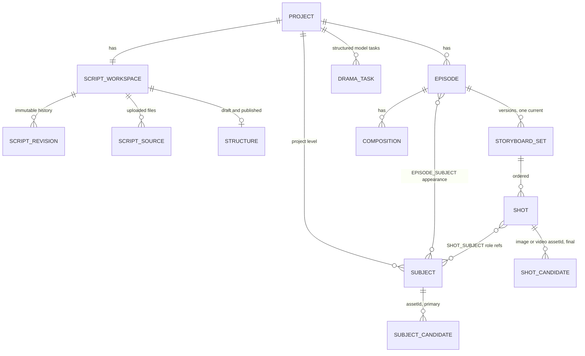

# Mio AI 漫剧工作流后端 PRD

**状态**：待评审。本文只规划 Mio 后端如何承接 `miioo` 的漫剧项目工作流，包括项目、剧本、分集、主体、分镜、分镜视频和剪辑成片。D1–D6 是本期开发单元；依赖视频或语音生成的子任务登记了进入条件，前置能力被接受后再开发。所有接口均为候选，当前只交付规划。开发授权、候选验证和业务接受按[协调协议](../../coordination.md#规划交付要求)分别记录。前端会在后端迭代完成后，由专人按 Mio 的新逻辑改造，本文不设计前端改动。[任务资料入口](../index.md)

## 用户目标与首个里程碑

登录创作者新建一个漫剧项目后，可以在 Mio 中完成以下流程：写或上传剧本，通过多轮对话打磨剧本，确认为结构化草稿并发布为若干集，提取角色、场景、道具并为它们定稿形象图，再为某一集智能分镜、为镜头生图或生视频、选定稿，最后进入剪辑、渲染成片或导出剪映工程。关闭页面或重新登录后，所有已保存的内容、选择和在途任务都能恢复。

**首个业务验收点**设在 D4 结束：手写剧本 → 发布 3 集 → 提取主体 → 生成角色图并定稿 → 第 1 集智能分镜 → 某个镜头生图，且实际送入的参考图是定稿角色图 → 刷新后各项一致。这条链路不依赖视频和语音生成，可以用现有能力真实验收。

| 单元                | 用户得到的结果                                                                                                               | 直接依赖                     |
| ------------------- | ---------------------------------------------------------------------------------------------------------------------------- | ---------------------------- |
| D1 项目、分集与总览 | 新建、打开、改名、复制、归档漫剧项目；项目信息和自定义风格；手工维护分集；总览进度                                           | Mio 登录、资产               |
| D2 剧本工作区       | 编辑或上传剧本，多轮对话创作，确认为结构化草稿，带版本编辑，重新分集或重写某集，发布为正式分集，回到对话，查看和恢复历史版本 | D1、对话服务、结构化任务机制 |
| D3 主体             | 按集提取角色、场景、道具；维护字段；上传、选择或生成候选图并定稿；批量生成                                                   | D2、图片任务                 |
| D4 分镜与分镜图     | 单集智能分镜（覆盖即新版本），编辑、排序、复制、删除，自然语言改写，Excel 导入，镜头生图（引用定稿主体图）和定稿，版本恢复   | D3、图片任务                 |
| D5 分镜视频         | 上传或选择视频作为镜头候选并定稿，抽取首尾帧作为下一镜参考；**生成视频待视频能力**                                           | D4、计算服务 B               |
| D6 剪辑与成片       | 按集开始剪辑，成片工程保存，服务端渲染，导出剪映工程包                                                                       | D5、计算服务 B               |

## 已确认的决定

以下决定来自 2026-11-22 项目负责人的明确回答，是本 PRD 的约束：

1. **漫剧项目和画布项目完全分开**，各自有自己的项目表和业务数据，互不干涉。两者只在使用用户资产时行为相同：调用同一个资产域的接口和函数（[资产 API](../../apis/assets.md)）。图片、视频等生成服务也作为下层服务共享，但漫剧与画布的结果记录不共用表或抽象。
2. **剧本对话走对话引擎**（多轮创作）。**结构化节点直接调用模型接口**，由代码组装每一步所需的上下文。
3. **D5/D6 纳入本期**。依赖尚未实现的视频生成或语音生成的子任务，等[视频 PRD](../onelink-video-generation/prd.md) 或[音频 PRD](../onelink-audio-generation/prd.md) 的对应能力被接受后再开发。
4. **只写后端**：接口按 Mio 现行规范设计，不背旧后端的协议兼容包袱，也不设计前端如何改。
5. **旧数据需要迁移**，迁移规则另立 PRD。本 PRD 的领域模型必须能承接旧库中的漫剧数据（包括 `legacy_v1` 项目和不属于任何分集的分镜），但模型按 Mio 的需求独立设计，不迁就旧表结构。旧的剧本对话消息不迁移。

## 已有能力与依据

需求输入为：miiooai.com 项目工作流逆向报告（个人资料，未入库）；`miioo` 前端 `feat/frontend_V2.0` 的 `1c1b363`，其中包括旧后端的 [OpenAPI 契约](https://github.com/miioo-aigc/miioo/blob/1c1b36339afb1f0db026d0809a3c688d285200c2/frontend/src/api/openapi.json)（`/api/projects` 下 163 个操作）；以及旧库只读快照的结构与规模画像。核对基线为 Mio `main` 的 `c00a018`。开发开始前须以目标基线重新核对。

| 领域           | 可直接依赖的事实                                                                                                                                                                                                                      | 漫剧要补的部分                                                                       |
| -------------- | ------------------------------------------------------------------------------------------------------------------------------------------------------------------------------------------------------------------------------------- | ------------------------------------------------------------------------------------ |
| 身份           | 登录 Cookie 识别可信用户；手机号验证码和微信扫码登录已有接受成果。[认证 API](../../apis/auth.md)                                                                                                                                      | 漫剧服务从装配入口注入 `Authentication.identity`，每次按 owner 条件查询              |
| 资产与 COS     | 浏览器申请上传、直传私有 COS、确认、短期下载；持久引用是 `assetId`。[资产 API](../../apis/assets.md) · [COS 契约](../../integrations/cos.md)                                                                                          | 列表与批量解析接口（与画布共用，由先开工的一方在资产域实现）；漫剧只保存对资产的引用 |
| 图片生成       | `POST /compute/images` 幂等受理、参考图 `imageAssetIds`、按序号登记输出、unknown 不重发、可恢复。[计算 API](../../apis/compute.md) · [图片成果](../onelink-image-generation/complete/report.md)                                       | 主体图和镜头图的执行记录，以及输出到候选记录的关联                                   |
| 文本与对话     | 对话服务支持用户归属、BYOK、持久回执、SSE、协作式取消；OneLink chat 路由已按平台路由白名单受控。[对话 API](../../apis/conversations.md) · [对话配置](../../conversations.md) · [对话成果](../conversation-service/complete/report.md) | 剧本对话需要漫剧专属提示词和项目上下文；结构化任务需要一个非对话的模型调用执行器     |
| 重媒体计算     | 服务 B 通过 RabbitMQ 接收固定 profile 的 `transcode.v1`，具备 ffmpeg/ffprobe 与恢复 journal。[计算协议](../compute-service/protocol.md) · [RabbitMQ](../../integrations/rabbitmq.md)                                                  | 抽帧、渲染、打包等新命令需要扩展协议                                                 |
| 素材库         | 本人素材组、同步、真人认证会话。[素材 API](../../apis/materials.md) · [素材成果](../onelink-material-library/complete/report.md)                                                                                                      | 主体绑定真人素材、Seedance 视频联动，依赖素材库后续单元和视频能力                    |
| 视频与语音生成 | 尚未启动                                                                                                                                                                                                                              | 分镜生视频、音色、配音片段：登记为被阻塞子任务                                       |

旧库规模（用于确定边界）：剧本正文最大约 170 KB（P95 约 44 KB），结构化草稿最大约 670 KB，单集正文最大约 45 KB；单项目最多 10 集、54 个主体；单集当前版本最多 119 个镜头；成片时间线最大约 8 KB。

## 领域模型

模型按 Mio 的需求设计，下面的名称和字段是候选，会在 D1 的 C0 定稿。

- **项目**：名称、描述、封面 `assetId`、画幅、视觉风格（预设、本人自定义风格引用或自由提示词）、创作模式（对白或旁白）、语言、备注、`revision`、活动或归档状态。用户自定义风格是用户级资源，单独维护。
- **剧本工作区**：阶段为 `draft`、`dialogue`、`structured`、`published` 之一；包括当前正文、绑定的对话 ID、草稿版本号。**剧本修订**一经写入不可修改，用 `source` 区分来源（manual、upload、dialogue、confirm、publish、episode_snapshot、migration）。**剧本源文件**引用 `assetId`，并保存解析出的文本。
- **结构化草稿**：用 Mio 自己的 schema 版本（例如 `mio.drama.structure.v1`）表达整体设定、剧本设计、主体提纲和分集条目；草稿和已发布内容各有 `revision`。
- **分集**：集号、标题、摘要、正文、结构条目引用和状态。状态为 `draft → scripted → extracted → storyboarded → editing → edited`，只能前进不能后退；进入剪辑只能通过专用接口，不能通过普通更新绕过。
- **主体**：一律是项目级，类型为角色、场景或道具，字段按类型校验。主体出现在哪一集，只由 `EPISODE_SUBJECT` 这一种关系表达。音色引用作为保留字段，语音能力就绪前不可用。
- **分镜**：一律属于某一集的某个 `STORYBOARD_SET` 版本，每集只有一个当前版本。重新分镜会生成新版本，旧版本可以恢复。镜头对主体的引用经 `SHOT_SUBJECT` 记录角色类型。
- **候选**：主体图和镜头图/视频都只通过候选记录引用 `assetId`，分别标记定稿。行上不直接存 URL。生成来源（执行 ID、输出序号）由服务端写入。
- **成片工程**：归属某一集，包括时间线、轨道设置、字幕样式、分辨率、画幅、`revision`；渲染结果是一个资产。
- **结构化任务**：见下一节。

领域表不带任何旧流程标记。迁移进来的项目在行为上与新建项目一致，旧来源只记录在迁移映射中。

## 跨期接口约定

下表路径均省略 `/api/v1`。私有请求使用 Mio 登录 Cookie，写请求必须带允许的精确 Origin 和 JSON 正文。owner 由服务端从会话取得；跨用户资源一律按"不可访问"处理。错误体沿用 `{error:{code,message,requestId}}`，并复用[响应原语](../../apis/index.md#运行时公共能力)。存储、COS、OneLink 和 RabbitMQ 分别遵循既有集成契约。[PostgreSQL](../../integrations/postgres.md) · [COS](../../integrations/cos.md) · [OneLink](../../integrations/onelink.md)

- **幂等与版本**：创建、生成、发布、复制、批量操作都使用客户端稳定的 UUID `requestId`。同一用户在同一作用域用相同输入重试，返回原结果；同键不同输入返回 409。可编辑资源带 `revision`，写入时传 `baseRevision`，版本过期返回 409 并告知当前版本。
- **正文上限**：当前请求读取器默认 8 KiB（认证和对话为 16 KiB，见[请求原语](../../../src/http-request.ts)）。剧本正文、结构化草稿和分镜批量写入需要按路由单独设限，上限值按旧库实际规模在 D2 的 C0 确定，超出时返回 413，原内容保持不变。
- **资产引用**：所有媒体以 `assetId` 引用，写入时经资产服务核对"本人所有且为 ready"。漫剧数据与资产位于同一媒体数据库时，可以在同一事务内核对（见 D1 的 C0）。签名地址只在读取时按需签发，不持久保存。
- **异步任务**：模型结构化任务、图片生成、B 计算任务都返回持久任务 ID。页面刷新后按 ID 查询；状态区分 accepted、running、succeeded、partial、failed、unknown。unknown 不自动重发，只能沿原身份核对。
- **总览与列表**：列表使用游标分页；总览统计与分集状态同源计算。

## 结构化任务与剧本对话

**结构化任务（直接调用模型）**：确认剧本、重新分集、重写某集、提取主体、梳理主体字段、智能分镜、自然语言改写镜头字段，都是同一种任务：

1. **受理**：短事务核对项目、工作区或分镜集的 `baseRevision`，冻结本次输入。输入包括所引用的修订、主体表快照、模型 `modelRef` 和路由快照、提示词模板版本。持久化任务意图后返回任务 ID。
2. **组装上下文**：由代码按任务类型确定性组装，不依赖对话历史。例如智能分镜只放项目设定、本集正文、本集主体表（ID、名称、要点）和分镜规范。超长剧本按集或按场景分块执行。稳定前缀放在前面，以便命中 prompt 缓存。
3. **调用**：使用用户本人的 OneLink Key 和已启用的平台路由，只提交一次。提交结果不明时进入 unknown，不自动重发。
4. **校验与修复**：输出必须符合该任务的 JSON schema，主体名称必须能对应到主体 ID。不合格时，最多针对失败字段做一次定向修复调用，这是计入任务记录的第二次显式调用。仍不合格则任务失败，不写入领域数据。
5. **结算**：在短事务中按受理时的 `baseRevision` 写入新修订或新分镜版本。基线已变化时，任务结果标记为 conflicted 并保留，不覆盖用户的新编辑。
6. **观测**：沿用对话服务的 token 与失败分类口径，不记录费用。

提示词模板以代码形式维护并带版本号，任务记录保存所用版本。

**剧本对话（对话引擎）**：每个项目工作区绑定一个由对话服务创建、归属于用户的会话，消息、SSE 事件和取消沿用[对话 API](../../apis/conversations.md)。漫剧需要对话服务提供两项扩展，在 D2 的 C0 与对话服务边界一同确定：

- 按会话用途注入专属系统提示词（剧本创作）；
- 每轮注入项目上下文（当前正文摘要、已确认设定）。

对话产出不会直接成为正式数据，只有用户明确采纳某轮回复时，才写入一个新的剧本修订。

## D1 · 项目、分集与总览

**结果与非目标**：项目的增删改查、复制、归档；项目信息自动保存；用户自定义风格；分集手工维护；总览统计。团队、成员、权限、积分、批注、备份、回收站不在范围内。

**C0**

- 确认漫剧表放在资产所在的媒体数据库（建议，和素材库同库不同表，各自持连接池），还是独立数据库。
- 确认项目名称、描述的服务端上限，并统一旧前端不一致的 50/200/30 字规则。
- 确认"删除"按归档处理（退出活动列表、停止新执行、保留数据），物理删除另行定义。
- 确认复制项目的范围。建议复制结构和当前定稿结果，资产只增加引用、不复制文件，排除在途任务。

| 接口                                                                                      | 输入、返回与副作用                                                                          |
| ----------------------------------------------------------------------------------------- | ------------------------------------------------------------------------------------------- |
| 新增 `POST /drama-projects`、`GET /drama-projects`                                        | 创建传 `requestId` 和项目字段，同一事务建立项目和空剧本工作区；列表按本人、搜索词、游标返回 |
| 新增 `GET/PATCH/DELETE /drama-projects/{id}`                                              | 详情包括 `revision`；PATCH 带 `baseRevision`；DELETE 为归档                                 |
| 新增 `POST /drama-projects/{id}/copies`、`GET /drama-operations/{operationId}`            | 复制受理后返回操作 ID，完成时给出新项目 ID；同键重试返回原操作                              |
| 新增 `GET /drama-projects/{id}/overview`                                                  | 各集状态，以及角色、场景、道具的"定稿数/总数"，与分集同源                                   |
| 新增 `GET/POST /drama-projects/{id}/episodes`、`PATCH/DELETE /drama-episodes/{episodeId}` | 手工增删改分集；状态只能前进；进入剪辑不能经此接口                                          |
| 新增 `GET/POST /visual-styles`、`PATCH/DELETE /visual-styles/{id}`                        | 用户级自定义风格（名称、提示词、颜色）                                                      |

**C1 要点**：先建项目和分集的存储、服务、HTTP 三层并接入装配入口，再做总览与复制。新模块进入护栏的 AST 边界和源码覆盖。

**验收**：模拟创建响应丢失后用同一 `requestId` 重试，只得到原项目；两个标签页基于同一版本修改，后到的一方得到 409；另一个账号读写返回不可访问；复制后修改副本不影响原项目，资产引用数量正确、文件未被复制；归档后项目退出列表，已受理的任务仍可查询。

## D2 · 剧本工作区

**结果与非目标**：正文编辑与上传、多轮对话、确认、结构编辑、重新分集、重写某集、发布、回到对话、历史版本。剧本格式质量的人工评估不在范围内。

**C0**

- 确定可上传的剧本格式（txt、docx、pdf 等）和解析库，以及解析失败的处理方式。
- 按旧库规模确定正文、结构化草稿的请求上限（见上文）。
- 与对话服务确定"会话用途提示词 + 项目上下文注入"的扩展边界；它影响对话服务的公共契约，须在对话服务一侧同步规范。
- 定义 `mio.drama.structure.v1` 的 schema，以及发布时"已有下游数据"的影响策略：发布后新增、删减、改动的集，如何处理已有主体关系和分镜。
- 为确认、重新分集、重写各选定一个可验收的 chat 路由。

| 接口                                                                                            | 输入、返回与副作用                                                                                                   |
| ----------------------------------------------------------------------------------------------- | -------------------------------------------------------------------------------------------------------------------- |
| 新增 `GET /drama-projects/{id}/script`                                                          | 阶段、当前正文、草稿版本、结构摘要、绑定的会话 ID、可用动作                                                          |
| 新增 `PUT /drama-projects/{id}/script/text`                                                     | `requestId, baseRevision, text`；写入新修订（manual）                                                                |
| 新增 `POST /drama-projects/{id}/script/sources`                                                 | `requestId, assetId`；登记本人已上传的剧本文件并解析，写入新修订（upload）                                           |
| 新增 `POST /drama-projects/{id}/script/dialogue`                                                | 为工作区创建或返回绑定的会话；之后的消息、事件、取消直接使用对话 API                                                 |
| 新增 `POST /drama-projects/{id}/script/adoptions`                                               | `requestId, baseRevision, conversationId, turnRequestId`；把指定轮次的回复采纳为新修订（dialogue）                   |
| 新增 `POST /drama-projects/{id}/script/confirm`                                                 | `requestId, baseRevision, modelRef, episodeCount?, episodeDurationSeconds?`；受理结构化任务，成功后进入 `structured` |
| 新增 `GET/PATCH /drama-projects/{id}/script/structure`                                          | PATCH 传 `baseRevision` 和有序操作列表（增删改、移动条目）                                                           |
| 新增 `POST .../script/structure/resplit`、`POST .../script/structure/items/{itemId}/regenerate` | 结构化任务；结果写入新的草稿版本                                                                                     |
| 新增 `POST /drama-projects/{id}/script/structure/publish`                                       | `requestId, baseRevision, impactPolicy`；在同一事务中生成或更新正式分集，进入 `published`                            |
| 新增 `POST /drama-projects/{id}/script/reopen`                                                  | 回到对话阶段，已发布的分集保留                                                                                       |
| 新增 `GET .../script/revisions`、`GET .../script/revisions/{revisionId}`、`POST .../restore`    | 历史版本列表、详情、恢复（恢复本身也写入一个新修订）                                                                 |
| 新增 `GET /drama-projects/{id}/tasks/{taskId}`                                                  | 结构化任务状态、所用模板版本、结算结果或冲突                                                                         |

**C1 要点**：先实现结构化任务执行器（受理、组装、单次调用、校验修复、结算、恢复），用确认剧本作为首个消费者。之后依次做结构编辑、发布、重新分集和重写，最后做对话扩展与采纳。

**验收**：手写剧本后确认，得到结构化草稿；编辑结构时用旧版本提交得到 409；发布 3 集后，分集与草稿条目一一对应；受理后再修改正文，任务结算为 conflicted，用户的新修改保留；模拟提交结果不明，任务停留在 unknown，供应商调用次数不增加；在对话中采纳某轮回复，生成一条新修订，未采纳的回复不进入正文；恢复旧版本后历史完整。真实模型调用使用常驻开发环境的有界最小规格。

## D3 · 主体

**结果与非目标**：提取、维护、候选图、定稿、参考图、批量生成。音色绑定和真人素材绑定是被阻塞子任务。

**C0**

- 确定各类型主体的字段 schema。
- 确定提取任务的去重规则：同名主体合并为一个，同时记录它出现在哪些集。
- 确定批量生成的上限与并发，以及"仅生成未定稿"的语义。
- 为主体图选定一个图片路由；需要参考图时选支持参考图的路由。

| 接口                                                                                                             | 输入、返回与副作用                                                                                             |
| ---------------------------------------------------------------------------------------------------------------- | -------------------------------------------------------------------------------------------------------------- |
| 新增 `POST /drama-projects/{id}/script/extract-subjects`                                                         | `requestId, episodeIds, sourceRevision, modelRef`；结构化任务，结算为主体及出现关系                            |
| 新增 `GET/POST /drama-projects/{id}/subjects`、`GET/PATCH/DELETE /drama-subjects/{subjectId}`、`POST .../copies` | 按类型、分集、游标列出；PATCH 带 `baseRevision`                                                                |
| 新增 `POST /drama-subjects/{subjectId}/extract-fields`                                                           | 结构化任务，梳理主体字段                                                                                       |
| 新增 `PUT /drama-episodes/{episodeId}/subjects`                                                                  | 维护本集出现的主体                                                                                             |
| 新增 `GET/POST /drama-subjects/{subjectId}/candidates`、`DELETE .../candidates/{candidateId}`                    | 把本人 ready 的图片资产登记为候选（覆盖上传和从资产库选择两种来源）                                            |
| 新增 `POST /drama-subjects/{subjectId}/generations`                                                              | `requestId, modelRef, parameters`；内部复用图片任务服务，输出按序号登记为候选                                  |
| 新增 `PUT/DELETE /drama-subjects/{subjectId}/primary`                                                            | 设置或取消定稿候选                                                                                             |
| 新增 `PUT /drama-subjects/{subjectId}/references`                                                                | `assetIds, primaryAssetId`；绑定参考图                                                                         |
| 新增 `POST /drama-projects/{id}/subject-generations`                                                             | 批量：`requestId, subjectIds, modelRef, parameters, onlyWithoutPrimary`；返回操作 ID，每个主体对应一个图片任务 |

**C1 要点**：先做主体与候选存储，再做提取任务，然后做单个生成（关联图片任务输出），最后做批量。

**验收**：从 3 集剧本提取主体，同名主体合并且出现关系正确；生成角色图后，刷新可以看到候选并定稿；同一 `requestId` 重试只有一个图片任务；批量生成部分失败时，成功的候选保留，失败项可以单独重试；另一个账号不能操作该主体。

## D4 · 分镜与分镜图

**结果与非目标**：智能分镜、编辑、排序、复制、删除、自然语言改写、Excel 导入、镜头生图与定稿、版本恢复。生成视频不在本单元。

**C0**

- 确定镜头字段 schema，以及台词、主体引用、提示词提及（mentions）的结构。
- 确定 Excel 导入模板与校验规则。
- 确定镜头生图时自动附带的参考图规则（定稿主体图、上一镜尾帧）和数量上限，须符合路由的参考图上限。
- 确定批量生图"仅未定稿"的语义。

| 接口                                                                                                      | 输入、返回与副作用                                                                                                    |
| --------------------------------------------------------------------------------------------------------- | --------------------------------------------------------------------------------------------------------------------- |
| 新增 `GET /drama-episodes/{episodeId}/storyboard`                                                         | 当前版本及镜头，游标分页，可选附带生成参数                                                                            |
| 新增 `POST /drama-episodes/{episodeId}/storyboard/generations`                                            | `requestId, modelRef, baseSetRevision?`；结构化任务，结果写成**新版本**并设为当前版本（"覆盖"即新版本，旧版本可恢复） |
| 新增 `GET .../storyboard/versions`、`POST .../storyboard/versions/{setId}/restore`                        | 版本列表与恢复                                                                                                        |
| 新增 `POST /drama-episodes/{episodeId}/storyboard/imports`                                                | `requestId, assetId`（xlsx）；校验后生成新版本                                                                        |
| 新增 `POST /drama-episodes/{episodeId}/shots`、`PATCH/DELETE /drama-shots/{shotId}`、`POST .../copies`    | PATCH 只接受字段白名单，带 `baseRevision`                                                                             |
| 新增 `PUT /drama-episodes/{episodeId}/storyboard/order`                                                   | `baseRevision, shotIds`，提交完整顺序                                                                                 |
| 新增 `POST /drama-shots/{shotId}/rework`                                                                  | 自然语言改写单个字段，结构化任务                                                                                      |
| 新增 `GET/POST /drama-shots/{shotId}/candidates`、`PUT /drama-shots/{shotId}/final`                       | 登记本人图片或视频资产为候选；分别设置图片定稿和视频定稿                                                              |
| 新增 `POST /drama-shots/{shotId}/image-generations`、`POST /drama-episodes/{episodeId}/image-generations` | 单个或批量生图，受理时冻结参考图                                                                                      |

**C1 要点**：先做分镜集与镜头存储，然后依次做智能分镜任务、编辑排序、生图（复用图片任务），最后做导入和改写。

**验收**：即首个业务验收点。另需覆盖：再次智能分镜生成新版本，恢复旧版本后镜头和定稿一致；镜头生图受理后修改主体定稿，本次已冻结的参考图不变；批量生图部分成功时保留原序号；排序用旧版本提交得到 409。

## D5 · 分镜视频

**结果与非目标**：本期先交付不依赖视频生成的部分，包括视频候选（上传或从资产库选择）、视频定稿、抽取首尾帧作为下一镜参考。**分镜生成视频**和 **Seedance 真人素材参考**是被阻塞子任务。

**C0**

- 在计算协议中新增抽帧命令（例如 `frame.v1`）：确定输入（本人视频资产的冻结键和 ETag）、输出（图片资产）和恢复语义；这会改变计算协议契约。
- 确定视频候选可接受的格式与大小（沿资产 1 GiB 上限）。

| 接口                                            | 输入、返回与副作用                                                                                       |
| ----------------------------------------------- | -------------------------------------------------------------------------------------------------------- |
| 复用 D4 的候选与定稿接口                        | 视频资产作为候选，分别设置定稿                                                                           |
| 新增 `POST /drama-shots/{shotId}/frames`        | `requestId, candidateId, position: first\|last`；受理 B 抽帧任务，结果登记为该镜头或下一镜头的参考图资产 |
| 新增 `GET /drama-shots/{shotId}/frames/{jobId}` | 抽帧任务状态与结果资产                                                                                   |

**C1 要点**：先扩展 A→B 命令与 B 的抽帧适配器（复用 ffmpeg 与 journal 恢复），再接漫剧接口。

**验收**：上传视频并定稿，抽取尾帧并作为下一镜生图的参考图，实际送入的参考图字节与抽帧结果一致；B 在抽帧过程中重启后按原身份恢复，不重复登记。

## D6 · 剪辑与成片

**结果与非目标**：开始剪辑、成片工程、服务端渲染、剪映导出。以上都能用已上传的视频、图片、音频真实验收。自动配音、配音片段是被阻塞子任务。

**C0**

- 定义渲染命令（例如 `render.v1`）的时间线子集：视频、图片、音频、字幕轨，裁剪、倍速、音量、视觉变换。确定字幕烧录范围：SRT 完整支持，ASS 只支持声明的子集。确定输出规格和时长上限；这会改变计算协议契约。
- 确定剪映工程包的目标版本和打包方式（由 A 生成草稿 JSON，B 打包媒体）。
- 确定成片工程与分集状态的关系：进入剪辑只写 `editing`；"完成"的判定沿用产品规则，渲染或导出成功本身不自动等于完成。

| 接口                                                                                                                                | 输入、返回与副作用                                                                                       |
| ----------------------------------------------------------------------------------------------------------------------------------- | -------------------------------------------------------------------------------------------------------- |
| 新增 `POST /drama-episodes/{episodeId}/start-edit`                                                                                  | 前置条件为本集已分镜；幂等地推进 `storyboarded → editing`，已是 editing 或 edited 则原样返回；不创建工程 |
| 新增 `GET/POST /drama-episodes/{episodeId}/compositions`、`GET/PATCH/DELETE /drama-compositions/{compositionId}`、`POST .../copies` | 工程归属本集；PATCH 带 `baseRevision`；时间线只引用本人 ready 资产                                       |
| 新增 `POST /drama-compositions/{compositionId}/renders`、`GET .../renders/{renderId}`                                               | 冻结当时的工程版本与资产快照，受理 B 渲染任务，成功后结果是一个资产                                      |
| 新增 `POST /drama-episodes/{episodeId}/jianying-exports`、`GET .../jianying-exports/{exportId}`                                     | 导出剪映工程包，结果是一个 zip 资产                                                                      |

**C1 要点**：先做开始剪辑和工程存储，然后做 B 渲染命令与适配器，最后做剪映导出。

**验收**：未分镜的集开始剪辑返回 409；重复开始剪辑不重复推进、不降级；保存工程时用旧版本提交得到 409；用上传的两段视频、一段音频和 SRT 字幕渲染成片，可以下载、解码，时长和轨道符合时间线；渲染期间 B 重启后按原身份恢复；剪映包可以被目标版本的剪映打开（人工观察）。

## 被阻塞子任务与进入条件

这些子任务现在不建执行记录。前置能力被接受后，在对应单元内细化 C0 再实施。

| 子任务                                                               | 所属单元 | 进入条件                                                                                |
| -------------------------------------------------------------------- | -------- | --------------------------------------------------------------------------------------- |
| 分镜生成视频（文生、首尾帧、主体参考、多镜头等按模式逐项）           | D5       | [视频 PRD](../onelink-video-generation/prd.md) 的对应模式被接受                         |
| Seedance 真人素材作为视频参考、主体绑定真人素材、AIGC 素材库同步主体 | D3/D5    | 视频模式被接受，且[素材库 PRD](../onelink-material-library/prd.md) 的视频联动单元被接受 |
| 主体绑定音色、项目音色设置                                           | D3/D1    | [音频 PRD](../onelink-audio-generation/prd.md) 的音色查询被接受                         |
| 旁白、台词配音片段，按分镜生成旁白                                   | D6       | 音频 PRD 的 TTS 被接受                                                                  |
| 项目资产或分镜资源打包下载                                           | D6 之后  | 打包命令随剪映导出一并验证后再开放                                                      |

## 旧前端功能覆盖

本表是需求来源核对，不是前端设计：保证将来前端改造时，所需数据和接口都已具备或明确置后。

| 旧功能（`/api/projects` 及相关）                                                                                                                | 处置                                     |
| ----------------------------------------------------------------------------------------------------------------------------------------------- | ---------------------------------------- |
| 项目 CRUD、复制、总览、项目信息、封面、自定义风格                                                                                               | D1                                       |
| 分集 CRUD、开始剪辑                                                                                                                             | D1、D6                                   |
| 剧本工作区：对话（含流式与中断）、上传、确认、结构编辑、重新分集、重写、发布、回到对话、任务查询、历史版本                                      | D2（对话消息与事件沿用对话 API）         |
| 旧版拆分预览/应用拆分/定稿（finalize）兼容路径、单集剧本同步或流式生成                                                                          | 不单独承接，由 D2 的确认、发布和重写覆盖 |
| 主体：提取、CRUD、复制、字段梳理、场景梗概、候选图、上传、从资产选择、生成、批量生成、定稿、参考图、下载                                        | D3（下载走资产短期地址）                 |
| 分镜：列表、CRUD、排序、智能分镜、从定稿剧本生成首集、Excel 导入、自然语言改写、单字段更新、生图、上传图/视频、候选与定稿、版本历史与恢复、下载 | D4/D5                                    |
| 分镜生视频                                                                                                                                      | 被阻塞（视频）                           |
| 成片工程、渲染、剪映导出                                                                                                                        | D6                                       |
| 配音片段、音色设置、视频片段                                                                                                                    | 被阻塞（音频/视频）                      |
| 项目资产打包下载、分镜资源包                                                                                                                    | 被阻塞（打包命令）                       |
| 工作台图片（`workbench`）                                                                                                                       | 归入待立项的创作模块 PRD                 |
| 成员、邀请、分集授权、编辑锁、积分、快照、批注、备份、回收站、审计日志、工作流审批                                                              | 不承接（团队协作不在当前范围）           |
| 项目包导入导出（`package/export`、`package/import`）                                                                                            | 不承接，旧数据经迁移 PRD 转入            |

## 与其他资料的关系

- **旧数据迁移**：另立迁移 PRD，负责把旧库漫剧数据转换为本 PRD 的领域模型。本 PRD 的各单元在设计存储时，须保留迁移所需的稳定 ID 和写入入口，但不在领域表中加旧流程标记。迁移切换要求漫剧、画布和创作模块都已完成。
- **画布**：画布接口承接 PRD 在独立评审分支上维护。两者共享资产域和下层生成服务；资产列表与批量解析接口由先开工的一方在资产域实现，另一方复用。
- **技术底座**：沿用[技术底座 PRD](../ai-drama-foundation/prd.md) 的分层、护栏和 DESIGN-OVER-001 规则；本 PRD 不改写其已接受成果。

## 验收环境

业务验收通过 HTTP 调用链（脚本或 API 场景）执行，记录请求、任务、资产 ID、版本以及操作前后的持久状态。重复提交、并发、故障和部分成功优先在隔离回归通道用可控替身验证；模型、图片和 COS 的业务闭环在常驻开发环境逐次执行有界最小规格调用，保留请求身份、实际产物与结论。[常驻环境](../../local-environments.md) · [验证与接受](../../coordination.md#验证与接受)

各单元的接受条件：该单元的接口链路跑通；适用的归属、冲突、幂等、恢复场景通过；持久数据与接口返回一致。单元通过只承认该单元。被阻塞子任务不影响其所属单元其余部分的接受。

## 未决事项

| 事项                             | 影响                            | 解决动作                         |
| -------------------------------- | ------------------------------- | -------------------------------- |
| 漫剧表的数据库位置               | D1 存储与事务边界               | D1 的 C0 决定，建议与资产同库    |
| 对话服务的会话用途和上下文注入   | D2 对话部分及对话服务的公共契约 | D2 的 C0 与对话服务边界一同确定  |
| 剧本上传格式与解析库             | D2 上传                         | D2 的 C0                         |
| 结构化 schema 与发布影响策略     | D2/D3/D4 数据一致性             | D2 的 C0                         |
| 计算协议新增抽帧、渲染、打包命令 | D5/D6，以及计算协议契约         | 各单元 C0 分别设计并同步协议规范 |
| 分集"完成"（edited）的判定规则   | D6 分集状态                     | D6 的 C0 按产品规则确认          |
