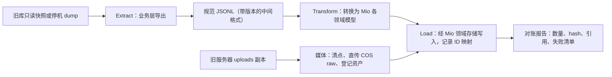

# 旧后端数据迁移 PRD

**状态**：待评审。本文规划如何把旧后端（miiooai.com，Python/FastAPI）的生产数据一次性迁入 Mio，包括账号、OneLink Key、媒体文件、漫剧项目、真人素材、画布和创作数据。本文只交付规划，不执行任何迁移。各单元的开发授权、候选验证和业务接受按[协调协议](../../coordination.md#规划交付要求)分别记录。[任务资料入口](../index.md) · [统一资产库 PRD](../unified-asset-library/prd.md)

## 目标与切换方式

旧用户在 Mio 上线后，用原来的手机号验证码或微信扫码登录，就能看到并继续使用自己原有的项目、资产、素材和 OneLink 配置。服务器不再保存任何用户文件，所有文件都存放在 Mio 私有 COS。

- **一次停机切换（方案 A）**：等漫剧、画布、创作三个模块在 Mio 都完成后，生产环境停机一次，迁移所有数据，然后切到 Mio。停机期间不会产生新任务，所以在途任务、未完成的上传等不需要处理。
- **演练与正式执行用同一套脚本**：开发与演练使用旧库只读快照；正式切换时，停机后重新导出一份 dump，跑同一套脚本。脚本必须可以重复运行。
- **回退**：切换验收通过前，旧系统和旧数据保持原样（只读），Mio 侧的迁移结果可以清空重跑。

## 已确认的决定

以下决定来自 2026-11-22 及 2026-11-23 项目负责人的明确回答：

| 主题                 | 决定                                                                                                                                                                                                                                                                                                                                                                                                                     |
| -------------------- | ------------------------------------------------------------------------------------------------------------------------------------------------------------------------------------------------------------------------------------------------------------------------------------------------------------------------------------------------------------------------------------------------------------------------ |
| 登录方式             | Mio 只开放手机号验证码和微信扫码；**邮箱密码登录用配置关闭**；旧密码不迁移                                                                                                                                                                                                                                                                                                                                               |
| 账号认领             | **能收到该手机号验证码的人就是账号主人**，包括旧"手机号+密码"注册、手机号未经短信验证的账号                                                                                                                                                                                                                                                                                                                              |
| 微信                 | 新旧网站应用的 **AppID 相同**，旧 openid 可以直接对应 Mio 的微信账号身份                                                                                                                                                                                                                                                                                                                                                 |
| 特殊账号             | 打码手机号账号和停用账号**全部迁移**；原本停用的设为禁用                                                                                                                                                                                                                                                                                                                                                                 |
| OneLink Key          | **迁移**，保证旧用户可以直接使用；迁移后为每个用户调用一次 OneLink 目录查询；一人有多条 OneLink 配置时取"启用且最近测试过"的那条；非 OneLink 供应商配置丢弃                                                                                                                                                                                                                                                              |
| 业务数据             | 旧库业务数据**完整迁移**：漫剧项目（包括 legacy_v1、版本历史、剧本源文件）、真人素材、画布、创作模块；旧线上资产按 2026-11-23 确认的新版[统一资产库 PRD](../unified-asset-library/prd.md#9-存量归位边界)逻辑**各归各位**（可确认生成结果入统一生成历史、项目/画布直传留原业务引用、老用户「我的资产」初始为空库）                                                                                                        |
| 不迁移               | 用户发起的 LLM 对话记录（剧本工作区的对话消息和轮次、旧 Agent 对话）；在途任务；团队、积分、批注、备份、旧回收站；通知；存储订阅与配额；旧模型配置 `model_configs`；管理员标记；旧资产分类入口壳子、旧列表星标（`is_favorite` / `is_starred`）与旧隐藏画布目录壳子；已软删除且无任何有效引用的物理文件（但**旧库中曾被删除的生成结果必须迁移最小不可复活去重墓碑或等价删除标识，严防迁移重跑或对账令已删生成历史复活**） |
| 音色                 | 主体绑定的音色和项目音色设置作为保留字段迁移，音频能力就绪后启用                                                                                                                                                                                                                                                                                                                                                         |
| 风格与资料           | 自定义风格、昵称、头像、`display_id` 迁移                                                                                                                                                                                                                                                                                                                                                                                |
| 不属于任何分集的分镜 | 项目只有 1 集时挂到这一集；有多集时新建一集"未归属分镜（迁移）"来放置，由用户自己处理                                                                                                                                                                                                                                                                                                                                    |
| 新模型               | Mio 各模块按自己的需求设计，**不迁就旧表结构**；迁移只是一个从旧数据形态到新模型的转换器。旧线上资产不搬旧分类入口壳子、不为旧隐藏画布目录专门构建兼容网盘，全部按新版[统一资产库 PRD](../unified-asset-library/prd.md#9-存量归位边界)逻辑各归各位                                                                                                                                                                       |

这些决定替代了认证扩展方案中"不迁移旧用户与资产"的旧结论（见[认证扩展方案](../ai-drama-foundation/pending/auth-extension.md)和[手机号与微信变更](../ai-drama-foundation/changes/phone-wechat-auth/change.md)）。对应的认证调整另行登记，不改写既有接受事实。

## 源数据画像

数据来自旧库只读快照（2026-11 导出，Alembic 版本 `zz_storage_free_personal_10gb_01`，旧后端代码基线 `a73df40`），只统计了结构和数量。

| 领域       | 规模与关键事实                                                                                                                                                                                                |
| ---------- | ------------------------------------------------------------------------------------------------------------------------------------------------------------------------------------------------------------- |
| 用户       | 143 个，其中 9 个停用、46 个绑定微信；141 个是标准 11 位手机号，2 个手机号被打码；71 个用户没有项目也没有资产                                                                                                 |
| 供应商配置 | 70 条，全部可以用生产密钥解密（只做了计数校验）；OneLink 63 条对应 62 人，全部指向 `api.onelinkai.cloud`                                                                                                      |
| 项目       | 109 个：video 101 个（dialogue_v2 84、legacy_v1 17）、canvas 7 个、无类型 1 个；都没有团队                                                                                                                    |
| 漫剧数据   | 剧本工作区 95（其中 24 个带已上传的剧本文件，`project_script_sources` 表为空）、剧本历史 210、分集 131、主体 728、主体图 313、分镜 783（其中非当前版本 102）、分镜版本 55、分镜候选 120、成片 6、配音片段 158 |
| 媒体       | 资产 8285 条对应 8176 个存储对象，约 30 GB，单个最大 90 MB；200 个对象被多条资产共用。**文件以旧服务器本地 `uploads/` 为准**：`storage_bucket` 全为空，COS 镜像从 2026-10 才开始且不完整                      |
| 真人素材   | 102 个组（AIGC 92、真人认证 10）、311 个素材（其中 6 个是视频），都有远端 ID                                                                                                                                  |
| 创作模块   | 独立会话 337 个、镜头 3172 个，以及对应的生成任务结果                                                                                                                                                         |
| 画布       | 7 个项目、9 份文档，另有画布资产库和生成历史                                                                                                                                                                  |

**时间语义**：旧库时间列是不带时区的 `timestamp`，连接时区为 `Asia/Shanghai`，但代码中混用了 `utcnow()`（74 处）、带时区写法（43 处）和数据库 `now()`。同一类列里可能混有北京时间和 UTC，需要逐列确定换算规则。

## 迁移架构

- **Extract（业务层导出）**：对只读快照运行导出程序，借用旧后端自己的 ORM 模型把数据序列化为规范 JSONL。这样不受数据库物理类型影响，也能拿到 HTTP 接口不暴露的内部字段（例如 openid、修订号）。不调用旧 HTTP 接口：旧接口只能读本人数据，也缺少内部字段。
- **规范 JSONL**：每个聚合（用户、项目、素材组等）一类文件，带格式版本号。类型规则统一：时间转为带时区的 ISO8601，枚举按显式表映射，JSON 列按版本校验，ID 保持原 UUID 小写形式。**密文原样导出**，不在导出阶段解密。
- **Transform**：纯函数，把规范记录转换为 Mio 各领域的写入请求。所有语义规则（状态映射、合成结构、分集归属等）都集中在这里，并有单元测试。
- **Load**：通过 Mio 各领域的存储层写入，复用各领域的约束校验，不直接拼 SQL 绕过领域规则。每条写入记录"旧 ID → Mio ID"映射和输入摘要；重复运行时，映射已存在且摘要一致就跳过，摘要不一致则报告冲突。
- **对账**：每次运行输出报告，包括按领域的数量对比、文件 hash 校验、引用完整性、跳过与失败清单。报告里不包含手机号、密钥、openid 原值。

## 各领域转换规则

### 账号与认证

| 旧数据                                 | Mio                                                                            |
| -------------------------------------- | ------------------------------------------------------------------------------ |
| `users.id`                             | 保留为 Mio `userId`；冲突时进入映射                                            |
| `phone`                                | 转为 E.164（`+86…`），作为已验证手机号登录身份；2 个打码手机号不写入手机号身份 |
| `wechat_openid`                        | 写入微信账号关联，身份规则与 Mio 现有实现一致（AppID + openid）                |
| `nickname`、`avatar_url`、`display_id` | 写入用户资料；头像文件按媒体流程转为资产                                       |
| `is_active=false`                      | 设为禁用：不能登录，已有会话失效                                               |
| `password_hash`、`is_admin`、旧会话    | 不迁移                                                                         |
| 邮箱                                   | Mio 底层要求 email 字段，迁移用户使用手机号认证已有的占位邮箱保留域            |

**依赖的认证调整**（另行登记，迁移的前置条件）：

1. 邮箱密码登录的配置开关（目前在[认证配置](../../../src/auth/config.ts)中写死为开启）；
2. 账号禁用能力（Mio 目前没有）；
3. 用户资料承载 `display_id` 和头像资产。

### OneLink 配置

- 每个用户只迁移一条 OneLink 配置（一人多条时取"启用且最近测试过"的那条），保留启用状态和默认图片、视频水印。
- **密钥处理**：Load 进程在内存中用旧 `ENCRYPTION_KEY`（AES-GCM）解密，立即用 Mio 的 provider master key 按[供应商规范](../../providers.md)重新加密写入，凭据版本从 1 开始。旧密钥只通过受保护的环境变量注入，不进入仓库、数据库、规范 JSONL、日志或报告。
- **目录发现**：Load 完成后，为每个用户调用一次 OneLink `/v1/models`（免费目录查询），有界并发，不自动重试。被拒绝的 Key 保留密文并标记为不可用，写入报告。
- 非 OneLink 配置（7 条）和 `model_configs` 不迁移。

### 媒体与资产

原则：`uploads/` 只作为一次性迁移来源，Mio 运行时不读写本地文件。每个旧文件都变成一个普通 Mio 资产，后续的下载、参考图、视觉读取等路径无需任何兼容逻辑。[资产 API](../../apis/assets.md) · [COS 契约](../../integrations/cos.md)

1. **清点**：从规范 JSONL 收集所有指向文件的字段，包括存储对象、资产、主体图、分镜图/视频、候选、配音、成片输出、封面、头像、剧本源文件、创作镜头、素材源文件等，与 `uploads/` 实际文件逐一对照，分成"有引用且存在"、"有引用但缺失"、"存在但无引用"三类。只迁移被引用的原件；缩略图、预览、HLS、波形等派生缓存不迁移。
2. **上传**：使用迁移专用的 COS 凭据（只需对 raw 前缀写入和 HEAD），**直接写入** `mio/raw/<assetId>/<attemptId>`，不经过 `mio/staging`（staging 会被 24 小时清理任务删除）。上传时带 Content-MD5，同时计算 SHA-256，写完用 HEAD 核对长度和 ETag。
3. **登记**：每个旧存储对象对应一个 Mio 资产（状态 ready，归属原用户）；被多条旧资产共用的对象只上传一次，再由多处引用。
4. **预传与增量**：切换前就用 `uploads/` 副本把全部文件预传完（同时作为演练）。停机后只 rsync 快照之后新增的文件并补传。已上传且校验一致的对象直接复用。
5. **缺失文件**：先从旧 COS 镜像桶找回；仍缺失的，在对应业务记录上标记为"文件不可用"，并写入报告。
6. **收尾**：对账通过后，`uploads/` 打包冷备并保留一段时间，然后从服务器删除。

旧资产上的业务元数据（分类、星标、提示词、模型、作用域等）不写入 `mio_assets` 核心表。所有存量资产统一按新版[统一资产库 PRD](../unified-asset-library/prd.md#9-存量归位边界)与各使用领域规则**各归各位**：

**存量资产按新逻辑归位对照表**

| 存量数据类别                                                                                                                                               | 归位去向与引用保护                                                                                                                                                                                                                                                                                                                                                                                                                                                                           | 明确禁令                                                                                                                                    |
| ---------------------------------------------------------------------------------------------------------------------------------------------------------- | -------------------------------------------------------------------------------------------------------------------------------------------------------------------------------------------------------------------------------------------------------------------------------------------------------------------------------------------------------------------------------------------------------------------------------------------------------------------------------------------- | ------------------------------------------------------------------------------------------------------------------------------------------- |
| **可确认来源的 AI 生成 / 二次编辑 / 导出成片结果**（含创作模块独立会话与镜头的图片/视频/配音生成结果、漫剧生成的主体图/分镜图视频/成片、画布节点生成输出） | 底层文件迁入 `mio_assets`，并在统一资产库登记为**统一生成历史**（全局与漫剧/画布上下文共用同一 `historyId`），保留真实完成时间、稳定输出顺序与来源上下文快照（源对象已删时保留名称快照并标 `sourceDeleted = true`）。**缺失或无法核实真实完成时间的记录显式写入 `completedAt = null`（未知），在倒序分页中排在已知完成时间之后**。旧库曾被删除的生成结果仅写最小不可复活去重墓碑（或等价删除标识）。其在漫剧主体/分镜/成片（含项目总览展示）与画布节点中的既有业务引用原样建立显式引用保护。 | **严禁用 `created_at` 或迁移执行时间伪造完成时间**；绝不复活旧库已删生成结果进入活动列表；不自动塞入「我的资产」；严禁按 URL 猜测身份去重。 |
| **漫剧项目内直接上传的素材**（主体上传的候选图/参考图、分镜直接上传的图片/视频、配音上传、已上传剧本源文件等）                                             | 底层文件迁入 `mio_assets`，业务记录**保持原样留在对应漫剧项目关系内**并建立项目侧业务引用保护；其中属当前采用的分镜图/视频/音频按新规则自然呈现在漫剧项目总览资产概况中。                                                                                                                                                                                                                                                                                                                    | **不进入生成历史，也不自动塞入「我的资产」个人库**；遵循项目直传生命周期，不进入普通资产回收站。                                            |
| **旧画布（7 个项目、9 份文档）内本地上传并被节点使用的媒体**                                                                                               | 底层文件迁入 `mio_assets` 并建立画布节点持久引用，保障重开旧画布 100% 正常解析展示。                                                                                                                                                                                                                                                                                                                                                                                                         | **不进入生成历史，也不自动塞入「我的资产」**（与漫剧项目直接上传同口径）。                                                                  |
| **旧 Seedance 真人 / AIGC 认证素材**（102 组、311 条）                                                                                                     | 按[真人素材](#真人素材)节迁入素材库，保留原远端组/素材映射并关联 `mio_assets` 本地原件引用（6 条视频素材按 ML-09 就绪度写入或归档）。                                                                                                                                                                                                                                                                                                                                                        | 不混入普通「我的资产」目录或普通资产回收站；不向客户端暴露上游 `supplier_asset_id`。                                                        |
| **旧列表星标字段（`is_favorite` / `is_starred`）及旧隐藏画布资产目录壳子**                                                                                 | 随旧方案退役；切换上线后老用户的「我的资产」个人文件库**初始即为干净空库**，后续由用户主动本地上传或从历史/项目主动“保存到我的资产”沉淀。                                                                                                                                                                                                                                                                                                                                                    | **不自动转存为「我的资产」文件副本，也不为旧隐藏画布目录构建兼容网盘迁移**；不搬迁旧分类入口壳子。                                          |
| **无法确认来源或无任何有效引用的残留数据**                                                                                                                 | 在清点与 Transform 阶段分类处理：凡仍有业务可读关系的保持安全可读原引用；对“无法确认来源且无任何项目/画布引用的无主孤儿文件”，由迁移脚本在快照演练时拉出**精确文件数量、占用总体积（空间大小）与明细清单**，交负责人在演练后拍板全删或保留，并于正式切换前落定。                                                                                                                                                                                                                             | **严禁按 URL 猜测身份去重或伪造为新生成结果**；严禁静默丢弃仍被业务引用的底层原件。                                                         |

### 漫剧项目

目标模型见[漫剧工作流 PRD](../drama-workflow/prd.md#领域模型)。规则**按数据形态判断**，同时覆盖 legacy_v1 项目和 dialogue_v2 中形态相同的老数据（例如 dialogue_v2 中也有 69 个分集没有结构条目）。

| 实体                 | 规则                                                                                                                                                                                                                                                                                                                           |
| -------------------- | ------------------------------------------------------------------------------------------------------------------------------------------------------------------------------------------------------------------------------------------------------------------------------------------------------------------------------ |
| 项目                 | `project_type` 为 video 或为空的进入漫剧（为空的 1 个项目有分集、主体和分镜，旧前端也按视频项目展示）；canvas 进入画布。字段按漫剧模型映射；`custom:<styleId>` 映射到迁移后的自定义风格                                                                                                                                        |
| 剧本工作区阶段       | 有已发布结构的保持 `published`；有分集但没有结构的，由现有分集**合成**一份已发布结构（每集一个条目，条目 ID 回填分集），阶段为 `published`；只有正文、没有分集的为 `draft`；空草稿为空的 `draft`；`dialogue`、`structured` 阶段按原值迁移，但不带对话消息。迁移期间不调用 LLM                                                  |
| 剧本正文与源文件     | 当前正文、解析文本保留；`last_uploaded_file_url` 指向的已上传剧本文件转为剧本源文件（建立项目侧资产引用保护，不写生成历史，不进入「我的资产」）                                                                                                                                                                                |
| 剧本历史             | 210 条按版本号和时间顺序写成不可变修订，来源标签原样保留（chat 类历史保存的是剧本快照，不是对话消息，保留）；分集快照类关联对应分集                                                                                                                                                                                            |
| 对话消息与轮次       | 不迁移；迁移后的项目需要对话时新建会话                                                                                                                                                                                                                                                                                         |
| 分集                 | 状态一一对应，不升不降；集号冲突时按创建时间重新编号并写入报告                                                                                                                                                                                                                                                                 |
| 主体                 | 全部转为项目级。出现关系：dialogue_v2 用 `episode_subject_links`；legacy 用 `subjects.episode_id`，以及"被某集分镜引用过"推导出的集；全局且从未被引用的只留在项目级。音色引用作为保留字段                                                                                                                                      |
| 主体图与参考图       | 主体图转为候选，`is_primary` 转为定稿；主体行上的主图如果不在候选里，补一条候选并设为定稿；参考资产转为参考关系。凡可确认属于 AI 生成的主体图，同步在统一资产库写入统一生成历史（保留真实完成时间或 `completedAt = null`）并关联主体业务记录与显式引用；直接上传的候选/参考图仅写漫剧候选/引用，不写生成历史也不入「我的资产」 |
| 分镜版本             | dialogue_v2 的 `storyboard_versions` 按原版本号迁移，当前版本保持当前；没有版本的分镜，每集新建一个版本 1 并设为当前                                                                                                                                                                                                           |
| 不属于任何分集的分镜 | 4 个项目共 72 个：项目只有 1 集时挂到这一集；有多集时新建一集"未归属分镜（迁移）"（状态 storyboarded）来放置                                                                                                                                                                                                                   |
| 镜头字段             | 文本字段原样迁移；`character_ids/scene_id/prop_ids` 或 `subject_refs_json` 转为镜头的主体引用，逐项校验存在性；台词为空的转为空列表，不做 LLM 解析；生成参数作为元数据保留                                                                                                                                                     |
| 镜头媒体             | 候选照常迁移；镜头行上的图片、视频地址如果不在候选里，补为定稿候选（同一资产去重）。凡可确认属于 AI 生成的镜头图/视频，同步在统一资产库写入统一生成历史并关联业务记录与显式引用；直接上传的镜头图/视频仅写漫剧候选与业务引用（当前采用项自然呈现在项目总览资产概况），不写生成历史也不入「我的资产」                           |
| 成片                 | 6 个工程的时间线中，`/uploads/...` 引用转为 `assetId` 并建立显式业务引用保护；每次成功渲染输出的成片转为资产，同步在统一资产库写入统一生成历史并关联成片业务记录（保留真实导出时间，无法核实时标为 `completedAt = null`）                                                                                                      |
| 配音片段             | 158 条：音频文件转为资产；记录写入漫剧配音实体（该实体随音频能力实现），若切换时尚未实现则原样存入迁移归档待实现后导入。可确认属于 AI 生成的配音同步写入统一生成历史并关联业务记录，直接上传的配音仅建项目侧引用而不写生成历史、不入「我的资产」                                                                               |
| 自定义风格           | 22 条转为用户级自定义风格                                                                                                                                                                                                                                                                                                      |

### 真人素材

迁移到 Mio 素材库（[素材 API](../../apis/materials.md)）。

- 组：`AIGC` 转为 `aigc`，`LivenessFace` 转为 `real`（认证状态 verified）。关联用户迁移后的 OneLink 配置，远端组 ID 原样保留。
- 素材：`Active` 转为 `active`，`Failed` 转为 `failed`，远端素材 ID 原样保留；源文件转为资产引用。
- **视频素材**：Mio 素材库当前只实现图片类型，视频/音频素材属于[素材库 PRD](../onelink-material-library/prd.md)的后续条件单元 ML-09。旧数据中的 6 个视频素材依赖 ML-09 被接受后再写入素材表；如果切换前 ML-09 尚未完成，这 6 条先原样存入迁移归档，待 ML-09 完成后导入。

### 画布与创作模块

两者的目标模型分别由[画布接口承接 PRD](../canvas-integration/prd.md)和待立项的创作模块 PRD 设计。本 PRD 约定：

- 同样采用业务层导出 → 规范 JSONL → 转换 → 经领域写入；
- 资产引用统一转为 `assetId` 并建立显式持久引用保护；
- **生成输出同步登记统一生成历史**：画布节点生成输出与创作模块生成结果（图片/视频/配音）在 Transform/Load 时同步在[统一资产库 PRD](../unified-asset-library/prd.md#u1--身份契约统一历史与引用保护底座)登记统一生成历史，保证全局历史与画布内部历史共享同一 `historyId` 与删除状态（缺失真实完成时间显式标 `completedAt = null`，旧库已删生成结果仅写不可复活去重墓碑）；
- **画布本地上传与旧目录处理**：画布本地上传并被节点使用的媒体仅迁入 `mio_assets` 并建立画布节点持久引用，**不进入生成历史，也不自动进入「我的资产」**；旧隐藏画布目录壳子与星标不迁入「我的资产」，也不构建兼容网盘；
- 具体转换规则，在对应模块完成存储设计（C0）后补入本 PRD；
- 用户发起的 LLM 对话记录不迁移。

## 本期开发单元

| 单元              | 结果                                                                                       | 直接依赖                                                              |
| ----------------- | ------------------------------------------------------------------------------------------ | --------------------------------------------------------------------- |
| M1 迁移框架       | 导出程序、规范 JSONL 格式、Transform/Load 框架、ID 映射、运行记录与对账报告                | 无                                                                    |
| M2 账号与 OneLink | 用户、手机号、微信、资料、禁用状态、OneLink Key 重加密与目录发现                           | M1、认证调整                                                          |
| M3 媒体           | 清点、直传 COS、资产登记、预传与增量、缺失与残留清单处理                                   | M1、Mio 生产 COS 桶                                                   |
| M4 漫剧数据       | 按上文规则迁移漫剧项目、项目侧业务引用、漫剧统一生成历史与已删墓碑                         | M1、M3、漫剧 PRD 与统一资产库 U1 存储已实现                           |
| M5 真人素材       | 素材组与素材迁移（及本地原件引用）                                                         | M1–M3（6 个视频素材另依赖 ML-09）                                     |
| M6 画布数据       | 画布项目、文档、节点本地上传持久引用、画布统一生成历史与已删墓碑（退役旧隐藏画布目录壳子） | M1、M3、画布 PRD 与统一资产库 U1 存储已实现                           |
| M7 创作数据       | 创作会话、镜头、生成结果统一生成历史与已删墓碑                                             | M1、M3、创作模块 PRD 与统一资产库 U1 存储已实现                       |
| M8 演练与切换     | 完整演练、存量归位闭合对账、物理 GC dry-run 核验、切换手册、回退手册、正式执行             | M1–M7、统一资产库 U1/U3（并与 U5 协同存量归位对账与 GC dry-run 核验） |

### M1 · 迁移框架

**C0**

- 导出程序依赖旧后端代码。确定它放在哪里：建议放在独立于 Mio 运行时的迁移工具目录，固定引用旧后端 `a73df40`。Mio 仓库只放规范 JSONL 的格式定义和 Transform/Load。新增目录须纳入护栏配置，并保证 Mio 运行时代码不依赖迁移脚本。
- 确定 ID 映射与运行记录表的位置（建议放在媒体数据库的独立迁移 schema）。
- 逐列确定时间换算规则：**生成结果的真实完成时间须逐表核实来源列，无法确定真实完成时间的显式保留 `completedAt = null`（未知），禁止用申请/创建/入库时间（如 `created_at`）或迁移执行当前时间冒充**。
- 明确“已删生成结果不可复活去重墓碑”与“无法确认来源或无引用残留明细（含无主孤儿文件的精确文件数量与占用总体积统计）”在规范 JSONL 与对账报告中的统一结构（衔接[统一资产库 PRD](../unified-asset-library/prd.md#u5--存量归位对账与跨业务联合验收)）。

**C1 要点**：先定规范 JSONL 格式与版本号，再写导出程序和对账报告，最后做 Load 框架（幂等、映射、冲突报告，确保重跑绝不复活墓碑或篡改 `completedAt = null`）。

**验收**：对快照连续运行两次，第二次没有新增写入，报告一致，已删墓碑不复活且 `completedAt = null` 保持不变；人为修改一条规范记录后重跑，报告冲突而不是覆盖；报告中没有手机号、密钥、openid 原值。

### M2 · 账号与 OneLink

**C0**：认证调整（邮箱密码开关、账号禁用、资料字段）已经实现；确认每个用户一次目录查询的并发上限。

**C1 要点**：先写用户与登录身份，再写 OneLink 配置（解密后立即重加密），最后执行目录发现。

**验收**：

- 迁移后，用测试账号走真实短信验证码和微信扫码登录，都进入原 `userId`；
- 停用账号无法登录；
- 用迁移后的 Key 完成一次有界最小规格的图片生成；
- 解密失败数为 0；
- 被拒绝的 Key 标记为不可用且出现在报告中。

### M3 · 媒体

**C0**：Mio 生产 COS 桶和迁移专用凭据已就绪；确定执行位置（建议与 COS 同地域的云服务器）；确定冷备保留期；明确“无法确认来源且无任何项目/画布引用的孤儿文件”清点清单格式——迁移脚本须在快照演练时拉出**精确文件数量与占用总体积（占用空间）及文件明细清单**，供负责人在演练后直接拍板全删或保留并于切换前落定（严禁按 URL 猜测身份去重）。

**C1 要点**：先做清点与差异报告（区分“有引用且存在”“有引用但缺失”“存在但无引用”与无法确认来源且无项目/画布引用的孤儿文件数量与占用空间清单，剔除旧回收站及已软删除且无任何有效引用的物理文件，不搬旧隐藏目录壳子），再做上传与登记 `mio_assets`，最后做增量补传。

**验收**：

- 清点报告的各类数量相加等于实际文件数与引用数，且已软删无有效引用的物理文件未迁入 `mio_assets`；
- 无法确认来源且无任何项目/画布引用的孤儿文件已产出包含精确文件数量、占用总体积（占用空间）与明细的可核对清单，未按 URL 猜测合并或伪造为新生成结果；
- 抽样资产通过 Mio 资产接口下载，SHA-256 与原文件一致；
- 重复运行不产生新对象；
- 新增一个文件后，增量运行只补传它；
- 缺失文件出现在报告中，对应记录标记为"文件不可用"。

### M4 · 漫剧数据

**C0**：漫剧 PRD 的 D1–D4（及 D6 的成片存储）与[统一资产库 PRD](../unified-asset-library/prd.md#u1--身份契约统一历史与引用保护底座)（U1：统一生成历史、不可复活墓碑与显式持久引用存储）已实现存储；合成结构的条目格式与 `mio.drama.structure.v1` 一致；核实旧漫剧表中 AI 生成产出、项目直传素材与已删生成结果的区分依据及真实完成时间列。

**C1 要点**：按"项目 → 剧本 → 分集 → 主体 → 分镜 → 成片"的依赖顺序写入；同步向统一资产库 U1 登记漫剧显式业务引用、可确认 AI 生成/成功渲染成片的统一生成历史（含来源快照与真实完成时间或 `completedAt = null`）及旧库已删生成结果的不可复活墓碑；项目直传素材仅建立漫剧业务引用而不写生成历史、不写入「我的资产」。

**验收**：

- 每个项目的分集、主体、镜头、候选、修订数量守恒（加上明确登记的合成或补齐项）；
- 漫剧资产归位数量闭合：漫剧统一生成历史条数 + 已删历史墓碑数 + 项目直传业务引用数 + 无法映射残留数与旧库源快照严格一致；
- 所有资产和主体引用都能解析；抽样核对漫剧生成历史时间与来源快照准确、`completedAt = null` 排在已知时间之后，项目直传留在项目及项目总览资产概况且未进入生成历史或「我的资产」；
- 通过 Mio API 读取时，阶段和分集状态正确；删除一条漫剧生成历史并令签名过期后，重开漫剧主体/分镜/成片引用不断链；
- 在一个迁移后的 legacy 项目和一个 dialogue_v2 项目上，各走通一次"镜头以定稿主体图作参考生图 → 定稿"；
- "未归属分镜（迁移）"只出现在多集项目中。

### M5 · 真人素材

**C0**：核对[素材库 PRD](../onelink-material-library/prd.md)的 ML-09 是否已被接受。已接受时，6 个视频素材一并写入素材表；尚未完成时，确认这 6 条写入迁移归档的格式与后续补导入口。

**验收**：组和图片素材数量守恒；远端 ID 唯一；用迁移后的配置执行一次组同步，状态与远端一致；认证素材本地原件已建立素材侧持有引用且未混入普通「我的资产」目录或普通资产回收站。ML-09 已接受时，6 个视频素材同步核对；未完成时，核对这 6 条在迁移归档中完整可追踪。

### M6 · 画布数据 / M7 · 创作数据

**进入条件**：M6 依赖[画布接口承接 PRD](../canvas-integration/prd.md)与[统一资产库 PRD](../unified-asset-library/prd.md#u1--身份契约统一历史与引用保护底座)（U1）的存储设计和实现完成；M7 依赖创作模块 PRD 与统一资产库 U1 的存储设计和实现完成。满足进入条件后在本 PRD 中补充转换规则、C0/C1 和验收，不提前建执行记录。

**已冻结的资产归位与验收底线**：

- **M6（画布数据）**：画布节点生成输出同步写入统一生成历史（全局历史与画布内部历史共享同一 `historyId`，缺失真实完成时间标 `completedAt = null`，已删生成结果写不可复活墓碑）；画布内本地上传并被节点使用的媒体仅迁入 `mio_assets` 并建画布节点持久引用，不入生成历史、不自动进入「我的资产」；旧隐藏画布目录壳子不迁入「我的资产」。验收须核对画布统一生成历史条数 + 已删墓碑数 + 画布本地直传引用数 + 无法映射残留数与旧库快照闭合，且重开旧画布节点媒体 100% 正常解析展示（删除对应历史后重开仍不断链）。
- **M7（创作数据）**：创作会话与镜头中可确认来源的图片/视频/配音生成结果同步写入统一生成历史（保留来源快照与真实完成时间，未知标 `completedAt = null`，已删生成结果写不可复活墓碑），生成文本与失败项不入生成历史，不自动进入「我的资产」。验收须核对创作统一生成历史条数 + 已删墓碑数 + 无法映射残留数与旧库快照闭合。

### M8 · 演练与切换

**C0**：确定切换窗口、DNS 和前端切换方式，以及验收的抽样老账号（覆盖漫剧、直传素材、旧画布、创作历史、认证素材与缺失完成时间/已删历史样本）；基于快照演练拉出的无主孤儿文件精确数量与占用总体积（占用空间）清单，取得负责人全删或保留的最终处置拍板并在切换前落定；确认物理媒体 GC 保持只扫描（dry-run）模式直至切换后核验放行。

**C1 要点**：在快照上做完整演练并记录各阶段耗时，协同[统一资产库 PRD](../unified-asset-library/prd.md#u5--存量归位对账与跨业务联合验收)（U5）完成全域存量归位对账与抽样验收；编写切换手册（停机 → 导出 dump → rsync 增量 → 导出 → 转换 → 写入 → 全域闭合对账 → 老账号抽样验收 → 切换上线 → 按统一资产库 U3/U5 运行物理媒体 GC dry-run 引用覆盖核验并经人工复核后受控开启实际物理删除）和回退手册（切换验收不通过时，恢复旧系统对外服务，Mio 侧数据清空）。

**验收**：

- **全域闭合对账**：完整演练与切换报告无未解释差异，**“统一生成历史条数 + 已删历史墓碑数 + 项目/画布直传业务引用数 + 认证素材数 + 单列无法映射残留数”与旧库源快照严格闭合**；重复运行不会复活已删历史，且无旧隐藏画布目录兼容网盘遗留；
- **老账号抽样验证**：老账号登录后核对——生成历史时间与来源快照准确（源已删项标 `sourceDeleted = true` 且无失效跳转）、`completedAt = null` 排在已知完成时间之后、「我的资产」初始为空库、项目直传留在项目及项目总览且重开漫剧/画布作品引用不断链（含签名过期重签）；
- **物理媒体 GC 受控开启门槛**：切换后物理媒体 GC 须先按[统一资产库 PRD](../unified-asset-library/prd.md#7-回收站与物理媒体清理)（[U3](../unified-asset-library/prd.md#u3--30-天可恢复回收站与物理媒体-gc) / [U5](../unified-asset-library/prd.md#u5--存量归位对账与跨业务联合验收)）完成只扫描（dry-run）引用覆盖核验、确认 **7 类**有效持有无漏项与零误判后，方允许开启实际删除；
- 停机阶段的预计耗时在可接受范围内；回退手册演练一次。

## 依赖与进入条件

| 依赖                                                                                                                                                                                                       | 影响单元             | 状态                                                                            |
| ---------------------------------------------------------------------------------------------------------------------------------------------------------------------------------------------------------- | -------------------- | ------------------------------------------------------------------------------- |
| 认证调整：邮箱密码开关、账号禁用、资料字段                                                                                                                                                                 | M2                   | 待登记为认证变更                                                                |
| [统一资产库 PRD](../unified-asset-library/prd.md#u1--身份契约统一历史与引用保护底座) U1（统一生成历史、不可复活墓碑与显式持久引用存储）                                                                    | M4、M6、M7、M8       | [统一资产库 PRD](../unified-asset-library/prd.md) 待评审                        |
| [统一资产库 PRD](../unified-asset-library/prd.md#u3--30-天可恢复回收站与物理媒体-gc) U3 / [U5](../unified-asset-library/prd.md#u5--存量归位对账与跨业务联合验收)（存量归位对账与物理媒体 GC dry-run 核验） | M8（切换后 GC 放行） | [统一资产库 PRD](../unified-asset-library/prd.md) 待评审；先 dry-run 后开启删除 |
| 漫剧工作流 PRD 各单元的存储                                                                                                                                                                                | M4                   | [漫剧 PRD](../drama-workflow/prd.md) 待评审                                     |
| 画布 PRD 的存储                                                                                                                                                                                            | M6                   | [画布 PRD](../canvas-integration/prd.md) 待评审                                 |
| 创作模块 PRD                                                                                                                                                                                               | M7                   | 待用户提供需求                                                                  |
| [素材库 PRD](../onelink-material-library/prd.md) ML-09（视频素材）                                                                                                                                         | M5（6 个视频素材）   | 后续条件单元，尚未启动；未完成前先存迁移归档                                    |
| Mio 生产环境：数据库、COS 桶、provider master key                                                                                                                                                          | M2、M3、M8           | 尚未部署                                                                        |

## 验收环境

演练使用旧库只读快照和独立的 Mio 目标库，不读写常驻开发库的业务数据。只读快照的访问只用于导出，不做写入。真实登录、生成和目录查询属于有界的外部调用，按[常驻环境](../../local-environments.md)规则逐次执行并保留请求身份。旧 `ENCRYPTION_KEY` 和迁移 COS 凭据只在执行进程中注入。[验证与接受](../../coordination.md#验证与接受)

## 未决事项

| 事项                                                                    | 影响                                           | 解决动作                                                                                                               |
| ----------------------------------------------------------------------- | ---------------------------------------------- | ---------------------------------------------------------------------------------------------------------------------- |
| 导出程序与迁移工具的存放位置                                            | M1 护栏与依赖边界                              | M1 的 C0                                                                                                               |
| ID 映射与运行记录的存储位置                                             | M1                                             | M1 的 C0                                                                                                               |
| 逐列时间换算规则（含生成真实完成时间核实与 `completedAt = null` 口径）  | 全部领域的时间字段与统一生成历史排序           | M1 的 C0 审计                                                                                                          |
| 老系统无主孤儿文件（无法确认来源且无任何项目/画布引用）的全删或保留拍板 | M3 媒体清点、M8 闭合对账与物理 GC dry-run 核验 | M3/M8 快照演练时由迁移脚本拉出精确文件数量、占用总体积（占用空间）与明细清单，演练后交负责人拍板全删或保留，切换前落定 |
| 冷备保留期                                                              | M3 收尾                                        | M3 的 C0                                                                                                               |
| 画布与创作的转换规则                                                    | M6、M7                                         | 对应 PRD 完成存储设计后补入                                                                                            |
