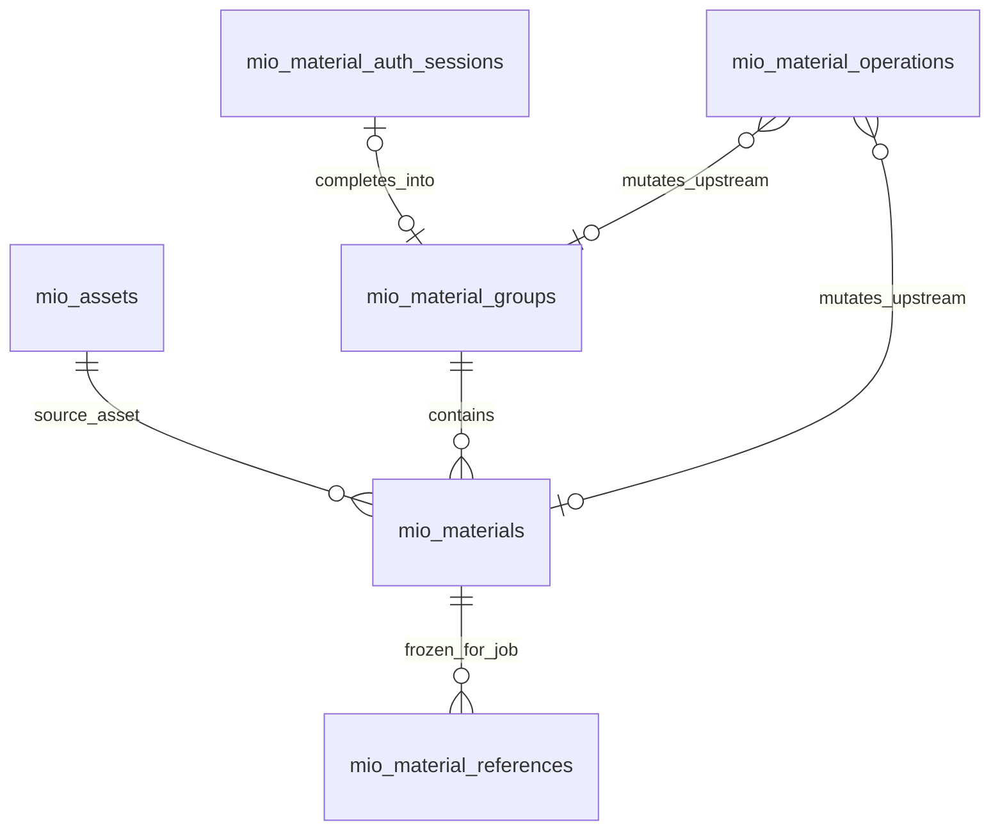

# 万联真人与 AIGC 素材库 PRD

状态：完整需求与后端实施计划。Pre-C1 已完成协议与 COS 拉取摸底，`D-01`–`D-04` 实证留存于 `.runtime/dev/materials-pre-c1-probe/report.json`。原 W6 / WL-10 继续沿用。第 12 节记录各后端单元的范围与就绪判断，实际接受范围由已发布成果记录确认。2026-11-23 配合[统一资产库 PRD](../unified-asset-library/prd.md) 方向更新，增量补充资产页并列入口导入隔离约定与条件单元 `ML-12`（认证失效识别与重新认证闭环），既有 Pre-C1 及 Units 1–4 范围与已发布接受成果保持不变。[任务资料入口](../index.md) · [素材成果](complete/report.md)

## 1. 结果与范围

### 1.1 用户结果与授权来源

面向使用 Mio 的登录创作者：在新项目中完成手机真人认证，将图片从客户端直接上传腾讯云 COS，再由后端把已登记文件核验并提交到远程认证素材组，查询审核状态，并在支持的 Seedance 视频能力中复用素材。用户无需理解 COS 对象键、供应商素材 ID 或回调参数。

本期需求来自本次会话明确要求：真人认证、素材库、客户端图片上传、COS 上传授权下发、assets 数据库及完整接入安排。原 PRD 的真人/AIGC 管理、同步和视频联动目标保留；本轮文档同步仅收口 Pre-C1 实证结论与常驻环境口径，不直接触发后端源码修改、生产迁移、部署、真机人脸扫码采集或外部付费调用。后续当用户指示推进功能开发、协议摸底或本地业务验收时，按[常驻环境](../../local-environments.md#自动化回归与人工数据)口径默认放行直接复用常驻 `mio_dev`（`.env`、已加密落库的供应商凭据与私有测试 COS）执行单次有界、最小规格的真实外部调用与非破坏增量迁移并保留数据，无需再为读取 `mio_dev` 既有凭据二次索要口令；同时严格守住三条底线：常规自动化回归（`pnpm test`、`pnpm check` 与 CI）离线隔离不读取 `mio_dev` 凭据、纯讨论／只读审阅／纯文档编制不触发外部调用、真实调用禁止自动无限重试且高敏操作（传入新 `apiKey` 覆盖既有凭据、改写影响他人的全局路由、发送扣费短信、Unit 3 需本人扫码配合的真人生物识别采集及落实 `D-05` 已确认的保留策略与授权展示文案、Unit 4 最小规格以上的批量付费生成）仍须最小必要触发或由用户明确指定／配合。

核心能力是认证、素材登记和生成复用；COS 直传、身份映射、恢复、数据库与受限回调是兑现核心结果的必要支撑。按[底座规格](../../foundation.md#当前范围与来源)，本仓库是纯 TypeScript 后端插件服务，不包含正式产品前端 UI。服务端业务、持久化与 HTTP 契约属于本期后端开发单元；客户端交互约定（`ML-08` 与第 3.3 节）作为外部客户端消费约定 / 跨仓交接规格维护，正式前端 UI 由外部前端仓库独立承接（`D-06`），**移出本仓库后端开发单元的完成门禁**。真实验收中涉及浏览器直传 COS（`AC-02`）与手机扫码闭环（`AC-05`）的环节，仅使用独立隔离的浏览器验收页夹具验证，夹具不构成正式产品页面交付，也不成为本仓库构建或常规检查的依赖。

### 1.2 完整需求与当前阶段视图

| ID    | 用户结果 / 必要能力                                                                                                     | 来源及定位依据                                    | 阶段与必要性                                                                                                 | 直接依赖                                                   |
| ----- | ----------------------------------------------------------------------------------------------------------------------- | ------------------------------------------------- | ------------------------------------------------------------------------------------------------------------ | ---------------------------------------------------------- |
| ML-01 | 手机扫码认证，结果归属当前 Mio 用户                                                                                     | 用户明确要求、原 WL-10、旧服务认证协议            | 当前核心（后端）；没有结果绑定则无法使用真人组                                                               | 登录、供应商、公网 HTTPS、上游协议                         |
| ML-02 | 查看、命名、删除本人真人/AIGC 素材组                                                                                    | 原 PRD、线上素材库观察                            | 当前核心（后端）；纯后端管理与有界同步可先行交付                                                             | 组持久化、供应商账号凭据与资源权限                         |
| ML-03 | 客户端图片直传 COS，原文件上传流量不经过应用上传接口                                                                    | 用户明确要求；当前 assets 已具备直传              | 当前核心与复用；不重建存储链                                                                                 | assets、私有 COS、精确 Origin CORS                         |
| ML-04 | 后端把 ready 本地资产核验并登记到远程组，持久保存素材 ID                                                                | 用户问答目标、旧服务 CreateAsset                  | 当前核心（后端）；COS 上传不会自动创建远程素材                                                               | ML-02/03、独立上限内容核验与读取签名                       |
| ML-05 | 查询审核状态，失败可理解、刷新后可恢复                                                                                  | 原 PRD、旧 GetAsset/ListAssets                    | 当前核心（后端）；已创建不等于已通过                                                                         | 组内有界同步、状态归一、持久记录                           |
| ML-06 | 本地素材 ID 安全解析为远程 `asset://` 引用并生成视频                                                                    | 原 PRD、用户对引用机制的需求                      | 当前目标，条件实施；对应 Seedance 视频精确模式就绪后接受                                                     | ML-01/04/05、视频精确模式                                  |
| ML-07 | 归属、并发、幂等、账号级凭据轮换、未知结果、删除保护和显式远端组级联确认                                                | 当前规范、原 PRD                                  | 当前必要支撑；防串号、重复外部资源和悬空引用                                                                 | PG、供应商账号凭据接缝、护栏与操作恢复                     |
| ML-08 | 外部客户端消费约定（真人/AIGC 列表、二维码、上传阶段展示、轮询节流、删除确认与错误语义）                                | 线上参考、跨仓交接需求；本仓库不含正式产品前端UI  | 跨仓交接规格（移出后端开发单元完成门禁）；正式 UI 由外部前端仓库承接（D-06），真实验收仅以隔离验收页覆盖闭环 | 外部前端载体（D-06）、上述后端 API                         |
| ML-09 | 视频/音频专属素材登记与验证                                                                                             | 原 PRD 泛素材、旧协议观察                         | 后续条件单元；先完成图片，不删除既有通用资产能力                                                             | 独立媒体限制、上游支持和对应生成模式                       |
| ML-10 | 项目角色/分镜关联同一素材服务                                                                                           | 原 PRD                                            | 后续；项目模块有真实消费者时接入                                                                             | 项目/主体稳定身份及权限                                    |
| ML-11 | 批量导入、自动同步调度、断点续传、多桶/多供应商抽象                                                                     | 尚无当前需求证据                                  | 排除本期，不自动形成后续任务                                                                                 | 新需求或实际失败证据                                       |
| ML-12 | 认证失效精细化展示、新生成提交前有效性复核拦截、重新认证尝试与服务端新旧上游 ID 映射，以及与统一资产库导入/删除双向隔离 | 2026-11-23 统一资产库方向更新、跨模块资产交接约定 | 后续条件单元（Unit 5）；依赖 D-08 上游失效形态与续认协议实测收口后实施，不阻塞 Units 1–4 既有交付与接受      | ML-01/04/05/07、D-08 上游实测、统一资产库导入/引用保护约定 |

本期纯后端图片闭环不以所有视频模式、音频、项目 CRUD、Agent 工具或外部正式前端 UI 完成作为前置。完整后端素材库接受仍必须包括真人认证及至少一条匹配的 `asset://` 视频生成；管理/直传局部通过、隔离浏览器验收页夹具观察与完整后端业务接受分别报告。

### 1.3 术语：四个标识不可混用

| 标识                      | 例子                         | 含义与使用者                                      |
| ------------------------- | ---------------------------- | ------------------------------------------------- |
| 本地 assetId              | Mio UUID                     | assets 域保存的文件记录；用于归属、原件读取与复用 |
| COS 对象键 / 签名地址     | mio/raw/... / 临时 HTTPS URL | 文件存放位置和临时读取权限；不是永久业务身份      |
| 本地 materialId / groupId | Mio UUID                     | 素材域的记录；关联当前用户、本地资产和远程资源    |
| 上游 AssetId / GroupId    | 供应商返回值                 | 远程平台登记编号；asset:// 后面使用上游 AssetId   |

通俗解释：COS 是存照片的柜子；远程组是平台里的相册；CreateAsset 是把柜子里的照片登记到相册；asset:// 是让生成平台按编号选中照片。asset:// 本身不是证书，不是浏览器下载地址，也不保证跨账号可用。AIGC 同样可以有这种引用。

## 2. 当前事实、复用边界与证据等级

### 2.1 当前 Mio 已有能力

现行契约以[底座规格](../../foundation.md)、[资产 HTTP](../../apis/assets.md)、[COS 集成](../../integrations/cos.md)、[PostgreSQL 契约](../../integrations/postgres.md)、[供应商规范](../../providers.md)、[供应商 HTTP](../../apis/providers.md)为准；本 PRD 中新增接口、字段和表结构均是候选，实施前须同步对应现行规范。

- [资产 schema](../../../src/assets/schema.ts) 已有 `mio_assets`：`owner_id` 为 `text` 且自创建起不可变、单文件上限 1 GiB、staging/raw 键、pending/finalizing/ready/expired、ETag、租约和到期清理标识。[计算 schema](../../../src/compute/schema.ts) 与[图片生成 schema](../../../src/generations/schema.ts) 增量增加了 `asset_kind`（`original`/`derived`），并直接以普通 `REFERENCES mio_assets(id)` 关联资产，不侵入修改 `mio_assets` 核心列。
- [资产服务](../../../src/assets/service.ts) 已签发 300 秒 PUT URL；`complete` 对 staging 执行 HEAD 核验长度/ETag，按冻结 ETag 条件复制到唯一 raw 键，再条件登记。staging 不能作为最终素材原件。复制由 COS 执行，上传字节无需经应用后端。
- `assets.readVisionSource` 当前硬上限为 `MAX_VISION_SOURCE_BYTES = 10 MiB`（见[资产契约](../../../src/assets/contracts.ts)），且[对话视觉适配](../../../src/dsh/vision.ts) 依赖 `@deepseek-ai/*`（直接导入 `@deepseek-ai/*` 受[源码护栏](../../../scripts/harness/check-source.ts) `DSH_BOUNDARY` 限制，仅 [src/plugin.ts](../../../src/plugin.ts) 与 `src/dsh/*` 允许；目前 `check-source.ts` 禁止业务模块直接导入 `src/dsh/*` 的清单只覆盖 `src/providers` 与 `src/conversations`，Unit 1 新增 `src/materials/` 时须同步将其纳入该清单）。素材图片核验（已冻结 20 MiB、宽高/宽高比/像素预算）不能直接沿用 `readVisionSource` 的 10 MiB 上限或导入 `src/dsh/vision.ts`，须走资产/COS 域独立上限的有界条件流读取与纯 `sharp` 串行解码校验（复用/提炼[图片解码器](../../../src/generations/image/decode.ts)模式）。
- [供应商 schema](../../../src/providers/schema.ts) 已有每用户一个逻辑 `onelink` 配置、AES-256-GCM 密文五元组（`cipher_format`/`master_key_id`/`nonce`/`ciphertext`/`auth_tag`）、`credential_version` 与 `credential_auth_state`；但当前[供应商契约](../../../src/providers/contracts.ts) 仅定义绑定具体模型的快照类型（`ChatRuntimeSnapshot` / `ImageRuntimeSnapshot` / `ImageAdmissionSnapshot`）与 `operation: 'chat' | 'image.generate'`，[供应商服务](../../../src/providers/service.ts) 仅有绑定具体 `modelRef` 的 `resolveChat` / `snapshotImage`（以及已受理图片任务恢复用的 `resolveImageTaskCredential`），尚无面向无模型账号资源服务的凭据快照入口。Unit 1 须在 `providers` 域增补最小“账号级凭据快照/解密接缝”并同步[供应商规范](../../providers.md)，不能自行复制凭据系统或把素材强塞进模型路由枚举。
- [@mio/foundation/logging](../../../packages/foundation/src/logging.ts) 仅接受固定大写 `event` 标签及 `requestId`/`jobId`/`attemptId`/`messageId` 四个小写 UUID v4 关联键，是尽力而为的应用日志而非持久审计记录。
- [源码护栏](../../../scripts/harness/check-source.ts) 通过 `businessDatabase` 白名单限制生产代码导入 `pg`/`@types/pg`，[护栏配置](../../../harness.config.json) 通过 `developmentDependencies["scripts/service"]` 限制迁移脚本的跨模块依赖；[插件入口](../../../src/plugin.ts) 在末尾注册了 `/api/v1` 前缀探针与服务 Bearer 兜底路由。
- 当前无必要直接签发 STS 给浏览器：预签名 PUT 已实现“下发 COS 上传凭证”的用户结果。服务端若使用临时凭据，可沿既有 `MIO_COS_SESSION_TOKEN`，不等于客户端获得 STS。

### 2.2 调查来源、Pre-C1 实证与适用限制

本次会上对 miiooai.com/workspace/assets 发布包观察到真人/AIGC 分组、扫码、3 秒认证轮询、4 秒审核轮询、组预览和元数据字段。旧后端调查位置为 backend/app/routers/live_materials.py、services/live_material_runtime.py、services/live_material_provider_binding.py、services/direct_upload.py；仅作为协议参考，不构成新项目的运行依赖。公共文档不要求开发者拥有旧仓库的个人绝对路径。

**Pre-C1 受控协议与 COS 拉取实证（已完成，脱敏原件见 `.runtime/dev/materials-pre-c1-probe/report.json`）**：按[常驻环境](../../local-environments.md#自动化回归与人工数据)口径，使用常驻 `mio_dev` 既有加密 OneLink 凭据（只读 `SELECT`）与私有测试 COS 执行了 14 次有界出站调用（0 次付费模型生成、0 短信、0 真人扫码；探针远端素材、远端组与 2 个合成 PNG COS 对象均已清理），已实证收口 `D-01`–`D-04`：

- **出站信封与可用 Action（`D-01`）**：固定端点为 `POST https://api.onelinkai.cloud/volc/openapi?Action=<Action>&Version=2024-01-01`（`Authorization: Bearer <apiKey>`），统一响应 `{ ResponseMetadata: { RequestId, Action, Version, Service: "ark", Region: "cn-beijing", Error?: { Code, Message, Data? } }, Result?: { ... } }`。实证可用：`CreateAssetGroup`（`GroupType: "AIGC"`，真人组枚举实证为 `"LivenessFace"`，ID 格式 `group-<14digits>-<5alnum>`）、`GetAssetGroup`、`UpdateAssetGroup`（支持同步远端重命名）、`DeleteAssetGroup`（Pre-C1 实测先清空素材再删组；现行显式级联见第 11 节）、`CreateAsset`（ID 格式 `asset-<14digits>-<5alnum>`）、`GetAsset`（精确首字母大写状态如 `"Active"`；不存在返回 HTTP 404 + `Error.Code === "ResourceNotFound"`）、`ListAssets`（**必须传非空复数 `Filter: { GroupIds: [upstreamGroupId] }`**，单数 `GroupId` 会被静默忽略并全池扫描超时）、`DeleteAsset` 与 `CreateVisualValidateSession`（无域名白名单阻断，直接返回 `{ BytedToken, CallbackURL, H5Link }`，无到期时间字段，OneLink 经 `/volc/callback?redirect_url=...&supplier=...` 浏览器 **GET** 重定向回跳且无 HMAC 签名头）。`GetVisualValidateResult` 因零真人扫码约束留待 Unit 3 真机实测核对返回字段。
- **图片边界与 COS 签名拉取（`D-02 / D-03`）**：实测 `512x512` PNG 经 600 秒无 `attachment` 私有 COS `GET` 签名 URL 在 `CreateAsset` 内同步拉取（~2.4s）并约 1 秒转为 `"Active"`；`200x200` PNG 同步返回 HTTP 400 `InvalidParameter.WidthTooSmall`（`"Width must be between 300px and 6000px."`）。据此冻结本地准入（JPEG/PNG/WEBP、`<= 20 MiB`、`300 <= width, height <= 6000` 含端点、宽高比 `0.4 <= width / height <= 2.5`）与 600 秒无 `attachment` 专用 COS GET 签名有效期（STS 临时凭据附注见第 5.2 节）。旧前后端矛盾校验不再沿用。
- **共享上游池多租户隔离发现（`D-04`）**：实测 OneLinkAI `/volc/openapi` 后端复用共享火山方舟账号池，响应不含按 OneLink Key 隔离的 `AccountId`，且 `ListAssetGroups` 返回了池内其他租户的 761 个组（含 42 个 `LivenessFace`）。因此确立铁律：运行时严禁调用 `ListAssetGroups` 做全账号枚举或自动导入，本地 PG `mio_material_groups` 为组归属唯一权威，非空上游组/素材 ID 全局唯一，`upstream_scope` 固定为逻辑值 `'onelink-volc-ark'`，换 Key 后经单资源 `GetAssetGroup`/`GetAsset` 核验可访问性并区分 403 与 404。旧实现把凭据指纹直接作为资源主键的做法同样禁止沿用。
- **本地视频目录线索（`D-07`）**：只读核对 `mio_dev` 目录已发现 `doubao-seedance-2.0`、`doubao-seedance-2-0-fast`、`doubao-seedance-2-5-260628` 等 Seedance 模型，但 `mio_provider_model_routes` 视频路由数仍为 0，Unit 4 继续等待视频路由落地。

## 3. 端到端业务与外部客户端消费约定

### 3.1 真人认证

1. 登录用户进入“素材库 → 真人人像”，点击“录入新的真人”，确认本人有权进行本次授权。
2. 客户端请求后端创建认证会话。后端冻结 owner、来源、允许的返回目标、当前供应商账号凭据版本及协议声明快照，先在 `mio_material_auth_sessions` 持久保存本地会话身份（唯一事实源，不额外写操作表），再发起远程会话创建。
3. 后端把带会话随机标识的完整 `CallbackURL` 传给远程，持久化上游返回的 `H5Link` 与 `BytedToken`（Pre-C1 已证实为跳转与服务端复核必需，直接采用 `providers` 同款 AES-256-GCM 五元组密文），同时保存 `token_digest = sha256(BytedToken)` 并按本地保守 TTL（已确认 20 分钟，因上游未返回到期时间字段）计算 `expires_at`；返回本系统 `launchUrl` 和到期时间，客户端绘制二维码。
4. 手机打开 `launchUrl`，后端在无桌面登录 Cookie / 无浏览器 Origin 的公开通道内检查会话与到期时间，再跳转预先验证的远程 `H5Link`。
5. 手机完成检测后，通过 OneLink `/volc/callback` 浏览器 **GET** 重定向回跳本系统公开回调 `GET /auth-sessions/{id}/complete`（无 HMAC 签名头）。后端按单次会话查 owner，先对回调 token 计算 SHA-256 并与本会话 `token_digest` 执行常量时间比对（彻底阻断跨会话 token 嫁接），再用 owner 凭据服务端调用 `GetVisualValidateResult({ BytedToken })` 复核；不能按 `resultCode`、前端“成功”或任意提交的 `GroupId` 直接标记完成。
6. 复核成功，幂等保存本地组与上游 `GroupId` 的映射，认证状态 `verified`。桌面端查询本地会话，显示成功及命名入口。命名失败保留认证成功，同时明确“名称未保存”，不能用本地假成功遮蔽失败。
7. `expired`/`failed`/`unknown` 返回具体可操作状态；`expired` 允许新建会话，`unknown` 先由本人对原 sessionId 显式 `POST /auth-sessions/{id}/refresh {}` 查询恢复，使用原 token/当前凭据并复用有界预算；无 token 则明确人工核对，不能自动再创建。普通 GET 状态不解密或联网，公开 complete 仍先验证回调 token 防嫁接，不依赖重开 H5 保证再次回跳。

认证组可以为空；组卡片数量为 0 不等于认证失败。真人认证不等于验证用户的法定姓名，也不自动授予全部图片使用权。用户自定义名称仅为展示标签。

### 3.2 AIGC 组与素材登记

AIGC 新建组不走真人扫码，后端先在 `mio_material_operations` 登记不可逆远端变更，创建上游 AIGC 组后条件提交本地组映射。用户在真人或 AIGC 组上传图片：申请 assets 上传 → 客户端 PUT COS → `assets complete` → `ready` → 后端独立上限内容核验与素材登记 → `processing` → `active`/`rejected`。AIGC 上传并非免审核，且不能把任意真人照片标为 AIGC 来规避平台认证要求。

从已存在资产选择时只提交本人 `ready` 的 `assetId`，无需客户端下载后重新上传。登记失败保留本地原件，可以定位失败原因再处理；COS 成功不能显示“素材已认证”。同一原件可在允许的不同组分别登记，远程素材记录必须分开。

在[统一资产库 PRD](../unified-asset-library/prd.md)确立的资产模块四个并列一级入口（生成历史、我的资产、Seedance 认证素材库、回收站）中，Seedance 认证素材库作为独立入口，支持从「生成历史」或「我的资产」提交本人 `ready` 图片的本地 `assetId`（复用现行 `POST /api/v1/materials/groups/{id}/materials`）导入建立独立认证关联：**导入仅建立独立素材域记录与本地 `sourceAssetId` 持有，不产生生成历史，也不改变来源记录**。同时重申，本域图片登记准入（JPEG/PNG/WEBP、`<= 20 MiB`、`300 <= width, height <= 6000`、宽高比 `0.4–2.5`）是本域供应商专用准入规则，与统一资产库「我的资产本地上传（`jpg/jpeg/png/mp4/mp3` + `20 MiB`）」及 `mio_assets` 通用 `1 GiB` 上限各自独立、互不覆盖。导入后的认证素材与来源生成历史、我的资产副本及普通回收站双向隔离（详见第 5.3、10.1 与 11 节）。

### 3.3 外部客户端消费约定与跨仓交接规格

本仓库是纯 TypeScript 后端插件服务，不包含正式产品前端 UI。本节作为外部前端仓库（`D-06`）消费素材域 API 的跨仓交接规格，**不构成后端开发单元（Units 1–4）的完成门禁**。后端真实验收仅以独立隔离的浏览器验收页作为夹具覆盖 `AC-02`（真 COS 浏览器直传）与 `AC-05`（手机扫码认证闭环），夹具不代表正式产品页面交付。

- **分组与本地分页消费**：一级“素材库”，二级“真人 / AIGC”；列表直接读取后端本地分页（组名、素材数、认证状态、`lastSyncedAt` 与最近同步状态），进入组后再展示素材卡片、审核状态、预览和显式管理动作；不要求复刻旧版视觉，也不得对每张组卡片并发触发远程同步。
- **上传与登记阶段展示**：独立区分“获取上传权限、浏览器直传 COS 进度、确认文件（`complete`）、提交远程素材登记、审核中、可用、拒绝/失败”。页面切换或刷新后以服务端持久记录恢复事实，不依赖浏览器内存维持状态。
- **审核与预览语义**：仅 `active` 素材可选作视频生成输入；`pending`/`processing` 显示等待，`rejected` 展示脱敏错误码与原因，`unknown` 提示需核对/恢复。预览地址可用不代表审核通过。
- **二维码与轮询节流**：展示会话到期时间与重新发起入口；认证与审核轮询严格按后端返回的 `pollAfterMs` 与 `Retry-After` 退避，页面不可见或离开时停止本地轮询，同一资源仅保留单个在途查询；关闭弹窗停止轮询，不假定远程会话已撤销，也不伪造完成。
- **显式修改、同步与删除错误语义**：重命名（`PATCH /groups/{id}`）与组内有界同步（`POST /groups/{id}/sync`）直接等待响应确认。删除界面区分本地移除与远端删除。选择远端删组时，确认文案须说明将永久删除该远端组及供应商执行时的全部成员，包括本地看不到、已本地移除与确认后新增的成员。仅确认后可提交 `scope:"upstream"` 和 `confirmCascade:true`。重复提交复用同一 requestId 和输入；结果未知时按原操作 ID 查询，成功后刷新列表。失败展示脱敏 `{error:{code,message,requestId}}` 或操作错误码。

## 4. 系统边界、身份与工程护栏

浏览器/外部客户端仅调用 Mio 登录接口及拿到的单对象 COS PUT 地址；供应商长期 API Key、COS SecretId/SecretKey、回调证明材料不下发客户端。客户端不直接调用 `CreateAsset`，也不能自报认证完成或提交一个上游素材 ID 就获得可用记录。

后端职责划分：`assets` 域负责文件生命周期、直传签名及面向素材域的独立上限有界读取/上游读取签名 URL；`materials` 域负责真人认证会话、分组、有界同步、远程登记与引用保护，严禁导入 `@deepseek-ai/*` 或 `src/dsh/*`；`providers` 域负责凭据管理与加密；`onelink` 集成域编码固定上游 OpenAPI；视频域仅消费经 `materials` 域校验解析后的 `asset://` 引用；插件适配入口 [src/plugin.ts](../../../src/plugin.ts) 集中处理 DSH/Cordis 装配与路由分流，运行时不导入旧 Python 服务、开发脚本或测试。

- **用户身份与隔离**：owner 只来自当前登录身份 `Authentication.identity`，类型沿现有 `text` 用户 ID；全部资源查询均带 owner 条件。路径 ID 猜测不泄露他人资源，跨用户统一不可见。
- **供应商账号级凭据接缝（无模型资源服务）**：当前[供应商契约](../../../src/providers/contracts.ts) 仅定义绑定具体模型的快照类型（`ChatRuntimeSnapshot` / `ImageRuntimeSnapshot` / `ImageAdmissionSnapshot`）与 `operation: 'chat' | 'image.generate'`，[供应商服务](../../../src/providers/service.ts) 仅有绑定具体 `modelRef` 的 `resolveChat` / `snapshotImage`（以及任务恢复用的 `resolveImageTaskCredential`）；素材域是无模型账号级资源服务，不强塞进模型路由枚举。Unit 1 须在 `providers` 域增补最小“账号级凭据快照/解密接缝”：核验当前 owner 存在已启用的 `onelink` 配置且 `credential_auth_state !== 'rejected'`，返回 `providerConfigId`、`credentialVersion` 及受控密文/内存凭据快照（仅在受控出站时按 AAD 解密到请求内存），并同步更新[供应商规范](../../providers.md)。
- **凭据轮换与只读/出站分工**：`providerConfigId`、`credentialVersion` 与协议版本仅为路由与审计维度；资源 owner 不随 Key 轮换改变，素材不强制绑定具体生成模型。普通本地列表/详情读取不解密也不依赖当前 Key；新建外部资源、远程登记、有界同步与远程删除须通过账号级凭据接缝核验可用线路与权限。Key 轮换后通过单资源 `GetAssetGroup({ Id })` / `GetAsset({ Id })` 核验既有资源可访问性，明确区分上游 403（无权访问，保留本地归属与历史并阻塞该资源出站）与 HTTP 404 `ResourceNotFound`（远端资源不存在），禁止静默改挂新账号或把同名组视为原组。`/v1/models` 发现成功不证明素材 OpenAPI 权限，素材操作成功也不给模型打 `verified`。
- **共享上游池多租户隔离铁律（`D-04` 已实证收口）**：Pre-C1 实证 OneLinkAI `/volc/openapi` 后端复用共享火山方舟账号池，响应不含按 OneLink Key 隔离的 `AccountId`，且 `ListAssetGroups` 返回了池内其他租户的 761 个组（含 42 个 `LivenessFace`）。因此强制执行三条隔离铁律：(1) **运行时严禁调用 `ListAssetGroups` 做全账号枚举或自动导入**，本地 PG `mio_material_groups`（仅收录 Mio 为当前 `owner_id` 创建或认证生成的组）是组归属的唯一权威；(2) `mio_material_groups` 上非空 `(provider_type, upstream_group_id)` 与 `mio_materials` 上非空 `(provider_type, upstream_asset_id)` 全局唯一（彻底防止跨用户碰撞绑定同一上游 ID），`upstream_scope` 固定为逻辑值 `'onelink-volc-ark'`；(3) 换 Key 后仅对本用户已有资源通过单资源 `GetAssetGroup({ Id })` / `GetAsset({ Id })` 核验可访问性（区分 403 与 404），绝不按同名或全池扫描认领资源。
- **源码与迁移护栏维护（`BOUNDARY-01`）**：Unit 1 新增 `src/materials/store.ts`、`src/materials/schema.ts` 与 `scripts/service/migrate-materials.ts` 时，必须同步维护 [scripts/harness/check-source.ts](../../../scripts/harness/check-source.ts) 中的 `businessDatabase` 白名单（允许素材存储与 schema 模块导入 `pg`/`@types/pg`）以及禁止业务模块直接导入 `src/dsh/*` 的 `DSH_BOUNDARY` 清单（加入 `src/materials`，与现有 `src/providers`/`src/conversations` 一致，防止经 `src/dsh/vision.ts` 间接绕过框架边界检查），并同步维护 [harness.config.json](../../../harness.config.json) 中的 `developmentDependencies["scripts/service"]`（允许迁移脚本导入素材配置与 schema），同时补充合法放行与违规阻断的护栏正反测试样例。
- **HTTP 路由分流与公开回调边界**：[src/plugin.ts](../../../src/plugin.ts) 末尾注册了 `/api/v1` 前缀探针与服务 Bearer 兜底路由。注册 `/api/v1/materials` 前缀时必须位于 `/api/v1` 兜底路由**之前**，并在素材处理器内部精确分流：登录态端点严格沿用登录 Cookie、精确允许 Origin、JSON 限制、`no-store`、`requestId` 与脱敏错误；仅无桌面 Cookie / 无浏览器 Origin 的公开手机入口 `GET /api/v1/materials/auth-sessions/{id}/launch` 与供应商浏览器回跳回调入口 `GET /api/v1/materials/auth-sessions/{id}/complete`（Pre-C1 实证为浏览器 GET 重定向；若未来上游出现 POST 通知再独立扩展）走独立的公开校验通道，绝不放宽其余 `/api/v1/materials` 接口或其他业务域的 Origin / Cookie 检查，也不落入 `/api/v1` 探针 Bearer 兜底。

## 5. COS 上传授权与原件生命周期

### 5.1 直接复用的接口

```text
POST /api/v1/assets/uploads
  {filename, contentType, size}
  → {assetId, uploadUrl, expiresIn:300}

客户端 PUT uploadUrl，正文为文件原字节

POST /api/v1/assets/{assetId}/complete
  {}
  → AssetView，status=ready 后允许登记素材
```

客户端上传后无需回传 COS URL、bucket 或对象键。`complete` 正文继续是空对象，后端根据 `assetId` 找回固定位置；不新增信任客户端 URL 的捷径。

签名绑定 Host 与声明长度。`complete` HEAD 长度及 ETag，条件复制到新的 raw 键并登记；复制后的 raw 不可被原上传 URL 覆盖。签名过期新申请上传；同一次 `complete` 幂等返回同一原件。重试遵循现有 `ASSET_BUSY`、`ASSET_SOURCE_CHANGED` 等错误，不重复创造原件。

### 5.2 上游读取 URL 与独立上限内容核验

素材登记时后端按 owner 获取 `ready` 原件，冻结 `assetId`、`rawKey`、`raw ETag`、大小及实际内容核验结果，再为固定 raw 键生成供应商专用短期 GET URL（**有效期冻结为 600 秒**，不含 `response-content-disposition: attachment` 响应头）。该 URL 与普通 `attachment` 下载地址用途分开，不由客户端选择，不持久化作文件身份，不写入日志或公共证据。

原文件上传流量不经过应用后端，上游也直接从 COS 拉取；但远程登记前后端仍须有界读取原件执行真实主图内容校验，不能把“上传不经后端”承诺成“任何处理都不读取图片”。现行 `assets.readVisionSource` 硬上限为 `MAX_VISION_SOURCE_BYTES = 10 MiB`（服务于对话视觉），且 [src/dsh/vision.ts](../../../src/dsh/vision.ts) 依赖 `@deepseek-ai/*`（`@deepseek-ai/*` 直接导入受 `DSH_BOUNDARY` 限制，且 `src/materials/` 将同步纳入 `check-source.ts` 禁止导入 `src/dsh/*` 的业务模块清单）。因此，素材登记**不得**直接复用 `readVisionSource` 的 10 MiB 限制或导入 `src/dsh/vision.ts`；Unit 2 须在资产/COS 域提供支持独立大小预算（已冻结 20 MiB，既不缩窄 `mio_assets` 1 GiB 通用上限，也不放宽对话视觉 10 MiB 上限）的有界条件流读取（按冻结 `rawKey` 与 `raw ETag` 执行 `If-Match` 流式读取并核验实际长度与 SHA-256，超限立即销毁流），再交由不依赖框架包的纯 `sharp` 串行校验器（复用/提炼 [src/generations/image/decode.ts](../../../src/generations/image/decode.ts) 模式）核验真实格式与宽高元数据。

**COS 签名拉取窗口实证（`D-03` 已收口）**：Pre-C1 实测 600 秒无 `response-content-disposition: attachment` 的私有 COS `GET` 签名 URL（该签名严格绑定 `GET` 方法，本机自测 `HEAD` 返回 403）在 `CreateAsset` 请求内即被上游通过 `GET` 同步拉取并校验尺寸（耗时约 2.4–2.7 秒），随后上游转存图片并在约 1 秒后转为 `Status: "Active"`。因此冻结供应商专用无 `attachment` GET 签名有效期为 **600 秒**，既能稳定覆盖上游拉取与审核窗口，也无需把私有桶改公开或增加下载代理。**STS 附注**：本机 `.env` 当前使用长效测试 COS 密钥（未配置 `MIO_COS_SESSION_TOKEN`），临时凭据环境下的 `x-cos-security-token` 实网拉取未在本次实测覆盖；启用 `MIO_COS_SESSION_TOKEN` 的部署环境继续保留 [COS 适配器](../../../src/integrations/cos.ts) 中的 `encodeUrlToken` 编码逻辑，且签名有效期受临时凭据剩余寿命约束，需在启用 STS 的目标环境补充复核。

### 5.3 存储与清理

沿既有 24 小时上传过期和有界 staging 清理。不自动删除已登记 raw 或已引用资产；登记失败不删除用户照片。素材域删除不顺带删除 COS 文件。上传配额、签名频率和计费归属应复用现有策略；若当前无配额能力，最小上传准入限制在 Unit 2 C0 冻结，不扩成账单平台。

**与统一资产库物理 GC 及域间准入隔离衔接**：凡未解除且非删除态的认证素材，均通过本地 `mio_materials.source_asset_id` 计入[统一资产库 PRD](../unified-asset-library/prd.md)物理媒体 GC 的**第 5 类有效持有关系**，持续保护底层 `mio_assets` 与私有 COS 原件不被提前物理清理；删除来源「生成历史」或「我的资产」副本绝不连带删除已建立的认证素材。仅当认证素材解除本地 `source_asset_id` 有效持有（如本地/远端删除落墓碑）后，才释放该处认证持有，并由统一资产库核验全部 7 类有效持有关系同时归零后才可进入物理清理。此外，本域图片登记准入（JPEG/PNG/WEBP、`<= 20 MiB`、`300 <= width, height <= 6000`、宽高比 `0.4–2.5`）系供应商专用准入规则，与统一资产库「我的资产本地上传（5 后缀 + 20 MiB）」及 `mio_assets` 通用 `1 GiB` 上限各自独立、互不覆盖。

## 6. 图片范围、校验与预览

**本地图片准入规格（`D-02` 已实证收口并冻结）**：Pre-C1 实测 `512x512` PNG 在 `CreateAsset` 正常受理并约 1 秒转为 `"Active"`，而 `200x200` PNG 在 `CreateAsset` 同步返回 HTTP 400 `InvalidParameter.WidthTooSmall`（`"Width must be between 300px and 6000px."`），与火山方舟图片素材规格一致。据此冻结首期本地图片准入为：

- 格式：仅允许 **JPEG / PNG / WEBP**；GIF、HEIC、视频、音频不在图片登记首期承诺。
- 文件大小：**`<= 20 MiB`**（保守安全落在上游上限内；通用 `mio_assets` 仍保留现有 1 GiB 上限，对话视觉仍保留 `MAX_VISION_SOURCE_BYTES = 10 MiB`，各域限制互不干扰，本域规则不得全局缩窄资产能力）。
- 尺寸与宽高比：宽高 **`300 <= width, height <= 6000`（含端点）**，宽高比 **`0.4 <= width / height <= 2.5`（含端点）**。后端准入与外部客户端提示共用已发布的能力限制；文件名/MIME 不能代替真实解码。

本地核验以当前解码器实际读取的主图内容为准，验证静态 JPEG/PNG 的真实解码；对解码器可读取的 WebP 动画按每帧宽高/比例及累计不超过 36M 解码像素核验，不把 stacked 总高度误当单帧高度。PNG 含 APNG 扩展时继续按普通 PNG 主图读取与提交完整原件，不新增 APNG 专门支持、拒绝或静态化，也不承诺全部动画帧已验证；最终素材审核由上游处理。图片读取和解码前同步认领单服务登记槽，无图片缓冲等待队列。

素材服务在 `CreateAsset` 前按第 5.2 节通过资产/COS 域独立上限（已冻结 20 MiB）的有界条件流读取原件，采用不依赖 `@deepseek-ai/*` 或 `src/dsh/vision.ts` 的纯 `sharp` 串行解码与宽高元数据校验（复用/提炼 [src/generations/image/decode.ts](../../../src/generations/image/decode.ts) 的串行队列与文件头魔数校验模式，补充 `metadata()` 宽高、宽高比与像素预算检查），避免违反 `DSH_BOUNDARY` 及并发全图解码导致内存飙升。拒绝损坏/伪装图片、超预算解码和读取期间对象变化（ETag 不符）。展示缩略图/预览与原件身份分开；派生物沿现有 `derived` 契约，避免把预览压缩图登记成用户原件。首期无需新增独立缩略图平台，已有受控图片展示足够时直接复用。

## 7. 认证回调与本地开发环境

### 7.1 回调地址

部署配置候选 `MIO_MATERIALS_PUBLIC_BASE_URL`，必须为运维配置的 HTTPS origin，可选路径规则在 Unit 3 C0 固定；不从请求 Host、客户端 `returnUrl` 或任意 URL 推导。具体变量命名在实现时与项目配置风格统一，非当前已实现变量。

Pre-C1 实测每次创建会话调用 `CreateVisualValidateSession({ CallbackURL })` 传完整回调地址（实测占位 HTTPS 域名无上游域名白名单阻断），创建阶段直接返回 `{ BytedToken, CallbackURL, H5Link }`，但**不返回会话到期时间字段**（由 Mio 本地自管保守 TTL，已确认 20 分钟）；OneLink 会将传入回调包装为 `/volc/callback?redirect_url=...&supplier=...` 并通过浏览器 **GET** 重定向回跳。新项目可使用自己的回调域名，不要求照抄旧域名。回调必须落到能读取本次会话的同一服务/共享 PG 的实例。`launchUrl` 和回调的会话 ID 不进入普通访问日志；使用高熵随机标识，禁止可枚举自增编号。在 [src/plugin.ts](../../../src/plugin.ts) 中，`/api/v1/materials` 注册在 `/api/v1` 探针 Bearer 兜底之前，精确放行无 Cookie / 无 Origin 的 `GET /api/v1/materials/auth-sessions/{id}/launch` 与 `GET /api/v1/materials/auth-sessions/{id}/complete` 公开入口（若未来上游出现 POST 通知再独立扩展），不放宽其他接口校验。

开发后端在本机时，可用 ngrok 快速联调；已有自有公网服务器时可用 frp 与固定 HTTPS 域名；已有公网后端无需隧道。工具是环境选择，不引入运行时依赖。隧道变更后重新创建会话，旧 `CallbackURL` 不自动迁移。仅暴露所需入口，不暴露数据库、管理端或开发调试端点；手机检查连通和中间提示页影响。

### 7.2 验证与状态

**回调关联证明与收敛方案（`D-01` 已实证收口）**：Pre-C1 实测 OneLink 回调属浏览器 **GET** 重定向，**无 HMAC 签名头**；但 `CreateVisualValidateSession` 在创建阶段即直接返回 `BytedToken`（34 字符，且 `H5Link` 不含明文 `BytedToken`）。因此确认持久化 `H5Link`（供 `/launch` 跳转）与 `BytedToken`（供服务端调用 `GetVisualValidateResult({ BytedToken })`）确有必要，直接采用第 8.3 节 AES-256-GCM 五元组密文落库；同时建会话时保存 `token_digest = sha256(BytedToken)`。公开回调端点收敛为 `GET /auth-sessions/{id}/complete`（若未来上游出现 POST 再独立扩展）。

回调校验链路必须包含：核验单次会话存在、未到期（以本地 TTL 固定 20 分钟为准）、处于预期状态、对回调携带的 token 计算 SHA-256 并与本会话持久化的 `token_digest` 执行**常量时间比对**（彻底阻断跨会话 token 嫁接）、校验固定返回目标，再由服务端使用 owner 当前凭据调用 `GetVisualValidateResult({ BytedToken })` 复核认证状态与 `GroupId`（注：`GetVisualValidateResult` 因 Pre-C1 零真人扫码约束留待 Unit 3 真机实测核对精确返回字段）。

旧实现仅检查 `resultCode=10000`、token 非空并查询 `GroupId`，未做创建阶段 `token_digest` 常量时间比对；新实现须专门验证“把另一有效认证结果 token 投递到本会话”的负向场景。不可把高熵 URL、浏览器 query 参数或前端自报成功单独视为完整证明。

会话状态候选：`creating → pending → verifying → completed`；可转 `failed`、`expired`、`unknown`。`completed` 重放返回既有结果，不再创建组；伪造/负面回调不应无依据终止合法 `pending` 会话；并发回调使用 PG 条件更新/租约，旧处理者不能覆盖新终态。请求超时可能上游已成功时在 `mio_material_auth_sessions` 记录 `unknown`，按原会话身份恢复。

回调页面只显示成功/失败和受限站内返回入口，不回显 token/姓名等敏感原文。`returnTarget` 使用服务器预设枚举（例如 `materials`）；不接受任意绝对 URL、协议相对地址或跨域跳转。

## 8. assets 与素材数据库候选设计

### 8.1 基础原则与关系

复用现有 PostgreSQL 媒体数据库（`MIO_ASSETS_DATABASE_URL`）和 `mio_assets`，不新建平行文件表、不重建既有表；**素材域在 `MIO_ASSETS_DATABASE_URL` 上独立持池**（沿用[PostgreSQL 契约](../../integrations/postgres.md)与 `compute`/`generations` 独立持池模式，不复用认证或资产内部连接池）。认证身份由当前 auth 服务提供，`owner_id` 继续使用 `text`。因认证库与 `MIO_PROVIDERS_DATABASE_URL` 均可独立分库部署，**绝不对认证表或 `mio_provider_configs` 建立跨库外键**，仅保存受控业务身份快照。迁移通过 `scripts/service/migrate-materials.ts` 显式执行，启动只读检查；开发环境按现有增量迁移惯例，不做生产迁移。



### 8.2 现有 `mio_assets` 的处理

保留 `mio_assets` 既有列（`id`、`owner_id`、`filename`、`content_type`、`size_bytes`、`staging_key`、`raw_key`、`state`、`source_etag`、`lease_id`、`lease_until`、`created_at`、`expires_at`、`staging_deleted_at` 以及计算/生成迁移引入的 `asset_kind`）。**不侵入修改 `mio_assets` 核心列：不增加 `updated_at`，不增加 `UNIQUE(owner_id, id)`**。

沿用 [src/compute/schema.ts](../../../src/compute/schema.ts) 与 [src/generations/schema.ts](../../../src/generations/schema.ts) 既有模式：`mio_assets.owner_id` 自创建起不可变，`mio_materials.source_asset_id` 使用普通外键 `REFERENCES mio_assets(id)`，由素材业务查询与事务严格执行 `WHERE id = $1 AND owner_id = $2 AND state = 'ready'` 核验本人归属、就绪状态与合法 `asset_kind`（仅接受本人 `ready` 的 `original` 或明确支持的 `derived` 图片，验证键与真实解码内容而不只看 MIME）。仅在 Unit 2 采纳资产分页接口 `GET /api/v1/assets` 时，按需为 `mio_assets` 增量添加 `(owner_id, created_at DESC, id DESC)` 索引。登记冻结的 `raw ETag`/大小/宽高摘要放在素材快照中，不复用 `source_etag` 冒充 `raw ETag`。

通用资产删除不是当前已存在接口。首期提供素材域显式本地移除与引用保护；真正删除原文件需独立明确文件删除语义，不能在本期通过级联删除实现。

### 8.3 新增表与关键字段

Pre-C1（`D-01`–`D-04`）已实证收口；下表核心唯一性与隔离约束已按实证结论冻结，完整 DDL 列类型、错误码和迁移脚本随 Unit 1 实施冻结落地。所有状态列用 CHECK，JSON 快照限定可写字段、体积与版本，不能存任意上游响应。

为遵循 `DESIGN-OVER-001` 并消除实体表与操作表的双轨状态重叠，各表严格单一职责：

1. **`mio_material_auth_sessions`（Unit 3 建表）**：独立承担真人认证会话的 `request_id`/`input_hash`/状态/租约/`next_query_at`、AES-256-GCM 密文载荷（`H5Link` 与 `BytedToken`）及 `token_digest`，不双写到 `mio_material_operations`。
2. **`mio_material_groups`（Unit 1 建表）**：直接挂接组内有界同步游标（编码 `ListAssets` 1 基 `PageNumber`）、同步租约与最近尝试字段（对齐 `mio_provider_configs` 的刷新模式）；组重命名（同步调用 `UpdateAssetGroup`）与组内有界同步直接返回结果，不制造异步 `operationId` 轮询。
3. **`mio_material_operations`（Unit 1 建表）**：建组、素材登记、远端删素材与已确认的远端删组在出站变更前持久化。在组删除的版本 1 操作快照中记录原远端 ID 和 `confirmCascade:true`；确认意图参与输入摘要。未确认操作仍使用旧输入摘要，只有已精确确认空组目标在远端不存在时才受理本地收束。

| 表                         | 关键字段                                                                                                                                                                                                                                                                                                                                                                                                                                                                                                                                                    | 约束 / 索引 / 用途                                                                                                                                                                                                                                                                                                                                                                                  |
| -------------------------- | ----------------------------------------------------------------------------------------------------------------------------------------------------------------------------------------------------------------------------------------------------------------------------------------------------------------------------------------------------------------------------------------------------------------------------------------------------------------------------------------------------------------------------------------------------------- | --------------------------------------------------------------------------------------------------------------------------------------------------------------------------------------------------------------------------------------------------------------------------------------------------------------------------------------------------------------------------------------------------- |
| mio_material_auth_sessions | `id uuid PK`、`owner_id text`、`provider_type`、`provider_config_id uuid`（无跨库 FK）、`credential_version int`、`request_id uuid`、`input_hash`、`state`、`token_digest`（`sha256(BytedToken)`）、AES-256-GCM 密文五元组（`cipher_format`/`master_key_id`/`nonce`/`ciphertext`/`auth_tag`，加密存储 `H5Link` 与 `BytedToken`）、`protocol_snapshot jsonb`、`return_target`、`group_id uuid nullable`、`expires_at`（本地 TTL 固定 20 分钟）、`lease_id`/`lease_until`、`next_query_at`、`error_code`、`created_at`/`updated_at`                           | Unit 3 建表；`UNIQUE(owner_id, request_id)`；同库 `(owner_id, group_id) REFERENCES mio_material_groups(owner_id, id)`；owner/时间与未终态到期索引；同 `request_id` 异输入 409；已实测的上游创建响应未提供独立会话 ID。会话按本地 ID 和原 token 摘要关联，创建/查结果/验组三个 RequestId 仅用于审计                                                                                                  |
| mio_material_groups        | `id uuid PK`、`owner_id text`、`provider_type`、`provider_config_id uuid`（无跨库 FK）、`upstream_scope text`（固定逻辑值 `'onelink-volc-ark'`）、`upstream_group_id text nullable`、`group_type real/aigc`、`name`、`auth_status`、`state`、`revision int`、`sync_cursor text nullable`（编码 1 基 `PageNumber`）、`sync_lease_id uuid nullable`、`sync_lease_until timestamptz nullable`、`last_sync_attempt_at`、`last_sync_status`、`last_sync_error_code`、`last_synced_at`、`source_session_id uuid nullable`、`created_at`/`updated_at`/`deleted_at` | Unit 1 建表；`UNIQUE(owner_id, id)`、`UNIQUE(owner_id, provider_type, id)`；**上游 ID 非空时全局唯一 `UNIQUE(provider_type, upstream_group_id)`**（防共享上游池跨用户碰撞绑定）；仅收录 Mio 为当前 `owner_id` 创建/认证生成的组（严禁 `ListAssetGroups` 自动导入）；`source_session_id` 非空唯一；owner/type/时间游标索引；直接承载组内有界同步状态                                                 |
| mio_materials              | `id uuid PK`、`owner_id text`、`provider_type`、`group_id uuid`、`source_asset_id uuid nullable REFERENCES mio_assets(id)`、`upstream_asset_id text nullable`、`asset_type image`、`name`、`state`、`upstream_status`、`raw_snapshot jsonb`、`registration_credential_version int`、`last_synced_at`、`error_code`、`revision int`、`created_at`/`updated_at`/`deleted_at`                                                                                                                                                                                  | Unit 1 建表；`(owner_id, provider_type, group_id) REFERENCES mio_material_groups(owner_id, provider_type, id)`（强制素材与父组 `owner_id`/`provider_type` 一致）；`UNIQUE(owner_id, id)`；`source_asset_id` 仅普通 FK，归属与 ready 由业务事务校验；本地新登记必填、组内有界同步发现的本组远端既有素材允许空；**上游 ID 非空时全局唯一 `UNIQUE(provider_type, upstream_asset_id)`**；group/时间索引 |
| mio_material_operations    | `id uuid PK`、`owner_id text`、`request_id uuid`、`kind`（仅 `create_group`/`register_material`/`delete_material_upstream`/`delete_group_upstream`）、`target_group_id`/`target_material_id nullable`、`input_hash`、`state`、`provider_config_id uuid`（无跨库 FK）、`credential_version int`、`protocol_snapshot jsonb`、`upstream_request_id nullable`、`attempt int`、`lease_id`/`lease_until`、`next_query_at`、`result_local_id nullable`、`error_code`、`created_at`/`updated_at`                                                                    | Unit 1 建表；`UNIQUE(owner_id, kind, request_id)`；不可逆远端变更在出站前写入，组删除记录原远端 ID 及显式确认意图；保留 `creating`/`deleting`/`unknown` 恢复事实；到期租约与待恢复索引；不承接认证会话、本地移除、重命名或组内有界同步                                                                                                                                                              |
| mio_material_references    | `owner_id text`、`material_id uuid`、`consumer_type`、`consumer_id uuid`、`input_index int`、`upstream_ref`、`group_snapshot jsonb`、`state`、`created_at`                                                                                                                                                                                                                                                                                                                                                                                                  | **仅 Unit 4 接入视频联动时建表**；`PK(consumer_type, consumer_id, input_index)`；`(owner_id, material_id) REFERENCES mio_materials(owner_id, id)`；`(material_id, state)` 索引；删除前检查在途引用                                                                                                                                                                                                  |

**共享上游池与唯一性冻结结论（`D-04` 铁律）**：Pre-C1 实证 OneLinkAI `/volc/openapi` 后端复用共享火山方舟池，响应不含按 OneLink Key 隔离的 `AccountId`，且 `ListAssetGroups` 会返回池内其他租户的 761 个组（含 42 个 `LivenessFace`）。据此冻结：(1) **运行时严禁调用 `ListAssetGroups` 做全账号枚举或自动导入**，本地 PG `mio_material_groups`（仅收录 Mio 为当前 `owner_id` 创建/认证生成的组）是组归属的唯一权威；(2) `upstream_scope` 固定为逻辑值 `'onelink-volc-ark'`（不使用 `credentialVersion` 或 Key 指纹作为永久身份），并在 `mio_material_groups` 上对非空 `(provider_type, upstream_group_id)`、在 `mio_materials` 上对非空 `(provider_type, upstream_asset_id)` 建立**全局部分唯一索引**，彻底防止跨用户碰撞绑定同一上游 ID；(3) 换 Key 后对本用户已有资源通过单资源 `GetAssetGroup({ Id })` / `GetAsset({ Id })` 核验可访问性，明确区分 403（无权访问，保留本地归属与历史）与 HTTP 404 `ResourceNotFound`（远端已不存在）。

不保存永久签名 URL；`asset://` 引用由上游 ID 派生，无需冗余列。Pre-C1（`D-01`）已证实必须持久化可逆 `H5Link` 与 `BytedToken`（分别供 `/launch` 跳转及服务端调用 `GetVisualValidateResult({ BytedToken })`），**直接复用 [src/providers/schema.ts](../../../src/providers/schema.ts) 成熟的 AES-256-GCM 五元组**（`cipher_format smallint CHECK (cipher_format = 1)`、`master_key_id text`、`nonce bytea` 12 字节、`ciphertext bytea`、`auth_tag bytea` 16 字节；复用部署主密钥体系，AAD 显式绑定固定用途标签、`owner_id`、会话 `id` 与 `master_key_id`），不自造自定义密文列格式或平行密钥平台；`token_digest = sha256(BytedToken)` 仅用于回调常量时间关联比对与防嫁接，不作可逆查询凭证。

### 8.4 状态、事务和恢复

- 组 `state`：`creating` / `ready` / `unknown` / `deleting` / `deleted` / `failed`；`auth_status` 与生命周期分列，真人 `verified` 才可接纳真人素材，AIGC 显式 `not_applicable`。
- 素材 `state`：`registering` / `processing` / `active` / `rejected` / `unknown` / `deleting` / `deleted` / `failed`。`active` 只来自明确的上游状态映射（Pre-C1 实证首字母大写枚举 `"Active"`）；未知字符串保留原文并按不可用处理，不采用“未知就通过”。
- 单一事实源与提交规则：PG 与远程平台/COS 不在同一事务。真人认证全程以 `mio_material_auth_sessions` 为唯一事实源；重命名与组内有界同步在 `mio_material_groups` 行锁/同步租约内执行并直接返回结果；仅不可逆远端变更（建组、登记素材、远端删素材/组）先提交 `mio_material_operations` 再出站，断线/超时 `unknown` 期间以操作表为恢复权威，获得确定外部结果后在同一 PG 事务内按 owner、租约与输入快照条件提交实体终态并收束操作行。仅同 owner、同操作/requestId、同输入可幂等读回原操作；跨 owner 全局上游 ID 冲突必须拒绝，不读回他人记录、不重绑、不重试创建。
- 请求发出后超时进入 `unknown`，优先按可精确核验的身份找回。`CreateAssetGroup` 已返回合法 ID 但本地提交失败时，fallback 将该 ID 写入原操作受限 `protocol_snapshot`（`version:1`、`upstreamId`），并保留 `upstream_request_id`；当前 owner 凭据在原操作冷却和组/操作双租约内单次 `GetAssetGroup({Id})` 证实存在后，同事务补本地映射并收束操作。403、404、跨 owner 唯一冲突继续显式 unknown，不返回远端 ID。无 ID 或 fallback 也失败时人工核对并披露资源残留；不能全池枚举、按名认领或自动重发 `CreateAsset`/`CreateAssetGroup`/认证创建。
- 组内有界同步写入本地快照；一次分页缺失不能判定删除。只有完整覆盖或明确 `GetAsset` 返回 HTTP 404 + `Error.Code === "ResourceNotFound"` 且账号权限核实后才更新缺失事实；403 不当 404。
- 复杂度依据（`DESIGN-OVER-001`）：`mio_material_operations` 严格收敛到跨断线不可逆远端变更，认证会话与组同步各自内聚在所属实体表上，避免双写冲突与多余轮询；不引入通用工作流引擎、缓存、消息队列或跨服务 saga。

## 9. HTTP 接口候选合同

以下统一 `/api/v1/materials`；候选 HTTP 不宣称已注册。JSON 严格校验且拒绝 `owner`、`bucket`、`rawKey`、`url`、`upstreamId`、`status` 等客户端越权字段。

为避免代理、网关与 WAF 丢弃或拒绝 `DELETE` 请求体并防止误触不可逆远端删除，删除语义统一采用代理安全、显式动作的 `POST /items/{id}/delete` 与 `POST /groups/{id}/delete`（配合必填 `scope`），不使用带 JSON 正文的 `DELETE` 端点。

| 接口                             | 请求                                                                            | 结果与语义                                                                                                                                                                                                                                                                                                                                        |
| -------------------------------- | ------------------------------------------------------------------------------- | ------------------------------------------------------------------------------------------------------------------------------------------------------------------------------------------------------------------------------------------------------------------------------------------------------------------------------------------------- |
| POST /auth-sessions              | `{requestId, source: "materials", returnTarget: "materials"}`                   | 201 会话视图（写入 `mio_material_auth_sessions`，AES-256-GCM 存 `H5Link`/`BytedToken`、保存 `token_digest` 与本地 TTL）；同 `requestId` 同输入复用，异输入 409；`pending`/`unknown` 返回原会话                                                                                                                                                    |
| GET /auth-sessions/{id}          | 无正文                                                                          | 本人会话状态、`groupId?`、`expiresAt`、`pollAfterMs`、脱敏 `errorCode`；不返 token 或密文                                                                                                                                                                                                                                                         |
| POST /auth-sessions/{id}/refresh | `{}`                                                                            | 本人 Cookie/Origin 下显式恢复：从原会话保存的 token 执行有界 GetResult/GetGroup，不依赖 H5 再次回跳、不新建；无 token unknown 明确人工核对，GET 状态保持本地只读                                                                                                                                                                                  |
| GET /auth-sessions/{id}/launch   | 高熵路径标识                                                                    | 无桌面 Cookie / 无 Origin 公开手机入口（位于 `/api/v1` 兜底前）；到期校验后跳转已验证 `H5Link`；`no-store`/referrer 限制                                                                                                                                                                                                                          |
| GET /auth-sessions/{id}/complete | 供应商浏览器 GET 重定向回调（经 OneLink `/volc/callback`）                      | 公开回调入口（首期收敛为 GET；若未来上游出现 POST 再独立扩展）；常量时间比对回调 token 的 SHA-256 与 `token_digest`（防跨会话嫁接）、校验到期与防重放，再服务端调 `GetVisualValidateResult` 复核并幂等完成；返脱敏 HTML 与预设返回链接                                                                                                            |
| POST /groups                     | `{requestId, type: "aigc", name}`                                               | 不可逆远端建组（写 `mio_material_operations` 后调 `CreateAssetGroup`）；201 组视图或 202 + `operationId`；真人组只由认证成功产生，不能直接创建                                                                                                                                                                                                    |
| GET /groups                      | `type?`、`cursor?`、`limit?`                                                    | `{items, nextCursor}`；读本地 PG，默认 20、最大 100；不为每张卡同步全组，严禁调用 `ListAssetGroups`                                                                                                                                                                                                                                               |
| GET /groups/{id}                 | 无正文                                                                          | 本人组与状态、素材计数、`revision`、`lastSyncedAt`、`lastSyncStatus`、`lastSyncErrorCode`                                                                                                                                                                                                                                                         |
| PATCH /groups/{id}               | `{revision, name}`                                                              | Pre-C1 实证 `UpdateAssetGroup` 支持同步远端重命名；直接同步调用远端重命名成功后再条件落本地库并返回确认后的组视图（无异步 `operationId` 轮询），超时或失败明确报错不假成功                                                                                                                                                                        |
| POST /groups/{id}/sync           | `{cursor?}`                                                                     | 组行级租约单批有界同步（每批最多 100，上游更小时从严），仅对本人组调 `ListAssets` 强制传非空复数 `Filter: { GroupIds: [upstreamGroupId] }` 与 1 基 `PageNumber`/`PageSize`（`cursor` 编码页码）、超时预算 `>= 20s` 且逐条校验 `Item.GroupId === group.upstream_group_id`；直接返回本批摘要、`nextCursor`、`lastSyncedAt` 与状态，无 `operationId` |
| POST /groups/{id}/materials      | `{requestId, assetId, name?}`                                                   | 独立上限（20 MiB）+ 纯 `sharp` 校验本人 ready 原件（`300 <= width, height <= 6000` 含端点、宽高比 `0.4–2.5`），签发 600 秒无 `attachment` COS GET URL，写 `mio_material_operations` 后调用 `CreateAsset`；201/202 素材与 `operationId`                                                                                                            |
| GET /groups/{id}/materials       | `cursor?`、`limit?`                                                             | 本人素材分页；含 `materialId`/`sourceAssetId?`、状态、`previewUrl?`、`lastSyncedAt`                                                                                                                                                                                                                                                               |
| GET /items/{id}                  | 无正文                                                                          | 本人素材详情；短期预览地址即时生成，remote-only 素材标明来源与可预览性                                                                                                                                                                                                                                                                            |
| POST /items/{id}/refresh         | `{}`                                                                            | 去重状态复核（`GetAsset`，区分 403 与 HTTP 404 `ResourceNotFound`），直接返回最新素材视图与 `pollAfterMs`，不执行创建；限频时 429/`Retry-After`                                                                                                                                                                                                   |
| POST /items/{id}/delete          | `{requestId, revision, scope: "local" \| "upstream"}`                           | 显式本地移除或远程删除（无 `DELETE` body）；在途引用 409；`local` 直接返回 200，`upstream` 写操作表并调用已实证支持的 `DeleteAsset`（可返 `operationId`）；不删 COS                                                                                                                                                                               |
| POST /groups/{id}/delete         | `{requestId, revision, scope: "local" \| "upstream", confirmCascade?: boolean}` | local 仅移除本地空组。upstream 的 `confirmCascade:true` 授权单次远端级联；缺失或 false 沿空组且远端已不存在的兼容路径。确认、错误和操作恢复见第 11 节。                                                                                                                                                                                           |
| GET /operations/{id}             | 无正文                                                                          | 查询建组、登记和远端删除的操作与脱敏错误码。unknown 组删除仅查询受理时冻结的远端 ID 并按原确认意图收束墓碑。                                                                                                                                                                                                                                      |

**`docs/apis/` 文档护栏要求**：后续在 Unit 1–3 对应单元的 verify 阶段前正式采纳并递增更新 `docs/apis/materials.md`（覆盖 Unit 1 管理同步与删除、Unit 2 `POST /groups/{id}/materials` 与状态复核、Unit 3 认证会话与公开回调 `GET /api/v1/materials/auth-sessions/{id}/complete`，并链接进 [API 导航](../../apis/index.md)；Unit 2 若采纳 `GET /api/v1/assets` 亦同步更新 [资产 HTTP](../../apis/assets.md)）时，必须严格遵守 [scripts/harness/check-api-documents.ts](../../../scripts/harness/check-api-documents.ts) 的检查规则：除 `## 本域共同约定` 外，每个二级标题只能是单一、精确的 `METHOD /path`（不含查询串 `?` 或片段 `#`，禁止 `GET 或 POST /...` 合并标题；首期回调收敛为单一 `GET /api/v1/materials/auth-sessions/{id}/complete`，若未来上游出现 POST 通知再拆分为两个独立二级标题）；每个端点二级标题下必须恰好包含 `身份：`、`输入：`、`成功：`、`错误：`、`副作用：` 五个非空自然段，且端点标识全仓唯一。

组视图不直接泄露 Key、上游 token 或任意原始响应；`asset://` 可只在服务内部解析，客户端生成请求仍提交 `materialId`。上游 ID 如需支持调试，仅走授权的脱敏管理证据，不让普通客户端依赖它。

资产选取可在 `assets` 域增补 `GET /api/v1/assets?kind&cursor&limit`，返回本人 `ready` 文件摘要，不返内部键；`(owner_id, created_at DESC, id DESC)` 索引和分页契约随 Unit 2 采纳。首期无需全局资产改名/删除 API 才能完成上传与素材管理。

主要错误候选：`MATERIAL_NOT_FOUND`、`AUTH_EXPIRED`、`AUTH_PROOF_INVALID`、`MATERIAL_NOT_ACTIVE`、`ASSET_NOT_READY`、`MATERIAL_IMAGE_INVALID`、`PROVIDER_UNAVAILABLE`、`PROVIDER_RESOURCE_FORBIDDEN`、`REVISION_CONFLICT`、`IDEMPOTENCY_CONFLICT`、`RESOURCE_IN_USE`、`UPSTREAM_RESULT_UNKNOWN`。复用现有结构 `{error:{code,message,requestId}}`，不返回供应商原始异常。

## 10. 上游适配、同步、轮换与视频联动

**固定出站协议与已实证 Action（`D-01` 已冻结）**：出站统一固定为 `POST https://api.onelinkai.cloud/volc/openapi?Action=<Action>&Version=2024-01-01`，认证头 `Authorization: Bearer <apiKey>`；顶层响应信封 `{ ResponseMetadata: { RequestId, Action, Version, Service: "ark", Region: "cn-beijing", Error?: { Code, Message, Data? } }, Result?: { ... } }`。经 Pre-C1 实证冻结以下 Action 与参数契约（`UpdateAsset` 未实测亦非首期必需，不假定存在；`GetVisualValidateResult({ BytedToken })` 留待 Unit 3 真机扫码实测核对返回字段）：

- **组操作**：`CreateAssetGroup({ Name, Description?, GroupType: "AIGC" }) -> { Id }`（格式 `group-<14digits>-<5alnum>`；真人组枚举实证为 `"LivenessFace"`，仅通过真人认证产生）、`GetAssetGroup({ Id })`、`UpdateAssetGroup({ Id, Name?, Description? }) -> { Id }`（支持同步远端重命名，故 `PATCH /groups/{id}` 直接同步改远端名再落本地库）、`DeleteAssetGroup({ Id }) -> { Id } | {}`（删除指定组及其全部远端成员，空回执须另做精确查询）。[OneLink 素材组删除](https://docs.onelinkai.cloud/451001190e0)。
- **素材操作**：`CreateAsset({ GroupId, URL, AssetType: "Image", Name? }) -> { Id }`（格式 `asset-<14digits>-<5alnum>`）、`GetAsset({ Id })`（精确首字母大写状态如 `"Active"`；不存在返回 HTTP 404 + `Error.Code === "ResourceNotFound"`，可与 403 明确区分）、`DeleteAsset({ Id }) -> {}`。
- **组内素材列表（`ListAssets` 重大避坑硬约束）**：实测传单数 `Filter: { GroupId }` 会被上游静默忽略并全池扫描导致 `>15s` 超时！运行时必须强制传非空复数数组 **`Filter: { GroupIds: [upstreamGroupId] }`**，配合 1 基 `PageNumber`/`PageSize`（同步接口本地 `cursor` 编码该页码），出站超时预算设为 **`>= 20s`**，且服务端必须逐条二次校验返回项 **`Item.GroupId === group.upstream_group_id`**，丢弃/拒绝任何越界项。
- **真人认证会话**：`CreateVisualValidateSession({ CallbackURL }) -> { BytedToken, CallbackURL, H5Link }`（无域名白名单阻断，无到期时间字段，由 Mio 本地自管保守 TTL 如 20 分钟；OneLink 经 `/volc/callback?redirect_url=...&supplier=...` 浏览器 GET 回跳且无 HMAC 签名头）。

**共享上游池多租户隔离铁律（`D-04` 已冻结）**：Pre-C1 实证 OneLinkAI `/volc/openapi` 后端复用共享火山方舟池，响应不含按 OneLink Key 隔离的 `AccountId`，且 `ListAssetGroups` 返回池内其他租户的 761 个组（含 42 个 `LivenessFace`）。因此：(1) **运行时严禁调用 `ListAssetGroups` 做全账号枚举或自动导入**，本地 PG `mio_material_groups`（仅收录 Mio 为当前 `owner_id` 创建/认证生成的组）是组归属的唯一权威；(2) `mio_material_groups` 上非空 `(provider_type, upstream_group_id)` 与 `mio_materials` 上非空 `(provider_type, upstream_asset_id)` 全局唯一（防跨用户碰撞绑定），`upstream_scope` 固定为逻辑值 `'onelink-volc-ark'`；(3) 换 Key 后仅对本用户已有资源通过单资源 `GetAssetGroup({ Id })` / `GetAsset({ Id })` 核验可访问性，明确区分 403 与 HTTP 404 `ResourceNotFound`。

素材接口是无模型账号级资源服务，不强塞进当前仅 `chat`/`image.generate` 的模型路由枚举，而是经 Unit 1 在 `providers` 域增补的最小账号级凭据快照/解密接缝（核验配置启用、`credential_auth_state !== 'rejected'`，返回 `providerConfigId`、`credentialVersion` 及受控凭据快照，并同步[供应商规范](../../providers.md)）获取出站凭据。复用固定 OneLink 主机与公开 HTTPS 校验，不开放用户任意 action/URL。模型调用仍沿现有声明与验证：素材注册成功不能给模型打 `verified`，文本 `/v1/models` 成功也不能给素材权限打 `verified`。

同步不做全组 N+1 封面刷新。组列表读本地摘要，显式进入组或触发 `POST /groups/{id}/sync` 才在组行级同步租约下按上述 `ListAssets` 硬约束（非空 `Filter.GroupIds`、`PageNumber`/`PageSize`、出站超时 `>= 20s`、`Item.GroupId` 逐条校验与有界响应字节）发受限远程查询并直接返回结果。无证据不新增无限周期全量同步；在途审核按 `next_query_at` 有界恢复，达到查询预算仍未知则显式 `pending`/`unknown`，不伪造 `failed`。

视频受理（Unit 4）提交本地 `materialId`，后端核验 owner、组归属、`verified` 真人组/合法 AIGC、素材 `active`、当前供应商资源可访问性及模式兼容，写入 `mio_material_references` 冻结上游 ID、组/线路、原件版本和调用审计。只向经验证的对应 Seedance 模式编码 `asset://<upstreamAssetId>`。有同名不同账号资源时绝不通过名称匹配。本地 `mio_dev` 目录只读实况补充（`D-07`）：已发现 `doubao-seedance-2.0`、`doubao-seedance-2-0-fast`、`doubao-seedance-2-5-260628`（及 `doubao-seedance-2-0-mini-260615`、`doubao-seedance-2-5-flash-261115`）等 Seedance 模型，但 `mio_provider_model_routes` 视频路由数仍为 **0**，Unit 4 继续等待视频路由落地。

已受理视频记录输入引用和操作快照，避免运行中改名/移除改变既有任务。Key 轮换不改 owner 或历史记录，换 Key 后经单资源 `GetAssetGroup({ Id })` / `GetAsset({ Id })` 核验可访问性并清晰区分 403 与 404 `ResourceNotFound`；上游撤权或 403 会令旧资源无法生成，应明确阻塞并保留历史。未知任务恢复沿对应视频协议，不另建素材专属生成队列。

### 10.1 认证失效识别与重新认证生命周期（条件单元 ML-12）

本小节定义条件单元 `Unit 5（ML-12）` 的候选业务规则与边界，依赖 `D-08` 完成上游失效形态与续认协议实测后冻结实施，不追溯变更 Units 1–3 已接受的[素材库 HTTP 契约](../../apis/materials.md)与已发布成果。**上游身份隔离红线**：按现行[素材库 HTTP 契约](../../apis/materials.md)，客户端统一只消费本地稳定 `materialId` / `groupId`（及重新认证 `attemptId`）、归一化状态、脱敏失效原因、允许恢复动作与版本号（`revision`）；**供应商新旧编号关联映射全部收口在服务端内部维护，严禁向客户端暴露上游 `supplier_asset_id` 或任何上游 `GroupId`/`AssetId`、密钥、密文与供应商原始响应**。

- **状态来源与六类异常严格区分**：服务端认证有效性状态仅以供应商精确响应、经校验回调结果及单资源 `GetAsset`/`GetAssetGroup` 复核为准（服务端内部保留脱敏上游原码供排查），必须严格区分以下六类异常，禁止混判：
  1. **认证授权失效**：真人授权到期、被第三方平台撤销或上游明确返回认证失效态（精确触发条件与上游码以 `D-08` 实测为准），保留条目并标明“已失效”、脱敏原因及可用恢复动作；
  2. **审核拒绝（`rejected`）**：上游内容审核未通过，展示脱敏审核拒绝原因，不混同为授权失效；
  3. **手机扫码会话 20 分钟到期（`AUTH_EXPIRED`）**：仅代表单次扫码会话窗口超时、可重新发起扫码，**扫码会话 20 分钟 TTL 绝不代表已认证成功的真人组或素材在 20 分钟后失效**；
  4. **凭据轮换后无权访问（HTTP `403` / `PROVIDER_RESOURCE_FORBIDDEN`）**：保留本地归属与历史并阻塞该资源出站，不拒绝整个 provider，也不误判为远端删除或授权自然到期；
  5. **远端资源不存在（HTTP `404 ResourceNotFound`）**：在组权限核验成功后按现行规则判定远端缺失，与 403 及认证失效分开处理；
  6. **普通网络抖动或上游临时超时/限流**：保留原状态或记录临时查询失败/`unknown` 供重试。**严禁凭前端请求失败或普通网络错误把有效素材判为认证失效，也严禁将认证失效当成底层 COS 原文件损坏**（本地 `sourceAssetId` 仍有效时，预览继续按底层文件可用性独立处理；remote-only 素材继续沿 `sourceAssetId = null` 既有语义）。
- **新生成提交前强复核与既有作品保护**：失效条目在素材卡片与跨模块素材选择器中明确展示“已失效”、脱敏原因与可用恢复动作（不可恢复的原因如实隐藏恢复入口，不承诺全部失效均可一键恢复），禁止用于新的生成请求。若用户在选择器预选后、提交前发生失效，服务端在受理新生成请求（如 Unit 4 Seedance 视频生成）时**必须再次复核认证有效性并准确拦截**（候选错误码如 `MATERIAL_CERTIFICATION_INVALID` / `MATERIAL_NOT_ACTIVE`，明确引导重新认证，不与网络错误混淆）。**此前已生成的图片、视频及画布/漫剧既有作品引用完全不受后续认证失效、重新认证失败或删除认证素材/组的影响**；认证变更事件仅刷新认证卡片、选择器与提交校验，绝不回删既有媒体或作品。
- **重新认证尝试、防迟到回调覆盖与服务端新旧上游 ID 映射**：对允许恢复的失效认证对象支持发起重新认证尝试（候选端点如 `POST /api/v1/materials/items/{id}/reauthentications`、`GET /api/v1/materials/reauthentications/{attemptId}`，素材或组粒度及是否需重新扫码/补充材料由 `D-08` 实测冻结）：
  - 服务端持久保存 `attemptId`，关联本人原本地稳定 `materialId`/`groupId` 与客户端稳定 `requestId`（同 owner/目标/requestId 同输入幂等回放原尝试，异输入 `409 IDEMPOTENCY_CONFLICT`；已有进行中尝试时返回明确进行中态防并发重复发起）；完整追踪“认证中 / 成功 / 失败 / 到期 / 未知”状态流转，刷新页面后以服务端记录恢复事实；重新认证完成后原条目恢复可选，**绝不重复生成多余的逻辑素材卡片**，失败则保留原失效条目与脱敏原因。
  - **并发与迟到回调防覆盖**：每次重新认证尝试分配单调递增的尝试序号/版本（及独立 `token_digest`，若涉及扫码则复用 Unit 3 AES-256-GCM 密文与常量时间摘要校验），全部回调与状态写回在数据库事务内按当前最新尝试序号条件更新，**迟到的旧尝试回调绝不得覆盖新一轮尝试或已恢复的成功状态**，亦不复活已删除墓碑。
  - **服务端新旧上游 ID 版本映射**：若重新认证后上游分配了新的供应商 `GroupId` / `AssetId`，**在服务端持久维护原本地稳定 `materialId` / `groupId` 到新旧上游 ID 的内部版本映射**（活跃指针切换至新上游 ID 且继续满足共享上游池非空全局唯一约束，历史上游 ID 保留于内部版本映射/审计表中供旧任务与审计追溯，**不自动重跑旧任务或改写既有生成结果**），对外响应严禁包含 `supplier_asset_id` 或任何上游 ID。

## 11. 删除、隐私与运维

本地移除、远程删素材、远程删组、删除 COS 原件和撤销真人授权是独立动作。组的 `scope:"upstream"` 只有在明确提交布尔值 `confirmCascade:true` 后才授权永久删除指定远端组及供应商执行时的全部成员。成员范围包括本地未同步、已本地移除及确认后并发新增的素材。缺失或 false 沿用原空组保护，本地有未移除成员或远端组仍存在即拒绝，即使本地只剩墓碑也须精确确认远端组已经不存在。其他动作拒绝该确认字段。

出站前核对本人组、当前 revision、绑定的远端组 ID 与账号配置，保留组状态、在途操作、租约及已接入的在途引用保护。完成单组权限核验后，短事务记录目标、确认意图、输入摘要和凭据版本。对仍存在的已确认目标只发一次 `DeleteAssetGroup`。匹配的 `Result.Id` 或空回执后精确 `GetAssetGroup` 返回 HTTP 404 `ResourceNotFound` 才能确认删除。首次核验目标已不存在时可直接收束。超时、错误 ID、协议异常或本地提交失败保持 unknown，沿原组身份查询恢复。明确拒绝不标记墓碑。远端删除成功时在同事务为本地已知成员和组写入墓碑并收束操作，保留原历史和已有墓碑。对应的历史未确认操作仅可在精确确认远端已不存在且本地为空时收束。

组删除保留 COS 原件、其他组及历史输入快照。撤销真人授权须通过第三方平台实际提供的渠道办理。

**与统一资产库的双向删除及回收站隔离**：对齐[统一资产库 PRD](../unified-asset-library/prd.md)第 6、7 节，删除来源「生成历史」或「我的资产」文件/文件夹副本**绝不连带删除**已建立的 Seedance 认证素材（有效认证素材通过本地 `source_asset_id` 计入统一资产库物理 GC 的第 5 类有效持有关系，独立保护底层 COS 原件）。反之，删除认证素材或素材组仅遵循本节规则，**不进入普通资产回收站**，也不回删导入前的生成历史、「我的资产」副本或此前已生成的图片、视频及画布/漫剧既有作品引用（仅在本地/远端删除落墓碑解除本地 `source_asset_id` 有效持有后，释放该处认证持有，是否具备物理清理资格由统一资产库核验全部 7 类有效持有归零后裁决）。

生物识别原始视频/人脸模板不在本地自行采集或扩存；仅保留必要的认证结果、资源 ID 和脱敏审计。Pre-C1 已证实需持久化可逆 `H5Link` 与 `BytedToken`，采用第 8.3 节 AES-256-GCM 五元组密文存储；用户已确认会话有效 20 分钟，完成或到期后清理 `H5Link`/`BytedToken` 密文，仅保留必要脱敏结果和资源映射，同时持久化 `token_digest = sha256(BytedToken)` 供回调常量时间防嫁接比对；业务组/素材历史按用户删除和法律要求处理。`D-05` 保留策略已由用户于 2026-11-20 明确确认；授权展示文案、远程撤销能力和本人真机配合仍须分别落实，不据此宣称已完成真人认证。

**应用日志与持久审计分工**：按[底座规格](../../foundation.md)与[@mio/foundation/logging](../../../packages/foundation/src/logging.ts)，应用日志仅接受固定大写 `event` 标签（`/^[A-Z][A-Z0-9_]{0,79}$/`）及 `requestId`、`jobId`、`attemptId`、`messageId` 四个小写 UUID v4 关联键，任何 `operationId`、耗时数值、阶段文本或错误码字段传入都会被静默丢弃，且标准输出背压时日志可被丢弃。因此，持久阶段、尝试次数、耗时起止、上游请求身份与脱敏 `error_code` 一律保存在 PostgreSQL 表（`mio_material_auth_sessions`、`mio_material_groups`、`mio_material_operations`）中作为审计与恢复事实，应用日志仅输出既有四个关联 ID 与固定事件标签。日志与持久审计均严禁记录原图字节、签名 URL、`H5Link`、token、API Key 或完整回调 query。对外回调限频与体积限制须避免攻击者通过伪造请求耗尽上游查询；上游拒绝、超时、`unknown` 和回调失败均须可观测。

启动只读检查配置/表结构，缺部分必需配置 fail-fast；未启用素材域不影响已有纯文本/资产服务。正常退出停止新操作，收敛在途并保留持久状态；重启不能把 `unknown` 重置为新建。正式 HTTPS、CORS、回调白名单和私有桶权限分别做环境验收。

<a id="2-直接依赖与-c0-缺口"></a>

## 12. 开发单元、C0/C1 与依赖安排

Pre-C1 已完成受控协议与 COS 拉取摸底。下表记录四个后端开发单元的原规划与依赖，Unit 1 的本期补修另见下节；2026-11-23 配合[统一资产库 PRD](../unified-asset-library/prd.md)在表末增量追加条件单元 `Unit 5（ML-12）`，其启动依赖 `D-08` 实测收口，不改变 Units 1–4 的既有范围、依赖与已发布接受成果。实际接受以所属成果与任务证据为准。本仓库交付 TypeScript 后端插件服务，正式前端 UI 由外部前端仓库按第 3.3 节消费约定与 `D-06` 独立承接，不作为本仓库后端单元的退出门禁。执行记录按将要推进的单元建立，不预建所有远期记录；每个单元唯一写入者，共享 schema/API 先冻结，多人实施时隔离代码冲突。后续推进 Units 1–4 开发与本地真实业务验收按[常驻环境](../../local-environments.md#自动化回归与人工数据)口径默认放行复用常驻 `mio_dev` 既有加密凭据与私有测试 COS 执行单次有界最小规格调用与非破坏增量迁移（常规 `pnpm test` 保持离线隔离；Unit 3 真机人脸扫码仍需本人配合及落实 `D-05` 授权文案；Unit 4 付费视频生成保持单次最小规格）。

| 阶段 / 单元                                             | 结果、范围与非目标                                                                                                                                                                                                                                                                                                                                                                                                                                                                                                              | C0 就绪条件 / 缺口处理                                                                                                                                                                                                                                                                                                                                                                      | C1 路线与回归                                                                                                                                                                                                                                                                                                                                                                                                                                                                                          | 验收 / 下一步                                                                                                                                          |
| ------------------------------------------------------- | ------------------------------------------------------------------------------------------------------------------------------------------------------------------------------------------------------------------------------------------------------------------------------------------------------------------------------------------------------------------------------------------------------------------------------------------------------------------------------------------------------------------------------- | ------------------------------------------------------------------------------------------------------------------------------------------------------------------------------------------------------------------------------------------------------------------------------------------------------------------------------------------------------------------------------------------- | ------------------------------------------------------------------------------------------------------------------------------------------------------------------------------------------------------------------------------------------------------------------------------------------------------------------------------------------------------------------------------------------------------------------------------------------------------------------------------------------------------ | ------------------------------------------------------------------------------------------------------------------------------------------------------ |
| Pre-C1：上游协议与 COS 拉取受控摸底（**已完成**）       | 已实证收口 `D-01 / D-02 / D-03 / D-04`（并只读核对 `D-07` 本地目录）：确认 `POST /volc/openapi?Action=...&Version=2024-01-01` 信封、组/素材 CRUD + `UpdateAssetGroup`/`DeleteAsset`/`DeleteAssetGroup` 可用、`ListAssets` 复数 `Filter.GroupIds` 硬约束、认证 `BytedToken`/`token_digest` + `GET /complete`、图片 `300..6000` 含端点与 600s COS GET 拉图、共享方舟池禁用 `ListAssetGroups` 与全局唯一铁律；未改生产代码                                                                                                         | **已完成**（按[常驻环境](../../local-environments.md#自动化回归与人工数据)复用 `mio_dev` 既有凭据与私有测试 COS 执行 14 次有界出站请求，0 次付费生成/短信/真人扫码，探针远端与 COS 对象已清理）                                                                                                                                                                                             | 脱敏实证原件留存 `.runtime/dev/materials-pre-c1-probe/report.json`（含 STS 与 `GetVisualValidateResult` 待后续单元实测的边界说明）                                                                                                                                                                                                                                                                                                                                                                     | **已完成（`D-01`–`D-04` 已冻结）**；已解锁 Unit 1，下一步可直接启动 Unit 1 实施                                                                        |
| Unit 1：供应商账号凭据接缝、素材存储底座与有界管理同步  | `ML-02/05/07`：`providers` 账号级凭据快照/解密接缝并同步[供应商规范](../../providers.md)；护栏白名单与样例；媒体库独立持池三表（组/素材/不可逆远端变更，不改 `mio_assets` 核心列、无跨库 FK、`upstream_scope='onelink-volc-ark'`、非空上游组/素材 ID 全局唯一）；AIGC 组、本地分页、组内有界同步、同步远端重命名、显式 `POST .../delete` 与 `GET /operations/{id}`；严禁运行时调 `ListAssetGroups`                                                                                                                              | **C0 已就绪（下一步可直接启动实施）**：Pre-C1 已收口 `D-01`（含 `UpdateAssetGroup`/`DeleteAsset`/`DeleteAssetGroup` 与 `ListAssets` 强约束）及 `D-04`（共享池隔离、全局唯一与换 Key 403/404 单资源探测）；核对供应商与媒体库基线即可冻结三表 DDL、账号凭据接缝与符合 `check-api-documents.ts` 的 API 契约                                                                                   | 维护 `check-source.ts` `businessDatabase` 白名单与禁止导入 `src/dsh/*` 的 `DSH_BOUNDARY` 业务模块清单（加入 `src/materials`）、`harness.config.json` `scripts/service` 白名单及正反样例；显式迁移 `scripts/service/migrate-materials.ts` 与启动只读检查；实现账号凭据接缝、同步远端重命名、`ListAssets`（`Filter.GroupIds` + `PageNumber`/`PageSize` + `>=20s` 超时 + `Item.GroupId` 校验）、显式删除与协议替身；回归 auth/providers/assets                                                            | `AC-01/06/08/10`；纯后端管理与同步候选验证后进入 Unit 2（按常驻环境规则可复用 `mio_dev` 单次有界验证），不宣称真人或图片登记可用                       |
| Unit 2：图片核验、COS 直传衔接与远程素材登记            | `ML-03/04/05`：按需增补 `GET /api/v1/assets` 分页与 `(owner_id, created_at DESC, id DESC)` 索引；600 秒 COS 无 `attachment` 供应商读取签名 URL（保留 `encodeUrlToken`）；独立大小上限（已冻结 20 MiB）有界条件流读取 + 纯 `sharp` 串行核验（`300<=w,h<=6000` 含端点、宽高比 `0.4–2.5`）；`CreateAsset` 与审核状态恢复；不增 STS/公开桶、不含正式 UI                                                                                                                                                                             | 依赖 Unit 1 就绪；Pre-C1 已收口 `D-01`（`CreateAsset`/`GetAsset` 404 `ResourceNotFound`）、`D-02`（图片边界已冻结）与 `D-03`（600 秒无 `attachment` COS GET 签名拉图窗口已实证；若目标环境启用 `MIO_COS_SESSION_TOKEN` 则单独复核 STS 寿命）；推进验收按常驻环境规则复用 `mio_dev` 与私有测试 COS                                                                                           | 资产分页与独立上限读取（不复用 `readVisionSource` 10 MiB）、纯 `sharp` 串行解码校验（复用 `decode.ts` 模式，不导入 `src/dsh/vision.ts`）、`mio_material_operations` 先落库再 `CreateAsset`、审核恢复；隔离验收页夹具验真 COS 直传；回归 assets `complete`/视觉 10 MiB/生图输出                                                                                                                                                                                                                         | `AC-02/03/04/06/09`；图片直传与远程登记可局部接受，下一步推进 Unit 3                                                                                   |
| Unit 3：手机扫码真人认证与公开回调闭环                  | `ML-01/07`：`mio_material_auth_sessions` 独立建表（复用 `providers` AES-256-GCM 五元组存 `H5Link`/`BytedToken`，保存 `token_digest = sha256(BytedToken)` 与本地 TTL 固定 20 分钟）；`src/plugin.ts` `/api/v1` 兜底前精确分流无 Cookie/无 Origin `GET /launch` 与 `GET /complete`；常量时间防嫁接、`GetVisualValidateResult` 复核落库 `verified` 真人组与过期清理；不含正式 UI                                                                                                                                                   | Pre-C1 已收口 `D-01` 建会话与回调防嫁接方案；**`D-05` 已确认会话 20 分钟、完成或到期清理密文；仍需落实授权展示文案、配置可达公网 HTTPS/隧道与测试本人配合真机扫码**，并在真机实测时核对 `GetVisualValidateResult({ BytedToken })` 返回字段；缺授权文案或公网/本人扫码仍阻塞真实认证开放                                                                                                     | 认证会话持久与 AES-256-GCM 加密、受限 `/launch` 与固定 `returnTarget`、单列 `GET /api/v1/materials/auth-sessions/{id}/complete` 公开回调、常量时间 `token_digest` 比对、上游复核、条件终态与过期清理；真机 HTTPS/隧道 + 隔离验收页夹具实测；回归 Origin/auth/Bearer 兜底、轮换与重启                                                                                                                                                                                                                   | `AC-05/06/07/09`；真机扫码观察通过后接受认证单元，转 Unit 4                                                                                            |
| Unit 4：认证素材 `asset://` 视频生成联动                | `ML-06/07`：新建 `mio_material_references` 引用保护表；接入[视频 PRD](../onelink-video-generation/prd.md) 中至少一个已就绪 Seedance 精确模式完成 `materialId -> asset://<upstreamAssetId>` 真实视频闭环；不要求全部模式、不开放 Agent 工具、不含正式 UI                                                                                                                                                                                                                                                                         | 依赖 Units 1–3 后端能力就绪及 `D-07` 视频路由落地（`mio_dev` 目录已发现 `doubao-seedance-2.0`、`doubao-seedance-2-0-fast`、`doubao-seedance-2-5-260628` 等模型，但 `mio_provider_model_routes` 视频路由数仍为 0）；`D-04` 隔离与换 Key 探测规则已冻结；付费生视频保持单次最小规格                                                                                                           | 按本地 `materialId` 校验 owner/`verified` 组/`active`/账号权限与模式兼容、写入 `mio_material_references` 冻结引用并编码 `asset://`、视频成品沿既有资产/任务落库；同步视频契约并回归引用删除保护                                                                                                                                                                                                                                                                                                        | `AC-11`；真人认证 + 素材管理 + 至少一条 `asset://` 真实视频闭环后评估后端完整接受                                                                      |
| Unit 5（条件单元）：认证失效识别与重新认证闭环（ML-12） | `ML-12`：交付认证失效精细化判定（区分六类异常）与脱敏展示字段、新生成提交前服务端有效性复核拦截、重新认证尝试持久化/状态查询/幂等与防迟到旧回调覆盖、服务端本地 `materialId`/`groupId` 到新旧上游 ID 版本映射（保持共享池全局唯一），以及与[统一资产库 PRD](../unified-asset-library/prd.md)导入/双向删除隔离及第 5 类物理 GC 持有联调（`S01–S05`）；**非目标**：严禁向客户端暴露上游 `supplier_asset_id` 或任何上游 ID，不自动重跑历史生成任务或改写既有作品，不进普通资产回收站，不改写 Units 1–3 已接受契约，不含正式前端 UI | 依赖 Units 1–3 已实现能力；**进入 C1 前必须在常驻 `mio_dev` 完成受控协议摸底（`D-08`）**：核实火山方舟/OneLink 中真人组与素材失效的真实触发条件与上游状态码，以及上游究竟支持原组/原素材续认接口，还是只能新建认证会话/新建远端素材后在 Mio 服务端切换本地 `materialId`/`groupId` 指向的新上游编号；未取得 `D-08` 实证前保持条件单元待决，绝不凭空假定未实测的上游 Action；不阻塞 Units 1–4 | 基于 `D-08` 实证冻结重新认证尝试表（如 `mio_material_reauth_attempts` 或复用受控会话结构）、新旧上游 ID 内部版本映射字段及显式增量迁移；冻结新增候选端点（如 `POST /api/v1/materials/items/{id}/reauthentications`、`GET /api/v1/materials/reauthentications/{attemptId}`，正式契约在 verify 前按 `check-api-documents.ts` 规则同步[素材库 HTTP 契约](../../apis/materials.md)）；实现单调尝试序号防旧回调覆盖与提交前有效性拦截，回归 Units 1–4 共享池唯一性、防 token 嫁接、引用保护与普通回收站隔离 | `AC-13`（覆盖 `S01–S05`）；按[当前任务的生命周期](../../coordination.md#当前任务的生命周期)独立评估条件单元接受，不影响 Units 1–4 独立推进与已接受成果 |

### Unit 1 补修：显式确认远端删组

- **范围**覆盖 ML-02、ML-07 及 ML-08 删除客户端契约。复用原删除端点、三表与操作状态，保留本地移除、单素材删除及在途保护。Unit 4 视频引用链路、COS 原件和真人授权撤销属于各自需求。
- **C0** 已确认目标及全部成员的永久删除范围，兼容缺失或 false 的客户端。已核对 OneLink 单组协议与共享池限制、空回执格式、当前本地操作和组租约。真实非空删除是实施后验收。
- **C1** 先同步 HTTP 和持久意图语义，再实现严格字段校验、单组预检、单次删除和事务化墓碑，沿原操作做只读恢复。按 AC-06、AC-08、AC-09、AC-10 完成隔离回归与代码审阅，并通过有新建测试素材的隔离浏览器执行真实非空组场景。验收核对明确确认与目标归属、远端组和成员及本地墓碑成功、其他组和 COS 原件保留、全程至多一次远端组删除。实际结果按任务记录取证。

源码单元 verify 必须包含 `quality-review`：算法成本、未使用公共函数、已有实现复用及 `DESIGN-OVER-001`；并随 `norms-review` 同步受影响现行规范正文。单元结果与证据按所属 PRD 生成，文档不预造 accepted result。文档回交检查本表、未决、范围和验收可追溯，不能把文档通过当源码实现已接受。

<a id="5-验收与接受"></a>

## 13. 验收矩阵与完成定义

| ID    | 场景与可观察判据                                                                                                                                                                                                                                                                                                                                                                                                                                                                                                                                                                                                                                                                                                                                                                                 | 证据层次 / 关联需求                                                   |
| ----- | ------------------------------------------------------------------------------------------------------------------------------------------------------------------------------------------------------------------------------------------------------------------------------------------------------------------------------------------------------------------------------------------------------------------------------------------------------------------------------------------------------------------------------------------------------------------------------------------------------------------------------------------------------------------------------------------------------------------------------------------------------------------------------------------------ | --------------------------------------------------------------------- |
| AC-01 | 存量 schema 增量迁移后旧 `mio_assets` 核心列（无新增 `updated_at` 或 `UNIQUE(owner_id, id)`）、图片输出、供应商记录不变；素材域独立持池、无跨库 FK；非空上游组/素材 ID 全局唯一；启动只读缺列失败；护栏白名单与样例通过                                                                                                                                                                                                                                                                                                                                                                                                                                                                                                                                                                          | 隔离 PG/插件回归与 `pnpm guard`；ML-02/07                             |
| AC-02 | 隔离浏览器验收页夹具实际 PUT COS，应用 API 请求不含文件正文；精确 Origin 通过，其他 Origin 预检拒绝；签名过期失败；长期密钥未到客户端                                                                                                                                                                                                                                                                                                                                                                                                                                                                                                                                                                                                                                                            | 真 COS + 隔离浏览器验收页网络观察；ML-03                              |
| AC-03 | `complete` 长度不符/源变更/并发/旧租约/晚到复制均不登记错误原件；`ready` 才能登记；修改 staging 不改变 raw                                                                                                                                                                                                                                                                                                                                                                                                                                                                                                                                                                                                                                                                                       | 资产既有证据适用性核对 + 必要增量；ML-03/07                           |
| AC-04 | 图片登记按已冻结独立上限（JPEG/PNG/WEBP、`<= 20 MiB`、`300 <= width, height <= 6000` 含端点、宽高比 `0.4–2.5`，不干扰 10 MiB 视觉与 1 GiB 资产）有界条件读取并经纯 `sharp` 串行校验，签发 600 秒无 `attachment` COS GET 签名 URL，可见真实上游 ID/状态变化，审核通过/拒绝正确；非法/超预算/过期失败且原件保留                                                                                                                                                                                                                                                                                                                                                                                                                                                                                    | 受控负向 + `mio_dev` 真实平台单次有界验收；ML-04/05                   |
| AC-05 | 手机扫描隔离浏览器验收页夹具展示的 `launchUrl`（无 Cookie/无 Origin 分流且不落入 `/api/v1` Bearer 兜底）、远程认证、返回 `GET /complete`、常量时间 `token_digest` 比对并调 `GetVisualValidateResult({ BytedToken })` 复核 `GroupId`、本人列表出现 `verified` 组；刷新/重启不丢结果                                                                                                                                                                                                                                                                                                                                                                                                                                                                                                               | 真机 HTTPS/隧道回调原件 + 隔离验收页夹具；ML-01                       |
| AC-06 | 跨用户 asset/group/material/session/operation、跨用户碰撞绑定同一上游组/素材 ID、客户端自报上游 ID/owner/URL、错误账号资源、同 `requestId` 不同输入、重复提交被正确阻断/复用                                                                                                                                                                                                                                                                                                                                                                                                                                                                                                                                                                                                                     | 隔离 HTTP/PG/上游替身；ML-07                                          |
| AC-07 | 伪造回调、另一有效 token 嫁接（`token_digest` 常量时间比对拒收）、过期/重放、并发回调、任意返回 URL、负面通知均无法制造 `verified`/覆盖已完成；合法请求不被伪造失败终止；公开入口分流不削弱其余接口 Origin/Cookie 校验                                                                                                                                                                                                                                                                                                                                                                                                                                                                                                                                                                           | 协议核验 + 受控攻击负向 + 实际支持机制；ML-01/07                      |
| AC-08 | 本地分页有界、无 N+1 封面同步、运行时严禁调 `ListAssetGroups`；`ListAssets` 强制非空 `Filter.GroupIds` 数组 + `PageNumber`/`PageSize` + `>= 20s` 超时 + `Item.GroupId` 逐条校验，中断不删除未见资源；重命名同步调 `UpdateAssetGroup` 返回且失败明确；显式 `POST .../delete` 区分本地、未确认与显式确认远端级联，保留在途保护。非空组仅经布尔 true 确认后远端删除，涵盖未同步、已本地移除及并发新增；组与已知成员同时落墓碑，其他组与原件保留                                                                                                                                                                                                                                                                                                                                                     | 隔离 HTTP/PG/协议对照、代码与护栏检查、真实非空组体验；ML-02/05/07/08 |
| AC-09 | 不可逆远端变更发出后断线、PG 写失败、重启均在 `mio_material_operations` 保留 `unknown` 并按原身份恢复；组删除复用原 requestId，错 ID/空回执/超时/PG 故障仅按单组核实恢复且不重发；存量未确认操作保留原意图；认证会话独立恢复；应用日志仅用固定事件与四 UUID 键，审计存 PG，秘密不入日志                                                                                                                                                                                                                                                                                                                                                                                                                                                                                                          | 隔离故障注入 + 日志/脱敏审阅；ML-07                                   |
| AC-10 | `providers` 账号级凭据接缝正确校验启用与 `credential_auth_state !== 'rejected'`；Key 轮换不改 owner/ID/历史；换 Key 后经单资源 `GetAssetGroup({ Id })` / `GetAsset({ Id })` 核验可访问性并明确区分 403 与 HTTP 404 `ResourceNotFound`，跨账号拒绝后保留元数据；权限未知不冒充成功                                                                                                                                                                                                                                                                                                                                                                                                                                                                                                                | 凭据替身/`mio_dev` 实测按可用条件分报；ML-07                          |
| AC-11 | 至少一个明确 Seedance 模式：选择本人 `active` 素材 → 写入 `mio_material_references` 并解析为 `asset://` → 上游成功 → 成品落库本人持久资产；未 `active`/跨账号/不支持模式拒绝，在途引用阻断删除                                                                                                                                                                                                                                                                                                                                                                                                                                                                                                                                                                                                   | 单次最小规格真实视频闭环；ML-06/07                                    |
| AC-12 | PRD 当前事实/Pre-C1 实证/候选/未决有区分，表/API/护栏/状态一致，Pre-C1 已完成与 Units 1–4 C0/C1 和范围可追溯，跨文档锚点、格式与资料登记核对通过                                                                                                                                                                                                                                                                                                                                                                                                                                                                                                                                                                                                                                                 | 文档 review + 工具；本次文档交付                                      |
| AC-13 | 覆盖 `S01–S05`：失效卡片与选择器明确展示“已失效”、脱敏原因与可用恢复动作且底层 `sourceAssetId` 有效时预览按文件可用性正常处理（不把认证失效当原文件损坏）；普通网络抖动/超时、403、404、`rejected` 与扫码 20 分钟到期（`AUTH_EXPIRED`）均不误判为认证失效；预选后失效在提交新生成前由服务端复核准确拦截并引导重新认证，既有已生成图片/视频与画布/漫剧作品不受影响；重新认证尝试持久化 `attemptId`、幂等 `requestId`、认证中/成功/失败状态流转真实且不造重复素材；新上游 `GroupId`/`AssetId` 经服务端版本映射更新（满足共享池全局唯一并留存历史上游 ID 供审计追溯，不自动重跑旧任务），迟到旧回调被单调序号/独立 `token_digest` 拦截不覆盖新尝试或成功态；从生成历史/我的资产导入不产生生成历史，双向删除独立且认证对象不入普通回收站，全部对外响应严禁包含上游 `supplier_asset_id` 或任何上游 ID | 隔离 HTTP/PG/协议替身 + `D-08` 实证对照 + 跨模块联调（Unit 5）；ML-12 |

常规自动化回归（`pnpm test`、`pnpm check` 与 CI）严格复用常驻 `mio-dev` 容器内的隔离通道（PG `mio_regression_test` 随机 schema、Redis `~mio:regtest-*:*` 前缀、RabbitMQ 临时 vhost 与协议替身），严禁读取 `mio_dev` 凭据、触碰业务数据或自动联网。按[常驻环境](../../local-environments.md#自动化回归与人工数据)规则，当用户指示推进功能开发、协议摸底（如已完成的 Pre-C1）或本地真实业务验收时，默认放行直接复用常驻 `mio_dev`（`.env`、已加密落库的供应商凭据与私有测试 COS）执行单次有界、最小规格的真实外部调用与非破坏增量迁移并保留数据，无需再为读取 `mio_dev` 既有凭据停下二次索要口令；独立 `*-live.ts`／`*-probe.ts` 脚本的显式环境变量开关保留作防普通测试误触发的脚本安全阀。同时严格守住底线：纯讨论、只读审阅或纯文档编制任务不触发真实外部调用；禁止自动无限重试；Unit 3 需本人扫码配合的真人生物识别信息采集及 `D-05` 授权展示文案落实、Unit 4 单次最小规格付费视频生成，以及传入新 `apiKey` 覆盖既有凭据、改写影响他人的全局路由、发送扣费短信或执行大额批量付费生成等高敏操作，仍须最小必要触发或由用户明确指定／配合。

测试替身证明编码、状态和失败处理，不能证明供应商授权、真人检测质量或真实业务结果。分别报告静态检查、插件装载、COS 浏览器直传（隔离验收页）、手机认证、纯后端素材管理、视频生成和远端门禁；正式产品前端 UI 归属外部前端仓库（`D-06`），不在本仓库后端验收门禁内。最终源码交付仍需当前有效 `pnpm check` 覆盖；仅文档改动执行受影响文档检查并披露未跑全量，不凭文档格式通过宣称运行能力接受。

完整后端业务接受须 `AC-05`、真实素材管理及 `AC-11` 均已验证，或由有权者明确处置缺口并披露接受边界；保留失败/未知，不自动把部分单元通过改为完整 W6 complete。

条件单元 Unit 5（`ML-12` / `AC-13`）待 `D-08` 实测收口后独立追踪与评估接受，不作为 Units 1–4 的验收前置，也不追溯变更已发布接受成果。

## 14. 未决、阻塞面与下一步

| 决定                                        | 当前已知 / 未知                                                                                                                                                                                                                                                                                                                                                                                                                                                                                                                                                                                                                                                                                                                                                                                                                                                                     | 阻塞面                                                                      | 解决动作                                                                                                                                                                                                                       |
| ------------------------------------------- | ----------------------------------------------------------------------------------------------------------------------------------------------------------------------------------------------------------------------------------------------------------------------------------------------------------------------------------------------------------------------------------------------------------------------------------------------------------------------------------------------------------------------------------------------------------------------------------------------------------------------------------------------------------------------------------------------------------------------------------------------------------------------------------------------------------------------------------------------------------------------------------- | --------------------------------------------------------------------------- | ------------------------------------------------------------------------------------------------------------------------------------------------------------------------------------------------------------------------------ |
| D-01 上游当前协议（**已实证收口**）         | Pre-C1 确认固定端点 `POST https://api.onelinkai.cloud/volc/openapi?Action=<Action>&Version=2024-01-01`（`Authorization: Bearer <apiKey>`）与统一信封；`CreateAssetGroup`/`GetAssetGroup`/`UpdateAssetGroup`（支持同步重命名）/`DeleteAssetGroup`（删空后）/`CreateAsset`/`GetAsset`（`"Active"`、404 `ResourceNotFound`）/`DeleteAsset`/`CreateVisualValidateSession` 均可用；`ListAssets` 必须传非空复数 `Filter: { GroupIds: [upstreamGroupId] }` + 1 基 `PageNumber`/`PageSize` + `>= 20s` 超时 + 逐条核对 `Item.GroupId`；建认证会话返回 `{ BytedToken, CallbackURL, H5Link }`（无域名白名单阻断、无到期字段、OneLink 包装 `/volc/callback` 浏览器 GET 重定向且无 HMAC 头），收敛为 AES-256-GCM 存 `H5Link`/`BytedToken` + `token_digest = sha256(BytedToken)` 常量时间防嫁接 + `GET /auth-sessions/{id}/complete`；仅 `GetVisualValidateResult` 返回字段待 Unit 3 真机扫码核对 | 已解除 Unit 1 / Unit 2 阻塞；Unit 3 仅留 `GetVisualValidateResult` 真机核对 | **Pre-C1 已完成冻结**；Unit 1/2 直接按冻结契约实施，Unit 3 真机实测时锁死 `GetVisualValidateResult` 返回字段                                                                                                                   |
| D-02 图片格式/边界（**已实证收口**）        | Pre-C1 实测 `512x512` PNG 受理并转 `"Active"`，`200x200` PNG 同步返回 HTTP 400 `InvalidParameter.WidthTooSmall`（`"Width must be between 300px and 6000px."`）；本地准入冻结为 JPEG/PNG/WEBP、`<= 20 MiB`、`300 <= width, height <= 6000`（含端点）、宽高比 `0.4 <= width / height <= 2.5`                                                                                                                                                                                                                                                                                                                                                                                                                                                                                                                                                                                          | 已解除（不缩窄通用 1 GiB 资产也不放宽 10 MiB 视觉）                         | **Pre-C1 已完成冻结**；Unit 2 直接按冻结规格实现独立上限有界条件流读取与纯 `sharp` 串行核验                                                                                                                                    |
| D-03 COS 拉取时效（**长效密钥已收口**）     | Pre-C1 实测 600 秒无 `response-content-disposition: attachment` 的私有 COS `GET` 签名 URL 在 `CreateAsset` 内被上游同步拉取（~2.4s）并约 1 秒转为 `"Active"`，冻结专用 GET 签名有效期为 **600 秒**；本机 `.env` 当前为长效测试密钥，未配置 `MIO_COS_SESSION_TOKEN`                                                                                                                                                                                                                                                                                                                                                                                                                                                                                                                                                                                                                  | 长效测试 COS 路径已解除 Unit 2 阻塞；STS 环境需单独复核临时凭据寿命         | **Pre-C1 已完成冻结**；Unit 2 实现 600 秒无 `attachment` 专用 GET 签名并保留 `encodeUrlToken`，启用 STS 环境时补充实测                                                                                                         |
| D-04 账号命名空间与隔离（**已实证收口**）   | Pre-C1 实证 OneLinkAI `/volc/openapi` 后端复用共享火山方舟池，响应不含按 OneLink Key 隔离的 `AccountId`，`ListAssetGroups` 返回池内其他租户 761 个组（含 42 个 `LivenessFace`）；确立铁律：运行时严禁调 `ListAssetGroups`，本地 PG `mio_material_groups` 为组归属唯一权威，非空 `(provider_type, upstream_group_id)` 与 `(provider_type, upstream_asset_id)` 全局唯一，`upstream_scope` 固定 `'onelink-volc-ark'`，换 Key 后经单资源 `GetAssetGroup`/`GetAsset` 区分 403 与 404                                                                                                                                                                                                                                                                                                                                                                                                     | 已解除 Unit 1 / Unit 2 阻塞；换 Key 跨账号资源按 403 阻断并保留历史         | **Pre-C1 已完成冻结**；Unit 1/4 直接执行共享池隔离、全局唯一索引与单资源 403/404 探测规则                                                                                                                                      |
| D-05 真人授权与保留（保留已确认）           | 不本地采集生物模板；用户于 2026-11-20 明确接受：会话有效 20 分钟，完成或到期后清理 `H5Link`/`BytedToken` 密文，保留必要脱敏结果/资源映射。授权展示文案、测试本人扫码配合与远程撤销能力仍待落实                                                                                                                                                                                                                                                                                                                                                                                                                                                                                                                                                                                                                                                                                      | Unit 3 真实认证开放                                                         | 按已确认保留策略实施；落实授权展示文案并安排本人真机扫码，核对远程撤销说明；不以删组替代撤销                                                                                                                                   |
| D-06 外部前端载体（边界已定）               | 本仓库是纯 TS 后端插件服务，正式产品前端 UI 位于外部独立前端仓库                                                                                                                                                                                                                                                                                                                                                                                                                                                                                                                                                                                                                                                                                                                                                                                                                    | 外部前端仓库正式 UI 交付（不阻塞后端 Units 1–4）                            | 外部前端仓库按第 3.3 节消费约定独立实施正式页面；本仓库后端验收仅以隔离浏览器验收页夹具覆盖 `AC-02`/`AC-05`                                                                                                                    |
| D-07 视频精确模式（待决，附本地目录实况）   | `mio_dev` 当前目录已发现 `doubao-seedance-2.0`、`doubao-seedance-2-0-fast`、`doubao-seedance-2-5-260628`（及 `doubao-seedance-2-0-mini-260615`、`doubao-seedance-2-5-flash-261115`）等 Seedance 模型，但 `mio_provider_model_routes` 视频路由数仍为 **0**，视频消费路由尚未落地                                                                                                                                                                                                                                                                                                                                                                                                                                                                                                                                                                                                     | Unit 4                                                                      | 等待[视频 PRD](../onelink-video-generation/prd.md) 落地精确 Seedance 型号/模式路由与输入限制后启动 Unit 4，实测保持单次最小规格                                                                                                |
| D-08 认证失效形态与重新认证上游协议（待决） | 已知现有扫码会话本地 TTL 固定 20 分钟（仅会话超时，绝不代表已认证素材失效），且单资源 `GetAsset`/`GetAssetGroup` 可区分 `403` 与 `404 ResourceNotFound`；**未知**：① 火山方舟/OneLink 中真人组与已认证素材发生真实认证授权失效的触发条件、上游精确状态码/错误码及是否返回到期字段；② 上游究竟支持原组/原素材续认接口，还是仅支持新建认证会话/新建远端素材后在 Mio 服务端切换本地稳定 `materialId`/`groupId` 指向的新上游编号（历史编号仅在服务端内部映射与审计留存，对外严禁暴露 `supplier_asset_id`）                                                                                                                                                                                                                                                                                                                                                                              | 仅阻塞条件单元 Unit 5（`ML-12`）；**不阻塞** Units 1–4 及统一资产库 U1–U4   | 进入 Unit 5 C1 前在 C0 阶段按[常驻环境](../../local-environments.md#自动化回归与人工数据)口径复用常驻 `mio_dev` 完成受控协议摸底与实测，锁死失效形态、续认/重建映射路径后再冻结表结构与候选 API，绝不凭空假定未实测上游 Action |

Pre-C1 已完成，`D-01`–`D-04` 已实证冻结。后续单元按第 12 节的 C0/C1 与依赖安排推进，远端删组以本期 Unit 1 补修的显式确认契约和验收目标为准；条件单元 Unit 5（`ML-12`）待 `D-08` 实测收口后再行进入 C1。
