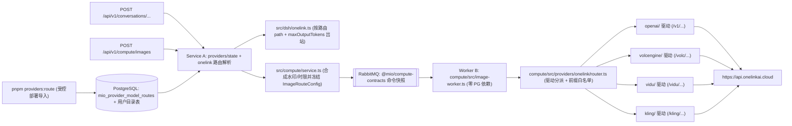

# 万联数据库模型路由目录与原厂协议解耦详细设计

状态：Unit 1（`onelink-db-vendor-routing`）实施与待人类接受阶段的专属架构、机制修枝与硬编码处置规格，归属[本需求 PRD](prd.md)。关联现行权威规范：[供应商配置](../../providers.md)、[供应商 HTTP](../../apis/providers.md)、[万联集成](../../integrations/onelink.md)、[计算 HTTP](../../apis/compute.md)、[计算服务协议](../compute-service/protocol.md)与[本地对话服务](../../conversations.md)。返回[任务资料与成果](../index.md)。

## 1. 现网 87+51 模型目录分布与协议分化矩阵

基于隔离库 `mio_provider_models` 的 **87 项现网 `current` 模型**与非生产迁移参考 [onelink-legacy-snapshot.ts](../../../tests/providers/fixtures/onelink-legacy-snapshot.ts)（`92` 项预设、`21` 组能力规格、`25` 项旧禁用 ID）全量比对，上游原厂、网关 `owned_by` 与真实通信协议的映射关系如下：

| 上游原厂域（`vendor`） | 现网数 / 旧预设门控数            | `/v1/models` `owned_by` 观察值    | 涵盖模态与协议/参数内部分化事实                                                                                                                                                                                                                                                                                                                                 |
| ---------------------- | -------------------------------- | --------------------------------- | --------------------------------------------------------------------------------------------------------------------------------------------------------------------------------------------------------------------------------------------------------------------------------------------------------------------------------------------------------------- |
| `alibaba`              | `30` 现网 / `+1` 门控            | `"阿里"`（29）、`"NVIDIA"`（1）   | 对话/推理/代码 16 项（含 `"NVIDIA"` 下的 `WL-Qwen2.5-72B-Instruct` 空描述）；全模态 `qwen3.5-omni-flash` 1 项；机器翻译 `` `qwen-mt-*` `` 4 项（专用 `translation_options`）；向量 `/v1/embeddings` `qwen3.7-text-embedding` 1 项；百炼 HappyHorse 异步视频 7 项（按 `*-t2v`/`*-i2v`/`*-r2v`/`*-video-edit` 分化参考上限）                                      |
| `volcengine`           | `14` 现网（另承接 2 项 Vega）    | `"字节跳动"`（14）、`"腾讯"`（2） | 对话 `` `doubao-seed-2*` `` 6 项；同步生图 `/volc/api/v3/images/generations` 4 项（`doubao-seedream-4.0` vs `4.5` vs `5.0-lite`/`5-0-pro-260628`：尺寸 `1024x1024`–`4K`、参考图 `0..14`、`sequential_image_generation` 最多 `15` 张输出、`png`/`jpeg`、水印覆盖）；异步视频 Seedance 4 项 + `"腾讯"` 名下 `` `vega-1.0/1.5-pro` `` 2 项（均走火山方舟视频协议） |
| `minimax`              | `9` 现网 / `+3` 门控             | `"MiniMax"`                       | 对话 7 项（`minimax-m2`–`m3.1-flash`，兼容 OpenAI 或 Anthropic `/v1/messages`）；原生配音 `/v1/t2a_v2` 1 项（`speech-2.8-turbo`）；原生音乐 `/v1/music_generation` 1 项（`Music-3.0`，旧预设另有小写 `music-2.6`）                                                                                                                                              |
| `zhipu`                | `7` 现网                         | `"智谱"`                          | 对话 `glm-4.7`、`glm-5`、`glm-5-turbo`、`glm-5.1`（小写，与旧预设 `GLM-5.1` 大小写漂移）、`glm-5.2`、`glm-5.3`、`glm-5.3-flash`                                                                                                                                                                                                                                 |
| `moonshot`             | `7` 现网 / `+1` 门控             | `"月之暗面"`                      | 对话 `kimi-k2.5`、`kimi-k2.6`、`kimi-k2.7-code`、`kimi-k3`、`kimi-k3-1103`、`kimi-k3.1-pro`、`kimi-k3.1-pro-highspeed`                                                                                                                                                                                                                                          |
| `kling`                | `5` 现网 / `+1` 门控             | `"可灵"`                          | 异步生图 2 项：`image-kling-v3`（`/kling/v1/images/generations`，0–4 参考、1–4 输出）与 `image-kling-v3-omni`（`/kling/v1/images/omni-image`，单参考 `1`、单输出 `1`、`auto` 比例）；异步视频 3 项：`video-kling-v3`、`video-kling-v3-omni`、`kling-v2-5-turbo`（**无 `video-` 前缀且描述误写为生图**）                                                         |
| `deepseek`             | `4` 现网                         | `"DeepSeek"`                      | 对话 `deepseek-v3`、`deepseek-v4-flash`、`deepseek-v4-pro`、`deepseek-v4.1-flash`                                                                                                                                                                                                                                                                               |
| `tencent`              | `2` 现网混元（`+2` Vega 见火山） | `"腾讯"`                          | 混元对话 `hunyuan-3.0`、`hy4`（旧预设含 `hunyuan-3.0-free`）；同 `owned_by` 下 `vega-1.0-pro`、`vega-1.5-pro` 实走火山方舟协议                                                                                                                                                                                                                                  |
| `vidu`                 | `3` 现网                         | `"Vidu"`                          | 异步生图 `image-vidu-q2`（`/vidu/ent/v2/reference2image` + `/vidu/ent/v2/tasks/{task_id}/creations`，0–7 参考，`1080p`/`2K`/`4K`）；异步视频 `video-vidu-q2` 与 `video-viduq3-pro`（端点与参考模式互斥）                                                                                                                                                        |
| `xiaomi`               | `3` 现网                         | `"小米"`                          | 对话 `mimo-v2.6-flash`、`mimo-v2.6-pro`、`mimo-v2.6-pro-ultraspeed`                                                                                                                                                                                                                                                                                             |
| `stepfun`              | `1` 现网                         | `"阶跃星辰"`                      | 对话 `step-3.5-flash`                                                                                                                                                                                                                                                                                                                                           |
| `openai`               | `0` 现网 / `26` 门控             | 渠道门控未返回                    | 对话 22 项（`gpt-4o`、`` `gpt-5.5*` ``、`` `gpt-5.6*` ``、`` `s-gpt-*` ``）；生图 4 项：`` `gpt-image-2*` ``（`/v1/images/generations` + multipart `/v1/images/edits`，`1..10` 张，含 `'auto'`）与 `sp-gpt-image-2`（JSON 兼容路径，最多 `1` 张，无 `'auto'`）                                                                                                  |
| `anthropic`            | `0` 现网 / `8` 门控              | 渠道门控未返回                    | 对话 8 项（`` `claude-sonnet-*` ``、`` `s-claude-*` ``，走 `/v1/messages?beta=true`）                                                                                                                                                                                                                                                                           |
| `google`               | `0` 现网 / `6` 门控              | 渠道门控未返回                    | 对话 `gemini-3.5-flash`（OpenAI 兼容）；原生生图 3 项（`gemini-2.5-flash-image` 最多 3 参考/`1K`/`1` 张 vs `gemini-3.1-flash-image-preview` 最多 14 参考/`0.5K`–`4K`/`4` 张）；异步视频 `veo-3.1*` 2 项                                                                                                                                                         |

> [!IMPORTANT]
> 模态合计为 `59 对话/翻译/全模态 + 1 向量 + 7 图片 + 18 视频 + 1 语音 + 1 音乐 = 87 项现网模型`。上述实证直接决定：路由分类、驱动名、相对路径与参数上限必须以精确 `(provider_type, raw_model_id, operation)` 存储在 PostgreSQL，不能从 `owned_by`、前缀或自由描述推导，也不能把同原厂不同代际参数硬编码进协议驱动。

## 2. 全仓 164 个非文档/非测试文件硬编码清点与三类处置表

对全仓 `src/**`、`compute/src/**`、`contracts/compute/src/**`、`packages/foundation/src/**`、`scripts/**` 与根配置文件共 **164 个非 Markdown、非测试文件**扫描后确认：`src/assets/**`、`src/auth/**`、`src/contracts.ts`、`src/http-*.ts`、`src/integrations/{cos,redis,tencent-sms,wechat}.ts`、`packages/foundation/**` 与 `deploy/**` 为 **0 命中**。全部命中位点按以下三类桶处置：

- **桶 1（移入 PG 路由目录）**：迁入 `mio_provider_model_routes` 数据列或放宽硬编码 SQL/TS 枚举锁。
- **桶 2（重构为纯原厂驱动与逻辑路由）**：拆入共享 `ImageRouteConfig`、A 侧快照冻结与 B 侧 `compute/src/providers/onelink/` 纯协议驱动。
- **桶 3（按 `DESIGN-OVER-001` 保留的受控边界）**：显式保留的安全常量、进程隔离、防重放与非目标协议边界。

| 文件路径与行号范围                                                                                                                                                                                                                                                                                   | 当前硬编码内容                                                                                                                                         | 处置分类与目标规格                                                                                                                                                                                                                                                                                                                                                                           |
| ---------------------------------------------------------------------------------------------------------------------------------------------------------------------------------------------------------------------------------------------------------------------------------------------------- | ------------------------------------------------------------------------------------------------------------------------------------------------------ | -------------------------------------------------------------------------------------------------------------------------------------------------------------------------------------------------------------------------------------------------------------------------------------------------------------------------------------------------------------------------------------------- |
| [contracts/compute/src/images.ts](../../../contracts/compute/src/images.ts) 与 [contracts/compute/src/image-routes.ts](../../../contracts/compute/src/image-routes.ts)                                                                                                                               | 旧 `IMAGE_PROFILES` 四元数组、`isImageProfile` 及 `switch (profile)` 分支                                                                              | **桶 1 + 桶 2**：全面替换为纯原厂 `ImageDriver`（`openai-images`、`volcengine-ark-images`、`vidu-images`、`kling-images`）与必填 `ImageRouteConfig`；`validateImageInputByRoute` 按路由规格校验，移除全部旧四类 profile 名与兼容映射表                                                                                                                                                       |
| [contracts/compute/src/images.ts](../../../contracts/compute/src/images.ts)                                                                                                                                                                                                                          | `IMAGE_OPERATIONS = ['generate', 'edit', 'outpaint']`                                                                                                  | **桶 3**：保留图片计算契约的三类标准操作语义，具体模型允许集由路由 `param_spec.supportedOperations` 控制                                                                                                                                                                                                                                                                                     |
| [contracts/compute/src/image-routes.ts](../../../contracts/compute/src/image-routes.ts)                                                                                                                                                                                                              | 旧 `IMAGE_PROFILE_RULES` 与各 profile 硬编码锁（尺寸、张数、格式、强制水印、禁参考图）                                                                 | **桶 1**：全部迁入 `mio_provider_model_routes` 的 `param_spec`、`request_defaults` 与 `output_spec`；生产源码与共享契约不保留任何默认模型规格表                                                                                                                                                                                                                                              |
| [contracts/compute/src/images.ts](../../../contracts/compute/src/images.ts) `L65`, `L228-229`, `L262`, `L343-344`, `L444-445`, `L589`                                                                                                                                                                | 输入图片 `png\|jpeg\|webp`、mask `png`、`prompt.length <= 32_000`、`queryAttempt <= 16`                                                                | **桶 3**：保留平台级输入安全与有界轮询硬上限，单模型可在 `param_spec.async.maxQueries`（`1..16`）内进一步收紧                                                                                                                                                                                                                                                                                |
| [contracts/compute/src/images.ts](../../../contracts/compute/src/images.ts) `L68-103`, `L263-282`, `L509-577`                                                                                                                                                                                        | GPT 中心化的 `ImageRequestParameters` 与 `validGptImageInput`（`n` `1..10`、GPT 质量/背景/审核枚举、尺寸 `%16` 规则）                                  | **桶 1 + 桶 2**：请求字段与校验改为由 `ImageRouteConfig.paramSpec` 驱动（覆盖 `maxN: 1..16`、`allowedSizes`、`allowCustomDimensions`、各原厂可选枚举如 `aspect_ratio`/`resolution` 等已核实字段），未知字段继续拒绝                                                                                                                                                                          |
| [contracts/compute/src/images.ts](../../../contracts/compute/src/images.ts) `L190`, `L389-397`, `L431`                                                                                                                                                                                               | 输出键单数字正则 `^([0-9])-`、`index <= 9`、`outputs.length <= 10`                                                                                     | **桶 2**：放宽为 `^([0-9]\|1[0-5])-`、`index <= 15`、`outputs.length <= 16`，解锁火山 Seedream 5.0 最多 15 张输出                                                                                                                                                                                                                                                                            |
| [contracts/compute/src/index.ts](../../../contracts/compute/src/index.ts) `L9-16`, `L24-25`, `L36-39`, `L63`, `L81`, `L166`                                                                                                                                                                          | 重导出旧图片 profile；保留 `COMPUTE_PROFILE = 'mp4-h264-aac-720p24-v1'` 及消息字节上限 `8192` / `160_000` / `1 GiB`                                    | **桶 2 + 桶 3**：导出 `ImageRouteConfig` 与路由校验器；视频转码固定 `COMPUTE_PROFILE` 与 AMQP 消息体积护栏按 **桶 3** 原样保留                                                                                                                                                                                                                                                               |
| [compute/src/images.ts](../../../compute/src/images.ts) `L79-99`, `L308-513`, `L552-601`, `L614-615`, `L632`, `L677`, `L697`, `L725`, `L737-775`, `L814`                                                                                                                                             | 6 条硬编码完整 `https://api.onelinkai.cloud/...` URL、4 个 profile `switch`、Seedream `watermark: true`/`1024x1024`、Kling `n !== 1` 等 854 行混合实现 | **桶 1 + 桶 2 + 桶 3**：拆分为 `compute/src/providers/onelink/{router.ts,shared/,openai/,volcengine/,vidu/,kling/}`；路径与默认项全部来自 `ImageRouteConfig`（**桶 1/2**）；`ONELINK_ORIGIN`、`1 MiB` 异步 JSON 上限、`180_000ms` 超时与返回张数不超请求数校验按 **桶 3** 保留在 `shared/`                                                                                                   |
| [compute/src/image-worker.ts](../../../compute/src/image-worker.ts) `L90-109`, `L111-116`, `L125`, `L175`, `L214`, `L220`, `L464-478`                                                                                                                                                                | `isImageProfile` 分派、保存格式回退、3 次物化重试，以及 `L464-478` 仅在非异步 `edit`/`outpaint` 时预读私有 COS 输入资产                                | **桶 2 + 桶 3**：改为统一经 `router.ts` 按 `ImageRouteConfig` 分派；修复 `L464-478`，当请求含参考图/遮罩（含 `allowGenerateReferences: true` 的同步或异步 `generate`）时均在写日志前从私有 COS 预读输入；3 次物化重试上限按 **桶 3** 保留                                                                                                                                                    |
| [src/providers/contracts.ts](../../../src/providers/contracts.ts)                                                                                                                                                                                                                                    | 五类 `categories`、`type: 'onelink'`、`ChatProfile` 与图片驱动类型、`ChatRuntimeSnapshot`/`ImageRuntimeSnapshot`                                       | **桶 2 + 桶 3**：统一以 `vendor` 与 `ImageDriver`/`ChatProfile` 承载受控路由与运行时快照（不含 `origin` 双轨字段）；五类公开业务分类与逻辑供应商 `onelink` 按 **桶 3** 保留（`embedding` 等未开放执行器的模型保持不可调用）                                                                                                                                                                  |
| [src/providers/schema.ts](../../../src/providers/schema.ts)                                                                                                                                                                                                                                          | 旧 `imageProfileSqlLiterals`、硬编码枚举与 `checkProviderSchema` 字面量断言                                                                            | **桶 1**：在 `providerSchemaSQL` 建立 `mio_provider_model_routes` 与单用户 `mio_provider_model_verifications`（幂等移除旧 `adaptation_origin` 列，无损保留既有 `mio_provider_model_adaptations` 表并在命中已启用路由时回填已验证记录），同步更新 `checkProviderSchema` 只读校验                                                                                                              |
| [src/providers/schema-migration.ts](../../../src/providers/schema-migration.ts)                                                                                                                                                                                                                      | 历史引用 `^onelink:(chat\|image\|video\|voice\|music):.+` 与稳定 `onelink:model:<uuid>` 迁移解析                                                       | **桶 3**：保留既有历史模型引用无损迁移兼容逻辑，不重造历史实体                                                                                                                                                                                                                                                                                                                               |
| [src/providers/state.ts](../../../src/providers/state.ts) `providerStateSQL`                                                                                                                                                                                                                         | 单条 SQL 读取用户配置、目录、偏好与路由/验证关联                                                                                                       | **桶 1 + 桶 2**：在同一 `providerStateSQL` 中按 `(provider_type, raw_model_id)` 关联本人 `mio_provider_models` 与已启用 `mio_provider_model_routes`，并按 `(provider_id, model_key, operation)` 关联 `mio_provider_model_verifications`（均严格受本人成员门控）                                                                                                                              |
| [src/providers/catalog.ts](../../../src/providers/catalog.ts) 与 [src/providers/onelink/router.ts](../../../src/providers/onelink/router.ts)                                                                                                                                                         | 旧硬编码 profile 校验、`references.maxImages` 锁死 `2..16`、单用户 `adaptations` 读取、偏好 PATCH 仅限 `chat`                                          | **桶 1 + 桶 2 + 桶 3**：`references.maxImages` 放宽为 `1..16`；单轨解析 `平台有效路由 -> ADAPTER_PENDING` 并从 `mio_provider_model_verifications` 按用户元组计算 `'unverified' \| 'verified'`；偏好 `PATCH` 仅限 `chat` 按 **桶 3** 保留                                                                                                                                                     |
| [src/providers/store.ts](../../../src/providers/store.ts) 与 [src/providers/service.ts](../../../src/providers/service.ts)                                                                                                                                                                           | `'onelink-v1-models'` 来源标记、`recordVerification`、`resolveImage`/`resolveChat`                                                                     | **桶 1 + 桶 2**：`store.ts` 提供 `importRoutes` 原子导入入口，并将 `recordVerification` 改为向 `mio_provider_model_verifications` 幂等 `UPSERT`；`service.ts` 按解析后的有效平台路由判定资格并透出 `vendor`、`driver` 与声明版本                                                                                                                                                             |
| [src/providers/http.ts](../../../src/providers/http.ts) `L8` & [src/plugin.ts](../../../src/plugin.ts) `L178`                                                                                                                                                                                        | 固定公开路由 `/api/v1/providers/onelink`                                                                                                               | **桶 3**：保留现行用户万联 HTTP 路由路径与无管理员写入口边界                                                                                                                                                                                                                                                                                                                                 |
| [src/dsh/onelink.ts](../../../src/dsh/onelink.ts) `L12`, `L28-55`, `L65-66`, `L97-101`, `L125-140`, `L211-216` & [src/dsh/conversations.ts](../../../src/dsh/conversations.ts) `L26`, `L30`                                                                                                          | 硬编码文本路径/`baseUrl` 与 `maxTokens: 1024`（拒绝 `> 1024`）、`30_000ms` 超时、纯文本模态限制                                                        | **桶 1 + 桶 2 + 桶 3**：`maxOutputTokens` 改从有效路由 `capability_metadata.maxOutputTokens` 读取（`1..65536`，默认 `1024`）；`submit_path` 按 `PiAiAdapter` SDK 后缀不变量派生 `baseUrl`（`openai-chat` 剥离末尾 `/chat/completions`，`anthropic-messages` 固定 `/v1/messages`）；超时/工具拦截按 **桶 3** 保留                                                                             |
| [src/conversations/config.ts](../../../src/conversations/config.ts) `L31-32`、[cordis.patch.yml](../../../cordis.patch.yml) `L5-10`、[src/conversations/schema.ts](../../../src/conversations/schema.ts) `L8,14,18-20`、[src/conversations/store.ts](../../../src/conversations/store.ts) `L213-228` | 未启用 provider 域时的 `deepseek-official` legacy 装配；会话绑定 JSONB                                                                                 | **桶 3**：保留无 provider 域底座回退及既有会话 `model_binding` 元数据兼容                                                                                                                                                                                                                                                                                                                    |
| [src/integrations/onelink/models.ts](../../../src/integrations/onelink/models.ts) `L4`, `L27` & [src/integrations/onelink/chat.ts](../../../src/integrations/onelink/chat.ts) `L1`, `L17-24`                                                                                                         | `ONELINK_ORIGIN = 'https://api.onelinkai.cloud'`、固定 `/v1/models`、`chatTransport` 精确 URL 及 `/v1/messages?beta=true` 核验                         | **桶 2 + 桶 3**：保留固定 `ONELINK_ORIGIN` 与 `/v1/models` 目录发现入口（**桶 3**）；`chatTransport` 精确比对 `${ONELINK_ORIGIN}${submit_path}`（仅 `anthropic-messages` 的 `/v1/messages` 额外允许 `?beta=true`）（**桶 2**）                                                                                                                                                               |
| [src/compute/service.ts](../../../src/compute/service.ts) `L271-293`, `L309-337`, `L386-421`                                                                                                                                                                                                         | 硬编码参数键白名单、`IMAGE_PROFILE_RULES` 检查，以及 `L416-421` 将异步 `expiresAt` 硬截断在 `10 * 60_000`（10 分钟）                                   | **桶 1 + 桶 2**：改为消费有效 `ImageRouteConfig` 执行准入校验，按 `allowWatermarkOverride` 合成用户 `default_image_watermark`，将异步截止放开至声明的 `maxAgeSeconds`（最高 `86_400` 秒），并将 `ImageRouteConfig` 封入 AMQP 命令与任务记录                                                                                                                                                  |
| [src/compute/store.ts](../../../src/compute/store.ts) & [src/compute/schema.ts](../../../src/compute/schema.ts)                                                                                                                                                                                      | 配额检查（单用户 `10` / 全局 `500`）、`250ms` 首次轮询与线性退避、`mio_image_jobs` 表结构                                                              | **桶 2 + 桶 3**：在 `computeSchemaSQL` 与 `checkComputeSchema` 为 `mio_image_jobs` 新增可空 `route_snapshot jsonb` 支撑重启后继续 `image.query`（未发 `image.request` 缺失合法 `route` 时 fail-closed 结算 `rejected` / `IMAGE_HANDLER_UNAVAILABLE`，在途 `image.query` 缺失/非法快照 fail-closed 结算 `failed` / `IMAGE_QUERY_FAILED`，不回退硬编码表）；配额与均匀退避算法按 **桶 3** 保留 |
| [scripts/service/import-provider-route.ts](../../../scripts/service/import-provider-route.ts)                                                                                                                                                                                                        | 退役原单用户 `import-provider-adaptation.ts`（`providers:adapt`）及内置种子选项                                                                        | **桶 1 + 桶 2**：提供单轨受控路由导入 CLI `pnpm providers:route <--stdin \| routes.json>`（`<= 65_536` 字节，写入 `mio_provider_model_routes`），零内置模型清单                                                                                                                                                                                                                              |
| [scripts/service/observe-compute.ts](../../../scripts/service/observe-compute.ts) `L138-159`, `L243-295`                                                                                                                                                                                             | 本地视频转码基准延迟阈值与 `profileDigest` 观察脚本（零 OneLink 模型/协议硬编码）                                                                      | **桶 3**：按计算服务视频转码基准观察职责原样保留，不掺入供应商路由逻辑                                                                                                                                                                                                                                                                                                                       |

## 3. PostgreSQL `mio_provider_model_routes` 数据模型与读取语义

### 3.1 表结构与约束定义

在 `src/providers/schema.ts` 的 `providerSchemaSQL`（经 `scripts/service/migrate-providers.ts` / `pnpm providers:migrate --apply` 执行）中新增平台级路由目录表 `mio_provider_model_routes`（无跨库外键，不关联具体 `provider_id` 或 `user_id`）以及单用户运行验证表 `mio_provider_model_verifications`：

```sql
CREATE TABLE IF NOT EXISTS mio_provider_model_routes (
  provider_type text NOT NULL DEFAULT 'onelink'
    CHECK (provider_type = 'onelink'),
  raw_model_id text COLLATE "C" NOT NULL
    CHECK (octet_length(raw_model_id) BETWEEN 1 AND 256 AND raw_model_id !~ '[[:cntrl:]]'),
  operation text NOT NULL
    CHECK (operation IN ('chat', 'image.generate')),
  vendor text NOT NULL
    CHECK (char_length(vendor) BETWEEN 1 AND 64 AND vendor ~ '^[a-z0-9-]+$'),
  driver text NOT NULL
    CHECK (char_length(driver) BETWEEN 1 AND 64 AND driver ~ '^[a-z0-9-]+$'),
  classification text NOT NULL
    CHECK (classification IN ('chat', 'image', 'video', 'voice', 'music')),
  submit_path text NOT NULL
    CHECK (
      char_length(submit_path) BETWEEN 2 AND 256
      AND submit_path ~ '^/[A-Za-z0-9._/{}-]+$'
      AND position('..' in submit_path) = 0
      AND position('//' in submit_path) = 0
    ),
  edit_path text
    CHECK (
      edit_path IS NULL OR (
        char_length(edit_path) BETWEEN 2 AND 256
        AND edit_path ~ '^/[A-Za-z0-9._/{}-]+$'
        AND position('..' in edit_path) = 0
        AND position('//' in edit_path) = 0
      )
    ),
  query_path_template text
    CHECK (
      query_path_template IS NULL OR (
        char_length(query_path_template) BETWEEN 2 AND 256
        AND query_path_template ~ '^/[A-Za-z0-9._/{}-]+$'
        AND position('..' in query_path_template) = 0
        AND position('//' in query_path_template) = 0
        AND position('{task_id}' in query_path_template) > 0
      )
    ),
  param_spec jsonb NOT NULL DEFAULT '{}'::jsonb
    CHECK (jsonb_typeof(param_spec) = 'object'),
  request_defaults jsonb NOT NULL DEFAULT '{}'::jsonb
    CHECK (jsonb_typeof(request_defaults) = 'object'),
  output_spec jsonb NOT NULL DEFAULT '{}'::jsonb
    CHECK (jsonb_typeof(output_spec) = 'object'),
  capability_metadata jsonb NOT NULL DEFAULT '{}'::jsonb
    CHECK (jsonb_typeof(capability_metadata) = 'object'),
  source_kind text NOT NULL
    CHECK (source_kind IN ('protocol-reference', 'runtime-observation')),
  source text NOT NULL
    CHECK (char_length(btrim(source)) BETWEEN 1 AND 500),
  source_version text NOT NULL
    CHECK (char_length(btrim(source_version)) BETWEEN 1 AND 200),
  declaration_version integer NOT NULL DEFAULT 1
    CHECK (declaration_version >= 1),
  enabled boolean NOT NULL DEFAULT true,
  created_at timestamptz NOT NULL DEFAULT now(),
  updated_at timestamptz NOT NULL DEFAULT now(),
  PRIMARY KEY (provider_type, raw_model_id, operation)
);

CREATE TABLE IF NOT EXISTS mio_provider_model_verifications (
  provider_id uuid NOT NULL,
  model_key uuid NOT NULL,
  operation text NOT NULL
    CHECK (operation IN ('chat', 'image.generate')),
  declaration_version integer NOT NULL
    CHECK (declaration_version > 0),
  driver text NOT NULL
    CHECK (char_length(driver) BETWEEN 1 AND 64 AND driver ~ '^[a-z0-9-]+$'),
  verification_status text NOT NULL DEFAULT 'unverified'
    CHECK (verification_status IN ('unverified', 'verified')),
  verified_at timestamptz,
  verification_evidence text,
  tested_tuple jsonb,
  PRIMARY KEY (provider_id, model_key, operation),
  FOREIGN KEY (provider_id, model_key) REFERENCES mio_provider_models(provider_id, model_key)
);
```

同时在 `providerSchemaSQL` 中执行非破坏性增量升级与存量验证回填：

- 保留既有本地 `mio_provider_model_adaptations` 表与行数据不做破坏性删除，并通过 `ALTER TABLE mio_provider_model_verifications DROP COLUMN IF EXISTS adaptation_origin` 清理已退役的双轨来源列。
- 当 `mio_provider_model_adaptations` 存在且某条 `verification_status = 'verified'` 记录在 `mio_provider_model_routes` 存在匹配的已启用 `(provider_type, raw_model_id, operation, driver)` 路由时，将其（剥离 `tested_tuple.adaptationOrigin`）以 `ON CONFLICT (provider_id, model_key, operation) DO NOTHING` 幂等回填至 `mio_provider_model_verifications`。
- 更新 `src/providers/schema.ts` 的 `checkProviderSchema`，只读核验 `mio_provider_model_routes` 与 `mio_provider_model_verifications` 必需列、OID 类型及主键存在。

### 3.2 JSONB 字段结构契约

写入（`pnpm providers:route`）与读取（`src/providers/onelink/`）两侧共用严格的纯 TypeScript 结构校验器，拒绝未知键或越界值：

1. **`param_spec`（图片 `operation = 'image.generate'`）**：
   - `supportedOperations`: `readonly ('generate' | 'edit' | 'outpaint')[]`（非空且必须包含 `'generate'`；含 `'edit'` 且走独立编辑端点时须配置 `edit_path` 或由原厂驱动在同一 `submit_path` 承载；含 `'outpaint'` 时必须 `allowOutpaintGeometry: true`）。
   - `requiresAsync`: `boolean`（为 `true` 时 `query_path_template` 与 `async` 必填）。
   - `maxN`: `integer`（范围 `1..16`，如 `doubao-seedream-4.0` 为 `1`、`` `doubao-seedream-5.0*` `` 为 `15`、`` `gpt-image-2*` `` 为 `10`、`image-kling-v3` 为 `4`、`image-kling-v3-omni` 为 `1`）。
   - `allowedSizes`: `readonly string[] | null`（精确允许的尺寸/分辨率枚举，如 `['1024x1024']`、`['1K', '2K', '3K', '4K']`、`['1080p', '2K', '4K']`）。
   - `allowCustomDimensions`: `boolean`（是否允许像素宽高乘积/整除规则，如 GPT `%16` 自定义尺寸）。
   - `maxReferenceImages`: `integer`（范围 `0..16`，**显式允许 `1`** 以支持 `image-kling-v3-omni`，`7` 支持 `image-vidu-q2`，`14` 支持 `` `doubao-seedream-5.0*` ``）。
   - `allowGenerateReferences`: `boolean`（是否在 `operation = 'generate'` 下接受参考图资产）。
   - `allowMaskPng`: `boolean`（是否接受 PNG 遮罩资产 `maskAssetId`）。
   - `allowOutpaintGeometry`: `boolean`（默认 `false`；上游 `geometry` 未实证前按 `DESIGN-OVER-001` 保持关闭）。
   - 原厂可选参数白名单：`allowedQualities`、`allowedBackgrounds`、`allowedModerations`、`allowedOutputFormats`、`allowedAspectRatios`（均为空数组或字符串枚举；仅放行对应驱动实际编码的参数）。
   - `allowWatermarkOverride`: `boolean`（为 `true` 时准入层采用用户 `mio_provider_configs.default_image_watermark`；为 `false` 时固定使用 `request_defaults.watermark`）。
   - `async`: `null | { operations: readonly ('generate' | 'edit' | 'outpaint')[]; maxQueries: number /* 1..16 */; maxAgeSeconds: number /* 1..86400 */ }`。
2. **`request_defaults`**：`{ watermark?: boolean | null; sequentialImageGeneration?: 'disabled' | 'auto' | null; responseFormat?: 'b64_json' | 'url' | null; stream?: boolean | null; defaultSize?: string | null; referenceFormat?: 'image' | 'image_list' | null }`（其中 `kling-images` 开启参考图时必须显式声明 `referenceFormat`，`'image'` 模式硬性要求 `maxReferenceImages <= 1`，不按 URL 后缀猜测）。
3. **`output_spec`**：`{ fixedOutputFormat: 'png' | 'jpeg' | 'webp' | null }`。
4. **`capability_metadata`**：`{ contextWindow?: number /* 正整数 */; maxOutputTokens?: number /* 1..65536，缺省按 1024 执行 */ }`。

### 3.3 单条 SQL MVCC 合并与多用户隔离语义

`src/providers/state.ts` 的 `providerStateSQL` 保持单条一致读取 SQL，严格以当前用户的 `mio_provider_configs` 与 `mio_provider_models` 为主表，按本人成员门控关联平台路由表 `mio_provider_model_routes` 与本用户验证表 `mio_provider_model_verifications`：

- **零目录注入保证**：路由子查询限定 `r.provider_type = c.provider_type AND r.enabled = true AND EXISTS (SELECT 1 FROM mio_provider_models m WHERE m.provider_id = c.id AND m.raw_model_id = r.raw_model_id COLLATE "C")`；验证子查询限定 `v.provider_id = c.id`。若用户尚未执行 `/v1/models` 成功发现，或某 `raw_model_id` 不在该用户 `mio_provider_models` 中，绝不会返回该模型行；若该行 `membership_state <> 'current'` 或 `c.catalog_credential_version <> c.credential_version`，即使命中路由表，`discovered` 与 `runnable` 仍严格为 `false`。
- **单轨适配判定（同一 `(model_key, operation)`）**：
  1. **平台路由目录（`mio_provider_model_routes`）**：若 `r.enabled = true`、`r.driver` 属于当前服务端已实现驱动且路由规格校验通过，采用该路由记录，对外返回 `vendor`、`profile`（即 `driver`）及声明来源（`sourceKind`、`source`、`sourceVersion`、`declarationVersion`）。
  2. **待适配回退（`ADAPTER_PENDING`）**：未命中已启用平台路由、路由规格不完整（如异步模型缺少合法 `query_path_template`）或指向未实现驱动时，`adaptation = null`，保持 `ADAPTER_PENDING`。
- **分类与用户级验证独立持久化（`mio_provider_model_verifications`）**：
  - 模型展示分类按 `m.classification ?? effectiveRoute.classification ?? null` 计算（仅作用于用户已存在的模型实体，未知分类仍不自动归入 `chat`）。
  - `src/providers/store.ts` 的 `recordVerification` 在事务锁住当前 `mio_provider_configs` 行并核对请求快照仍匹配当前 `(credential_version, catalog_version)` 与当前生效平台路由 `(declaration_version, driver)` 后，向 `mio_provider_model_verifications` 执行 `INSERT ... ON CONFLICT (provider_id, model_key, operation) DO UPDATE SET verification_status = 'verified', verified_at = now(), verification_evidence = ..., tested_tuple = ...`。
  - 读取时仅当 `v.verification_status = 'verified'` 且 `v.declaration_version`、`v.driver` 及 `v.tested_tuple` 中的 `(credentialVersion, catalogVersion, adaptationVersion, operation, profile)` 与当前生效状态完全一致时，对外返回 `verification.status = 'verified'`（其余情形统一返回 `'unverified'`，保留 `verified_at`、`verification_evidence` 与 `tested_tuple` 供对账；不存在 `'failed'` 枚举值）。Key 轮换、目录重扫产生新版本或平台路由实质更新递增 `declaration_version` 均自动使当前有效验证回到 `'unverified'`，且绝不跨用户共享 `verified` 状态。

### 3.4 受控路由导入工具 `pnpm providers:route`

新增 [scripts/service/import-provider-route.ts](../../../scripts/service/import-provider-route.ts)（在 `package.json` 暴露 `pnpm providers:route`）：

- 仅支持显式输入 `pnpm providers:route <--stdin | routes.json>`，读取单条路由对象、`{ routes: [...] }` 或路由数组 JSON（`1..500` 条，读取前校验普通文件或标准输入上限 `65_536` 字节）；不提供 `--seed` 等内置模型清单参数。
- 写入前复用与运行时相同的校验器核验 `driver` 存在性、相对路径语法、驱动路径前缀/后缀不变量（如文本 `openai-chat` 的 `submit_path` 必须以 `/v1/` 开头且以 `/chat/completions` 结尾，`anthropic-messages` 的 `submit_path` 必须为 `/v1/messages`）及 `param_spec` 完整性；任何字段非法整批回滚。
- 对已存在的 `(provider_type, raw_model_id, operation)`，仅在实质路由/规格/来源字段变化时执行更新并递增 `declaration_version = mio_provider_model_routes.declaration_version + 1`；幂等重放相同内容不虚增版本号，从而不无故失效用户已完成的运行验证。

## 4. 跨进程路由快照与纯原厂协议驱动架构



### 4.1 `@mio/compute-contracts` 共享契约与消息密封

在 `contracts/compute/src/` 新增纯类型与校验模块（经 `contracts/compute/src/index.ts` 导出）：

- **`ImageRouteConfig`**：封装 `vendor`、`driver`（`'openai-images' | 'volcengine-ark-images' | 'vidu-images' | 'kling-images'`）、`submitPath`、`editPath`、`queryPathTemplate`、`requiresAsync`、`paramSpec`、`requestDefaults`、`outputSpec` 以及由 Service A 在准入时计算完毕的 `effectiveWatermark: boolean | null`。
- **防篡改与恢复绑定**：
  - `ImageCommandV1` 与 `ImageQueryCommandV1` 强制携带必填 `route: ImageRouteConfig` 与 `profile: ImageDriver`（且强制校验 `route.driver === profile`，消息总长受 `IMAGE_MAX_MESSAGE_BYTES = 160_000` 约束，拒绝缺省 `route` 或旧四类 profile 字符串）。
  - `src/compute/schema.ts` 在 `computeSchemaSQL` 新增 `ALTER TABLE mio_image_jobs ADD COLUMN IF NOT EXISTS route_snapshot jsonb` 并在 `checkComputeSchema` 只读校验该列（经 `pnpm compute:migrate --apply` 执行）；`src/compute/service.ts` 将规范化 `canonicalImageRouteConfig(route)` 纳入一次性凭据密文信封的 AEAD AAD（`imageCommandCredentialBinding` / `imageQueryCredentialBinding`），并将 `route_snapshot` 持久化至 `mio_image_jobs`。后续 `image.query` 调度与进程重启恢复直接消费任务准入时冻结的 `route_snapshot`，不受在途路由表变更干扰；若未发旧 `image.request` 缺失合法 `route`/`profile`，一律 fail-closed 结算 `rejected` / `IMAGE_HANDLER_UNAVAILABLE`，若在途 `image.query` 或恢复异常记录缺少有效 `route_snapshot`，一律 fail-closed 结算 `failed` / `IMAGE_QUERY_FAILED`，不回退任何已删除的硬编码规则表。
- **两处既有实现缺陷一并修正**：
  1. `contracts/compute/src/images.ts` 输出对象键正则从 `^([0-9])-`（`<= 10`）扩展为 `^([0-9]|1[0-5])-`（`outputs.length <= 16`）。
  2. `src/compute/service.ts:416-421` 异步任务 `expiresAt` 改为按 `route.paramSpec.async.maxAgeSeconds * 1000`（上限 `86_400_000` 毫秒，并与凭据有效期取较早值）计算，解除原 `10 * 60_000` 硬截断。

### 4.2 Worker B 纯原厂驱动目录与职责拆分

移除 `compute/src/images.ts` 内的混合编解码与硬编码常量，拆分为 `compute/src/providers/onelink/` 下的纯模块（`compute/src/images.ts` 仅保留对外薄重导出或按消费者直接切换至新入口，消除单文件膨胀）：

| 模块路径                                    | 单一职责与允许路径前缀                                                                                                             | 关键协议行为（零硬编码模型分支）                                                                                                                                                                                                                                                                                     |
| ------------------------------------------- | ---------------------------------------------------------------------------------------------------------------------------------- | -------------------------------------------------------------------------------------------------------------------------------------------------------------------------------------------------------------------------------------------------------------------------------------------------------------------- |
| `compute/src/providers/onelink/shared/`     | 固定 `ONELINK_ORIGIN`、相对路径拼接与前缀核验、`1 MiB` 异步 JSON 读取、`withPublicHttps` SSRF 固定下载、图片签名核验、网关错误脱敏 | 拒绝任何绝对 URL、`..`、`//`、查询串注入或跨前缀路径；统一执行 `rawImages.length <= requestedCount` 防膨胀核验                                                                                                                                                                                                       |
| `compute/src/providers/onelink/router.ts`   | 唯一图片驱动逻辑路由器                                                                                                             | 对 `route.driver` 执行穷尽 `switch`，强制核对各驱动路径前缀白名单后委托对应驱动，未知驱动立即以受控错误拒绝                                                                                                                                                                                                          |
| `compute/src/providers/onelink/openai/`     | 前缀白名单：`/v1/`                                                                                                                 | `generate` POST `route.submitPath`（JSON），`edit`/`outpaint` POST `route.editPath`（multipart `FormData` 携带私有 COS 预读参考图与可选 PNG `mask` 或 JSON `image_urls` 兼容模式），解析 `data[].b64_json` 与 token usage                                                                                            |
| `compute/src/providers/onelink/volcengine/` | 前缀白名单：`/volc/`                                                                                                               | 同步 POST `route.submitPath`（如 `/volc/api/v3/images/generations`），按 `route.requestDefaults` 与 `route.effectiveWatermark` 组装 `model`、`prompt`、`size`、可选参考图、`sequential_image_generation`（支持 `maxN` 至 `15`）、`response_format`、`watermark`，支持 `b64_json` 或经 `withPublicHttps` 下载结果 URL |
| `compute/src/providers/onelink/vidu/`       | 前缀白名单：`/vidu/`                                                                                                               | 异步提交 POST `route.submitPath`（0–7 张参考图编码为 data URI，`size` 映射 `resolution`），异步查询 GET 将 `route.queryPathTemplate` 中 `{task_id}` 替换为 `encodeURIComponent(upstreamTaskId)`，解析封闭状态集与 `creations[].url`                                                                                  |
| `compute/src/providers/onelink/kling/`      | 前缀白名单：`/kling/`                                                                                                              | 异步提交 POST `route.submitPath`（同时支持标准 `/kling/v1/images/generations` 与 Omni `/kling/v1/images/omni-image`，按 `paramSpec` 发送 `model_name`、`prompt`、`n`、可选参考图/比例），查询 GET 替换 `{task_id}`，复用纯大小写封闭状态机 `normalizeKlingTaskStatus` 并忽略万联计费包装字段                         |

同时更新 [compute/src/image-worker.ts](../../../compute/src/image-worker.ts) `L464-478`：只要命令中存在待读取的 `inputAssets` 或 `maskAsset`（涵盖 `edit`、`outpaint` 以及 `allowGenerateReferences: true` 的同步/异步 `generate`），统一在提交上游前以 `If-Match` 从私有 COS 读取原始字节，读取失败不触发任何上游请求。

### 4.3 Service A 供应商逻辑路由模块与文本上限接入

- 在 [src/providers/onelink/router.ts](../../../src/providers/onelink/router.ts) 建立零模型硬编码的纯逻辑路由与结构校验模块（生产代码不打包任何静态预设模型种子，测试所需路由样本集中位于 [onelink-routes-fixture.ts](../../../tests/providers/fixtures/onelink-routes-fixture.ts)）。
- 在 [src/dsh/onelink.ts](../../../src/dsh/onelink.ts)、[src/dsh/conversations.ts](../../../src/dsh/conversations.ts) 与 [src/integrations/onelink/chat.ts](../../../src/integrations/onelink/chat.ts) 中，将 `ChatRuntimeSnapshot` 携带的 `maxOutputTokens`（默认 `1024`，合法区间 `1..65536`）与 `submitPath` 接入请求校验与 `PiAiAdapter` 调用，解除全模型一刀切 `1024` token 锁。因固定版 `PiAiAdapter` 的 `openAICompletionsApi` 总是在 `model.baseUrl` 后追加 `/chat/completions`，而 `anthropicMessagesApi` 总是在 `model.baseUrl` 后追加 `/v1/messages?beta=true`，且 `chatTransport` 强制精确比对 `request.url`，路由校验与适配层严格遵守以下后缀不变量：
  1. `driver = 'openai-chat'`：`submit_path` 必须以 `/v1/` 开头且以 `/chat/completions` 结尾（如 `/v1/chat/completions`），`baseUrl` 派生为 `` `${ONELINK_ORIGIN}${submit_path.slice(0, -'/chat/completions'.length)}` ``，`chatTransport` 精确校验 `` request.url === `${ONELINK_ORIGIN}${submit_path}` ``。
  2. `driver = 'anthropic-messages'`：`submit_path` 必须精确为 `/v1/messages`，`baseUrl` 固定为 `ONELINK_ORIGIN`，`chatTransport` 仅允许 `` `${ONELINK_ORIGIN}/v1/messages` `` 或 `` `${ONELINK_ORIGIN}/v1/messages?beta=true` ``。

## 5. `DESIGN-OVER-001` 复杂度论证与源码护栏合规清单

### 5.1 `DESIGN-OVER-001` 设计取舍依据

| 审阅维度               | 具体事实与判断                                                                                                                                                                                                                     |
| ---------------------- | ---------------------------------------------------------------------------------------------------------------------------------------------------------------------------------------------------------------------------------- |
| 具体失败模式与发生概率 | 现网 87 项模型中 86 项对新用户 `ADAPTER_PENDING`（发生率 100%）；同原厂新模型（`doubao-seedream-4.5`/`5.0*`、`image-kling-v3-omni`）因代码写死 URL、张数 `<=10`、`maxImages >= 2`、10 分钟轮询上限与强制水印而被拦截（已实证发生） |
| 拒绝的过度设计方案     | 拒绝构建“通用 HTTP 请求模板/JSONPath 响应提取引擎”、拒绝运行时加载外部脚本/JSON 文件、拒绝按 `owned_by` 或前缀自动猜协议（无法安全表达 multipart 文件流、封闭异步状态机与 SSRF 校验，且实证存在跨厂借壳）                          |
| 最小替代方案与维护成本 | 仅新增 1 张平台级 `mio_provider_model_routes` 表 + `ImageRouteConfig` 共享结构，将既有 854 行混合 `compute/src/images.ts` 按 4 家已实现原厂拆分为纯函数驱动；无新增外部中间件或后台进程                                            |
| 本次净收益             | 兼容已有原厂驱动的新模型通过 1 条受控路由记录即可对所有发现该模型的用户生效（零 TS 改动、零重发版），同时完整保留动态成员隔离、每用户验证状态、固定网关与 Worker 零 PG 隔离                                                        |

### 5.2 机制退役与修枝对照表（`DESIGN-OVER-001`）

| 已退役机制 / 残留层                                                                                                                                                                      | 退役理由（`DESIGN-OVER-001`）                                                                         | 单轨替代与兼容处置                                                                                                                                                                             |
| ---------------------------------------------------------------------------------------------------------------------------------------------------------------------------------------- | ----------------------------------------------------------------------------------------------------- | ---------------------------------------------------------------------------------------------------------------------------------------------------------------------------------------------- |
| `pnpm providers:adapt`（`import-provider-adaptation.ts`）、运行时读取 `mio_provider_model_adaptations`、`adaptation.origin`                                                              | 本地底座阶段无生产存量负担；单用户 CLI 适配与平台路由职责重叠，且单用户行会长期遮蔽平台路由升级       | 收敛为 `pnpm providers:route <--stdin \| routes.json>` 维护 `mio_provider_model_routes`，`mio_provider_model_verifications` 按用户独立保存验证；迁移保留旧表行并在路由匹配时幂等回填已验证记录 |
| `src/providers/onelink/seed-routes.ts` 与 `--seed` 选项                                                                                                                                  | 违反生产源码与构建产物不内置静态预设模型清单的边界（45 项硬编码模型 ID）                              | 生产 `src/` 与 `scripts/` 零模型清单；测试路由夹具迁入 [onelink-routes-fixture.ts](../../../tests/providers/fixtures/onelink-routes-fixture.ts)                                                |
| `IMAGE_PROFILES`、`IMAGE_PROFILE_RULES`、`LEGACY_PROFILE_ROUTES`、`resolveLegacyImageProfileRoute`、`DEFAULT_DRIVER_BASE_ROUTES`、可选 `route?`、`createImageProtocol`、`?? '1024x1024'` | 在共享契约与驱动内保留了按具体代际（如 Seedream 4.0、Vidu Q2、Kling v2/v3）写死的默认尺寸、路径和上限 | `@mio/compute-contracts` 与 Worker B 强制要求显式 `route: ImageRouteConfig` 与 `profile: ImageDriver`，所有参数边界与默认项均由路由记录显式提供；缺损 `route_snapshot` 直接 fail-closed        |

### 5.3 Unit 1 实施遵守的 AST 与工程护栏（`pnpm guard`）

1. **PostgreSQL `pg` 导入精确白名单（`AUTH_ADAPTER`）**：[scripts/harness/check-source.ts](../../../scripts/harness/check-source.ts) `L425-446` 规定除 `src/auth/**` 外，全仓仅 `src/{conversations,providers,assets,compute}/{store,schema}.ts` 共 8 个文件可导入 `pg`。新增的 `src/providers/onelink/router.ts` **不导入 `pg`**（建表与 SQL 执行留在 `src/providers/schema.ts` 与 `src/providers/store.ts`）；`compute/src/**` 严禁引入 `pg`。
2. **跨工程包隔离与 HTTP 栈差异（`PROJECT_DEPENDENCY`）**：[harness.config.json](../../../harness.config.json) `L51-101` 禁止 `src/**`（`app`）与 `compute/src/**`（`worker`）互相直接导入。跨进程共享的 `ImageRouteConfig` 与校验器位于 `contracts/compute/src/**` 并从 `contracts/compute/src/index.ts` 导出，修改后先构建 `contracts/compute` 再运行 `typecheck` 与 `guard`。同时注意 HTTP 依赖差异：`src/integrations/onelink/*` 使用全局 `fetch`，而 `compute/src/providers/onelink/*` 必须经 `compute/src/adapters/public-https.ts`（`undici` + `ipaddr.js` SSRF 防护客户端）出站，两侧不强行合并网络层。
3. **DSH 框架边界（`DSH_BOUNDARY`）**：[scripts/harness/check-source.ts](../../../scripts/harness/check-source.ts) `L447-458,484-488` 限制 `@deepseek-ai/*` 与 `@earendil-works/pi-ai` 仅能出现在 `src/plugin.ts` 和 `src/dsh/**`；`src/providers/**` 与 `src/conversations/**` 严禁反向导入 `src/dsh/**`。
4. **纯 `.ts` 源码根、零生产种子与运行时能力限制（`SOURCE_UNSUPPORTED` / `RUNTIME_CAPABILITY`）**：`src/**`、`compute/src/**`、`contracts/compute/src/**` 与 `scripts/**` 下仅允许 `.ts` 文件，严禁内置模型清单，且 `src/**` 严禁导入 `node:fs`、`child_process`、`sqlite` 等受限模块。
5. **`scripts/service` 导入白名单同步（`DEVELOPMENT_DEPENDENCY`）**：`scripts/service/import-provider-route.ts` 仅依赖 [harness.config.json](../../../harness.config.json) `developmentDependencies["scripts/service"]` 已登记边界，并同步登记 [tsconfig.portable-tools.json](../../../tsconfig.portable-tools.json)。
6. **编译器与 Lint 严格约束**：全仓开启 `erasableSyntaxOnly: true`（禁用 TS `enum`，统一用 `as const` 字面量联合）、`exactOptionalPropertyTypes: true`、`noUncheckedIndexedAccess: true`、`verbatimModuleSyntax: true`，生产目录启用 `no-console: error` 与 `@typescript-eslint/no-explicit-any: error`。
