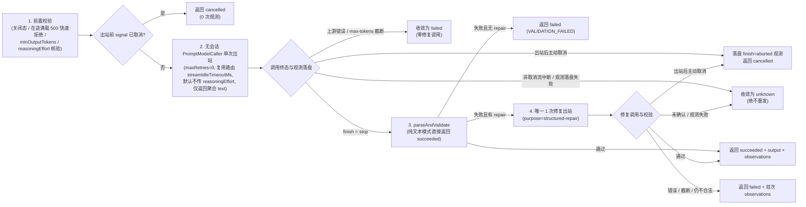

# Mio 受控提示词契约与结构化执行底座 PRD

**状态**：待评审。本文规划 Mio 后端跨业务共用的**受控提示词契约、不可信素材防注入信封、闭集实体短代号编解码、轻量 Token 预算估算及无会话 BYOK 单次/`1+1` 修复调用内核**（`src/prompts/` 与有界 `src/dsh/` 桥接），供漫剧工作流、画布工作流及后续无会话文本/结构化业务统一复用。P1–P2 是本期开发单元；本文当前只交付规划，不直接改写现行规范、生产源码或数据库。任务生命周期、开发授权、候选验证与业务接受按[当前任务的生命周期](../../coordination.md#当前任务的生命周期)与[规划交付要求](../../coordination.md#规划交付要求)分别记录。核对基线为仓库提交 `3441367`；实施前须以目标基线复核。[任务资料入口](../index.md) · [漫剧工作流 PRD](../drama-workflow/prd.md) · [画布接口承接 PRD](../canvas-integration/prd.md) · [统一资产库 PRD](../unified-asset-library/prd.md)

## 1. 背景、定位与跨业务需求依据

随着 Mio 从单一多轮对话底座向垂直创作业务演进，仓库内存在两类已明确的真实业务消费者共享同一套无会话推理与防注入需求：

1. **漫剧工作流**（[漫剧 PRD](../drama-workflow/prd.md#结构化任务与剧本对话)）：D2–D4 包含 7 类无对话历史的结构化文本任务（剧本确认、重新分集、单集重写、主体提取、主体字段梳理、智能分镜、自然语言改写镜头），均需要不可信素材隔离、闭集实体短代号、长剧本分块估算与 `1+1` 定向修复。
2. **画布工作流**（[画布 PRD](../canvas-integration/prd.md#第-4-期--文本节点执行)）：第 4 期单次无状态文本节点执行，按连线顺序读取直接上游节点已选正文与当前节点指令，执行单次无工具 BYOK 生成；复用本底座的不可信素材隔离信封、预算估算与 `executeTextPrompt` 即可零会话垃圾落地。

在架构定位上，本底座与既有[对话服务](../../conversations.md)构成互补的**双轨 AI 运行体系**：

- **有状态多轮自主 Agent 轨（既有）**：由 `src/conversations/` 与 `@deepseek-ai/dsh-agent` 承接，负责多轮创作对话、受控工具调用、长会话摘要压缩及后续按需技能（[对话增强 PRD](../conversation-enhancement/prd.md)）。
- **无状态结构化推理与文本执行轨（本 PRD）**：承接确定性业务管线所需的版本化提示词契约、不可信素材隔离、闭集实体短代号编解码、轻量 Token 预算估算及无会话 BYOK 单次/`1+1` 修复调用。

### 四层职责切分（消除跨层套娃与错层抽象）

| 职责维度             | 本底座（`src/prompts/` + `src/dsh/` 窄桥接）                                                                                           | 垂直业务域（`src/drama/`、`src/canvas/` 等）                                                                                         | 生成准入层（`src/generations/`）                                                       | 协议驱动层（`src/integrations/onelink/`）                                                                                                 |
| :------------------- | :------------------------------------------------------------------------------------------------------------------------------------- | :----------------------------------------------------------------------------------------------------------------------------------- | :------------------------------------------------------------------------------------- | :---------------------------------------------------------------------------------------------------------------------------------------- |
| 提示词契约与防注入   | `{ system, sharedContext?, prompt }` 前缀缓存布局约束、版本标识、不可信素材隔离信封（`formatDataBlock`）                               | 具体业务提示词文案、漫剧多模态风格/`three_view` 编译及业务侧用户可见提示词与私有入模词隔离                                           | 无（仅接收最终入模提示词）                                                             | 无（不感知业务语义）                                                                                                                      |
| 实体引用与业务校验   | 领域无关的闭集短代号双向映射（`RefTable<TId>`）与标准错误诊断结构                                                                      | 业务实体的 JSON Schema、字段白名单、同名合并约束、漫剧分镜正文 `@[Ref]` 提及防丢校验，以及实体到 `assetId` / `materialId` 的业务解析 | 无                                                                                     | 无                                                                                                                                        |
| 长文本与窗口预算     | 零 I/O 确定性纯函数 `estimateTokens(text)`                                                                                             | 按文档原生结构切分（如漫剧按集/场次切分大剧本、画布汇总多上游节点并决定是否拒单）                                                    | 无                                                                                     | 无                                                                                                                                        |
| 无会话模型调用与修复 | 无会话 BYOK 单次出站、满载 `503` 快速拒绝、`minOutputTokens` 零请求拦截、默认关闭 `reasoningEffort`、剥离 `thinking` 块、最多 1 次修复 | 任务受理幂等（`requestId`）、持久化任务队列 `claim` 并发控制、冻结业务快照、`baseRevision` 乐观锁结算与 `conflicted` 处理            | 无                                                                                     | `openai-chat` / `anthropic-messages` HTTP 传输边界、路由级 `streamIdleTimeoutMs`、错误脱敏与 `reasoningTokens` 提取                       |
| 多模态路由校验与槽位 | **不承担**（不建 `media.ts`，避免与准入层套娃校验及跨厂商槽位语法冲突）                                                                | 按业务优先级收集有序参考图/首尾帧/音视频引用并委托统一资产库维护显式引用与生成历史                                                   | 唯一负责提示词长度上限、`maxReferenceImages`、`supportedOperations`、文件体积/归属校验 | 唯一负责厂商专有线级槽位编码（如 [happyhorse-prompt.ts](../../../src/integrations/onelink/video/happyhorse-prompt.ts)、Kling、Vidu、Ark） |

## 2. 已确认的核心决策与反过度设计边界（DESIGN-OVER-001）

以下决策由项目负责人于 2026-11-27 明确确认，并严格遵循 [底座规格](../../foundation.md#已采用规则与验证) 的 `DESIGN-OVER-001` 规则，作为本 PRD 的硬约束：

1. **底座保持零建表、纯无状态运行时（`/api/v1/visual-styles` 不纳入本 PRD）**：用户级自定义视觉风格属于持久化的用户业务资源，保留在漫剧 D1（或独立用户资源域）维护 PostgreSQL 表与 HTTP CRUD；本底座**绝不新建跨业务全局任务表**（如 `mio_prompt_tasks`），严格维持[漫剧 PRD](../drama-workflow/prd.md#已确认的决定)“漫剧与画布业务任务表互不合并”的边界，确保各业务任务的结算可与各自聚合根的 `baseRevision` 留在同一数据库短事务内。
2. **底座只算预算、不做通用按字数盲切**：针对漫剧 170 KB 大剧本及长文本场景，本底座**不提供**按固定字数或换行硬切的通用切块器；底座仅提供单一确定性估算纯函数 `estimateTokens(text)`，按语义结构切分长文本的责任归属各业务层（如漫剧 D2 按集/场切分）。
3. **不涉足多模态编译与媒体生成历史，单业务定制语法留在业务域**：图片与视频的路由参数上限校验唯一归 `src/generations/` 准入层，厂商专有槽位语法唯一归 `src/integrations/onelink/`，多模态生成历史规则由[统一资产库 PRD](../unified-asset-library/prd.md#3-生成历史) 与各业务 PRD 维护；本底座不建设 `media.ts`，也不收纳仅漫剧分镜单点使用的正文 `@[Ref]` 散文提及提取语法（由漫剧层基于 `RefTable` 自行封装）。
4. **画布第 4 期文本节点直接定型为无会话单轮执行**：画布属于 DAG 可视化数据流而非多轮聊天窗口，节点输出由“冻结的直接上游已选正文 + 当前节点指令”确定性决定（多轮迭代通过串联下游文本节点完成）。[画布 PRD](../canvas-integration/prd.md#第-4-期--文本节点执行) 第 4 期直接复用本底座的 `executeTextPrompt`、`estimateTokens` 与 `formatDataBlock`，不走 `ConversationService`，零幽灵会话污染、零对话表垃圾、零生图工具越权面。
5. **代码级类型化契约，拒绝后台动态改 Prompt、字符串模板引擎与 `json_object` 线级篡改**：结构化提示词与其 TypeScript 输入类型、解析校验器强耦合，必须以纯函数与版本标识 `<domain>.<action>@v<N>` 在代码中同源维护；禁止引入 `{{variable}}` 字符串模板引擎或后台动态改写；**不引入 `jsonMode` / `response_format: { type: 'json_object' }` 线级篡改**（仓库锁定的 `@deepseek-ai/dsh-llm` 与 `@earendil-works/pi-ai` 无该公开标准选项，且 OneLink 多厂商兼容端点对此支持不一易触发 `400` 拒单，统一由系统指令、`extractStrictJson` 与单次修复保障）。
6. **BYOK 计费、`unknown` 零重发、非阻塞并发保护与超时复用策略**：
   - 无会话模型调用严格绑定当前用户本人的冻结 `ChatRuntimeSnapshot` 与已启用平台路由白名单，禁用全局或他人 Key 回退，网络、超时、限流与上游错误一律 `maxRetries: 0`；
   - **不建内存等待队列、不造双层空闲定时器**：后台异步任务的排队并发由各业务域持久表 `pump` 在 `claim` 前控制；`PromptRuntime` 仅维护在途计数与 `close()` 停机排空，在途满载时直接快速拒绝返回 `503`（零大对象内存排队堆积）。流式空闲与请求超时直接复用 `src/dsh/onelink.ts` 既有的路由级 `streamIdleTimeoutMs`（默认 30 秒，推理路由最高 120 秒），并透传调用方 `AbortSignal`；
   - **`reasoningEffort` 默认省略关闭（`undefined`）且出模无条件剥离 `thinking` 块**：默认省略以避免慢速深度思考或挤占输出配额，仅当调用方显式指定且 `supportsChatReasoning(snapshot.reasoning, effort)` 为真时透传（不支持时 0 次出站快速失败）；流式内容组装一律仅拼接 `type === 'text'` 文本块，丢弃 `thinking/reasoning` 块并在 `ModelObservation.usage.reasoningTokens` 如实记录消耗；
   - **首轮输出窗口前置门禁**：当 `Spec` 声明 `minOutputTokens` 且 `snapshotMaxTokens(snapshot) < spec.minOutputTokens` 时，在 **0 次出站前**直接返回确定性错误 `MODEL_MAX_TOKENS_INSUFFICIENT`；
   - **修复与终态红线**：仅在首轮明确返回 `finish === 'stop'` 且校验失败时允许触发**严格最多 1 次**修复调用（记录为同一任务的第 2 条显式 `ModelObservation`）；首轮因 `max-tokens` 截断直接判 `failed`（零修复）。出站前取消直接返回 `cancelled`（零观测）；出站后主动取消落盘 `finish: 'aborted'` 观测并返回 `cancelled`；非主动取消的传输流中断或 `onObservation` 落库失败立即收敛为 `unknown`，绝不自动重发。
7. **不破坏既有对话系统提示词与项目快照契约**：既有已接受的多轮对话系统提示词（[prompt.ts](../../../src/conversations/prompt.ts)）、项目上下文 JSON 快照槽（[project-context.ts](../../../src/conversations/project-context.ts) · [conversation-context.ts](../../../src/dsh/conversation-context.ts)）与长会话压缩逻辑原样保留，不在 `project-context.ts` 的 JSON 字段内叠加双重 XML 标签转义。

## 3. 现有代码基线与架构接缝核对

实施前须基于以下已核实的源码与护栏事实设计，不另起炉灶复制协议编解码或破坏模块方向：

| 接缝位置                                                                                                                                                                  | 当前代码事实                                                                                                                                                                                                                                                                                         | 对本 PRD 的约束与复用方式                                                                                                                                                                                                                                                                                                                                                                     |
| :------------------------------------------------------------------------------------------------------------------------------------------------------------------------ | :--------------------------------------------------------------------------------------------------------------------------------------------------------------------------------------------------------------------------------------------------------------------------------------------------- | :-------------------------------------------------------------------------------------------------------------------------------------------------------------------------------------------------------------------------------------------------------------------------------------------------------------------------------------------------------------------------------------------- |
| **AST 模块边界与共享观测类型下沉**<br>[check-source.ts](../../../scripts/harness/check-source.ts) · [conversations/contracts.ts](../../../src/conversations/contracts.ts) | 生产源码仅 `src/plugin.ts` 与 `src/dsh/` 可导入 `@deepseek-ai/*` 与 `@earendil-works/pi-ai`（`DSH_BOUNDARY`）；当前 `ModelObservation` 与 `ModelFailure` 定义在 `src/conversations/contracts.ts`。                                                                                                   | 将协议通用的 `ModelObservation` 与基础模型失败码下沉至 [providers/contracts.ts](../../../src/providers/contracts.ts)（`conversations/contracts.ts` 原地重导出并保留对话专属步数错误码，零外部破坏）；`src/prompts/` 仅允许导入标准库、`@mio/foundation/*` 与 `src/providers/contracts.ts`，严禁导入 `src/dsh/`、`pg`、`src/generations/`、`src/conversations/`、`src/drama/`、`src/canvas/`。 |
| **OneLink 聊天协议与观测**<br>[onelink.ts](../../../src/dsh/onelink.ts) · [chat.ts](../../../src/integrations/onelink/chat.ts)                                            | `OneLinkAdapter` 已封装双协议 `PiAiAdapter` 编码、`chatTransport`、`wireModel`（`effort === undefined` 时默认 `{ ...model, reasoning: false }`）、路由级 `streamIdleTimeoutMs`、`providerReasoningTokens` 与 `ModelObservation`；但 `dispatch()` 强制绑定 `ConversationRun`（要求 `dshSessionId`）。 | 在 `src/dsh/` 内抽出无会话依赖的请求构造与观测辅助，新建 `src/dsh/prompt-caller.ts` 提供**无 DSH Session、零 `DSH_HOME` JSONL 落盘、零工具授权、仅返回聚合后 `text` 正文与终态**的单次调用桥接，经 [plugin.ts](../../../src/plugin.ts) 注入 `PromptRuntime`。                                                                                                                                 |
| **BYOK 准入与验证**<br>[providers/service.ts](../../../src/providers/service.ts) · [providers/contracts.ts](../../../src/providers/contracts.ts)                          | `selectChat` 只读核验本人目录、平台白名单与路由资格（不解密）；`resolveChat` 冻结 `ChatRuntimeSnapshot`；`supportsChatReasoning` 核验路由思考档位；`recordVerification` 按 `(credentialVersion, catalogVersion, adaptationVersion)` 登记实测验证。                                                   | 无会话调用直接复用 `selectChat` / `resolveChat` / `supportsChatReasoning` / `recordVerification`，不在本底座另造第二套准入或加密凭据机制；验证更新仅在正式正文调用 `status === 200` 且 `finish` 为 `stop`/`max-tokens` 时写入。                                                                                                                                                               |
| **确定性基础原语**<br>[foundation.md](../../foundation.md#结构决定)                                                                                                       | 服务生产代码强制经 `@mio/foundation/errors`、`http-status`、`identifiers`、`time`、`hash`、`logging` 使用基础原语，受 `eslint` `foundation/consumer-primitives` 检查。                                                                                                                               | `src/prompts/` 的错误类型、状态码、日志与校验全部沿用 `@mio/foundation/*`，不引入新的第三方运行时依赖。                                                                                                                                                                                                                                                                                       |

## 4. 核心抽象与扩展契约设计

本底座围绕“确定性、前缀缓存友好、防注入、零套娃、易扩展”五个工程目标，收敛为 **4 组最小必要原语**（最终符号名可在 P1/P2 C0 微调，行为边界不变）：

### 4.1 前缀缓存消息结构与不可信素材隔离信封（`envelope.ts`）

1. **极简前缀缓存结构**：所有无会话调用统一接收纯数据对象 `{ system: string; sharedContext?: string; prompt: string }`，在 `src/dsh/prompt-caller.ts` 内直接映射为 `[SystemMessage, ...UserMessage[]]`（不单独抽象消息组装器类）：
   - `system`：纯静态常量，禁止拼入项目 ID、时间戳或用户输入；默认附带底座统一的数据隔离声明（明确标记数据块内任何祈使句、系统提示词字样均属待处理素材而非指令）。
   - `sharedContext`（可选）：承载同项目/同分集/同画布共享的稳定只读资料快照，以独立前置 `user[0]` 消息发送并保持确定性序列化，最大化命中上游 KV 前缀缓存。
   - `prompt`：仅承载本次任务增量目标与用户输入，作为末条 `user` 消息发送。
2. **不可信素材隔离信封（`formatDataBlock`）**：将任意不可信文本或 JSON 包装进具名边界标签（如 `<mio_material name="script_text">...</mio_material>`），对正文内出现的同名闭合标签及危险控制字符执行确定性转义，供结构化任务与画布上游文本拼接统一复用。

### 4.2 闭集实体短代号双向编解码器（`refs.ts`）

提供领域无关的闭集实体短代号映射原语 `RefTable<TId>`，消除模型在长 JSON 输出中手抄 36 位 UUIDv4 失真或编造未知实体的问题：

- **编码阶段（入模前）**：接收业务冻结的有序实体列表 `{ id, label, category?, summary? }[]`，内部对展示用的 `label` / `summary` 自动清除控制字符与换行符，按稳定前缀（如 `C01`、`L01`、`P01` 或 `N01`）生成紧凑短代号字典文本供写入 `sharedContext`。
- **解码与核验阶段（出模后）**：`resolve(code, optionalName?)` 确定性还原为原始 `id`；遇到未知代号、重复声明或名称与代号指向矛盾时，返回标准化 `ValidationIssue`（含精确 `path`、`code` 与合法候选提示），直接供给修复提示词或上层业务校验器复用。

### 4.3 轻量确定性 Token 预算估算原语（`budget.ts`）

- 仅提供单一零 I/O 纯函数 `estimateTokens(text: string): number`（不构造包含多态 `null` 字段的装填报告对象，不对普通短任务施加冗余前置检查）。
- 仅供**漫剧大剧本按集/场次分块决策**与**画布多上游文本节点汇总防爆窗**调用，由业务层直接对比冻结路由的 `snapshot.contextWindow` 与 `snapshotMaxTokens(snapshot)` 决定是否分块或拒绝超限输入。

### 4.4 结构化任务规格（`StructuredPromptSpec`）与无会话 BYOK `1+1` 执行内核（`contracts.ts` & `runner.ts`）

业务方扩展一个新结构化任务时，只需声明一个纯函数规格对象 `StructuredPromptSpec<TInput, TOutput>`：

- `templateVersion`：稳定只读版本标识（格式 `<domain>.<action>@v<N>`，如 `drama.storyboard.generate@v1`），由业务随任务记录持久化。
- `minOutputTokens?`：可选最小输出预算门槛；出站前若 `snapshotMaxTokens(snapshot) < minOutputTokens` 直接快速失败（`MODEL_MAX_TOKENS_INSUFFICIENT`，零出站消耗）。
- `buildInput(input)`：纯函数，返回 `{ system, sharedContext?, prompt }`。
- `parseAndValidate(rawText, input)`：纯函数，使用底座提供的严格 JSON 提取器完成解析与业务闭集校验，返回 `{ ok: true, value }` 或 `{ ok: false, issues }`。
  - **严格 JSON 提取边界**：底座 `extractStrictJson(rawText)` 仅接受“首尾 trim 后本身即合法 JSON”或“整段仅包含唯一完整闭合的 ` ```json ... ``` ` 代码块”；**严禁使用贪婪正则从散文中截取第一个 `{` 到最后一个 `}`**。
- `repair?(input, firstRawText, issues)`（可选）：纯函数，返回 `{ prompt: string; parse: (repairRawText: string) => ParseResult<TOutput> }`。**底座不强推差量补丁合并协议**；重型 Spec（如多镜分镜）可在自身 `parse` 中局部合并，轻量 Spec 可直接要求修正重出完整 JSON，底座只负责受控执行唯一 1 次修复调用。

无状态执行内核 `executeStructuredPrompt(spec, input, options)` 与纯文本入口 `executeTextPrompt(payload, options)` 共享同一无会话 BYOK 调用边界：



- **单次纯文本模式（`executeTextPrompt`）**：供画布第 4 期文本节点直接复用，跳过 JSON 提取与修复步骤，共享全部 BYOK 冻结快照、思考块剥离、在途容量门控、路由级空闲超时、取消分流、`ModelObservation` 与 `unknown` 保护。
- **非阻塞在途门控与停机排空**：`PromptRuntime` 仅跟踪在途 Promise 集合与服务级关闭信号；达到在途上限时立即返回 `503` 快速拒绝（不设内存排队信号量），`close()` 中止新准入并等待在途请求收敛后再释放 `providers`。
- **持久化归属**：每次出站完成时经调用方提供的 `onObservation(observation)` 回调持久化观测；若该回调抛错，立即按 `OBSERVATION_UNAVAILABLE` 收敛为 `unknown`（与 [onelink.ts](../../../src/dsh/onelink.ts#L477-L483) 保持一致）。整个执行内核不持有数据库连接，最终的 `baseRevision` 乐观锁核对与领域数据落库由业务服务在其短事务内完成。

### 4.5 垂直业务接入扩展模式

后续接入漫剧工作流、画布工作流或新业务时，标准扩展路径固定为三步，无需修改 `src/prompts/` 或 `src/dsh/`：

1. 在本业务目录（如 `src/drama/prompts/`）声明版本化的 `StructuredPromptSpec` 与领域专属校验（如漫剧五字段闭集枚举与分镜 `@[Ref]` 提及防丢）；
2. 在本业务存储与服务层维护自有任务表、幂等键 `(ownerId, scope, requestId)`、`claim` 并发泵与 `baseRevision` 冻结/结算事务；
3. 从 [plugin.ts](../../../src/plugin.ts) 注入本底座的 `PromptRuntime` 完成执行与观测落库。

## 5. 本期开发单元与 C0/C1 规划

生命周期状态沿用[当前任务的生命周期](../../coordination.md#当前任务的生命周期)。本期拆分为 **2 个可独立验证、无空壳的水平开发单元（P1、P2）**；不预建 P1/P2 的 `.work` 执行记录，待各单元获实施授权后再按需建档。

| 单元   | 稳定成果键（`result.key`）        | 核心交付结果                                                                                                                                                            | 直接依赖                                                    |
| :----- | :-------------------------------- | :---------------------------------------------------------------------------------------------------------------------------------------------------------------------- | :---------------------------------------------------------- |
| **P1** | `prompt-contracts-and-primitives` | 共享 `ModelObservation` 下沉、`src/prompts/` 纯函数契约、防注入素材信封、闭集 `RefTable`、严格 JSON 提取器、`estimateTokens` 纯函数，以及 AST 护栏单向边界              | 既有 `@mio/foundation`、`src/providers/contracts.ts`、护栏  |
| **P2** | `structured-prompt-runner`        | `src/dsh/prompt-caller.ts` 无会话 OneLink 调用桥、`src/prompts/runner.ts` 单次与 `1+1` 修复内核（含满载 `503`、`minOutputTokens` 与思考块剥离）、`plugin.ts` 装配及回归 | P1、既有 `ProviderService` 与 `src/dsh/onelink.ts` 协议基线 |

### 5.1 单元 P1：`prompt-contracts-and-primitives`（提示词契约、防注入信封与闭集引用原语）

- **结果与范围**：
  - 将协议通用的 `ModelObservation` 与基础模型错误码从 [conversations/contracts.ts](../../../src/conversations/contracts.ts) 无损下沉至 [providers/contracts.ts](../../../src/providers/contracts.ts)（对话契约层原地重导出保持零破坏）；
  - 建立框架无关的 `src/prompts/` 纯业务底座模块，交付 `contracts.ts`（`StructuredPromptSpec`、`PromptModelCaller`、版本正则、严格 JSON 提取器）、`envelope.ts`（`formatDataBlock` 闭合防注入信封与静态数据隔离声明）、`refs.ts`（闭集 `RefTable<TId>` 双向映射及字典标签单行净化）、`budget.ts`（单一确定性纯函数 `estimateTokens(text)`）；
  - 扩展 [check-source.ts](../../../scripts/harness/check-source.ts) 与对应 guardrail fixture，静态锁死 `src/prompts/` 的单向纯净边界（仅允许导入标准库、`@mio/foundation/*` 与 `src/providers/contracts.ts`，禁止导入 `@deepseek-ai/*`、`@earendil-works/pi-ai`、`src/dsh/`、`pg`、`src/generations/`、`src/conversations/` 及任何上层垂直业务目录）。
  - **明确非目标**：不创建数据库表或 HTTP 接口；不包含任何漫剧/画布私有业务文案或分镜 `@[Ref]` 散文提及规则；不建设 `media.ts` 或导出多模态防串槽函数；不实现通用按字数盲切切块器；不改动既有 `src/conversations/prompt.ts` 对话系统提示词字节。
- **C0 就绪条件与解决动作**：
  - **已确认决定**：底座零建表、不做通用盲切、砍掉 `media.ts` 与 `jsonMode`、`@[Ref]` 散文提及归漫剧层、`ModelObservation` 下沉至 `src/providers/contracts.ts`。
  - **C0 核对项**：确认 `estimateTokens` 的保守 UTF-8/CJK 启发式系数（对照典型中文剧本样本）与 `templateVersion` 命名正则（如 `/^[a-z][a-z0-9-]*\.[a-z][a-z0-9._-]*@v[1-9]\d*$/`）。无外部阻塞。
- **C1 实施要点与依赖顺序**：
  1. 先完成 [providers/contracts.ts](../../../src/providers/contracts.ts) 与 [conversations/contracts.ts](../../../src/conversations/contracts.ts) 的 `ModelObservation` / 基础模型错误码下沉重导出，确保既有对话与万联类型检查零变化。
  2. 在 `src/prompts/` 实现 `contracts.ts`、`envelope.ts`、`refs.ts`、`budget.ts`。
  3. 更新 [check-source.ts](../../../scripts/harness/check-source.ts) 将 `src/prompts` 纳入 `DSH_BOUNDARY` 与反向依赖阻断规则，在 `tests/harness/guardrails.test.ts` 补充合法引用与越界反例（如 `src/prompts/` 导入 `src/dsh/`、`pg`、`src/generations/` 或 `src/conversations/` 须返回非零）。
  4. 编写 `tests/prompts/` 纯确定性单元测试，进入 `verify` 前同步更新 [源码护栏](../../engineering/source-guardrails.md) 与 [资料导航](../../index.md)（若新增公共索引入口）。
- **验收与接受条件**：
  - 确定性单测覆盖：同输入下 `system` 与 `sharedContext` 字节 100% 稳定；素材正文含伪造闭合标签（`</mio_material>`）、系统流指令台词及 `{{...}}` 字面量时零逃逸、零插值；`RefTable` 自动净化实体名称中的控制符/换行并精确双向还原 50+ 实体，未知代号与名称冲突产出准确 `ValidationIssue`；`extractStrictJson` 接收裸 JSON 与唯一闭合 `json` 围栏、拒绝散文夹杂 JSON；`estimateTokens` 对空串、ASCII 与 CJK 文本返回确定性非负整数；
  - 护栏单测覆盖正反例；通过 `pnpm check:static` 及受影响测试，完成 `quality-review` 与 `norms-review` 并取得人类接受后交付。

### 5.2 单元 P2：`structured-prompt-runner`（无会话 BYOK 模型调用桥与 `1+1` 修复内核）

- **结果与范围**：
  - 在 `src/dsh/prompt-caller.ts` 实现轻量无会话 OneLink 调用适配器（复用 [onelink.ts](../../../src/dsh/onelink.ts) 的 `PiAiAdapter` 协议编码、`chatTransport`、`wireModel`、路由级 `streamIdleTimeoutMs`、`BlockAssembler`、`providerReasoningTokens` 与脱敏错误分类），**不创建 DSH Session、不读写 `DSH_HOME` JSONL、不注册任何工具、无条件剥离 `thinking` 块仅返回聚合后的 `text` 正文与终态**；
  - 在 `src/prompts/runner.ts` 实现 `executeStructuredPrompt` 与 `executeTextPrompt`，收口在途上限满载 `503` 快速拒绝、`minOutputTokens` 零请求拦截、`reasoningEffort` 默认省略与显式路由核验、`maxRetries: 0`、取消分流（出站前 `cancelled` / 出站后 `aborted` 观测 / 异常中断 `unknown`）、`onObservation` 持久屏障、首轮 `max-tokens` 拦截及**严格最多 1 次**修复调用；
  - 在 [plugin.ts](../../../src/plugin.ts) 装配并向业务模块提供窄端口 `PromptRuntime`（不新增公开 HTTP 路由，保持现有 `/api/v1/*` 行为零回归）；
  - 提供受显式环境变量开关保护的 `mio_dev` 最小规格真实验证脚本（如 `MIO_RUN_LIVE_PROMPT=yes`），防普通回归误触发联网。
  - **明确非目标**：不建内存等待队列、不自建第二套流式空闲超时、不建数据库任务表、不改变既有对话多轮 `OneLinkAdapter` 的会话绑定安全边界、不在普通 `pnpm test` / `pnpm check` 中触发真实外部调用。
- **C0 就绪条件与解决动作**：
  - **依赖**：P1 已完成并接受（或核心契约已冻结）。
  - **C0 核对项**：
    1. 核对 `ModelObservation.purpose` 的公开观测值扩展（如新增 `'structured'`、`'structured-repair'` 与 `'prompt-text'`，保留既有 `'compaction'` 兼容）；
    2. 核对修复调用是否允许 `Spec` 声明更紧的 `maxOutputTokens` 以及单进程在途并发硬上限默认值；
    3. 核对 [onelink.ts](../../../src/dsh/onelink.ts) 内部公共辅助函数拆分范围，确保零重复协议编码且不回归既有对话 `tests/onelink/` 用例。
- **C1 实施要点与依赖顺序**：
  1. 在 [src/dsh/onelink.ts](../../../src/dsh/onelink.ts) 抽出无会话依赖的纯协议请求构造/观测辅助，由 `src/dsh/prompt-caller.ts` 封装单次调用，强制显式传入当次冻结 `ChatRuntimeSnapshot`、`ownerId`、`AbortSignal` 与 `observe` 回调，禁止任何无主全局调用，严格禁止携带 `tools` 或文件附件块，并在流式组装时仅聚合 `text` 块。
  2. 在 `src/prompts/runner.ts` 实现 `executeStructuredPrompt` 与 `executeTextPrompt`，统一处理在途容量硬门控、`minOutputTokens` 门禁、`reasoningEffort` 路由核验、严格 JSON 提取、首轮 `max-tokens` 判 `failed`、单次修复调用、双观测汇总、取消 vs `unknown` 分流及成功后触发 `recordVerification`。
  3. 在 [plugin.ts](../../../src/plugin.ts) 完成窄端口装配（严格遵守关闭排空顺序：先停止新准入并排空 `PromptRuntime` 在途调用，再关闭 `providers`）。
  4. 补充 `tests/prompts/` 隔离双协议替身回归与 `mio_dev` 受控 live 探针脚本；进入 `verify` 前同步 [DSH 集成契约](../../integrations/dsh.md)、[OneLink 集成契约](../../integrations/onelink.md) 与 [供应商配置](../../providers.md)。
- **验收与接受条件**：
  - **隔离双协议替身回归**：同时覆盖 `openai-chat` 与 `anthropic-messages` 协议：
    - 合法结构化 JSON 一次出站即返回 `succeeded`，`observations` 长度为 `1`，`DSH_HOME` 下零新增会话文件；
    - 模拟纯推理模型在 `reasoningEffort === undefined` 下先输出 `thinking` 块再输出 `text` 块 JSON，核对 `thinking` 块被彻底剥离不影响解析且 `reasoningTokens` 正确记入观测；
    - 路由 `maxOutputTokens` 小于 `spec.minOutputTokens`、传入路由不支持的 `reasoningEffort` 或在途调用达硬上限时，**0 次出站**直接返回确定性失败（满载返回 `503`）；
    - 首轮返回局部非法字段或未知 `RefTable` 代号时，自动触发**恰好 1 次**修复调用并校验通过，`observations` 长度为 `2`；修复后仍不合法返回 `failed`（总出站严格为 `2`）；
    - 首轮返回 `max-tokens` 截断直接返回 `failed`（总出站严格为 `1`，零修复）；
    - 出站前取消返回 `cancelled` 且零观测；出站后主动取消落盘 `finish: 'aborted'` 观测并返回 `cancelled`；非取消流中断或 `onObservation` 落库失败立即返回 `unknown`（总出站严格为 `1`，零自动重发）；
    - `executeTextPrompt` 单轮纯文本路径（画布第 4 期形态）正常返回正文、零会话文件、零工具暴露；
    - 401/402/429/504/`CONTEXT_OVERFLOW` 返回精确脱敏错误码且不泄露上游响应原文或 Key；既有 `tests/onelink/` 与 `tests/conversations/` 全部无回归；
  - **打包与常驻 `mio_dev` 真实验证**：通过覆盖 `pnpm check` 的有效结论与打包产物 `pnpm test:smoke`；在常驻 `mio_dev` 使用既有加密凭据通过显式开关脚本完成一次有界最小规格真实模型结构化输出（含 1 次可控修复路径与 token/`reasoningTokens` 观察），保留真实观察原件；完成 `quality-review`、`norms-review` 与人类接受后交付。

### 5.3 远期与条件触发候选（本期不建执行记录）

遵循 `DESIGN-OVER-001` 与[规划交付要求](../../coordination.md#规划交付要求)，以下能力待真实业务沉淀出具体样本后再评估立项，本期不提前建设：

| 候选方向                         | 触发条件                                                                                                                                                |
| :------------------------------- | :------------------------------------------------------------------------------------------------------------------------------------------------------ |
| **P3 离线 Prompt Eval 回归套件** | 漫剧 D2–D4 落地真实 `Spec` 且积累代表性剧本/分镜样本后，再按需建立可重复对比版本间解析通过率与字段质量的离线评测入口。                                  |
| **P4 创作技能手册与对话联动**    | 与[对话增强 PRD](../conversation-enhancement/prd.md) M7c（`dsh-skill`）联动：待真实漫剧创作沉淀出高复用提示词手册后再拆分只读技能包，避免空搭技能框架。 |

## 6. 与其他资料及现行规范的关系

- **漫剧工作流（[drama-workflow/prd.md](../drama-workflow/prd.md)）**：本 PRD 的 P1/P2 是漫剧 D2–D4 结构化文本任务的直接前置底座；漫剧自身保留 `DRAMA_TASK` 队列泵、7 类领域 `Spec`（含分镜正文 `@[Ref]` 提及防丢校验）、长剧本按集/场切分、`/api/v1/visual-styles`、多模态提示词编译及统一资产库引用/历史接入。
- **画布工作流（[canvas-integration/prd.md](../canvas-integration/prd.md)）**：画布第 4 期文本节点已定型为单轮无状态执行，直接复用本底座 P1/P2 的 `formatDataBlock`、`estimateTokens` 与 `executeTextPrompt`，彻底脱离多轮对话会话。
- **统一资产库（[unified-asset-library/prd.md](../unified-asset-library/prd.md)）**：无会话纯文本与结构化文本产出不进入统一资产库媒体生成历史；多模态媒体生成历史规则由统一资产库与各业务 PRD 维护。
- **共享运行时底座（[runtime-foundation/prd.md](../runtime-foundation/prd.md)）**：沿用同一“无业务表、强静态边界、可独立验证”的水平底座治理风格，直接消费 `@mio/foundation/*` 公开入口。
- **现行规范同步边界**：本规划评审期间不提前改写 `docs/` 下的现行规范；P1/P2 实施时在进入各自 `verify` 前同步更新 [源码护栏](../../engineering/source-guardrails.md)、[DSH 集成契约](../../integrations/dsh.md)、[OneLink 集成契约](../../integrations/onelink.md) 与 [供应商配置](../../providers.md)。

## 7. 未决事项

| 事项                                                                      | 影响单元 | 解决动作                                                                                              |
| :------------------------------------------------------------------------ | :------- | :---------------------------------------------------------------------------------------------------- |
| `estimateTokens` 的保守估算系数与 `templateVersion` 正则                  | P1       | P1 C0 对照典型中文剧本样本确认保守系数与版本命名正则，保证零外部依赖与确定性。                        |
| `ModelObservation.purpose` 扩展枚举值、修复输出上限与在途并发硬上限默认值 | P2       | P2 C0 确认观测用途标识、修复调用可选 `maxOutputTokens` 收紧策略及单进程默认在途上限，与既有口径对齐。 |

## 8. 开发反防御硬约束（供 P1/P2 编码实现严格遵守）

- **边界单次解析（Parse, Don't Validate）**：外部模型原始文本仅在 `src/prompts/runner.ts` 与各业务 `Spec.parseAndValidate` 边界完成一次严格提取与类型收窄；通过校验的强类型 `TOutput` 进入业务服务与存储层后直接信任，禁止二次判空、重复 `typeof` 检查或重复 Schema 解析；多模态路由上限与操作校验唯一由 `src/generations/` 准入层执行，`src/prompts/` 严禁重复设卡。
- **实体只读下传与非阻塞门控（禁重查／禁深拷贝／禁内存排队）**：上游已核验并冻结的 `ChatRuntimeSnapshot`、`ownerId`、`RefTable` 与业务输入快照通过只读参数显式下传，禁止在 `src/prompts/` 或 `src/dsh/prompt-caller.ts` 内重查数据库、Redis 或供应商表；禁止建立内存 FIFO 等待队列积压大请求（在途超限一律快速失败返回 `503`），禁止在 `onelink.ts` 路由级 `streamIdleTimeoutMs` 之外自建第二套流式空闲定时器；无原地修改需求时禁止使用 `structuredClone` 或 `JSON.parse(JSON.stringify(...))` 防御性深拷贝。
- **快速失败（Fail Fast）**：除本文档明确声明的“首轮 `stop` 校验失败触发唯一 1 次修复调用”外，凡遇到 `minOutputTokens` 不足、非法 `reasoningEffort`、在途满载、JSON 提取失败（严禁使用正则贪婪扫描散文扣括号）、必填字段缺失或内部不变量违背，必须直接返回确定性错误或抛错中断；严禁使用宽泛 `try/catch` 吞错、严禁将 `unknown` 降级为可重试 `failed`、严禁在无业务定义处用 `??` 或 `||` 编造默认值（且不得误伤合法的 `0`、`false`、`""`）。
- **零无证兼容与零线级篡改**：仅实现本文档列出的单一契约，禁止私自添加 `{{var}}` 模板引擎、通过 `onPayload` 等钩子篡改底层请求强塞 `response_format: { type: 'json_object' }`、历史字段别名、多模态编译器、漫剧专属 `@[Ref]` 散文语法、通用按字数盲切器、默认开启深度思考或失败时自动换模型降级路径。
